# Module 1. Quick Start: Minimal Working Vehicle

**Navigation:** [README](./README.md) | **01. Minimal Car** | [02. Exterior, Lights & World](./02_Exterior_Lights_and_World.md) | [03. Interior, Dashboard & Cameras](./03_Interior_Dashboard_Cameras_Seats.md) | [04. Mirrors & Wipers](./04_Mirrors_and_Wipers.md) | [05. Sounds & FMOD](./05_Sounds_and_FMOD.md) | [06. Specs, Logic & Reference](./06_Advanced_Specs_Logic_and_Reference.md)

---

In this module, you will go **from an empty folder to a drivable vehicle in-game**: prepare and import a body and 4 wheels, assign basic materials, hook up minimal physics, assemble the Vehicle Actor with a basic camera, create the specification asset (`DA_*`), build a `.pak`, test it locally in **City Car Driving 2.0**, and learn how to publish it to Steam Workshop.

> [!NOTE]
> **What is intentionally omitted from Module 1:**
> Interior, mirrors, wipers, headlights, license plates, custom sounds, `LogicBox`, and `FuelTank` are **not required** for the car to spawn and drive. You can add all of those step by step in Modules 2–6.

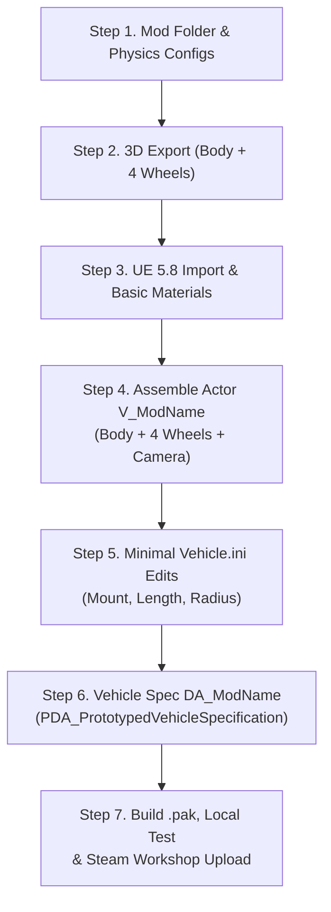

---

## Step 1. Creating the Mod Folder & Copying Base Physics

### 1.1. Create the Mod Folder in UE
1. Open `CityCarDriving2.uproject` in Unreal Engine 5.8.
2. Open **Content Browser** (`Ctrl + Space`), click **Settings** (top-right gear icon), and make sure **Show Plugin Content** is checked.
3. In the left folder tree, navigate to `All → Plugins → Mods Content`.
4. Right-click in the empty area → **New Folder** and name it using Latin letters with no spaces, e.g. **`MyFirstCar`**.
5. Inside `MyFirstCar`, create subfolders to keep things tidy: `Meshes`, `Materials`, `Textures`.

### 1.2. Copy Base Physics Files (`VehicleLib`)
1. In the Content Browser, right-click your `MyFirstCar` folder → **Show in Explorer** — Windows File Explorer will open `...\Plugins\Mods\Content\MyFirstCar\`.
2. Open another Explorer window to browse the ready-made physics samples:
   - `Docs\Samples\VehicleLibConfigs\Vehicle012_HangugEclauto\` *(petrol sedan, great general-purpose starting point)*
   - or `Docs\Samples\VehicleLibConfigs\Vehicle002_UlgaresGroberolf\`
   - or `Plugins\Mods\Content\CieBensVGruppe\` *(AWD diesel)*.
3. Copy three files into `Plugins\Mods\Content\MyFirstCar\`:
   - **`Vehicle.ini`**
   - **`options.xml`**
   - **`Engine.csv`** *(if your chosen sample uses differently named `.csv` files, copy those; if copying from `CieBensVGruppe`, also copy `AwdAuto.xml` and `AwdManual.xml`)*.

### 1.3. Update Relative Paths Inside `Vehicle.ini` and `options.xml`
Open the copied `Vehicle.ini` and `options.xml` in any text editor (Notepad, Notepad++, VS Code) saved as **UTF-8**.

All paths inside these files are resolved relative to the base game's `Content/` folder:
- Shared game files (`Common/Vehicles/MotorCars/...`) **do not need changes** — they resolve automatically.
- References to files **inside your mod folder** must start with `../Plugins/Mods/Content/<ModName>/`.

Update the sample car name to your mod folder name (`MyFirstCar`) in the lines below:

**In `Vehicle.ini`:**
```ini
[Vehicle]
; If using a standard built-in game schema (recommended to start):
DefaultSchema = Common/Vehicles/MotorCars/Schemes/FwdAuto.xml
; (or if you copied a local schema into your mod folder: ../Plugins/Mods/Content/MyFirstCar/AwdAuto.xml)

[Engine]
PowerCurves = ../Plugins/Mods/Content/MyFirstCar/Engine.csv
```

**In `options.xml`:**
```xml
<?xml version="1.0" encoding="UTF-8" ?>
<Options>
    <AvailableOptions>
        <Option Name="TransmissionType" SetSchema="true">
            <OptionValue Value="Auto" SchemaName="Common/Vehicles/MotorCars/Schemes/FwdAuto.xml" />
            <OptionValue Value="Manual" SchemaName="Common/Vehicles/MotorCars/Schemes/FwdManual.xml" />
        </Option>
    </AvailableOptions>
</Options>
```

> [!CAUTION]
> **Three strict `Vehicle.ini` syntax rules:**
> 1. The separator for lists and 3D vectors is **a semicolon `;` with NO space before `;`!**
>    - Correct: `Mount = 1.63; 0.85; 0.4455`
>    - Error: `Mount = 1.63 ; 0.85 ; 0.4455` (a space before `;` starts an inline comment and drops everything to the right!).
> 2. Decimal separator is strictly a **dot `.`** (never a comma).
> 3. Save files in **UTF-8** encoding.

---

## Step 2. Preparing & Exporting 3D Models (Body & 4 Wheels)

### 2.1. Critical Coordinate & Scale Rules (Especially for Blender!)

> [!WARNING]
> **Read this carefully before exporting from Blender!**
> In Unreal Engine, 1 unit = **1 centimeter**, the front of the car faces **`+X`**, and up is **`+Z`**.
> **You must NEVER scale the mesh or Actor inside Unreal Engine (`Scale` must always remain `1.0, 1.0, 1.0`) — otherwise physics and suspension will break!**

Recommendations for exporting **FBX** from **Blender**:
1. **Model scale:**
   - In Unreal Engine, the car must have real-world dimensions in centimeters (e.g., length ~450 cm, width ~180 cm, height ~150 cm).
   - If you modeled in Blender in meters (`Unit Scale = 1.0`) and export scaling causes issues, scale the model up by **100x** directly in Blender and apply transforms (**`Ctrl + A` → `Apply All Transforms`**), or work in centimeters from the start (`Scene Properties → Units → Metric`, `Unit Scale = 0.01`, `Length = Centimeters`) with `Scale = 1.0` applied.
2. **Axis orientation in FBX Export (`File → Export → FBX`):**
   - Under **Transform**, set:
     - **Forward:** `-X Forward`
     - **Up:** `Z Up`
   - Under **Geometry**, set **Smoothing:** `Face` (prevents smoothing group warnings in UE).

### 2.2. Body 3D Model Requirements (`Body`)
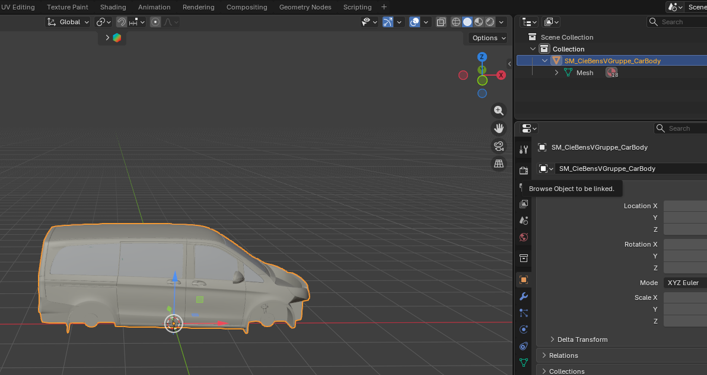

1. The main body volume should be a **single unified mesh** (extra trim pieces like bumpers or hood can be attached later as child meshes, while the primary physical body is one `Body` mesh).
2. The front of the car points along **`+X`**, centered at the world origin `(0, 0, 0)`.
3. All surfaces must have UV unwrapping on **UV channel 0**.
4. Functional elements (painted body, trim/chrome, glass, lamps) must each have their own **Material ID** (material slot).

### 2.3. Wheel 3D Model Requirements (`Wheel`)
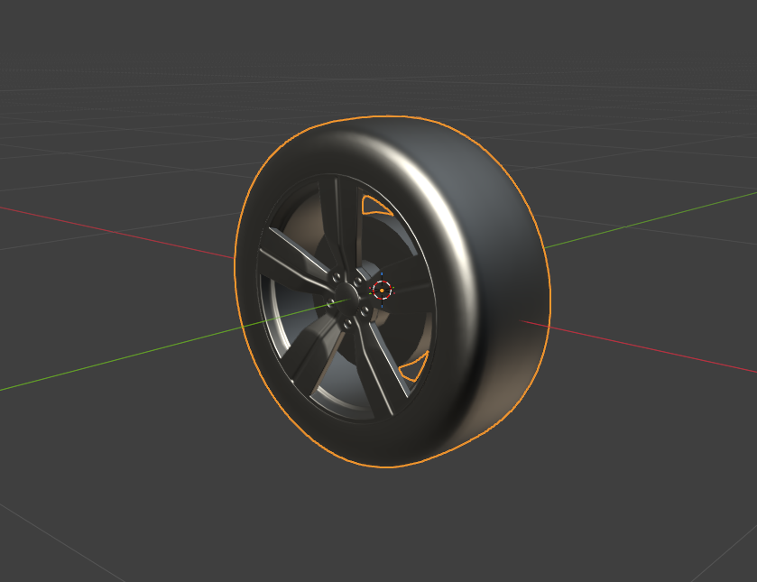

1. Each wheel's **Pivot (Origin)** must sit at the **exact geometric center of the wheel** `(0, 0, 0)`.
2. The wheel rotation axis is **`Y`** (rolling forward along `+X`).
3. Split materials into at least 2 slots: **tire** and **rim**.
4. If left and right wheels differ (directional tread or rim offset), export separate left/right meshes (or all 4 if rear tires are wider).

---

## Step 3. Importing Models & Setting Up Basic Materials in UE 5.8

### 3.1. Importing the Body (`Body`)
1. Open your `MyFirstCar/Meshes` folder in the Content Browser.
2. Drag and drop your body `.fbx` file from Explorer into the Content Browser (or click **Import**).
3. In the import dialog, verify these key settings:
   - **`Generate Missing Collision`** — **ON** (if you did not author custom `UCX_` collision in your 3D editor; the body requires collision for impacts!).
   - **`Material Import Method`** — select **`Do Not Create Material`** (so UE doesn't auto-generate incompatible base materials).
   - **`Build Nanite`** — **OFF** (Nanite is disabled in this project).
   - **`Import Uniform Scale`** — leave at **`1.0`**.

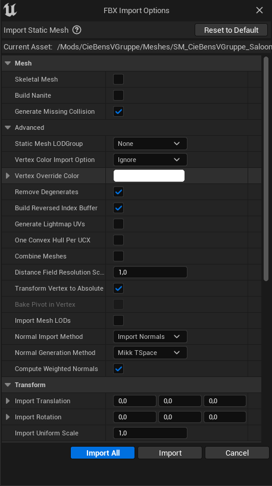

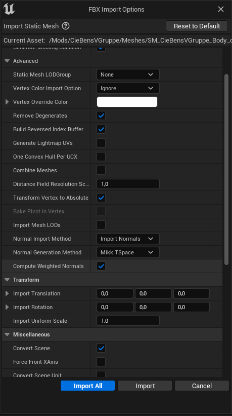

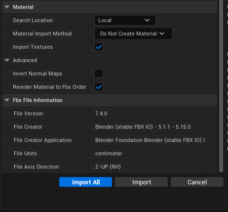

4. Click **Import All**.
5. **Quick size check after import:** double-click the imported body mesh. In the top-left of the 3D viewport, check **`Approx Size`**. A regular passenger car should read around `450 × 180 × 150` (centimeters). If it reads `4 × 2 × 1`, the model exported 100x too small — return to Step 2.1!

### 3.2. Importing the Wheels (`Wheel`)
Import the wheels into `MyFirstCar/Meshes` the same way, **with one critical difference**:
- **`Generate Missing Collision`** — must be **OFF**! Wheel meshes must **NOT** have collision (road contact is simulated via `WheelRaycast` in `VehicleLib`).
- **`Material Import Method`** — **`Do Not Create Material`**.

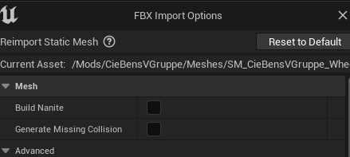

### 3.3. Textures & Basic Materials

> [!CAUTION]
> **Core Material Rule in CCD 2.0:**
> Mods **do NOT support** custom `Master Materials`!
> You must strictly create **Material Instances** inheriting from the pre-built parent materials located at:
> `Content/Common/MasterMaterials/VehicleMaterials/ModMaterials/`

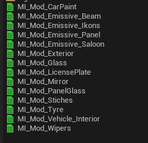

#### Preparing Textures (if importing your own)
Drag your textures (`.png` / `.tga`) into `MyFirstCar/Textures`. Double-click each imported texture:
1. **Virtual Texture (required for ALL mod textures!):** in **Details** (right panel), search `Virtual` and enable **`Virtual Texture Streaming`**. A `VT` badge will appear in the texture thumbnail corner.

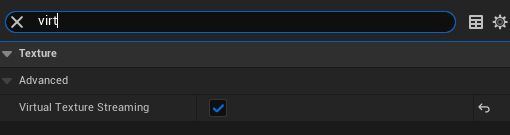

2. **MRA Map Compression** *(channel-packed mask: R = Metallic, G = Roughness, B = Ambient Occlusion)*: search `Compression` in Details and set **`Compression Settings = Masks (no sRGB)`**.

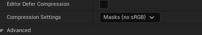

3. Click **Save** (`Ctrl + S`).

#### Minimal Material Set for Module 1
To make your car look clean right away, create 3 basic **Material Instances**:
1. Navigate to `Content/Common/MasterMaterials/VehicleMaterials/ModMaterials/` in the Content Browser.
2. Right-click a parent material → **Create Material Instance**, then move the created asset into your `MyFirstCar/Materials/` folder:
   - From **`MI_Mod_CarPaint`** → `MI_MyFirstCar_Paint` (painted body — you can pick a paint color even without textures!).
   - From **`MI_Mod_Exterior`** → `MI_MyFirstCar_Exterior` (plastic, metal, wheel rims).
   - From **`MI_Mod_Tyre`** → `MI_MyFirstCar_Tyre` (tires).
3. Double-click each `MI_*`, check the boxes next to parameters you want to override (color/textures), assign your textures, and click **Save**.
4. Open the body and wheel Static Meshes and assign your `MI_*` assets to their **Material Slots** in Details. Click **Save**.

*(Full reference for all 14 `MI_Mod_*` materials, liveries, glass, and lights is in [Module 2](./02_Exterior_Lights_and_World.md) and [Module 3](./03_Interior_Dashboard_Cameras_Seats.md).)*

---

## Step 4. Assembling the Minimal Vehicle Actor (`V_MyFirstCar`)

The Vehicle Actor is a Blueprint container holding the body, wheels, and cameras.

### 4.1. General Rules for All Actor Nodes
Keep these 3 rules in mind across every module:
1. **`Scale` is always `(1.0, 1.0, 1.0)`** on the Actor and every component.
2. **Collision off by default:** on every component except `Body`, set `Collision Presets = NoCollision` and disable `Receives Decals`.
3. **Unmodified Transform:** important named nodes (such as `Body`) keep `Location` and `Rotation` at `(0, 0, 0)` unless explicitly stated otherwise. You may attach additional decorative child meshes to any node (with `NoCollision` and any desired Transform).

### 4.2. Create the Actor Blueprint
1. Open the root of your mod folder `Plugins/Mods Content/MyFirstCar/`.
2. Right-click in empty space → **Blueprint Class**.
3. Pick **Actor** as the parent class.
4. Name it **`V_MyFirstCar`** and double-click to open it.

### 4.3. Add the Body (`Body`)
1. In the left **Components** panel, click **`+ Add`** → search `Static Mesh` → select **Static Mesh**.
2. Rename it strictly to **`Body`** (case-sensitive!). Make sure it is attached to `DefaultSceneRoot` with `Location` and `Rotation` at `(0, 0, 0)`.
3. Select **`Body`** and configure in **Details** (right panel):
   - **Static Mesh:** assign your imported body mesh.
   - **Collision → Collision Presets:** select **`BlockAllDynamic`**.
   - **Physics → Mass (kg):** check the box next to `Mass (kg)` (`Override Mass`) and enter the **sprung body mass** in kilograms (curb weight minus the 4 wheels; typically `1200–1500` kg for a sedan, `2100` kg for a minivan).
   - **Physics → Advanced → Center Of Mass Offset:** offset in centimeters `(X, Y, Z)` relative to the geometric collision center. For a first test, leave at `(0, 0, 0)` or lower `Z` slightly (e.g., `Z = -20`) for extra stability. *(See [VehicleLib_MD/00_Quick_Start.md](../VehicleLib_MD/00_Quick_Start.md) for the exact weight-distribution formula.)*

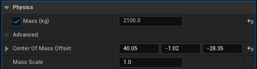

### 4.4. Add the 4 Wheels (`Wheel*`)

> [!CAUTION]
> **In standard schemas, the rear axle is named `Back` — NOT `Rear`!**
> Use these exact 4 component names:
> - `WheelFrontLeft` — front left
> - `WheelFrontRight` — front right
> - `WheelBackLeft` — rear left
> - `WheelBackRight` — rear right

In Module 1 (without suspension calipers), attach wheels directly to `Body`:
1. Select **`Body`** in **Components**, click **`+ Add`** → **Static Mesh**, and name it **`WheelFrontLeft`**.
2. Assign your front-left wheel mesh, set `Collision Presets = NoCollision`, and uncheck `Receives Decals`.
3. Under **Transform → Location**, set the wheel position in centimeters at **full suspension compression** (the top of suspension travel, matching `Mount` in `Vehicle.ini`; see Step 5).
4. Repeat for `WheelFrontRight`, `WheelBackLeft`, and `WheelBackRight`.

*(When you add non-rotating brake calipers `SuspensionFrontLeft/Right/BackLeft/Right` in [Module 2](./02_Exterior_Lights_and_World.md), `Location` moves to `Suspension*` and each child `Wheel*` becomes `Location = (0, 0, 0)`.)*

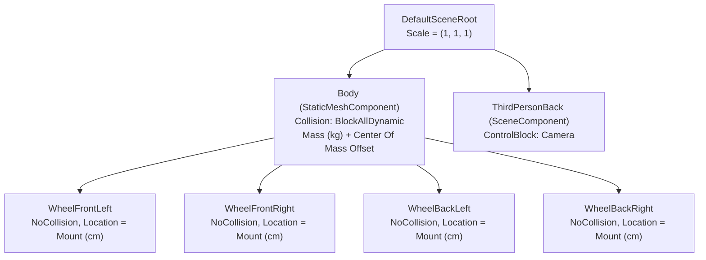

### 4.5. Learning `ControlBlock` and Adding a Basic Camera (`ThirdPersonBack`)

Let's add one basic third-person camera so you get a good view of your car right away, and learn CCD 2.0's core configuration mechanism — **`ControlBlock`**.

> [!NOTE]
> **What about the other cameras (`FirstPerson`, `Windshield`, `ThirdPersonFront`, `TopDown`)?**
> Any cameras you haven't manually created yet will **still exist in-game**, but at default positions that may not quite fit your specific vehicle's dimensions. You can fine-tune all 5 cameras in [Module 3](./03_Interior_Dashboard_Cameras_Seats.md#4-vehicle-cameras).

1. Select `DefaultSceneRoot` → click **`+ Add`** → **Scene** (creates a `SceneComponent`). Name it **`Cam_ThirdPersonBack`**.
2. Set its **Location** roughly at the center of the car (camera orbit pivot, e.g., `X = 0, Y = 0, Z = 130` cm).
3. Attach a **`ControlBlock`** (memorize this workflow — it is used throughout the entire guide):
   - With `Cam_ThirdPersonBack` selected, type **`Asset User Data`** in the **Details** search box.
   - Click **`+`** next to `Asset User Data` → in `Index [0]`, pick **`Control Asset Data`**.
   - Expand `Index [0]` → click **`+`** next to **`Control Blocks`**.
   - In the left text box, type **`Camera`**. Make sure the right dropdown says **`Control Block`**.
   - Expand **`Camera`** → click **`+`** next to **`Properties`** twice to add 2 properties:
     1. Left name: **`Type`** → right type: **`Control Property String`** → expand and set `Value` to **`ThirdPersonBack`**.
     2. *(Optional)* Left name: **`ArmLength`** → right type: **`Control Property Float`** → expand and set `Value` to the camera distance in centimeters, e.g. **`600.0`**. *(Note: the screenshot below shows an older typo `ArmLenght`, but the current version uses the correct spelling **`ArmLength`**.)*

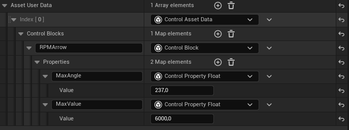

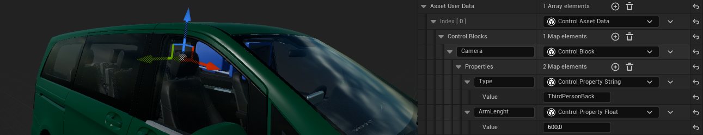

4. **Check:** look at the **Components** tree on the left — `Cam_ThirdPersonBack` should automatically **highlight in green**!
5. Click **Compile** and **Save** in the top-left toolbar of the Blueprint Editor.

---

## Step 5. Minimal Geometry & Wheel Setup in `Vehicle.ini`

Open `Plugins\Mods\Content\MyFirstCar\Vehicle.ini` and align the physics coordinates with your 3D model (remember: `Vehicle.ini` uses **meters**, while Unreal Engine uses **centimeters**!).

### 5.1. Converting `Location` (UE) → `Mount` (`Vehicle.ini`)

> [!IMPORTANT]
> **Coordinate conversion rule from UE to `Vehicle.ini`:**
> 1. Divide `X, Y, Z` by **100** (centimeters → meters).
> 2. **Invert the sign of `Y`!** In UE, the left side of the car is negative `Y` (`Y < 0`), whereas in `Vehicle.ini`, left wheels have **positive `Y`** (`Y > 0`) and right wheels have **negative `Y`** (`Y < 0`).

Example for the front-left wheel:
- In UE (`Location` of `WheelFrontLeft` / `SuspensionFrontLeft`): `X = 163 cm`, `Y = -85 cm`, `Z = 44.55 cm` (fully compressed suspension position).
- In `Vehicle.ini`:
```ini
[SuspensionFrontLeft]
Length = 0.20
Mount = 1.63; 0.85; 0.4455
```

> [!TIP]
> **How `Mount.Z`, `Length`, and resting wheel height relate:**
> At rest, the car settles by about one-third of suspension travel (`NormalSag = 0.33`).
> If you know the desired resting wheel-arch center `(X_cm, Y_cm, Z_cm)`, the top compressed mount point `Mount.Z` is:
> `Mount.Z = (Z_cm / 100) + (1 - 0.33) * Length`
> For example, with arch center `Z = 31 cm` and travel `Length = 0.20 m`: `Mount.Z = 0.31 + 0.67 * 0.20 = 0.444 m` (`44.4 cm` in UE).

Fill in `Mount` and `Length` for all four suspension sections:
- `[SuspensionFrontLeft]` (`Y > 0`)
- `[SuspensionFrontRight]` (`Y < 0`)
- `[SuspensionBackLeft]` (`Y > 0`)
- `[SuspensionBackRight]` (`Y < 0`)

### 5.2. Wheel Radius & Wheelbase
1. In `[WheelFrontLeft]`, `[WheelFrontRight]`, `[WheelBackLeft]`, `[WheelBackRight]`, set your wheel radius in **meters** (measure the 3D wheel diameter, divide by 2, and subtract ~1 cm for static tire deflection):
```ini
[WheelFrontLeft]
Radius = 0.345
```
2. In `[Steering]`, set the wheelbase (distance between front and rear axles) in meters:
```ini
[Steering]
InteraxleDistance = 2.75   ; = (MountFront.X - MountBack.X)
```

*(Once your car drives cleanly, see **[VehicleLib_MD/00_Quick_Start.md](../VehicleLib_MD/00_Quick_Start.md)** for full spring/damper, `Engine.csv`, and gearbox tuning.)*

---

## Step 6. Creating the Vehicle Specification (`PDA_PrototypedVehicleSpecification`)

For the game to discover your vehicle and list it in the garage menu, create a **Data Asset**:

1. Open the root of your mod folder `MyFirstCar/` in the Content Browser.
2. Right-click in empty space → **Data** (or **Miscellaneous**) → **Data Asset**.

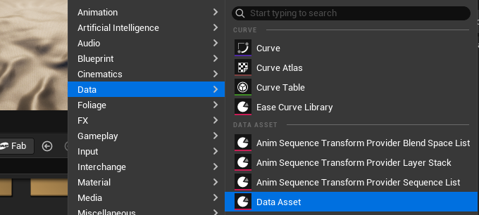

3. Search for and select **`PDA_PrototypedVehicleSpecification`** → click **Select**.

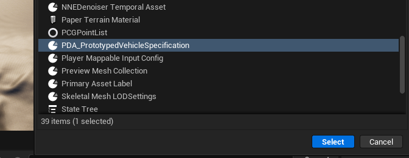

4. Name the asset **`DA_MyFirstCar`** and double-click to open it.
5. Fill out the **Prototype** section:
   - **`Prototype`:** select your Vehicle Actor Blueprint **`V_MyFirstCar`**.
   - **`Prototype Version`:** set to **`1`** (vehicle loader version).

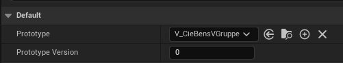

6. Fill out the **mandatory specifications** (**Vehicle Specifications** section):
   - **`Name`:** the vehicle's display name in-game (type text directly; no String Table is needed).
   - **`Image`:** menu preview image (import any `.png` into `Textures/` with Virtual Texture enabled, or temporarily pick an existing one).
   - **`Class`:** choose the vehicle class from the dropdown (e.g., `Economy`).
   - **`Engine Types`:** click `+` to add **at least one** engine entry — required because it defines the vehicle's **`Fuel Type`** (`Gasoline`, `Diesel`, etc.).
   - **`Transmission Types`:** it is best to add both `Automatic` and `Manual` and bind them to `options.xml`:
     - For `Index [0]` (`Automatic`): enable **`Bound to Option`**, set **`Option Name = TransmissionType`**, **`Option Value = Auto`**.
     - For `Index [1]` (`Manual`): enable **`Bound to Option`**, set **`Option Name = TransmissionType`**, **`Option Value = Manual`**.
     - `Option Name` and `Option Value` must **match `options.xml` character for character**!

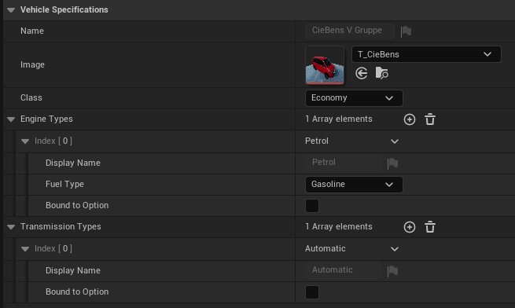

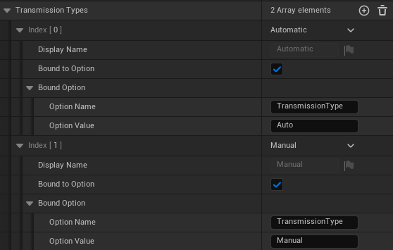

7. Click **File → Save All** (`Ctrl + Shift + S`) in UE.

---

## Step 7. Building the `.pak`, Local Testing & Steam Workshop Upload

### 7.1. Packaging Your Mod into `.pak`
1. Make sure all UE assets are saved (**File → Save All**).
2. In the root of `CCD2_VehicleKit`, double-click **`build_mod_dlc.bat`**.
3. Wait for the console to finish. On success, you will see:
   ```text
   DLC build successful: ...\Saved\DLC\Windows\Mods.pak
   ```
   *(The sample vehicle `CieBensVGruppe` contains the `L_IGNORE` label and is automatically excluded from your `.pak`.)*
4. Open `\Saved\DLC\Windows\`, find **`Mods.pak`**, and **rename it** to your mod's name, e.g. **`MyFirstCar.pak`**.

### 7.2. Local Testing in City Car Driving 2.0 (Before Publishing)
1. Copy your renamed **`MyFirstCar.pak`** into your installed game folder:
   ```text
   <Game Install Directory>\CityCarDriving2\Content\Paks\
   ```
2. Launch **City Car Driving 2.0** and pick your car in the vehicle selection menu.

### 7.3. Module 1 Verification Checklist
Before moving on to exterior details, interior, and audio, verify the fundamentals:

- [ ] Your vehicle appears in the vehicle menu with the right name, preview image, and Auto/Manual selection.
- [ ] On map load, the car sits evenly on all 4 wheels without sinking through the ground or launching into the air.
- [ ] Wheels sit at the right height inside the arches and are not swapped left-to-right (`Y` inversion is correct).
- [ ] The `ThirdPersonBack` camera orbits smoothly around the car at a comfortable distance.
- [ ] The engine starts, the car accelerates, wheels spin in the right direction, front wheels steer, and brakes stop the car.
- [ ] Lightly touching a curb or wall triggers `Body` collision properly.

### 7.4. Publishing to Steam Workshop
When your mod is tested and ready to share, follow **Step 4** of the official Steam Workshop publishing guide:
- <https://steamcommunity.com/sharedfiles/filedetails/?id=3763865332>

---

**Congratulations — your first car is driving in CCD 2.0!**
**Next step:** continue to **[Module 2. Exterior, Lights, Suspension & World Interaction](./02_Exterior_Lights_and_World.md)** to add brake calipers, working lights, license plates, refueling, and world interaction.
