# Module 2. Exterior, Lights, Suspension & World Interaction

**Navigation:** [README](./README.md) | [01. Minimal Car](./01_Minimal_Car_QuickStart.md) | **02. Exterior, Lights & World** | [03. Interior, Dashboard & Cameras](./03_Interior_Dashboard_Cameras_Seats.md) | [04. Mirrors & Wipers](./04_Mirrors_and_Wipers.md) | [05. Sounds & FMOD](./05_Sounds_and_FMOD.md) | [06. Specs, Logic & Reference](./06_Advanced_Specs_Logic_and_Reference.md)

---

After completing [Module 1](./01_Minimal_Car_QuickStart.md), your vehicle already drives. In this module we polish the exterior and connect the car to the game world:
- configure all exterior PBR materials and glass;
- add non-rotating suspension parts (brake calipers `Suspension*`);
- wire up glowing exterior lamps and real light sources illuminating the road;
- set up license plates;
- add world trigger interaction (`LogicBox`), refueling (`FuelTank`), and cabin rain blocking (`RainBlocker`).

---

## 1. Exterior Textures & Materials

All mod materials are **PBR Material Instances** inheriting from the parent materials in `Content/Common/MasterMaterials/VehicleMaterials/ModMaterials/` and mapped to **UV channel 0**.

### 1.1. PBR Texture Map Types

| Map | Purpose | Required UE Texture Settings |
| --- | --- | --- |
| **Diffuse (Albedo)** | Base color RGB texture. | `Virtual Texture Streaming = True` |
| **Normal** | Surface normal map. | `Virtual Texture Streaming = True` |
| **MRA** | Channel-packed mask: • **R** — Metallic • **G** — Roughness • **B** — Ambient Occlusion | `Virtual Texture Streaming = True` **`Compression Settings = Masks (no sRGB)`** |
| **Emissive** | RGB glow map for illuminated elements. | `Virtual Texture Streaming = True` |
| **Livery** | RGB livery/decal texture for the body; the **Alpha channel** masks the livery over the base car paint. | `Virtual Texture Streaming = True` |

> [!TIP]
> Double-click any `Material Instance` to inspect its parameters and check the tick box to the left of a parameter to override it. Check `Plugins/Mods Content/CieBensVGruppe/Materials/` for working reference setups.

### 1.2. Exterior Parent Materials

#### Painted Body — `MI_Mod_CarPaint`
Controls the base paint color and finish, and supports a `Livery` texture with an alpha mask.

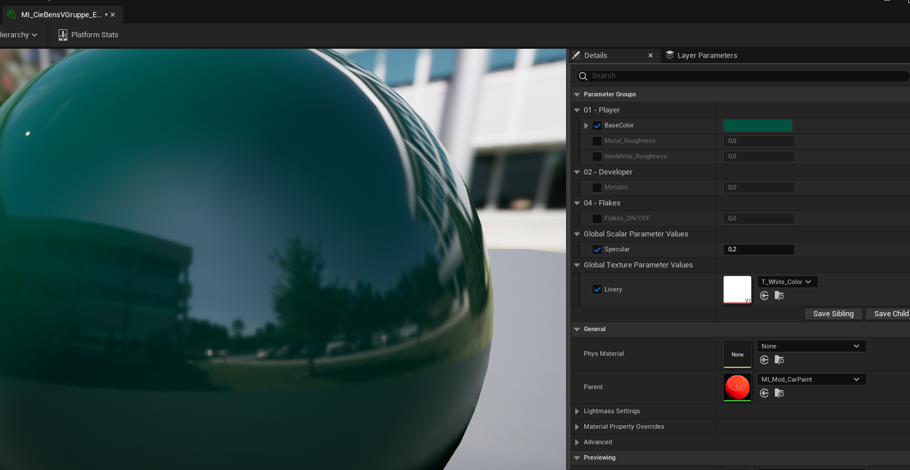

#### Trim, Chrome, Rims & Unpainted Parts — `MI_Mod_Exterior`
Used for any exterior elements that should **not** receive the base vehicle paint (plastic trim, grilles, chrome, underbody, wheel rims, calipers).

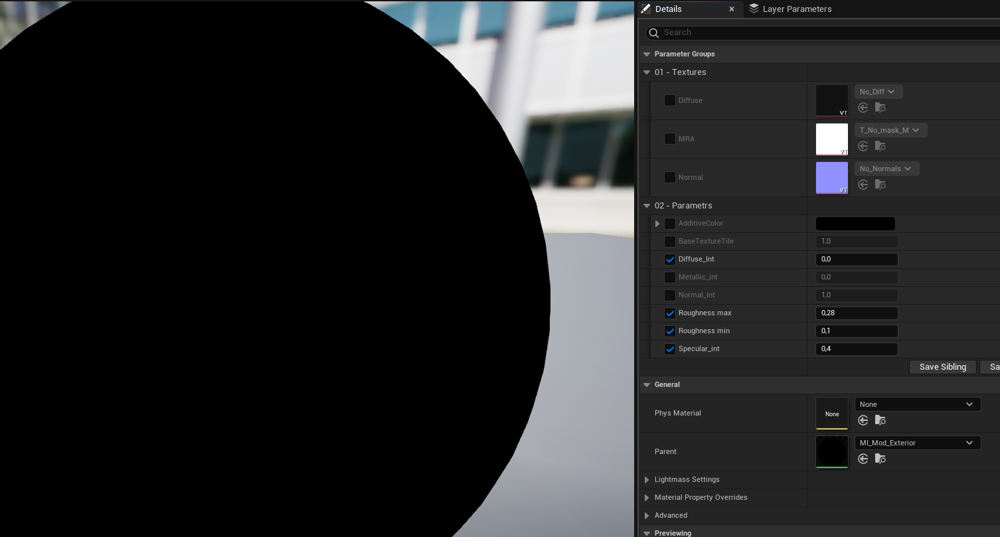

#### Tires — `MI_Mod_Tyre`
Dedicated material for rubber wheel tires.

#### Vehicle Windows & Headlight Lenses — `MI_Mod_Glass`
Used for transparent or tinted headlight lenses as well as windshields and side/rear windows.

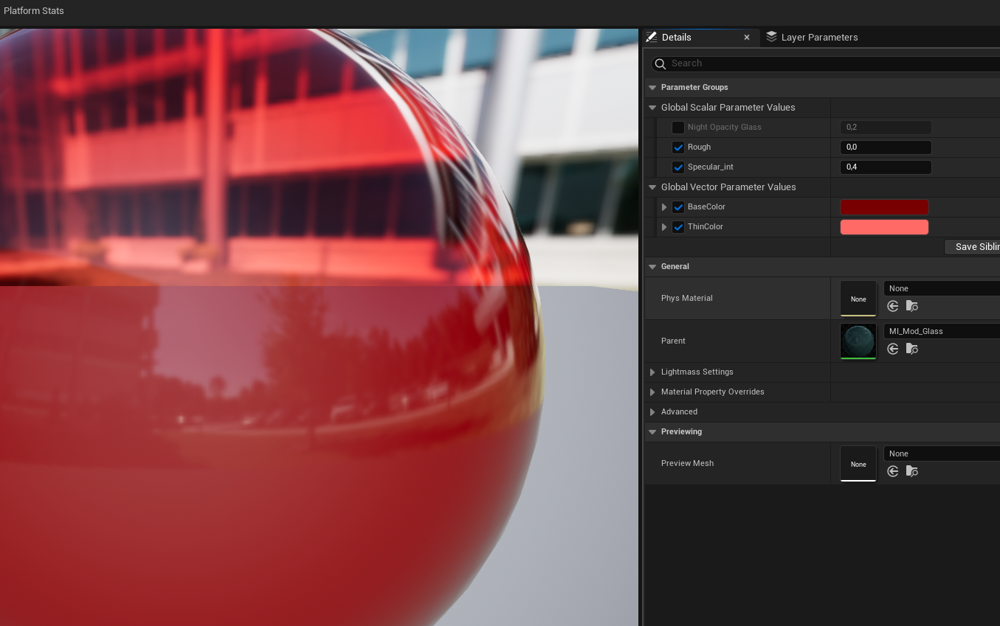

> [!NOTE]
> **About Glass (`Inner` / `Outer`) and Raindrops:**
> Raindrops on windows are not yet implemented for modded vehicles, so there are currently no strict mesh-splitting rules for glass — simply assign `MI_Mod_Glass` to your glass meshes.
> However, **in future updates** (when raindrop rendering and wiper clearing are enabled for mods), windows will need to be split into outer and inner meshes (`*_Outer` and `*_Inner`), as already demonstrated in `CieBensVGruppe/Meshes/`.

---

## 2. Non-Rotating Wheel Components / Brake Calipers (`Suspension*`)

If your vehicle has visible brake calipers or steering knuckles that should move up/down over bumps and steer with the front wheels **without spinning around the wheel axle**, use `Suspension*` nodes.

### 2.1. Preparing & Importing the Caliper Mesh
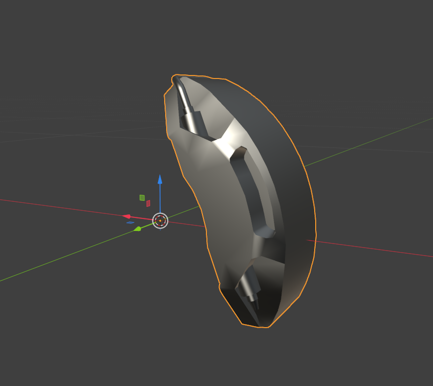

1. Place the **Pivot** at the exact wheel hub center (matching the wheel's pivot). Wheel rotation axis is **`Y`**.
2. Import into UE just like wheels: **`Generate Missing Collision = False`**, **`Do Not Create Material`**.
3. Assign a Material Instance inheriting from **`MI_Mod_Exterior`**.

### 2.2. Attaching in Actor `V_<ModName>`
1. Under **`Body`** *(recommended parent for clean hierarchy)*, add 4 `StaticMeshComponent` nodes with the exact names from the XML schema:
   - `SuspensionFrontLeft`
   - `SuspensionFrontRight`
   - `SuspensionBackLeft`
   - `SuspensionBackRight`
2. Set **`Collision Presets = NoCollision`** and uncheck **`Receives Decals`** on all four.
3. Move the `Location` coordinates (in centimeters, at full suspension compression, matching `Mount` in `Vehicle.ini` with inverted `Y`) from the wheel nodes onto the corresponding `Suspension*` nodes.
4. Drag each wheel (`WheelFrontLeft`, `WheelFrontRight`, `WheelBackLeft`, `WheelBackRight`) onto its corresponding `Suspension*` parent and reset each wheel's `Location` to `(0, 0, 0)`.

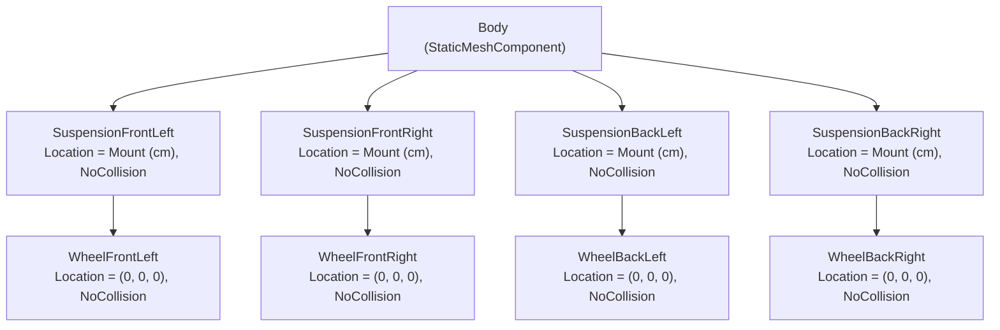

---

## 3. Exterior Lighting: Emissive Material Slots & Real Light Sources

Exterior lighting in CCD 2.0 consists of **two distinct layers**:
1. **Glowing lamp geometry** (visually lights up the bulb/LED housing on the car) — driven by **Material Slot Names** on the body mesh.
2. **Real light sources** (project light beams onto the road and environment) — separate **`SpotLight`** components on the Actor with **`ControlBlock` `Light`**.

### 3.1. Glowing Exterior Elements (`MI_Mod_Emissive_Beam`)

Each lighting function on the body 3D model needs its own **Material ID (slot)**.
1. Create Material Instances inheriting from **`MI_Mod_Emissive_Beam`**. Off-state lamp appearance uses `Albedo_texture`, and glow color uses `Emissive`.

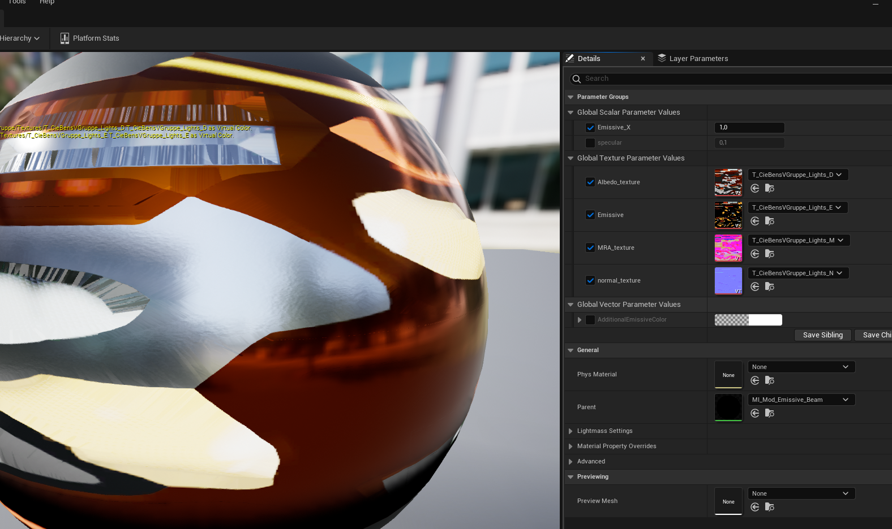

2. Open the body Static Mesh → under **Details → Material Slots**, assign your materials and **rename the `Slot Name`** strictly according to the table below:

> [!IMPORTANT]
> The game matches the **`Slot Name`** inside the Static Mesh, NOT the `MI_*` filename in the Content Browser!

| Required `Slot Name` | Lamp Function |
| --- | --- |
| `LowBeam` | Low-beam headlights |
| `HighBeam` | High-beam headlights |
| `ParkingLights` | Parking / position lights |
| `FrontFogLights` | Front fog lights |
| `RearFogLights` | Rear fog lights |
| `StopLight` | Brake lights |
| `ReverseLight` | Reverse lights |
| `LeftTurnLight` | Left turn signals |
| `RightTurnLight` | Right turn signals |
| `LicensePlates` | License plate illumination lamps |

### 3.2. Real Light Sources (`BP_ExportSpotLight` / `SpotLightComponent`)

#### Step 1. Create Reusable Light Components
In `MyFirstCar/Blueprints/`, it is convenient to pre-create reusable Blueprint light components:
- For **front headlights (low & high beams)**, use **`BP_ExportSpotLight`** as the parent class (`Content/Common/Player/BP_ExportSpotLight`).
- For **other lights** (reverse, brake, turn lights), any Light Component works, but a standard **`SpotLightComponent`** is recommended.

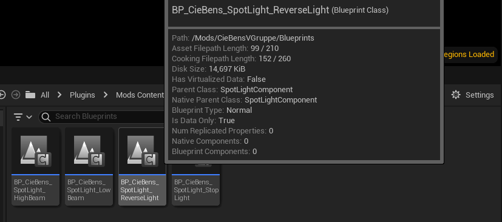

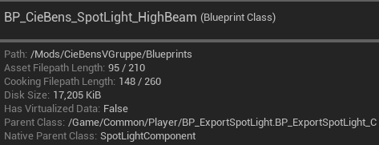

#### Step 2. Beam Pattern (`LFM_VehicleLightSpot`) & Intensity
To project a realistic headlight beam pattern onto the road:
1. Create a Material Instance from **`LFM_VehicleLightSpot`** (`Content/Common/MasterMaterials/VehicleMaterials/ModMaterials/Lights/LFM_VehicleLightSpot`).
2. If you plug in a custom beam-pattern texture, set its **`Compression Settings = Alpha`**.
3. Assign your `LFMI_*` to the light component's **`Light Function Material`** field.

Reference values from `CieBensVGruppe`:

| Light Type | Intensity Units | Intensity | Attenuation Radius | Inner / Outer Cone Angle | Shadow Bias |
| --- | --- | --- | --- | --- | --- |
| Low Beam (`LowBeam`) | `Candelas` | `8000.0 cd` | `2500.0` | `0.0 / 36.0` | `0.1` |
| High Beam (`HighBeam`) | `Candelas` | `2500.0 cd` | `10000.0` | `0.0 / 60.0` | `0.1` |
| Reverse (`ReverseLight`) | `Candelas` | `100.0 cd` | `400.0` | `0.0 / 60.0` | — |
| Brake (`StopLight`) | `Candelas` | `30.0 cd` | `300.0` | `0.0 / 60.0` | — |

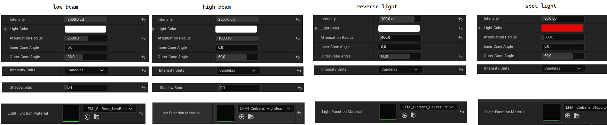

#### Step 3. Placement & Orientation on the Actor
1. Add your light components to `V_<ModName>` (under `Body` or `DefaultSceneRoot`) and position them at the headlights/taillights.
2. **Important when using beam patterns from the template project:** orient the component's local axes as shown below — **`Y` (green) pointing down, `Z` (blue) pointing sideways**, and `X` (red) pointing forward along the beam.

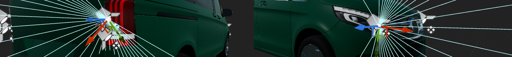

#### Step 4. Linking Lights to Physics via `ControlBlock` `Light`
On **every** light component, add `Asset User Data → Control Asset Data`:
- `Control Block` name: **`Light`**
- Property in `Properties`:
  - Name: **`PhysicsOutput`**
  - Type: **`Control Property String Array`**
  - In `Values`, add one or more `float` physics output names that drive this light's intensity:

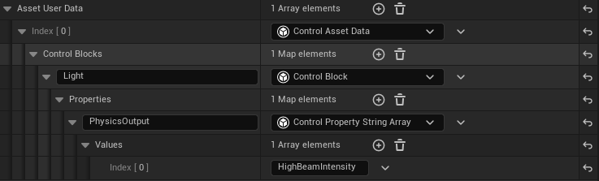

| `PhysicsOutput` Value | Controlled Lamp |
| --- | --- |
| `LowBeamIntensity` | Low beam |
| `HighBeamIntensity` | High beam |
| `ParkingLightsIntensity` | Parking lights |
| `FrontFogLightsIntensity` | Front fog lights |
| `RearFogLightsIntensity` | Rear fog lights |
| `StopLightIntensity` | Brake lights |
| `ReverseLightIntensity` | Reverse lights |
| `LeftTurnLightIntensity` | Left turn signals |
| `RightTurnLightIntensity` | Right turn signals |
| `LicensePlatesIntensity` | License plate lights |

> [!TIP]
> Make sure every active light has a positive electrical resistance (`*_Resistance > 0`) in `[CarElectrics]` inside `Vehicle.ini` — see [VehicleLib_MD/04_Components_Electrics.md](../VehicleLib_MD/04_Components_Electrics.md).

---

## 4. License Plates (`LicensePlates`)

License plates are generated dynamically by the game:
1. On your license plate mesh, set **`Slot Name = LicensePlates`**.
2. **Leave the material slot empty** — the game automatically assigns the dynamic license plate material at runtime. *(The `MI_Mod_LicensePlate` asset in `ModMaterials` is not used for mods.)*
3. Match the UV layout shown below (filling the `0..1` UV square).
4. **Fastest option:** reuse the ready-made plate mesh `SM_CieBensVGruppe_LicensePlate` from `Plugins/Mods Content/CieBensVGruppe/Meshes/` on your front and rear bumpers (with `NoCollision`).

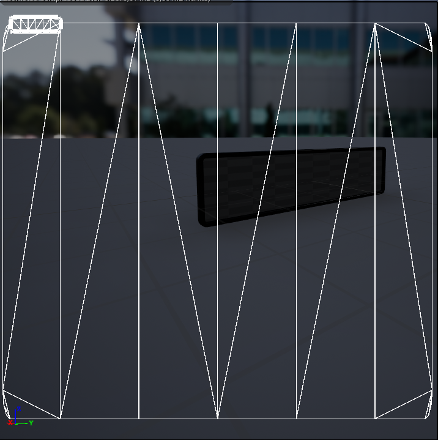

---

## 5. Game World Interaction

These 3 components are optional for minimal driving, but essential for full integration with simulator features (gas stations, in-game triggers, rain).

### 5.1. World Interaction Volume (`LogicBox`)
Allows interactive objects, barriers, parking zones, and in-game triggers to detect your vehicle's bounds accurately.
1. In `V_<ModName>`, add a **`Box Collision`** component (`+ Add → Box Collision`).
2. Adjust its **`Location`**, **`Rotation`**, and **`Box Extent`** so the box closely wraps your vehicle's exterior dimensions.
3. Add a `ControlBlock` named **`LogicBox`** (no properties needed).

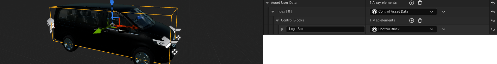

### 5.2. Fuel Tank (`FuelTank`)
Enables refueling at gas stations.
1. Add a **`SceneComponent`** (`+ Add → Scene`) attached to a parent with **zero transforms relative to root** (e.g., directly under `DefaultSceneRoot` or `Body`).
2. Add a `ControlBlock` named **`FuelTank`** (no properties needed — its presence alone enables the feature).

### 5.3. Blocking Raindrops Inside the Cabin (`RainBlocker`)
Prevents falling rain particles from passing through the roof into the interior:
1. Create a very simple closed box-like mesh **slightly larger than the entire car** (or adapt `SM_CieBensVGruppe_RainBlocker`). Import with no collision.
2. Add it as a `StaticMeshComponent` on the Vehicle Actor (`NoCollision`, `Receives Decals = False`).
3. For editor visibility without obscuring your car, assign the wireframe material **`MM_Wireframe`** (`Content/Common/MasterMaterials/System/MM_Wireframe`) — it stays invisible in-game.
4. Add a `ControlBlock` named **`RainBlocker`** (no properties needed).

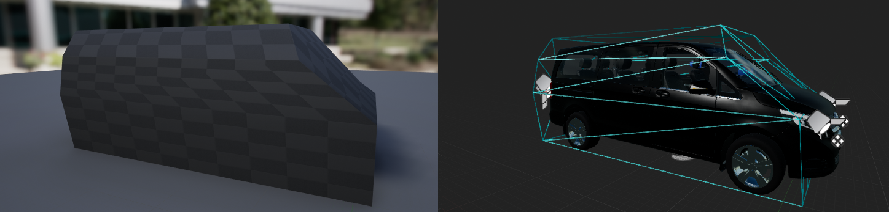

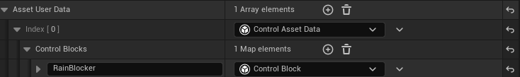

---

**Next step:** continue to **[Module 3. Interior, Dashboard, Cameras & Driver Seating](./03_Interior_Dashboard_Cameras_Seats.md)** to bring the cockpit and first-person view to life.
