# Module 3. Interior, Dashboard, Cameras & Driver Seating

**Navigation:** [README](./README.md) | [01. Minimal Car](./01_Minimal_Car_QuickStart.md) | [02. Exterior, Lights & World](./02_Exterior_Lights_and_World.md) | **03. Interior, Dashboard & Cameras** | [04. Mirrors & Wipers](./04_Mirrors_and_Wipers.md) | [05. Sounds & FMOD](./05_Sounds_and_FMOD.md) | [06. Specs, Logic & Reference](./06_Advanced_Specs_Logic_and_Reference.md)

---

In this module, we build out the full cockpit experience:
- import and shade the vehicle interior;
- hook up the rotating steering wheel;
- animate dashboard needles and warning lights;
- place all 5 game cameras;
- configure driver seating and the cabin toy mount.

---

## 1. Interior Model & `InteriorObjects` Container

### 1.1. Preparing the Interior 3D Model
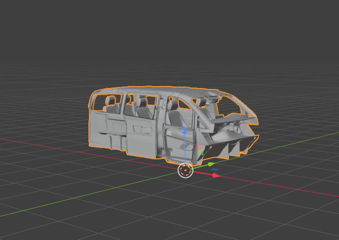

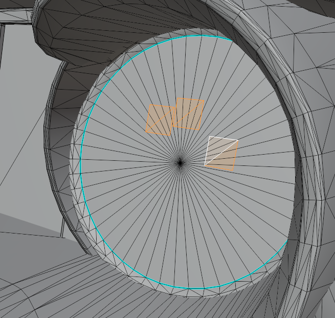

1. The interior should be a **single unified mesh** (steering wheel, gauge needles, and reflective mirror surfaces are exported separately).
2. Orient the mesh along **`+X`** in the exact same world coordinates and centimeter scale (`1:1`) as `Body`.
3. Every element must have UV unwrapping on **UV channel 0**.
4. Each functional surface (upholstery, cluster glass, stitching, center mirror housing, every dashboard warning icon, and backlit buttons) needs its own **Material ID (material slot)**.
5. Dashboard warning icons and illuminated control markings are modeled as separate mesh elements with their own Material IDs on UV channel 0.

### 1.2. Importing the Interior in UE 5.8
1. Import the interior `.fbx` into `MyFirstCar/Meshes/`.
2. Set **`Material Import Method = Do Not Create Material`** and **`Build Nanite = False`**.
3. Because the interior component uses **`NoCollision`** on the Actor (only `Body` has physical collision), you can leave `Generate Missing Collision` unchecked.

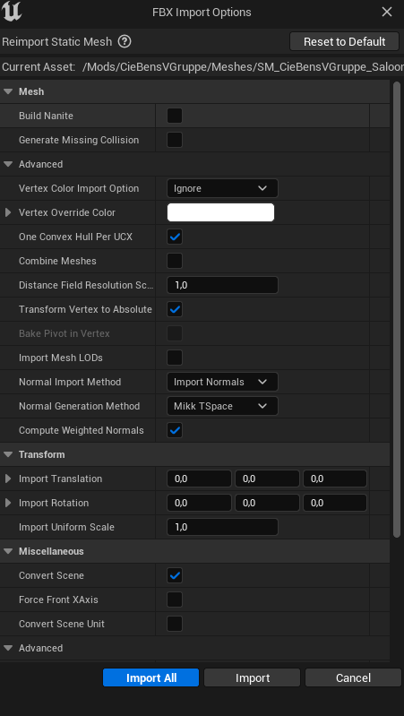

### 1.3. Interior Materials (`MI_Mod_*`)
All interior textures must also have **`Virtual Texture Streaming = True`** (and `Masks (no sRGB)` for `MRA` maps). Create Material Instances from `Content/Common/MasterMaterials/VehicleMaterials/ModMaterials/`:

| Interior Element | Parent Material | Notes |
| --- | --- | --- |
| Upholstery, dashboard, seats, trim | **`MI_Mod_Vehicle_Interior`** | Primary PBR interior shader. |
| Instrument cluster cover glass | **`MI_Mod_PanelGlass`** | Transparent protective glass over the gauges. |
| Alpha-masked trim (steering wheel wrap, seat stitching) | **`MI_Mod_Stiches`** *(note spelling: no `t`)* | Supports opacity masks. |
| Center rear-view mirror housing / dome | **`MI_Mod_Mirror`** | Used for the center mirror casing/housing (not the reflective glass!). |
| Dashboard warning icons | **`MI_Mod_Emissive_Ikons`** *(spelled with `k`)* | Recommended to reuse the provided `T_Dashboard_D` / `T_Dashboard_E` / `T_DashboardMask` atlas from `CieBensVGruppe/Textures/`. |
| Illuminated gauges & needles | **`MI_Mod_Emissive_Panel`** | For needles (`SpeedometrArrow`, `RPMArrow`, etc.) and dials (`Dashboard`). |
| Backlit cabin buttons & switches | **`MI_Mod_Emissive_Saloon`** | Window switches, climate buttons, etc. |

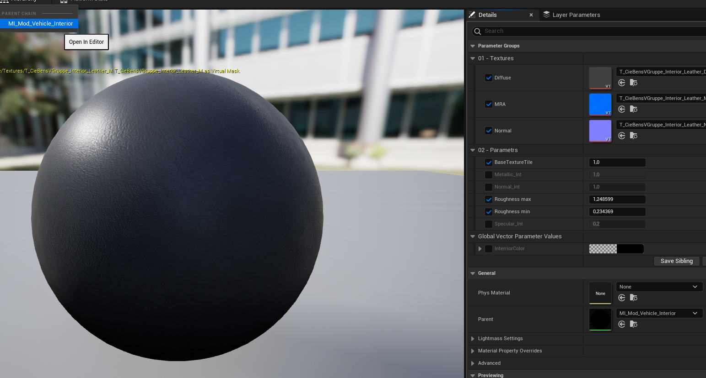

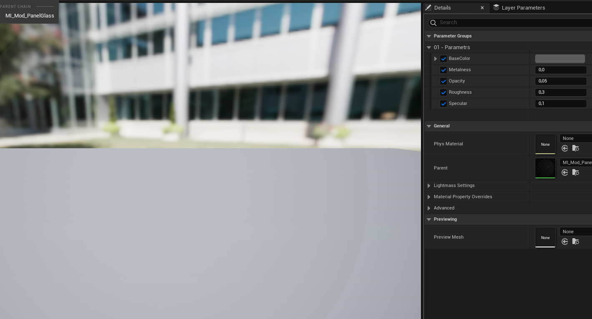

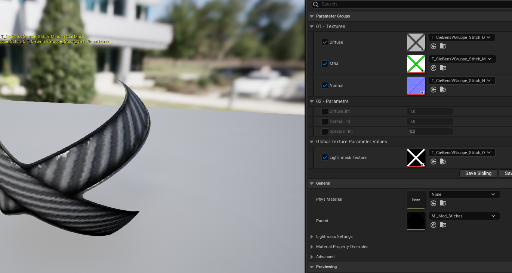

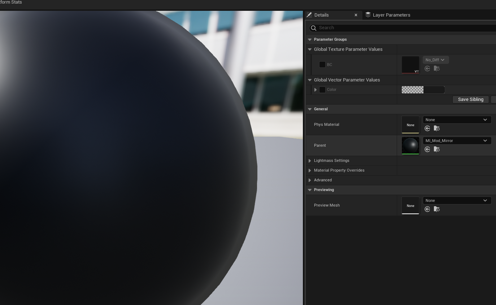

### 1.4. Placing the Interior in the Actor (`InteriorObjects`)
1. Open your Actor `V_<ModName>`.
2. Select `DefaultSceneRoot` → click **`+ Add`** → **Scene** and name it strictly **`InteriorObjects`** (`Location = 0, 0, 0`, `Rotation = 0, 0, 0`).
3. Add a child `StaticMeshComponent` under `InteriorObjects` with your interior mesh (`Collision Presets = NoCollision`, `Receives Decals = False`). Keep other cabin elements (steering wheel, gauge needles, etc.) organized under `InteriorObjects`.

---

## 2. Steering Wheel (`SteeringWheel`)

1. **3D model setup:** place the pivot at the rotation center `(0, 0, 0)` with the face of the steering wheel pointing along **`+Z`** (rotation axis is **`Z`**). Import with no collision and no auto-created materials.

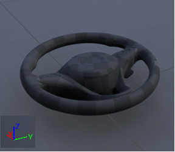

2. **Actor setup:**
   - Under `InteriorObjects`, add a `StaticMeshComponent` with your steering wheel mesh (`NoCollision`).
   - Position and rotate it onto the steering column.
   - Attach a **`ControlBlock`** named **`SteeringWheel`** (no properties required).

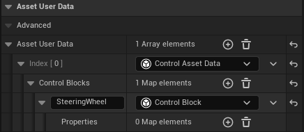

---

## 3. Dashboard (`Dashboard`): Needles & Warning Icons

### 3.1. Dashboard Needles
1. **3D model setup:**
   - Place the pivot at the needle's rotation hub `(0, 0, 0)`.
   - The front face of the needle points toward the viewer along **`+Z`**, and the needle tip points along **`+X`**.

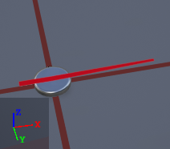

2. **Actor placement:**
   - Add a `StaticMeshComponent` for each needle (under `InteriorObjects`, `NoCollision`).
   - Set `Location` and `Rotation` so each needle **points directly at the zero (minimum) mark on its dial**.

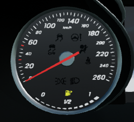

3. **`ControlBlock` settings for each needle:**

| Gauge Needle | `ControlBlock` Name | Properties (all **`Control Property Float`**) |
| --- | --- | --- |
| **Speedometer** | `SpeedArrow` | • `MaxAngle` — sweep angle (degrees) from zero to max scale • `MaxValue` — maximum speed on the dial (e.g., `260.0`) |
| **Tachometer (RPM)** | `RPMArrow` | • `MaxAngle` — sweep angle to max scale (e.g., `237.0`) • `MaxValue` — maximum RPM on the dial (e.g., `6000.0`) |
| **Fuel Level** | `FuelArrow` | • `MaxAngle` — sweep angle from empty to full |
| **Coolant Temperature** | `CoolantTemperatureArrow` | • `MaxAngle` — sweep angle from min to max scale • `MinValue` — minimum dial temperature (e.g., `50.0`) • `MaxValue` — maximum dial temperature (e.g., `130.0`) |

*(See [Module 1](./01_Minimal_Car_QuickStart.md#45-learning-controlblock-and-adding-a-basic-camera-thirdpersonback) for a screenshot of `RPMArrow` configured in Asset User Data.)*

### 3.2. Dashboard Indicators & Backlighting (`SalonLights`)

Two steps wire up your dashboard warning lights:

#### Step 1. Assign Matching `Slot Name`s on Your Interior Mesh
For icons, you can reuse `T_Dashboard_D` (diffuse) and `T_DashboardMask` / `T_Dashboard_E` from `CieBensVGruppe/Textures/` with **`MI_Mod_Emissive_Ikons`**.

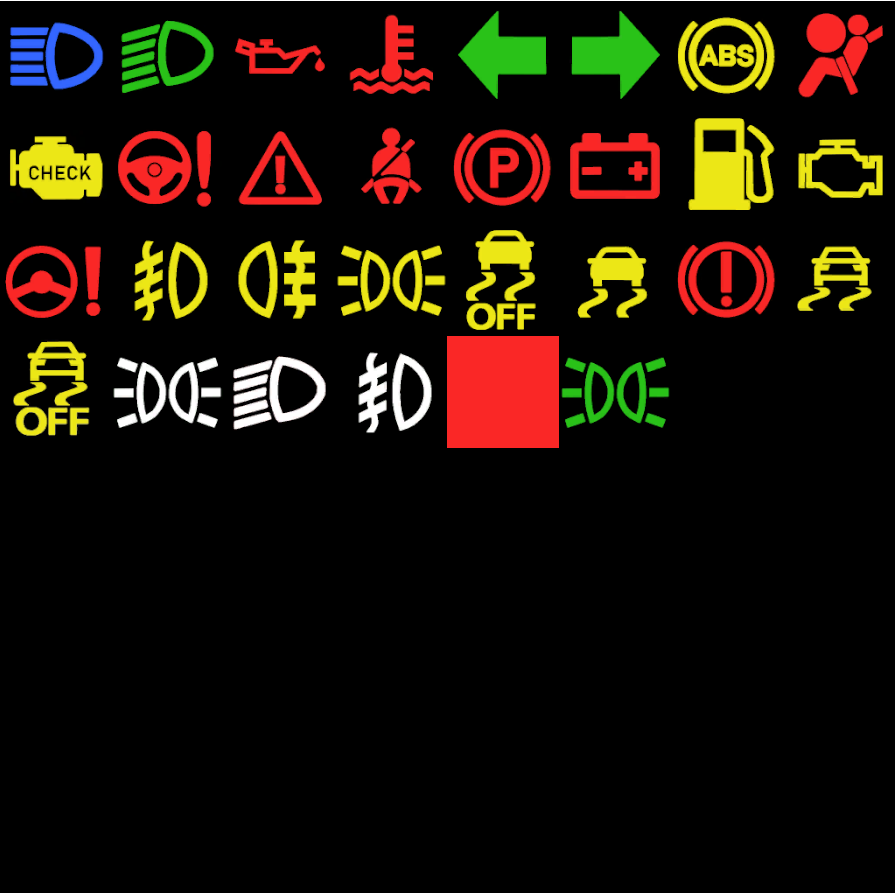

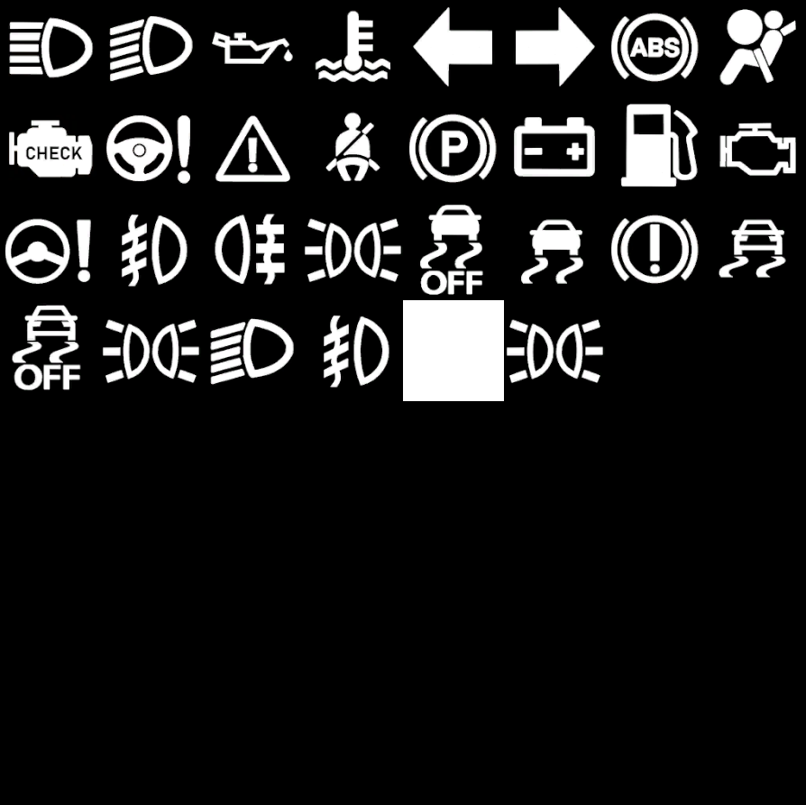

Open your interior (and needle) Static Meshes and set the **`Slot Name`** values in **Material Slots** using the reference table below.

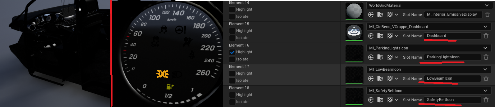

#### Step 2. Add `ControlBlock` `SalonLights` (or Copy `DashboardController`)

> [!TIP]
> **Fastest option for beginners:**
> If you don't need custom indicator mappings, open `V_CieBensVGruppe`, select **`DashboardController`** in the `Components` tree, press **`Ctrl + C`**, open your `V_<ModName>`, and press **`Ctrl + V`**! All 23 standard mappings are already configured — you only need matching `Slot Name`s on your interior mesh.

To set it up manually:
1. Add an empty `SceneComponent` (or select your interior mesh) and attach a **`ControlBlock`** named **`SalonLights`**.
2. In `Properties`, add key-value entries:
   - **Key (left):** physics output channel name (`*Intensity`).
   - **Value (right):** type **`Control Property String Array`**, with one or more material **`Slot Name`**s in `Values`.

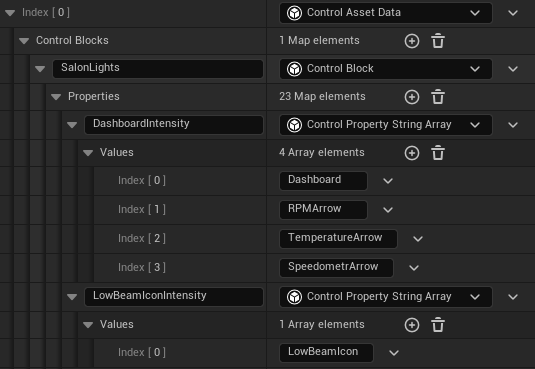

#### Complete Dashboard Indicators & Backlighting Table (`SalonLights`)

> [!WARNING]
> Note the exact slot spelling **`SpeedometrArrow`** (missing the `e` after `t`) — write it verbatim!

| Physics Parameter (key in `SalonLights`) | Recommended Material `Slot Name` | Purpose |
| --- | --- | --- |
| `LowBeamIconIntensity` | `LowBeamIcon` | Low-beam headlight indicator |
| `HighBeamIconIntensity` | `HighBeamIcon` | High-beam headlight indicator |
| `ParkingLightsIntensity` | `ParkingLightsIcon` | Parking lights indicator |
| `FrontFogLightsIntensity` | `FrontFogLightsIcon` | Front fog lights indicator |
| `RearFogLightsIntensity` | `RearFogLightsIcon` | Rear fog lights indicator |
| `LeftTurnLightIconIntensity` | `LeftTurnLightIcon` *(or shared `TurnLightIcon`)* | Left turn signal / hazard indicator |
| `RightTurnLightIconIntensity` | `RightTurnLightIcon` *(or shared `TurnLightIcon`)* | Right turn signal / hazard indicator |
| `HazardLightIconIntensity` | `HazardLightIcon` | Hazard button indicator |
| `SafetyBeltIconIntensity` | `SafetyBeltIcon` | Unfastened seatbelt warning |
| `ParkingBrakeIconIntensity` | `ParkingBrakeIcon` | Parking brake engaged indicator |
| `BatteryIconIntensity` | `BatteryIcon` | Battery discharge / alternator warning |
| `FuelIconIntensity` | `FuelIcon` | Low fuel reserve warning |
| `OilIconIntensity` | `OilIcon` | Low engine oil pressure warning |
| `OverheatIconIntensity` | `OverheatIcon` | Engine coolant overheat warning |
| `EmergencyStopIconIntensity` | `EmergencyStopIcon` | Critical "STOP" lamp (stop and shut off engine immediately) |
| `PowerSteeringIconIntensity` | `PowerSteeringIcon` | Power steering fault indicator |
| `AbsActiveIconIntensity` | `AbsIcon` | ABS active / self-check indicator |
| `AbsDisableIconIntensity` | `AbsIcon` | ABS disabled / fault indicator |
| `TcsActiveIconIntensity` | `TCSActiveIcon` | Traction/stability control (TCS/ESP) active indicator |
| `TcsDisableIconIntensity` | `TCSDisableIcon` | Traction/stability control (TCS/ESP) disabled indicator |
| `AirbagIconIntensity` | `AirbagIcon` | Airbag indicator (ignition self-check) |
| `ExhaustSystemIconIntensity` | `ExhaustSystemIcon` | Exhaust system / Check Engine indicator |
| `CheckIconsIntensity` | `CheckIcons` | Ignition self-check channel for decorative warning icons without dedicated logic |
| `DashboardIntensity` | `Dashboard`, `SpeedometrArrow`, `RPMArrow`, `FuelArrow`, `TemperatureArrow`, `InteriorButton`, `MainDisplay`, `SecondDisplay` | General dashboard, needle, cabin button, and display backlighting |

> [!NOTE]
> **In-Car Monitors / Infotainment Screens:**
> There is currently no dedicated interactive monitor workflow for modded vehicles (you can illuminate static screens using the `MainDisplay` / `SecondDisplay` slots).

---

## 4. Vehicle Cameras

All cameras follow the same pattern: add a component in `V_<ModName>`, position/orient it, and attach a **`ControlBlock`** named **`Camera`**.

| Camera Type (`Type`, `String`) | Component Type | Optional Properties | Placement |
| --- | --- | --- | --- |
| **`ThirdPersonBack`** | `SceneComponent` | `ArmLength` (`Float`, e.g., `600.0`) | Location defines the orbit pivot (typically vehicle center). Rear chase view. |
| **`ThirdPersonFront`** | `SceneComponent` | `ArmLength` (`Float`) | Location defines the orbit pivot. Front chase view. |
| **`FirstPerson`** | `CameraComponent` or `SceneComponent` | None | Driver eye position and rotation inside the cabin (`CameraComponent` gives a live preview in UE). |
| **`Windshield`** | `CameraComponent` or `SceneComponent` | None | Windshield / hood view position and rotation. |
| **`TopDown`** | `SceneComponent` | `ArmLength` (`Float`) | Place strictly at the center of the vehicle (top-down view). |

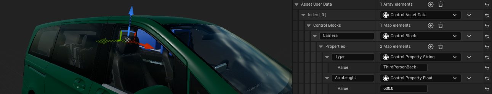

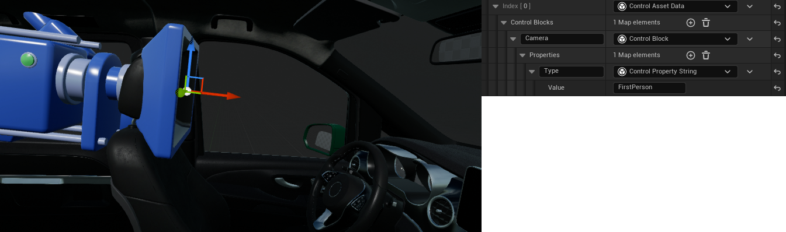

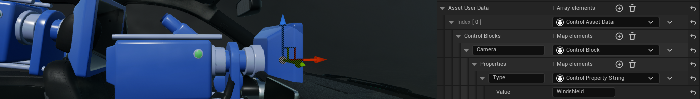

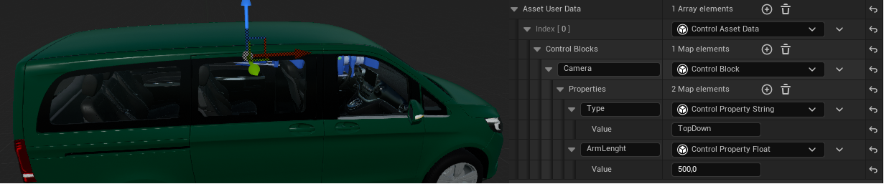

---

## 5. Driver Seating (`Seats`)

Currently, only the driver seat is supported in modded vehicles. It uses a **socket on the seat/interior Static Mesh** paired with **`ControlBlock` `Seats`**.

### Step 1. Create the `_Landing` Socket on the Static Mesh
1. Double-click the Static Mesh containing the driver's seat (usually the interior mesh).
2. Open **Window → Socket Manager**.
3. Click **`+`** (Create Socket) and name it **`<SeatSetName>_Landing`**, e.g., **`Seat0_Landing`**.
   - `<SeatSetName>` — any Latin identifier you choose (e.g., `Seat0`).
   - `_Landing` — required suffix (currently **only** `_Landing` is used).
4. Position the socket in the crease where the seat cushion meets the backrest, with the **red `+X` axis** pointing forward parallel to the seat cushion (toward the steering wheel) and **blue `+Z`** pointing up.
5. Click **Save**.

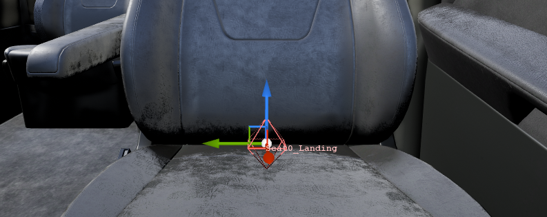

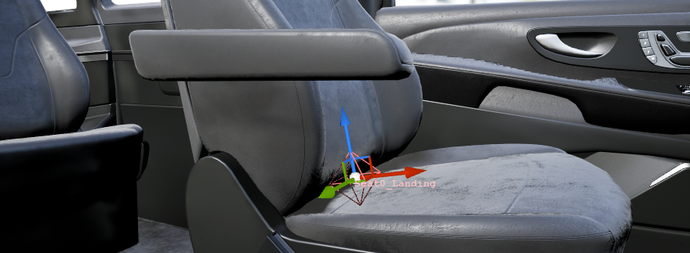

### Step 2. Add `ControlBlock` `Seats` on the Actor
1. Open `V_<ModName>` and select the `StaticMeshComponent` whose mesh holds `Seat0_Landing`.
2. Add `Asset User Data → Control Asset Data` → **`ControlBlock`** named **`Seats`**:
   - Property 1: name **`Names`**, type **`Control Property String Array`** → add **`Seat0`** (just the set prefix, **without** `_Landing`!).
   - Property 2 *(if this mesh contains the driver seat)*: name **`DriverIndex`**, type **`Control Property Int`** → index of the driver seat in `Names` (`0` for `Index [0]`).
3. Click **Compile** and **Save**.

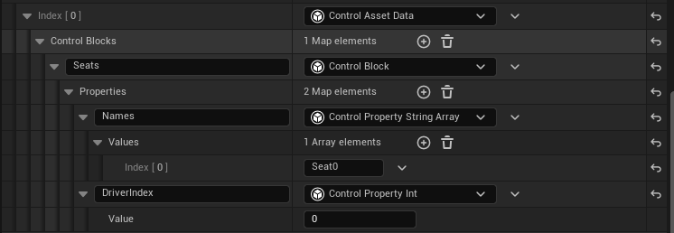

---

## 6. Cabin Toy Mount (`CarToy`)

To let players place workshop dashboard toys inside your vehicle:
1. In `V_<ModName>`, add any component inheriting from `SceneComponent` (for easy visual alignment, use the included astronaut preview mesh **`SM_Cosmonaft_Anim`** from `Content/Common/Enviroment/Cosmonaft/` — it helps judge scale and orientation in the editor and is automatically hidden in-game!).
2. Set `NoCollision`, place it on the dashboard, and attach a **`ControlBlock`** named **`CarToy`** (no properties needed).

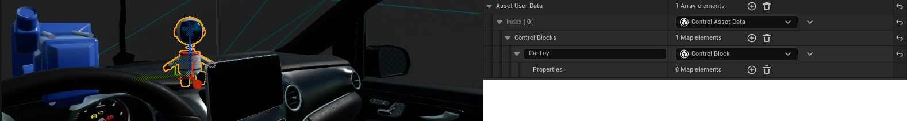

---

**Next step:** continue to **[Module 4. Mirrors & Wipers](./04_Mirrors_and_Wipers.md)** to add live rear-view mirrors and animated wipers.
