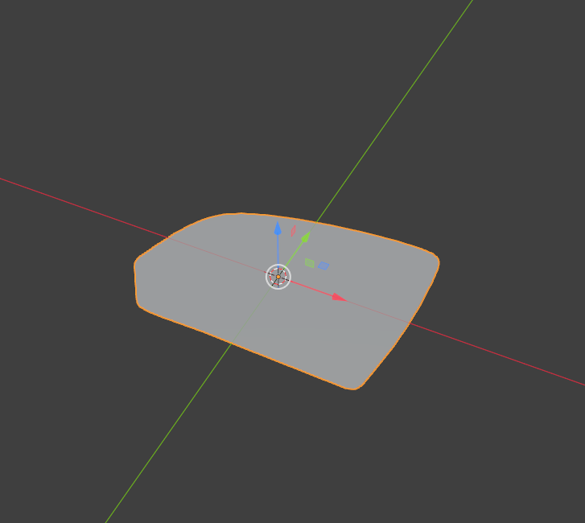
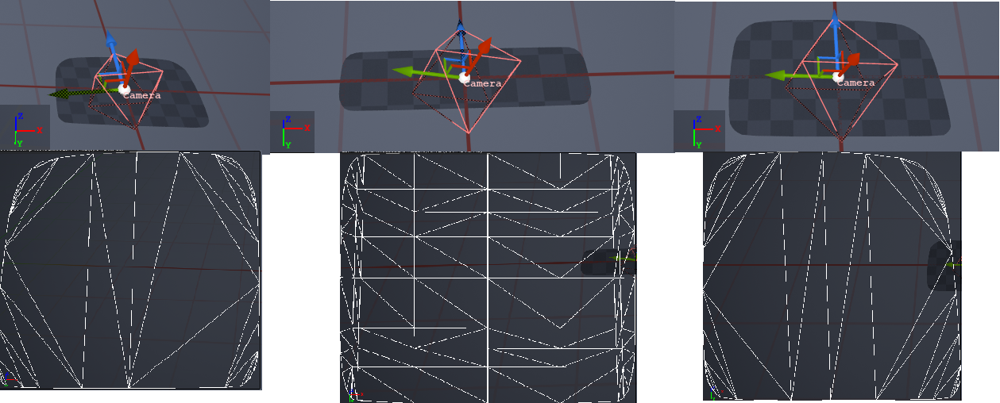
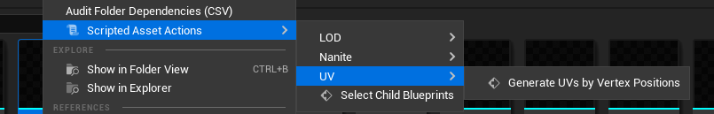
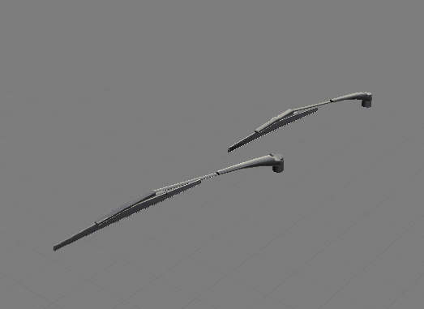
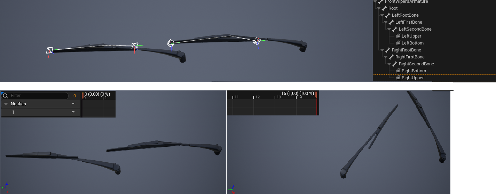

# Module 4. Mirrors & Wipers

**Navigation:** [README](./README.md) | [01. Minimal Car](./01_Minimal_Car_QuickStart.md) | [02. Exterior, Lights & World](./02_Exterior_Lights_and_World.md) | [03. Interior, Dashboard & Cameras](./03_Interior_Dashboard_Cameras_Seats.md) | **04. Mirrors & Wipers** | [05. Sounds & FMOD](./05_Sounds_and_FMOD.md) | [06. Specs, Logic & Reference](./06_Advanced_Specs_Logic_and_Reference.md)

---

In this module, you will configure two key driving-simulator features:
1. **Rear-view mirrors** (left, right, and interior center) — rendered live via dedicated capture cameras.
2. **Windshield wipers** (front and optional rear) — driven by skeletal animation.

---

## 1. Rear-View Mirrors (`Mirror`)

Mirror reflections in City Car Driving 2.0 are powered by render cameras bound to separate reflective surface meshes.

### 1.1. Preparing & Importing Mirror Meshes

1. Export a **separate mesh for each mirror** (left, right, center) — containing only the reflective glass surface (keep the mirror housing on the body/interior).
2. **Strict axis orientation:**
   - **`+Z` axis** defines the reflective face normal (pointing straight up along `+Z`, with the mirror surface lying in the `XY` plane!).
   - **`+Y` axis** points **downward** along the mirror glass.
   *(This alignment is required by the UV generation script, which projects vertex `X` and `Y` coordinates.)*
3. **Import into UE:** same as wheels — **`Generate Missing Collision = False`**, **`Material Import Method = Do Not Create Material`**, **`Build Nanite = False`**.
4. **Material:** **leave the material unassigned** on the reflective surface — the game automatically assigns the live reflection material. *(Reminder: `MI_Mod_Mirror` is only for the center mirror housing, not the reflective glass.)*

### 1.2. Adding the `Camera` Socket & Generating UVs in UE

Repeat these 2 steps for **every** mirror Static Mesh:

#### Step 1. Add the `Camera` Socket
1. Double-click the mirror Static Mesh to open it.
2. Open **Window → Socket Manager** and click **`+`** (Create Socket).
3. Rename the socket strictly to **`Camera`**.
4. Adjust the socket's **`Relative Rotation`** as needed — this rotation determines where the mirror capture camera looks.
5. Click **Save** and close the mesh editor.

#### Step 2. Run the UV Generation Script (`Generate UVs by Vertex Positions`)
1. In the **Content Browser**, right-click the mirror Static Mesh asset.
2. Choose:
   **`Scripted Asset Actions → UV → Generate UVs by Vertex Positions`**
3. The script automatically generates UVs from vertex positions on **UV channel 1**, stores mirror bounds in asset metadata, and enables `Allow CPU Access`.
4. **Be sure to Save the asset** (`Ctrl + S` or **RMB → Save**) so the `*` icon disappears!

### 1.3. Attaching Mirrors in Actor `V_<ModName>`
1. Add a `StaticMeshComponent` for each mirror (e.g., under `Body` for side mirrors and `InteriorObjects` for the center mirror), with **`NoCollision`** and **`Receives Decals = False`**.
2. Position and rotate each mirror into its housing on the car.
3. On each mirror component, add `Asset User Data → Control Asset Data` → **`ControlBlock`** named **`Mirror`**:
   - *(Optional)* Add property **`FOV`** of type **`Control Property Float`** (mirror camera field of view in degrees).
   - **Recommended `FOV` range: `20–40`** (higher values hurt performance and distort distance perception).
4. Click **Compile** and **Save**.

---

## 2. Windshield Wipers (`Wippers`)

Wipers in City Car Driving 2.0 are driven by **skeletal animation**.

### 2.1. Preparing the 3D Model & Animation

1. Rig the wiper arms and blades to a skeleton (Armature) in your 3D editor and animate the sweep motion.
2. **Important about the animation cycle:** your `Animation Sequence` must contain **only the first half of the cycle** — sweeping from the resting (bottom) position to the extreme (top) position! The game plays the return stroke automatically.

3. If your vehicle has both front and rear wipers, export them as **two separate Skeletal Meshes** (front wipers together in one mesh, rear wiper in another).

### 2.2. Importing & Assigning Material
1. Import the wiper `.fbx` into `MyFirstCar/Meshes/`. In the import dialog:
   - Enable **`Skeletal Mesh`** and **`Import Animations`**.
   - Disable **`Generate Missing Collision`** and set **`Material Import Method = Do Not Create Material`**.
   - This creates a `Skeletal Mesh`, `Skeleton`, and `Animation Sequence`.
2. Create a Material Instance from **`MI_Mod_Wipers`** (`Content/Common/MasterMaterials/VehicleMaterials/ModMaterials/MI_Mod_Wipers`) and assign it to the `Skeletal Mesh`.

> [!NOTE]
> **About wiper wiping-zone sockets (visible in `CieBensVGruppe`):**
> If you inspect `SM_CieBensVGruppe_Wipers`, you will see sockets like `LeftUpper`, `LeftBottom`, `RightUpper`, `RightBottom` on the bones. **Wiper sockets are currently NOT used in modded vehicles and do not need to be created** (glass raindrop wiping is not yet enabled for mods).

### 2.3. Attaching Wipers in Actor `V_<ModName>`

> [!WARNING]
> **Watch the exact `ControlBlock` spelling:**
> In the game code, this block is spelled **`Wippers`** — **with two `p`s**! Writing `Wipers` will cause wipers not to work.

1. Open `V_<ModName>` and add a **`Skeletal Mesh`** component (`+ Add → Skeletal Mesh`) with **`NoCollision`** and **`Receives Decals = False`**.
2. Position it on the windshield (or rear window).
3. In **Details**, configure:
   - **Mesh → Skeletal Mesh Asset:** select your imported wiper `Skeletal Mesh`.
   - **Animation → Animation Mode:** select **`Use Animation Asset`**.
   - **Animation → Anim to Play:** select your `Animation Sequence` (first half of the sweep).
4. Add `Asset User Data → Control Asset Data` → **`ControlBlock`** named **`Wippers`**:
   - Add property **`Side`** of type **`Control Property String`**:
     - **`Front`** — for front wipers;
     - **`Rear`** — for the rear wiper.
5. Make sure `FrontWindshieldWiper_Resistance > 0` (and `BackWindshieldWiper_Resistance > 0` if you have a rear wiper) is set in `[CarElectrics]` inside `Vehicle.ini`.
6. Click **Compile** and **Save**.

---

**Next step:** continue to **[Module 5. Vehicle Sounds & FMOD Studio](./05_Sounds_and_FMOD.md)** to customize your car's audio.
