# Module 5. Vehicle Sounds & FMOD Studio

**Navigation:** [README](./README.md) | [01. Minimal Car](./01_Minimal_Car_QuickStart.md) | [02. Exterior, Lights & World](./02_Exterior_Lights_and_World.md) | [03. Interior, Dashboard & Cameras](./03_Interior_Dashboard_Cameras_Seats.md) | [04. Mirrors & Wipers](./04_Mirrors_and_Wipers.md) | **05. Sounds & FMOD** | [06. Specs, Logic & Reference](./06_Advanced_Specs_Logic_and_Reference.md)

---

City Car Driving 2.0 supports **3 levels of vehicle audio customization** — pick whichever level fits your mod:

| Level | What You Do | Result |
| --- | --- | --- |
| **1. Default (Zero Setup)** | Do nothing. | Your car automatically uses a default set of sounds, though their 3D emitter positions may not match your vehicle's dimensions. |
| **2. In-Editor Setup (UE)** | Place `SceneComponent` nodes with `ControlBlock` `SoundEvent` on your Actor. | You set exact 3D sound positions, attenuation distances, and can pick any built-in sound event from stock game vehicles (e.g., a different engine or shifter sound). |
| **3. Custom Audio (FMOD Studio)** | Build your own `.bank` and `GUIDs.txt` in **FMOD Studio 2.03.14**. | Completely custom engine, horn, turn signals, switches, and any other vehicle sounds. |

---

## 1. Placing & Selecting Sounds in Unreal Engine (Level 2)

Sound configuration uses the same `ControlBlock` workflow as other components. **If you are happy with the default sound and position for any component, you can simply skip it.**

### 1.1. Adding a Sound Emitter to Actor `V_<ModName>`
1. In **Components**, add a **`SceneComponent`** (`+ Add → Scene`) and position it at the sound's real source (e.g., engine under the hood, `RainRoof` at the roof center, `Horn` behind the grille, `Radio` at the head unit).

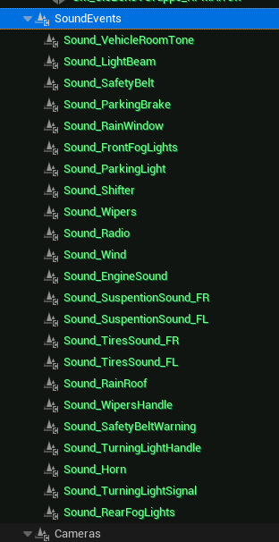

2. Attach `Asset User Data → Control Asset Data` → **`ControlBlock`** named **`SoundEvent`**.
3. Add properties in **`Properties`**:

| Property Name | Type | Required? | Description |
| --- | --- | :-: | --- |
| **`Type`** | `Control Property String` | **Yes** | Audio component type from the table in Section 1.2. Specifying **only** `Type` moves the default game sound to this `SceneComponent`'s position. |
| **`MinimumAttenuationDistance`** | `Control Property Float` | No | Minimum sound attenuation distance (if omitted, FMOD defaults are used). |
| **`MaximumAttenuationDistance`** | `Control Property Float` | No | Maximum audible distance (if omitted, FMOD defaults are used). |
| **`Bank`** | `Control Property String` | Pair with `EventName` | Sound bank name (`Master` for built-in game sounds, or your custom `.bank` name without extension). **Must always be set together with `EventName`!** |
| **`EventName`** | `Control Property String` | Pair with `Bank` | Full FMOD event path (e.g., `event:/Vehicles/CarSounds/FME_RainRoof`). **Must always be set together with `Bank`!** |

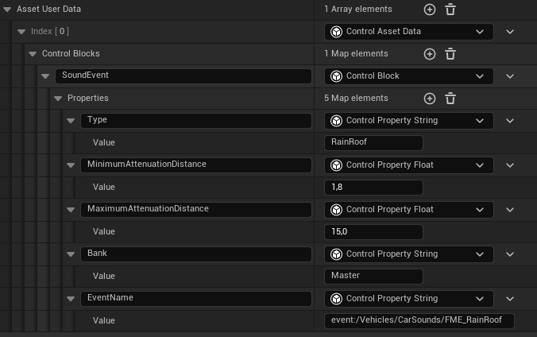

---

### 1.2. Complete Reference of Standard `Type`, `Bank` & `EventName` Values

> [!WARNING]
> **Watch the exact spelling:**
> `SuspentionSound_FR` and `SuspentionSound_FL` are spelled with a **`t`** (`Suspention`), not an `s`! Write them verbatim.

| `Type` | Description | `Bank` | Built-in `EventName` Options |
| --- | --- | --- | --- |
| `EngineSound` | Engine sound | `Master` | `event:/Vehicles/UlgaresFolk/FME_UlgaresFolk_WholeEngine` `event:/Vehicles/HangugEclauto/FME_HangugEclauto_WholeEngine` `event:/Vehicles/UlgaresGroberolf/FME_UlgaresGroberolf_WholeEngine` |
| `VehicleRoomTone` | Ambient cabin interior room tone | `Master` | `event:/Vehicles/CarSounds/FME_VehicleRoomTone` |
| `Shifter` | Gear shifter sound | `Master` | `event:/Vehicles/UlgaresFolk/FME_UlgaresFolk_Shifter` `event:/Vehicles/HangugEclauto/FME_HangugEclauto_Shifter` |
| `LightBeam` | Low-beam light switch | `Master` | `event:/Vehicles/CarSounds/FME_Handle` `event:/Vehicles/CarSounds/FME_Click` |
| `ParkingLight` | Parking light switch | `Master` | `event:/Vehicles/CarSounds/FME_Handle` `event:/Vehicles/CarSounds/FME_Click` |
| `FrontFogLights` | Front fog light switch | `Master` | `event:/Vehicles/CarSounds/FME_Handle` `event:/Vehicles/CarSounds/FME_Click` |
| `RearFogLights` | Rear fog light switch | `Master` | `event:/Vehicles/CarSounds/FME_Handle` `event:/Vehicles/CarSounds/FME_Click` |
| `WipersHandle` | Wiper stalk switch | `Master` | `event:/Vehicles/CarSounds/FME_Handle` `event:/Vehicles/CarSounds/FME_Click` |
| `Wipers` | Wiper blade movement sound | `Master` | `event:/Vehicles/CarSounds/FME_Wipers` |
| `TurningLightHandle` | Turn signal stalk switch | `Master` | `event:/Vehicles/CarSounds/FME_TurningLightHandle` |
| `TurningLightSignal` | Turn signal relay clicks | `Master` | `event:/Vehicles/CarSounds/FME_TurningLightsSignal` |
| `SafetyBelt` | Seatbelt buckle / unbuckle sound | `Master` | `event:/Vehicles/CarSounds/FME_SafetyBelt` |
| `SafetyBeltWarning` | Unfastened seatbelt chime *(configured in `Vehicle.ini`)* | `Master` | `event:/Vehicles/CarSounds/FME_SafetyBeltWarning` |
| `ParkingBrake` | Handbrake sound | `Master` | `event:/Vehicles/CarSounds/FME_ParkingBrake` |
| `Horn` | Vehicle horn | `Master` | `event:/Vehicles/CarSounds/FME_Horn` |
| `RainWindow` | Rain hitting the windshield | `Master` | `event:/Vehicles/CarSounds/FME_RainWindow` |
| `RainRoof` | Rain hitting the roof | `Master` | `event:/Vehicles/CarSounds/FME_RainRoof` |
| `Wind` | Aerodynamic wind noise (speed & surface dependent) | `Master` | `event:/Vehicles/CarSounds/FME_Wind` |
| `SuspentionSound_FR` / `SuspentionSound_FL` | Front-right / front-left suspension impact sounds | `Master` | `event:/Vehicles/CarSounds/FME_SuspensionHit` |
| `TiresSound_FR` / `TiresSound_FL` | Front-right / front-left tire surface sounds | `Master` | `event:/Vehicles/CarSounds/FME_Tires` |
| `Radio` | 3D position of the cabin radio | *(omit)* | No separate FMOD event — audio is driven by game logic. Set only `Type = Radio` (and optional attenuation distances). |

---

## 2. Creating Custom Sounds in FMOD Studio (Level 3)

### 2.1. Required Downloads
1. **FMOD Studio version `2.03.14`** (exact version matters for runtime bank compatibility!).
2. Official FMOD starter repository with two projects:
   - <https://github.com/Forward-Development/CCD2_VehicleKit_FMOD>
   - **`Template_CCD2`** — clean template project for authoring your custom bank.
   - **`Example_CCD2`** — reference project showing all replaceable FMOD events.

> [!CAUTION]
> **Never build your mod directly inside `Example_CCD2`!**
> Use `Example_CCD2` strictly as a reference (to inspect event parameters, structure, and Mixer Bus assignments). Always author and build your bank inside a copy of **`Template_CCD2`** to prevent file conflicts with the base game.

---

### 2.2. Step-by-Step Custom Sound Bank Pipeline

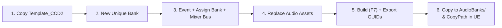

#### Step 1. Set Up Your Working Project
Copy **`Template_CCD2`** into a dedicated folder, optionally rename it after your mod, and open it in FMOD Studio 2.03.14.

#### Step 2. Create a Unique `Bank`
Create a new **Bank** with a globally unique name (e.g., `MyFirstCarBank`) to avoid conflicts with other mods. All of your custom events will be assigned to this bank.

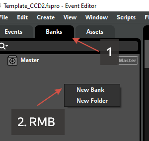

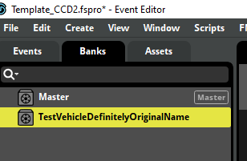

#### Step 3. Create Events Modeled After `Example_CCD2`
1. Create a folder under **Events** named after your Bank and store all your events inside it.
2. You may copy events directly from `Example_CCD2` into your project, but always give each event a **new unique name** distinct from the example.

#### Step 4. Assign Events to Your `Bank`
Right-click your event → **`Assign to Bank → <YourBank>`**, and remove it from `Master` (so you don't collide with stock banks).

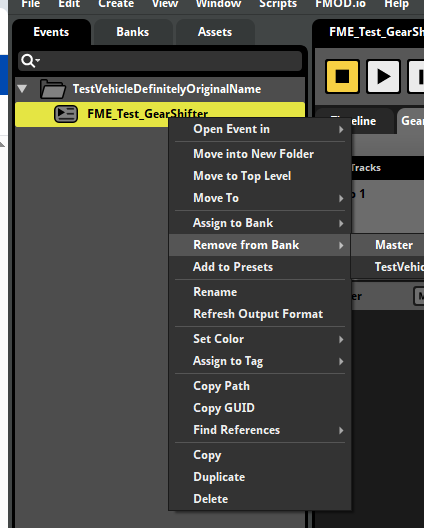

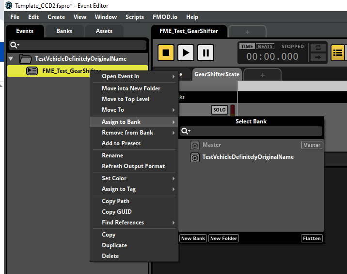

#### Step 5. Route to the Correct Mixer `Bus`
To make in-game volume sliders control your sounds properly, open **Mixer** (`Ctrl + 2`) and drag your event onto the same `Bus` it used in `Example_CCD2`. *(Copied events usually preserve bus routing automatically, but always double-check!)*

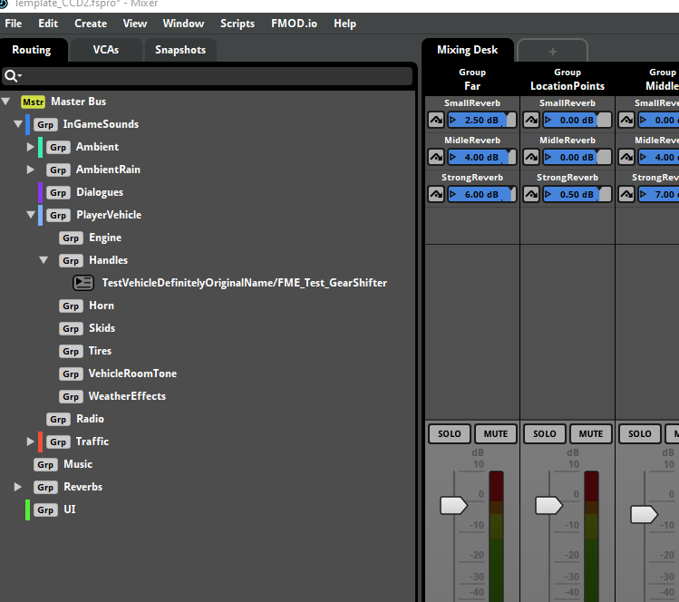

#### Step 6. Replace Audio Assets
Prepare your `.wav` / `.ogg` files in any external audio editor.
- **Simple workflow:** drag and drop your new audio file directly onto the instrument inside the copied FMOD event.
- **Advanced workflow:** you can redesign the event freely, **as long as you keep the exact parameter names, trigger points, and stop behavior** expected by the game!

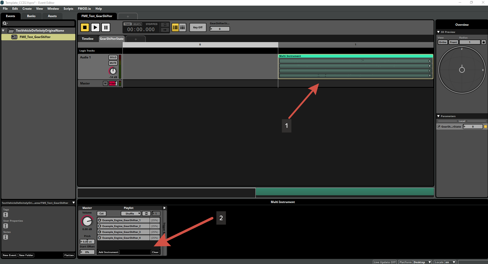

#### Step 7. Build the Bank (`Build`)
Press **`F7`** (or **`File → Build`**). Your compiled `<YourBank>.bank` file will appear under `\Build\Desktop\` inside your FMOD project folder.

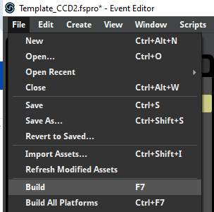

#### Step 8. Export `GUIDs.txt`
**Mandatory step!** Click **`File → Export GUIDs`**. This generates **`GUIDs.txt`** in your FMOD project's `\Build\` folder.

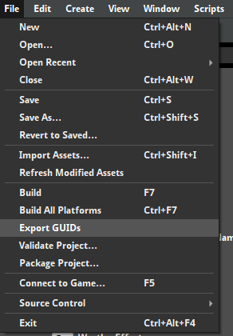

#### Step 9. Copy Bank Files into Your Mod Folder
1. In Windows Explorer, open `Plugins\Mods\Content\<ModName>\` and create a subfolder named **`AudioBanks`** (if it doesn't exist yet).
2. Copy both files into `AudioBanks/`:
   - `<YourBank>.bank` (from `\Build\Desktop\`)
   - `GUIDs.txt` (from `\Build\`)

> [!TIP]
> **One mod — one `Bank`:**
> Keep all sounds for one vehicle in a single bank whenever possible. If you must use multiple banks, merge their `GUIDs.txt` files into a single `GUIDs.txt` containing all bank and event lines.

#### Step 10. Link the Event Path in Unreal Engine
1. In FMOD Studio, right-click your event → **`Copy Path`**.

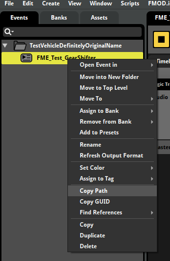

2. In Unreal Engine, open `V_<ModName>`, select the target `SceneComponent` with `ControlBlock` `SoundEvent`, and fill in:
   - **`Bank`** — your bank name (without `.bank`).
   - **`EventName`** — paste the copied path (e.g., `event:/MyFirstCar/FME_MyHorn`).

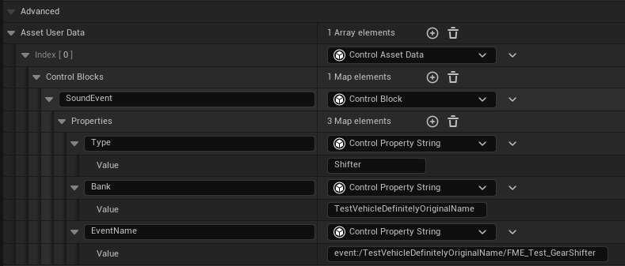

#### Step 11. Build the `.pak`
Click **Compile → Save All** and run `build_mod_dlc.bat` — the `AudioBanks/` folder will automatically be packaged into your `.pak`.

---

**Next step:** finish up with **[Module 6. Configurations, Physics, Custom Logic & Reference](./06_Advanced_Specs_Logic_and_Reference.md)** for vehicle card stats, switchable options, custom Blueprint logic, and the master cheat sheet.
