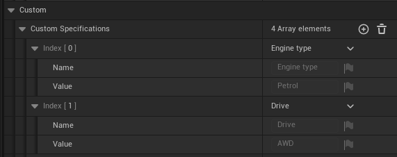
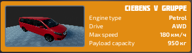
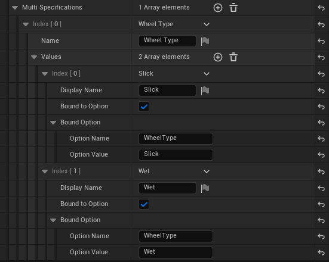

# Module 6. Configurations, Deep Physics, Custom Logic & Master Reference

**Navigation:** [README](./README.md) | [01. Minimal Car](./01_Minimal_Car_QuickStart.md) | [02. Exterior, Lights & World](./02_Exterior_Lights_and_World.md) | [03. Interior, Dashboard & Cameras](./03_Interior_Dashboard_Cameras_Seats.md) | [04. Mirrors & Wipers](./04_Mirrors_and_Wipers.md) | [05. Sounds & FMOD](./05_Sounds_and_FMOD.md) | **06. Specs, Logic & Reference**

---

This final module covers advanced vehicle card customization, switchable physics options, custom Blueprint logic, deep physics documentation links, and the **all-in-one cheat sheet** for every `ControlBlock`, `MI_Mod_*` parent material, and exact code identifier.

---

## 1. Advanced Specifications in `DA_<ModName>` (`PDA_PrototypedVehicleSpecification`)

You already set up the mandatory fields (`Name`, `Image`, `Class`, `EngineTypes`, `TransmissionTypes`) in [Module 1](./01_Minimal_Car_QuickStart.md#step-6-creating-the-vehicle-specification-pda_prototypedvehiclespecification). Under the **Custom** section, two more powerful lists are available:

### 1.1. Vehicle Card Info (`CustomSpecifications`)
Displays cosmetic spec entries (drivetrain, top speed, payload capacity, horsepower, etc.) directly on the vehicle's garage card.
- Currently, the **first 5 entries** in `CustomSpecifications` are displayed on the card.
- Each entry has a `Name` (label) and a `Value`.





### 1.2. Functional Switchable Options (`MultiSpecifications`)
Works just like `TransmissionTypes`, allowing players to **switch your custom physics options right from the in-game vehicle setup menu** — for example, tire types (summer/winter/sport), multiple engines, suspension trims, or tuning packages!

How to wire `MultiSpecifications` to physics:
1. In **`DA_<ModName>` → `MultiSpecifications`**, add a new specification (e.g., `Name = "Tire Type"`), populate its `Values` array (e.g., `Summer`, `Sport`), enable **`Bound to Option`** on each value, and fill in **`Option Name`** and **`Option Value`**.
2. In your mod folder's **`options.xml`**, declare an option with matching names (set `SetSchema="false"`, since only one option — usually `TransmissionType` — may have `SetSchema="true"`):
```xml
<Option Name="TireType" SetSchema="false">
    <OptionValue Value="Summer" />
    <OptionValue Value="Sport" />
</Option>
```
3. In **`Vehicle.ini`**, add override sections formatted as `[ComponentName.OptionName.OptionValue]`:
```ini
[WheelFrontLeft.TireType.Sport]
FrictionCoeff = 1.15
```
4. Any `MultiSpecifications` bound to options **automatically appear** in the vehicle's in-game customization menu!




---

## 2. Deep Physics Tuning (`VehicleLib`)

Standard XML schemas and lookup tables live in the base project at:
- Schemas: **`Content/Common/Vehicles/MotorCars/Schemes/`** (`AwdAuto.xml`, `AwdManual.xml`, `FwdAuto.xml`, `FwdManual.xml`, `RwdAuto.xml`, `RwdManual.xml`)
- Curve tables: **`Content/Common/Vehicles/MotorCars/Tables/`** (`SpringProgression.csv`, `EngineVibration.csv`, `WheelForceLat.csv`, `WheelForceLon.csv`, etc.)

> [!IMPORTANT]
> **Rule for editing schemas and curve tables:**
> Never edit files inside `Content/Common/Vehicles/MotorCars/` — changes there will NOT be packed into your `.pak`!
> To customize any schema or curve table, **copy it into your mod folder** `Plugins/Mods/Content/<ModName>/` and point to it using `../Plugins/Mods/Content/<ModName>/<File>` in `Vehicle.ini` / `options.xml`.

For the full engineering reference covering all 46 physics component classes, tuning formulas, and I/O channels, see **`VehicleLib_MD`**:
- **[README (VehicleLib)](../VehicleLib_MD/README.md)** — file architecture, component index, and units
- **[00. Physics Quick Start](../VehicleLib_MD/00_Quick_Start.md)** — mass, CoM, suspension, `Engine.csv`, gearbox formulas, and 5 verification tests
- **[01. Architecture & Configs](../VehicleLib_MD/01_Architecture_and_Config.md)** — custom XML schemas (e.g., `EngineDiesel + Turbocharger`) and `.csv` formats
- **[02. Named I/O & States](../VehicleLib_MD/02_Named_IO_and_States.md)** — all `*Intensity` channels, inputs, and states
- **[03. TorqueTrain](../VehicleLib_MD/03_Components_TorqueTrain.md)** — engines, starter, clutch, torque converter, gearboxes, differentials, brakes, tires
- **[04. Electrics](../VehicleLib_MD/04_Components_Electrics.md)** — circuits, battery, `CarElectrics`
- **[05. Chassis & Subsystems](../VehicleLib_MD/05_Components_Chassis_and_Subsystems.md)** — suspension, steering, turbocharger, aerodynamics, ABS/TCS

---

## 3. Custom Blueprint Logic

If you are familiar with Unreal Engine Blueprints and want to add custom behavior (active aero, extra animations, special effects, etc.):

> [!CAUTION]
> **Do NOT write custom logic directly in the Vehicle Actor's (`V_<ModName>`) Event Graph!**
> Instead, create a dedicated **`ActorComponent`** (`RMB in Content Browser → Blueprint Class → Actor Component`), implement your logic inside it, and attach that component to your Vehicle Actor.
> Make sure your custom component has **NO `ControlBlock` (`Control Asset Data`)** — it will then run normally without interference from the vehicle loader.

---

## 4. Master Cheat Sheet (Reference)

### 4.1. Exact Code Spellings (Do NOT "Fix"!)

> [!WARNING]
> The following identifiers are hardcoded in the engine exactly as shown — copy them **character for character**:
> - Wiper `ControlBlock`: **`Wippers`** *(double `p`)*
> - Suspension sound types: **`SuspentionSound_FR`**, **`SuspentionSound_FL`** *(spelled with `t`)*
> - Speedometer needle backlight slot: **`SpeedometrArrow`** *(no `e` after `t`)*
> - Parent materials: **`MI_Mod_Emissive_Ikons`** *(with `k`)*, **`MI_Mod_Stiches`** *(no `t`)*
> - Rear axle in Actor & `Vehicle.ini`: **`Back`** (`SuspensionBackLeft/Right`, `WheelBackLeft/Right`), **NOT** `Rear`!

---

### 4.2. Complete `ControlBlock` Reference Table

| `ControlBlock` Name | Attached To | Properties (name, type, values) | Module |
| --- | --- | --- | :-: |
| **`Camera`** | `SceneComponent` / `CameraComponent` | `Type` (`String`: `ThirdPersonBack`, `ThirdPersonFront`, `FirstPerson`, `Windshield`, `TopDown`); opt. `ArmLength` (`Float`) | [1](./01_Minimal_Car_QuickStart.md), [3](./03_Interior_Dashboard_Cameras_Seats.md) |
| **`Light`** | `BP_ExportSpotLight` / `SpotLightComponent` | `PhysicsOutput` (`StringArray`: `LowBeamIntensity`, `HighBeamIntensity`, `StopLightIntensity`, etc.) | [2](./02_Exterior_Lights_and_World.md) |
| **`LogicBox`** | `BoxCollision` | *(none)* | [2](./02_Exterior_Lights_and_World.md) |
| **`FuelTank`** | `SceneComponent` *(under zero-transform parent)* | *(none)* | [2](./02_Exterior_Lights_and_World.md) |
| **`RainBlocker`** | `StaticMeshComponent` *(with `MM_Wireframe`)* | *(none)* | [2](./02_Exterior_Lights_and_World.md) |
| **`SteeringWheel`** | `StaticMeshComponent` *(under `InteriorObjects`)* | *(none)* | [3](./03_Interior_Dashboard_Cameras_Seats.md) |
| **`SpeedArrow`** | `StaticMeshComponent` *(needle at zero mark)* | `MaxAngle` (`Float`), `MaxValue` (`Float`) | [3](./03_Interior_Dashboard_Cameras_Seats.md) |
| **`RPMArrow`** | `StaticMeshComponent` *(needle at zero mark)* | `MaxAngle` (`Float`), `MaxValue` (`Float`) | [3](./03_Interior_Dashboard_Cameras_Seats.md) |
| **`FuelArrow`** | `StaticMeshComponent` *(needle at zero mark)* | `MaxAngle` (`Float`) | [3](./03_Interior_Dashboard_Cameras_Seats.md) |
| **`CoolantTemperatureArrow`** | `StaticMeshComponent` *(needle at zero mark)* | `MaxAngle` (`Float`), `MinValue` (`Float`), `MaxValue` (`Float`) | [3](./03_Interior_Dashboard_Cameras_Seats.md) |
| **`SalonLights`** | `SceneComponent` *(or copied `DashboardController`)* | Key = physics channel (`*Intensity`), value = `StringArray` of material slot names | [3](./03_Interior_Dashboard_Cameras_Seats.md) |
| **`Seats`** | `StaticMeshComponent` *(with `<Name>_Landing` sockets)* | `Names` (`StringArray`, e.g., `["Seat0"]`), opt. `DriverIndex` (`Int`, e.g., `0`) | [3](./03_Interior_Dashboard_Cameras_Seats.md) |
| **`CarToy`** | `SceneComponent` *(or `SM_Cosmonaft_Anim`)* | *(none)* | [3](./03_Interior_Dashboard_Cameras_Seats.md) |
| **`Mirror`** | `StaticMeshComponent` *(with `Camera` socket & UV1)* | opt. `FOV` (`Float`, rec. `20–40`) | [4](./04_Mirrors_and_Wipers.md) |
| **`Wippers`** *(double `p`!)* | `SkeletalMeshComponent` *(Animation Asset)* | `Side` (`String`: `Front` or `Rear`) | [4](./04_Mirrors_and_Wipers.md) |
| **`SoundEvent`** | `SceneComponent` | `Type` (`String`, req.); opt. `MinimumAttenuationDistance` / `MaximumAttenuationDistance` (`Float`); paired `Bank` (`String`) + `EventName` (`String`) | [5](./05_Sounds_and_FMOD.md) |

---

### 4.3. Complete Reference of All 14 Parent Materials (`ModMaterials`)

Project folder: `Content/Common/MasterMaterials/VehicleMaterials/ModMaterials/`

| Material | Purpose |
| --- | --- |
| `MI_Mod_CarPaint` | Painted body panels (supports `Livery` texture with alpha mask). |
| `MI_Mod_Exterior` | Plastic, chrome, unpainted trim, wheel rims, brake calipers. |
| `MI_Mod_Tyre` | Rubber wheel tires. |
| `MI_Mod_Glass` | Vehicle windows and headlight lenses (clear or tinted). |
| `MI_Mod_Emissive_Beam` | Exterior illuminated elements (headlights, turn signals, brake lights). |
| `MI_Mod_Wipers` | Windshield wiper arms and blades. |
| `MI_Mod_Vehicle_Interior` | Cabin upholstery, dashboard, seats, and interior panels. |
| `MI_Mod_PanelGlass` | Instrument cluster protective glass. |
| `MI_Mod_Stiches` | Alpha-masked interior trim (seat stitching, steering wheel wrap). |
| `MI_Mod_Mirror` | Center rear-view mirror housing / dome. |
| `MI_Mod_Emissive_Ikons` | Illuminated dashboard warning icons. |
| `MI_Mod_Emissive_Panel` | Illuminated gauge elements (needles, scales). |
| `MI_Mod_Emissive_Saloon` | Backlit cabin buttons and switches (window switches, etc.). |
| `MI_Mod_LicensePlate` | **Not used** in mods (leave the `LicensePlates` slot empty; the game assigns its dynamic plate material automatically). |

---

## 5. Final Pre-Release Checklist (Before Steam Workshop Upload)

- [ ] All mod files live strictly inside `Plugins/Mods/Content/<ModName>/`, using Latin characters only and no spaces.
- [ ] Every texture has `Virtual Texture Streaming` enabled (`VT` badge), all `MRA` maps use `Compression Settings = Masks (no sRGB)`, and `LFM_VehicleLightSpot` beam textures use `Alpha`.
- [ ] Zero custom `Master Materials` are used — only `Material Instances` inheriting from `MI_Mod_*`.
- [ ] The Actor and every single component have `Scale = (1.0, 1.0, 1.0)`.
- [ ] Physical collision `BlockAllDynamic` is set **only** on `Body`; every other mesh (wheels, calipers, interior, glass, mirrors, wipers) uses `NoCollision` and has `Receives Decals` disabled.
- [ ] All paths in `Vehicle.ini` and `options.xml` point to `../Plugins/Mods/Content/<ModName>/...` or `Common/...`, with no spaces before semicolons `;`.
- [ ] All mirrors have a `Camera` socket, had `Generate UVs by Vertex Positions` executed, and were saved.
- [ ] All UE assets are saved (`Ctrl + Shift + S`) and all Blueprints compiled cleanly (**Compile** with zero errors).
- [ ] The mod was packaged via `build_mod_dlc.bat`, `\Saved\DLC\Windows\Mods.pak` was renamed to `<ModName>.pak`, and tested locally in `CityCarDriving2/Content/Paks/`.
- [ ] The vehicle was tested in daylight, at night (lights & dashboard), in rain (`RainBlocker` & wipers), at a gas station (`FuelTank`), and across all camera views.
