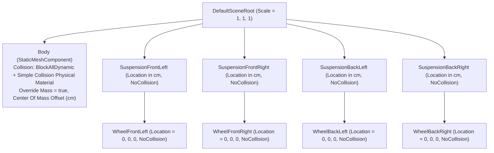

# 00. Quick Start: Configuring Vehicle Physics in City Car Driving 2.0

**Navigation:** [README](./README.md) | **00. Quick Start** | [01. Architecture & Configs](./01_Architecture_and_Config.md) | [02. Named I/O & States](./02_Named_IO_and_States.md) | [03. TorqueTrain](./03_Components_TorqueTrain.md) | [04. Electrics](./04_Components_Electrics.md) | [05. Chassis & Subsystems](./05_Components_Chassis_and_Subsystems.md)

---

This section is a concise practical guide to assembling and calculating the physics of a modded vehicle in **City Car Driving 2.0** from scratch. Detailed references for every component and telemetry channel are provided in sections [01](./01_Architecture_and_Config.md)–[05](./05_Components_Chassis_and_Subsystems.md).

---

## 1. Physics File Layout and Path Rules (`Vehicle.ini`, `options.xml`, `Engine.csv`, `*.xml`)

Inside the mod plugin folder `Plugins/Mods/Content/<ModName>/`, alongside the Unreal Engine 5 assets (`V_<ModName>.uasset`, `DA_<ModName>.uasset`, `ST_<ModName>.uasset`), place the **UTF-8**-encoded text physics configuration files:

- **`Vehicle.ini`** — main configuration file containing parameters for all vehicle units;
- **`options.xml`** — definition of available configurations (switching AT/MT, selecting engine variants);
- **`Engine.csv`** — 2D table of ICE combustion torque and mechanical losses;
- *(Optional)* local XML schema files (`AwdAuto.xml`, `AwdManual.xml`, etc.) and curve tables (`.csv`).

### 1.1. Path Resolution Rules Relative to `Content/`

All paths inside `Vehicle.ini` and `options.xml` are resolved **relative to the root `Content/` directory of the base game project**:

1. **Shared base-game resources (`Content/Common/Vehicles/MotorCars/...`):** written directly without a leading slash:
   ```ini
   DefaultSchema = Common/Vehicles/MotorCars/Schemes/AwdAuto.xml
   ProgressionCurve = Common/Vehicles/MotorCars/Tables/SpringProgression.csv
   ```
2. **Custom files inside the mod folder (`Plugins/Mods/Content/<ModName>/...`):** require stepping out of `Content/` using `../Plugins/Mods/Content/<ModName>/...`:
   ```ini
   PowerCurves = ../Plugins/Mods/Content/CieBensVGruppe/Engine.csv
   ```

### 1.2. Critical `Vehicle.ini` and `.csv` Syntax Rules

> [!CAUTION]
> **Three syntax rules whose violation breaks parameter parsing:**
>
> 1. **The separator for lists and 3D vectors is strictly a semicolon `;` with NO space before `;`!**
>    Commas `,` are not supported, and a "space before `;`" sequence (`" ;"`) is interpreted by the `.ini` parser as the start of an end-of-line comment, discarding all subsequent numbers:
>    ```ini
>    Mount = 1.63; 0.85; 0.4455                                  ; CORRECT
>    Gears = -3.416; 4.377; 2.859; 1.921; 1.368; 1.000; 0.820    ; CORRECT
>    Mount = 1.63 ; 0.85 ; 0.4455                                ; ERROR: space before ';' truncates 0.85 and 0.4455!
>    ```
> 2. **The decimal separator is strictly a dot `.`** (both in `Vehicle.ini` and in all `.csv` tables).
> 3. **Section header length limit is at most `49` characters** inside the square brackets `[...]` (including option suffixes `.OptionName.OptionValue`), and the single-line length limit is at most `400` characters.

A detailed description of `.ini` syntax and table formats is provided in [Section 01. Architecture & Configs](./01_Architecture_and_Config.md).

---

## 2. Mandatory Requirements for the `Body` Physics Chassis and Wheel Nodes in Blueprint

Chassis mass, center of mass, and wheel hierarchy are configured directly in the vehicle Blueprint `V_<ModName>.uasset` in the Unreal Engine 5 editor:



1. **Root chassis mesh `Body` and unit scale `Scale = (1, 1, 1)`:**
   - The sole physical chassis mesh must be a `StaticMeshComponent` named **`Body`**, whose mesh asset has convex collision hulls (`Simple Collision`) and an assigned **`Simple Collision Physical Material`**.
   - All other components and meshes in the Blueprint (wheels, suspension hubs, glass, interior and exterior body parts) must use the **`NoCollision`** collision preset (`Receives Decals = False`).
   - The actor and **all** of its components in the Blueprint must have unit scale **`Scale = (1.0, 1.0, 1.0)`** (FBX export axes: `-X Forward`, `Z Up`).
2. **Mandatory suspension and wheel node names (rear axle is strictly `Back`, not `Rear`!):**
   - Suspension hubs: **`SuspensionFrontLeft`**, **`SuspensionFrontRight`**, **`SuspensionBackLeft`**, **`SuspensionBackRight`** (their `Location` property defines the wheel center coordinates in centimeters).
   - Wheel meshes (children of the corresponding `Suspension*` with `Location = (0, 0, 0)`): **`WheelFrontLeft`**, **`WheelFrontRight`**, **`WheelBackLeft`**, **`WheelBackRight`**.
3. **Sprung chassis mass (`Override Mass`):**
   - In the **Physics** section of the `Body` component, be sure to check **`Override Mass`** and enter the sprung body mass in **`Mass in Kg`** (vehicle curb mass with driver minus the mass of all four wheels):
      $$M_{\text{body}} = M_{\text{curb}} - 4 \cdot M_{\text{wheel}}$$
   - If `Override Mass` is left unchecked, the physics engine calculates mass from the collision volume $V$ using the nonlinear formula $M_{\text{auto}} = 1000 \cdot V^{0.75}$, which underestimates the mass of mid-size and large vehicles by nearly half.
4. **Center of mass offset (`Center Of Mass Offset` in centimeters):**
   - The **`Center Of Mass Offset`** (`COMNudge`) vector on the `Body` component is specified in **centimeters (`cm`)** and represents a **relative offset** $(\Delta X, \Delta Y, \Delta Z)$ from the automatically computed geometric centroid of the collision volume $\text{COM}_{\text{auto}}$:
      $$\text{COM}_{\text{final}} = \text{COM}_{\text{auto}} + \text{Center Of Mass Offset}$$
   - To achieve the rated longitudinal weight distribution (where $w_{\text{front}}$ is the front-axle load fraction, e.g., `0.54` for `54% / 46%`), compute the target coordinate $X_{\text{target}}$ between the axles $X_{\text{front}}$ and $X_{\text{back}}$ (in `cm`) and subtract $X_{\text{auto}}$ from it:
      $$X_{\text{target}} = X_{\text{back}} + w_{\text{front}} \cdot (X_{\text{front}} - X_{\text{back}}), \qquad \Delta X = X_{\text{target}} - X_{\text{auto}}$$
   - Similarly, set $\Delta Y = -Y_{\text{auto}}$ (to eliminate static roll tilt) and $\Delta Z = Z_{\text{target}} - Z_{\text{auto}}$ (for tall bodies — hatchbacks, crossovers, and minivans — the geometric collision center $Z_{\text{auto}}$ sits too high, so the offset $\Delta Z$ should be negative).

---

## 3. Choosing an XML Schema and Configuring Trims (`options.xml`)

### 3.1. Differences Between the 6 Standard XML Schemas (`Common/Vehicles/MotorCars/Schemes/*.xml`)

| Feature / Unit | AT Schemas (`*Auto.xml`) | MT Schemas (`*Manual.xml`) | AWD Schemas (`Awd*.xml`) | 2WD Schemas (`Fwd*.xml`, `Rwd*.xml`) |
| --- | --- | --- | --- | --- |
| **Schema files** | `AwdAuto.xml`, `FwdAuto.xml`, `RwdAuto.xml` | `AwdManual.xml`, `FwdManual.xml`, `RwdManual.xml` | `AwdAuto.xml`, `AwdManual.xml` | `FwdAuto.xml`, `FwdManual.xml`, `RwdAuto.xml`, `RwdManual.xml` |
| **Gearbox and clutch / torque converter sections in `Vehicle.ini`** | **`[GearBoxAutomatic]`**, `[TorqueConverter]`, `[GearBoxLogic]`, `[GearBoxAutomaticPump]`, `[OilTank]` | **`[GearBox]`**, `[Clutch]`, `[ClutchPedal]` | Depends on `Auto` / `Manual` | Depends on `Auto` / `Manual` |
| **Differential sections in `Vehicle.ini`** | Depends on drivetrain type | Depends on drivetrain type | **`[DifferentialAxle]`** *(final drive)*, `[FrontAxisRelay]`, **`[DifferentialWheelFront]`**, **`[DifferentialWheelBack]`** | **`[Differential]`** *(single differential with final drive)* |
| **Rear brake, wheel, and suspension sections** | `[BrakeBackLeft/Right]`, `[WheelBackLeft/Right]`, `[SuspensionBackLeft/Right]` | `[BrakeBackLeft/Right]`, `[WheelBackLeft/Right]`, `[SuspensionBackLeft/Right]` | Rear axle always uses the **`Back`** suffix | Rear axle always uses the **`Back`** suffix |
| **How the game detects transmission type (AT vs MT)** | `<InputElements>` includes the **`AutoShifterState`** input | `AutoShifterState` is absent (has `GearBoxState` and `Clutch`) | — | — |

### 3.2. Combining Two Options in `options.xml` (Transmission + Engine)

In `options.xml`, **`SetSchema="true"` may only be set on a single option**. If your vehicle offers both a transmission choice (`Auto` / `Manual`) and an engine choice (for example, gasoline and diesel), assign `SetSchema="true"` to `TransmissionType` and use `EngineGazoline` from the standard schemas as a universal base ICE, switching its characteristics and `PowerCurves` table via `[Engine.EngineType.*]` and `[Idler.EngineType.*]` sections in `Vehicle.ini`:

```xml
<?xml version="1.0" encoding="UTF-8" ?>
<Options>
    <AvailableOptions>
        <Option Name="TransmissionType" SetSchema="true">
            <OptionValue Value="Auto"   SchemaName="Common/Vehicles/MotorCars/Schemes/AwdAuto.xml" />
            <OptionValue Value="Manual" SchemaName="Common/Vehicles/MotorCars/Schemes/AwdManual.xml" />
        </Option>
        <Option Name="EngineType" SetSchema="false">
            <OptionValue Value="2.0I" />
            <OptionValue Value="2.2TD" />
        </Option>
    </AvailableOptions>
</Options>
```

### 3.3. Quick Recipe for a Local `EngineDiesel` + `Turbocharger` Schema

If you need a custom schema using the `EngineDiesel` diesel class and a `Turbocharger`:

1. Copy a base schema (`AwdAuto.xml` / `AwdManual.xml`) into your mod folder `Plugins/Mods/Content/<ModName>/`.
2. In `<Components>`, change the `Engine` class to `Class="EngineDiesel"` and add `<Component Name="Turbocharger" Class="Turbocharger" />`.
3. In `<Links>`, **be sure to remove** `<Link Holder="IgnitionElectricCircuit" Reference="Engine" />`, **keep** `<Link Holder="IgnitionKey" Reference="Idler" />` (this cuts fuel to stop the diesel engine when the key is turned to `0`), and add `<Link Holder="Turbocharger" Reference="Engine" />`.
4. In `<InputProcessors>`, add `<Processor Input="Accelerator" Component="Turbocharger" InternalName="Throttle" />`, and in `Vehicle.ini` add a `[Turbocharger]` section with `LagTime = 0.08..0.10` (the effective boost smoothing time constant in the game is $\tau_{\text{eff}} = 4 \cdot \text{LagTime} \approx 0.32..0.40\text{ s}$).

Detailed schema examples and complete input/output tables are provided in sections [01. Architecture & Configs](./01_Architecture_and_Config.md) and [02. Named I/O & States](./02_Named_IO_and_States.md).

---

## 4. Step-by-Step Calculation of Key `Vehicle.ini` and `Engine.csv` Parameters

### Step 1. Steering Geometry `[Steering]` and Tires `[Wheel*]`

1. **Wheelbase (`InteraxleDistance` in `[Steering]`):** take the longitudinal coordinates $X_{\text{front,cm}}$ and $X_{\text{back,cm}}$ of the `SuspensionFront*` and `SuspensionBack*` nodes from the Blueprint (in `cm`) and convert the axle spacing to **meters**:
   $$\text{InteraxleDistance} = \frac{X_{\text{front,cm}} - X_{\text{back,cm}}}{100}$$
2. **Static wheel radius (`Radius` in `[Wheel*]`):** measure the unloaded radius of the 3D wheel mesh and subtract the static tire deflection under load ($8{-}12\text{ mm}$). For example, with a $710\text{ mm}$ mesh diameter ($R_{\text{free}} = 0.355\text{ m}$), set `Radius = 0.345` m.
3. **Handling balance (`ForceCurveLoad` in `[Wheel*]`):**
   - On the front wheels (`[WheelFrontLeft/Right]`), set `ForceCurveLoad` equal to the static vertical load on one front wheel: $\text{ForceCurveLoad}_{\text{front}} \approx F_{\text{stat,f}} = m_{\text{f}} \cdot 9.81$.
   - On the rear wheels (`[WheelBackLeft/Right]`), set `ForceCurveLoad` **$5{-}15\%$ higher** than the static vertical load on one rear wheel $F_{\text{stat,r}} = m_{\text{r}} \cdot 9.81$, giving the rear axle a natural stability margin against oversteer/spinout.

### Step 2. Suspension `[SuspensionFront*]` and `[SuspensionBack*]`

1. **Upper spring mount point `Mount` (converting from UE5 left-handed CS in `cm` to physics right-handed CS in `m`):**
   Choose the total suspension travel `Length` (e.g., `0.20` m front and `0.22` m rear) and the target static relative sag `NormalSag = 0.33`. To make the wheels settle cleanly at the wheel-arch center coordinates $(X_{\text{UE}}, Y_{\text{UE}}, Z_{\text{UE}})$ from the Blueprint, compute `Mount` using:
   $$\text{Mount} = \left(\frac{X_{\text{UE}}}{100};\quad -\frac{Y_{\text{UE}}}{100};\quad \frac{Z_{\text{UE}}}{100} + (1 - \text{NormalSag}) \cdot \text{Length}\right)$$
   *(Note the sign flip on $Y$: in `Vehicle.ini`, left wheels have $Y > 0$ and right wheels have $Y < 0$.)*
2. **Spring stiffness `SpringCoeff`, preload `PreloadForce`, and damper `DampCoeff`:**
   At `NormalSag = 0.33`, the standard progression table `Common/Vehicles/MotorCars/Tables/SpringProgression.csv` has an effective stiffness multiplier of **`0.654`**. Therefore, to hit `SpringSag = 0.33` accurately under the static corner load $F_{\text{stat}} = m_{\text{corner}} \cdot 9.81$, the parameters are related by:
   $$F_{\text{stat}} = \text{PreloadForce} + 0.654 \cdot \text{SpringCoeff} \cdot \text{Length} \cdot \text{NormalSag}, \qquad \text{DampCoeff} \approx (0.65 \dots 0.75) \cdot 2\sqrt{\text{SpringCoeff} \cdot m_{\text{corner}}}$$

### Step 3. Engine `[Engine]`, Idle Controller `[Idler]`, and `Engine.csv` Table

1. **Compensating for subtraction of the mechanical loss row $F(\text{RPM})$:**
   In `Engine.csv`, the last row (labeled `0` right after row `100`) specifies positive mechanical friction torque $F(\text{RPM}) > 0$. The engine **always subtracts $F(\text{RPM})$ from the interpolated combustion torque at every throttle position, including `100%`**. Therefore, to achieve the rated crankshaft torque $T_{\text{rated}}(\text{RPM})$, the `100%` row must store the sum:
   $$T_{100}(\text{RPM}) = T_{\text{rated}}(\text{RPM}) + F(\text{RPM})$$
   If the schema includes a **`[Turbocharger]`** component, additionally divide each combustion cell $(r, c)$ by the boost ratio at the corresponding throttle fraction $\text{thr} = \text{row\_pct} / 100$:
   $$\text{ratio}(\text{RPM}, \text{thr}) = 1 + (\text{RefCompressionRatio} - 1)\sqrt{\frac{\max(0,\; \text{RPM}\cdot\text{thr} - \text{MinRpm})}{\text{RefRpm} - \text{MinRpm}}}, \qquad T_{\text{CSV}}(\text{RPM}, \text{thr}) = \frac{T_{\text{target}}(\text{RPM}, \text{thr}) + F(\text{RPM})}{\text{ratio}(\text{RPM}, \text{thr})}$$
   *(Do NOT divide the last mechanical loss row $F(\text{RPM})$ by $\text{ratio}$!)*
2. **Shaping the "anti-stall hump" in the `500 RPM` column for the `5%–10%` rows:**
   The `[Idler]` controller operates open-loop: it computes the throttle opening so that at `IdleRpm` combustion torque exactly balances internal friction $F(\text{IdleRpm})$ alone, and it does not open the throttle further when RPM drops under external load (such as shifting an AT into `D` on the brake or engaging the clutch). To keep the engine idling reliably under load, create a pronounced torque rise in the low-throttle rows (`5%` and `10%`) at the **`500 RPM`** column (`3–5` times higher than the torque at the `750 RPM` column).

### Step 4. Gearbox, Differentials, and Speedometer

1. **Manual transmission (`[Clutch]`, `[GearBox]`):**
   - In `[Clutch]`, set `MaxTorque` with a safety margin of $1.4{-}1.6\times$ peak engine torque.
   - In `[GearBox]`, the first element of the `Gears` array is reverse (a negative number), followed by forward gears in order (`StartingGear = -1`). For crisp engagement of first gear from a standstill, configure the synchronizers: `MaxRPMDiffToShift = 200..250`, `SynchronizerMaxFrictionTorque = 10..15`.
2. **Automatic transmission (`[TorqueConverter]`, `[GearBoxAutomatic]`):**
   - In `[GearBoxAutomatic]`, set the input-shaft quadratic friction coefficient **`RotationalFrictionQuadCoeff = 2.0e-4 .. 3.0e-4`** (`RotationalFrictionConstant = 1.5`).
   - In the throttle-indexed shift schedules `ShiftAccelerator = 0; 0.1; ...; 1`, align the upshift thresholds **`MaxRpm`** with the torque converter slip RPM and provide a sufficiently wide lockup window **`TorqueConverterLockDiff`** (`650..2100`) so the lockup clutch engages after each shift.
   - To prevent the engine from stalling during full-force emergency braking in `D`, configure timely torque converter unlocking: **`UnlockTorqueConverterRpm = 1200..1250`** (`LockTorqueConverterRpm = 1350..1400`) and **`TorqueConverterLockTime = 0.25..0.30`**.
3. **Differentials and speedometer (`[Speedometer]`):**
   - For full-time AWD vehicles (`Awd*.xml`), set **`Locked = false`** in all three differentials (`[DifferentialAxle]`, `[DifferentialWheelFront]`, `[DifferentialWheelBack]`), and enter the final drive ratio `GearRatio` in `[DifferentialAxle]`.
   - In `[Speedometer]`, calculate the travel distance in meters per single revolution of the final-drive shaft from the static wheel radius $R_{\text{wheel}}$ and final drive ratio $i_{\text{diff}}$:
      $$\text{MetersPerRotation} = \frac{2\pi R_{\text{wheel}}}{i_{\text{diff}}}$$
      *(If you want the typical $+2\%$ factory speedometer over-read, multiply the result by `1.02`.)*

### Step 5. Onboard Electrics `[CarElectrics]`

In the `[CarElectrics]` section, for every lamp, dashboard indicator, wiper motor, and electric gauge needle used on the vehicle, **be sure to assign a positive electrical resistance `<Prefix>_Resistance > 0`** (for example, `100` Ohms for warning lamps and gauges, `4` Ohms for halogen headlights and wipers). Any element left at the default resistance of `0.0` Ohms is treated as disconnected from the electrical system and will not operate when the ignition is turned on.

Complete parameter tables for all components are documented in sections [03. TorqueTrain](./03_Components_TorqueTrain.md), [04. Electrics](./04_Components_Electrics.md), and [05. Chassis & Subsystems](./05_Components_Chassis_and_Subsystems.md).

---

## 5. Vehicle Verification Checklist (5 Core Tests)

Before finalizing your physics setup, verify the vehicle against these 5 test scenarios on flat horizontal ground:

- [ ] **1. Static stance (`SpringSag` and body angles):** after spawning, the vehicle sits level and motionless (`Pitch` and `Roll` near `0°`), the wheels sit cleanly centered in the wheel arches, and the relative suspension compression output `SpringSag` on all four corners is around **`0.33`** (`0.32..0.34`).
- [ ] **2. Key startup and shutdown (`0 -> 1 -> 2 -> 1 -> 0`):** turning the key to ignition (`1`) lights up the dashboard warning lamps without starting the engine; turning to starter (`2`) in `P` or `N` cranks and starts the engine within `0.4–0.7 s` and settles at idle (`WarmupRpm` / `IdleRpm`), while the starter is inhibited in `D` and `R`. Turning the key back to `0` cuts fuel delivery and brings the engine to a complete stop (`RPM = 0`).
- [ ] **3. Idling in `D` on the brake and `0–100 km/h` acceleration:** shifting the AT selector from `N` to `D` while holding the brake drops RPM smoothly by `60–100 RPM` and holds steady without dipping below `MinStableRpm`. Releasing the brake lets the car creep forward smoothly (`Creep`), and full-throttle acceleration from a standstill reaches `100 km/h` in line with real-world specs.
- [ ] **4. Coasting, kickdown, and emergency braking from `100` to `0 km/h` in `D`:** during gentle driving, the transmission progresses smoothly to top gear and locks the torque converter; lifting off the throttle at speed produces smooth engine braking; flooring the accelerator (`Kick-Down`) downshifts 2–3 gears; during maximum emergency braking from `100 km/h` to a complete stop (`0 km/h`) in `D`, the torque converter lockup clutch disengages in time and **the engine does not stall**.
- [ ] **5. MT configuration and gauge accuracy:** when the manual transmission option is selected in the menu, the vehicle launches smoothly on the clutch alone, all forward gears and reverse engage cleanly via synchronizers, and the speedometer and tachometer readings match true vehicle speed and the `RpmLimit` rev cutoff.
