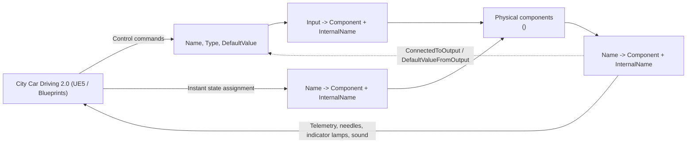

# 02. Named Inputs, Outputs, and States in City Car Driving 2.0 XML Schemas

**Navigation:** [README](./README.md) | [00. Quick Start](./00_Quick_Start.md) | [01. Architecture & Configs](./01_Architecture_and_Config.md) | **02. Named I/O & States** | [03. TorqueTrain](./03_Components_TorqueTrain.md) | [04. Electrics](./04_Components_Electrics.md) | [05. Chassis & Subsystems](./05_Components_Chassis_and_Subsystems.md)

---

## 1. Structure of `<InputElements>`, `<InputProcessors>`, `<OutputElements>`, and `<StateElements>` Sections

The connection between City Car Driving 2.0 game logic (player controls, AI traffic, instrument cluster, exterior lighting, FMOD audio, traffic rules enforcement, and Force Feedback) and the vehicle's physical components is defined in the XML schema (`<Vehicle>`) via 4 sections:



### 1.1. Tag Attributes: `Name`, `Component`, and `InternalName`

Every I/O element uses three attributes:

- **`Component`** — the **component instance name** from the `<Components><Component Name="..." Class="..." /></Components>` section of your XML schema. The `Component` name in the I/O system is **unrestricted** (except for the required suspension strut names `SuspensionFrontLeft/Right`, `SuspensionBackLeft/Right` and wheel names `WheelFrontLeft/Right`, `WheelBackLeft/Right`, which bind to 3D meshes in Blueprint). All other assemblies in a custom XML schema may be named arbitrarily, as long as the `Component="..."` attribute and the `[ComponentName]` section header in `Vehicle.ini` reference that exact name.
- **`InternalName`** — the **internal channel name of the component class (`Class`)**. It is hardcoded by the implementation of the corresponding `Class` and **must match exactly** the list of inputs/outputs/states supported by that class (see [Section 3](#3-reference-of-internal-names-internalname-by-component-class)). If the `InternalName` attribute is omitted in XML, it automatically defaults to the external `Name` (or `Input`).
- **`Name`** (or **`Input`** in `<InputProcessors>`) — the **external vehicle channel name** used by City Car Driving 2.0 and Blueprints to communicate with the physics simulation. Required external channel names are listed in the tables of Section 2.

| XML Section & Tag | Attributes | Purpose |
| --- | --- | --- |
| **`<OutputElements>`**<br>`<Element ... />` | `Name`, `Type` (`Real`/`Integer`/`Boolean`), `Component`, `InternalName` *(opt.)* | Exposes a physical quantity, gauge needle position, or indicator brightness from `Component` externally under the name `Name`. |
| **`<StateElements>`**<br>`<Element ... />` | `Name`, `Type` (`Real`/`Integer`/`Boolean`), `Component`, `InternalName` *(opt.)* | Allows the game to instantaneously set a component's internal state (fuel volume, engine temperature, mileage, gear) on spawn, refueling, or reset. |
| **`<InputElements>`**<br>`<Element ... />` | `Name`, `Type` (`Real`/`Integer`/`Boolean`), `DefaultValue` *(opt.)*, `DefaultValueFromOutput` *(opt.)*, `ConnectedToOutput` *(opt.)* | Declares an external control channel and how it is initially populated. |
| **`<InputProcessors>`**<br>`<Processor ... />` | `Input`, `Component`, `InternalName` *(opt.)* | Subscribes `Component` to updates on the `Input` channel. |

### 1.2. Initial Input Values and `ConnectedToOutput` Auto-Linking

The `<Element>` tag inside `<InputElements>` supports three initialization attributes (in ascending order of priority):

1. **`DefaultValue="..."`** — feeds the specified constant value once upon vehicle creation (for example, `DefaultValue="true"` for `Battery`, `EnableABS`, `EnableTCS`).
2. **`DefaultValueFromOutput="OutputName"`** — copies the initial value once upon vehicle creation from the specified `<OutputElements>` entry of the same type (for example, in `*Manual.xml`, the `Gear` input takes its starting gear via `DefaultValueFromOutput="Gear"`). The input remains controllable by the game.
3. **`ConnectedToOutput="OutputName"`** — automatically copies the value of the specified output into this input **on every simulation frame** and hides the input from the list of external inputs. Used for direct signal routing from one component to another without game involvement:

```xml
<OutputElements>
    <Element Name="RetarderActive" Type="Boolean" Component="Retarder" InternalName="Enabled" />
</OutputElements>
<InputElements>
    <Element Name="RetarderIndicatorInput" Type="Boolean" ConnectedToOutput="RetarderActive" />
</InputElements>
<InputProcessors>
    <Processor Input="RetarderIndicatorInput" Component="CarElectrics" InternalName="Retarder" />
</InputProcessors>
```

---

## 2. Standard and Required Inputs, States, and Outputs in City Car Driving 2.0

> [!IMPORTANT]
> **Six key rules for working with I/O channels in City Car Driving 2.0:**
>
> 1. **Transmission type detection via the `AutoShifterState` input:** interior, shifter, and sound controllers (`BP_VehicleInteriorController_Transmission`, `BP_CarSound`) check for `HasInput("AutoShifterState")`. If the `AutoShifterState` input is declared in the schema, the vehicle is treated as having an **automatic transmission (AT)**; if absent, a **manual transmission (MT)**.
> 2. **The gas pedal is named `Accelerator` (not `Throttle`):** across all CCD 2.0 schemas, the external throttle input is named **`Accelerator`** (`0.0 .. 1.0`). The name `Throttle` is used only as an `InternalName` inside the `Turbocharger` component.
> 3. **Inversion of the `Clutch` pedal (`*Manual.xml`):** a value of **`0.0`** means the **pedal is fully pressed** (clutch disengaged), while **`1.0`** means the **pedal is fully released** (clutch engaged).
> 4. **Ignition key `Ignition` and starter interlock:** accepts **`0`** (`Off`), **`1`** (`Ignition` — ignition on), and **`2`** (`Starter` — cranking the starter). In AT schemas (`*Auto.xml`), the ignition switch is linked to `GearBoxLogic` and **allows starter operation (`2`) only in `P (0)` or `N (2)`**.
> 5. **Transmission control (`AutoShifterState` in `*Auto.xml` vs. `Gear` in `*Manual.xml`):**
>    - In `*Auto.xml`, the selector is controlled by the **`AutoShifterState`** input: **`0 = P`**, **`1 = R`**, **`2 = N`**, **`3 = D`**. To shift out of `P (0)`, the brake pedal must be pressed (`Brake >= ShiftMinBrake`, default `0.1`).
>    - In `*Manual.xml`, the **`Gear`** input is used: inside `GearBox`, index **`-1`** is neutral (`N`), **`0`** is reverse (`R`), and **`1..N-1`** are forward gears *(the CCD 2.0 game controller automatically maps `-1 = R`, `0 = N`, `1..N = forward` into `GearBox` indices when the output `EnableNeutralInput = true` is present)*.
> 6. **Speed units for `Speed` and `DashboardSpeed`:** both outputs return speed strictly in **meters per second ($\text{m/s}$)** (`1 m/s = 3.6 km/h`).

### 2.1. Input Channels (`<InputElements>` and `<InputProcessors>`) — One Input per Row

The **"Status in CCD 2.0"** column highlights **required** channels whose names are hardcoded in the game's vehicle control code, AI traffic, and Blueprint components.

| External `Name` | `Type` | Default | Target (`Component` $\rightarrow$ `InternalName`) | Schemas | Status in CCD 2.0 (where used) |
| --- | :-: | :-: | --- | :-: | --- |
| **`Accelerator`** | `Real` | — | `AbsTcs`; in `*Auto`: + `GearBoxAutomatic`, `GearBoxLogic`; with turbo: + `Turbocharger` (`Throttle`) | All 6 | **Required** (player/AI control, engine load sound in `BP_CarSound`, `BP_TrafficSound`) |
| **`Brake`** | `Real` | — | `AbsTcs`, `CarElectrics`; in `*Auto`: + `GearBoxLogic` | All 6 | **Required** (player/AI control, brake lights, unlocking AT selector from `P`) |
| **`ParkingBrake`** | `Real` | — | `BrakeBackLeft`, `BrakeBackRight`, `CarElectrics` | All 6 | **Required** (player/AI parking brake, handbrake sound in `BP_CarSound`) |
| **`Clutch`** | `Real` | — | `ClutchPedal` (`Clutch`, `0.0` = pressed, `1.0` = released) | `*Manual` | **Required for MT** (player and AI clutch pedal) |
| **`Steering`** | `Real` | — | `Steering` (`Steering`, `-1.0..+1.0`) | All 6 | **Required** (player/AI steering, 3D steering wheel and hands rotation in `BP_SteeringWheel`) |
| **`Ignition`** | `Integer` | — | `IgnitionKey` (`Ignition`, `0=Off, 1=On, 2=Start`) | All 6 | **Required** (ignition switch, trip computer screen in `BP_VehicleDashboard`, engine sound in `BP_CarSound`) |
| **`AutoShifterState`** | `Integer` | — | `GearBoxLogic` (`AutoShifterState`, `0=P, 1=R, 2=N, 3=D`) | `*Auto` | **Required for AT** (AT selector; the game distinguishes AT from MT via `HasInput("AutoShifterState")`!) |
| **`AutoShifterMaxGear`** | `Integer` | — | `GearBoxLogic` (`AutoShifterMaxGear`, `0..N`) | `*Auto` | **Required for AT** (manual upper gear range limit for AT) |
| **`Gear`** | `Integer` | `FromOutput="Gear"` | `GearBox` (`Gear`) | `*Manual` | **Required for MT** (MT gear shifting, gear lever sound in `BP_CarSound`) |
| **`SafetyBelt`** | `Boolean` | — | `CarElectrics` (`SafetyBelt`) | All 6 | **Required** (seatbelt, animation in `BP_SteeringWheel`, sound in `BP_CarSound`, traffic rules enforcement) |
| **`Horn`** | `Boolean` | — | `CarElectrics` (`Horn`) | All 6 | **Required** (player and AI horn) |
| **`LowBeam`** | `Boolean` | — | `CarElectrics` (`LowBeam`) | All 6 | **Required** (player/AI low beam headlights, switch sound in `BP_CarSound`) |
| **`HighBeam`** | `Boolean` | — | `CarElectrics` (`HighBeam`) | All 6 | **Required** (latched high beam headlights, stalk sound in `BP_CarSound`) |
| **`HighBeamUnfixed`** | `Boolean` | — | `CarElectrics` (`HighBeamUnfixed`) | All 6 | Standard (high beam flash-to-pass) |
| **`ParkingLights`** | `Boolean` | — | `CarElectrics` (`ParkingLights`) | All 6 | **Required** (parking/position lights, light switch sound in `BP_CarSound`) |
| **`FrontFogLights`** | `Boolean` | — | `CarElectrics` (`FrontFogLights`) | All 6 | **Required** (front fog lights, button sound in `BP_CarSound`) |
| **`RearFogLights`** | `Boolean` | — | `CarElectrics` (`RearFogLights`) | All 6 | **Required** (rear fog lights, button sound in `BP_CarSound`) |
| **`LeftTurnLight`** | `Boolean` | — | `CarElectrics` (`LeftTurnLight`) | All 6 | **Required** (player/AI left turn signal, stalk sound in `BP_CarSound`, traffic rules check `EG_TurningLights`) |
| **`RightTurnLight`** | `Boolean` | — | `CarElectrics` (`RightTurnLight`) | All 6 | **Required** (player/AI right turn signal, stalk sound in `BP_CarSound`, traffic rules check `EG_TurningLights`) |
| **`HazardLight`** | `Boolean` | — | `CarElectrics` (`HazardLight`) | All 6 | **Required** (player and AI hazard warning lights) |
| **`FrontWindshieldWiper`** | `Integer` | — | `CarElectrics` (`FrontWindshieldWiper`, `0..3`) | All 6 | **Required** (front wiper mode `0..3`, switch sound in `BP_CarSound`) |
| **`BackWindshieldWiper`** | `Integer` | — | `CarElectrics` (`BackWindshieldWiper`, `0..3`) | All 6 | **Required** (rear wiper mode `0..3`) |
| **`EnableABS`** | `Boolean` | `true` | `AbsTcs` (`EnableABS`) | All 6 | **Required** (toggling ABS in settings and cheats) |
| **`EnableTCS`** | `Boolean` | `true` | `AbsTcs` (`EnableTCS`) | All 6 | **Required** (toggling TCS in settings) |
| **`AWD`** | `Boolean` | `true` | `FrontAxisRelay` (`Enable`) | `Awd*` | **Required for selectable AWD** (all-wheel drive toggle switch) |
| **`DifferentialAxleLock`** | `Boolean` | `false` | `DifferentialAxle` (`Lock`) | `Awd*` | Standard in `Awd*.xml` *(the game controller hardcodes the name `AxleDiffLock`)* |
| **`DifferentialWheelLock`** | `Boolean` | `false` | `DifferentialWheelFront` (`Lock`), `DifferentialWheelBack` (`Lock`) | `Awd*` | Standard in `Awd*.xml` *(the game controller hardcodes `FrontDiffLock` / `BackDiffLock`)* |
| **`Battery`** | `Boolean` | `true` | `Battery` (`Battery`) | All 6 | **Required** (`DefaultValue="true"` connects the battery ground switch on spawn) |
| **`MileageMultiplier`** | `Real` | `1.0` | `Speedometer` (`MileageMultiplier`), `Engine` (`FuelConsumptionMultiplier`) | All 6 | **Required** (mileage/fuel consumption multiplier, read in `BP_VehicleDashboard`) |
| **`UnlimitedFuelTank`** | `Boolean` | — | `FuelTank` (`EnableUnlimited`) | All 6 | **Required** (unlimited fuel mode in the game) |
| **`UnlimitedBattery`** | `Boolean` | — | `Battery` (`EnableUnlimited`) | All 6 | Standard (unlimited battery charge) |
| **`PerfectWheels`** | `Boolean` | `false` | `WheelFrontLeft..BackRight` (`NoSlip`) | All 6 | **Required** (ideal tire grip mode without slip) |
| **`FuelLeak`** | `Real` | — | `FuelTank` (`DrainSpeed`, L/s) | All 6 | **Required** (malfunction: fuel leak) |
| **`CoolantLeak`** | `Boolean` | — | `Engine` (`CoolantLeak`) | All 6 | **Required** (malfunction: coolant leak) |
| **`BrokenSteering`** | `Boolean` | — | `Steering` (`BrokenSteering`) | All 6 | **Required** (malfunction: steering failure) |
| **`BrokenPowerSteering`** | `Boolean` | — | `CarElectrics` (`BrokenPowerSteering`), `PowerSteering` (`Broken`) | All 6 | **Required** (malfunction: hydraulic/electric power steering failure) |
| **`BrokenLighting`** | `Boolean` | — | `CarElectrics` (`BrokenLighting`) | All 6 | Standard (malfunction: exterior lighting failure) |
| **`BrokenBrake`** | `Boolean` | — | `BrakeFrontLeft..BackRight` (`BrokenBrake`), `CarElectrics` (`BrokenBrake`) | All 6 | Standard in `*.xml` *(the damage system also looks for `BrokenFrontLeftBrake..BackRightBrake`)* |
| **`BlowoutTyreFrontLeft`** | `Boolean` | — | `WheelFrontLeft` (`Blowout`) | All 6 | Standard in `*.xml` *(the damage system also looks for `BlowoutFrontLeftWheel`)* |
| **`BlowoutTyreFrontRight`** | `Boolean` | — | `WheelFrontRight` (`Blowout`) | All 6 | Standard in `*.xml` *(the damage system also looks for `BlowoutFrontRightWheel`)* |

---

### 2.2. State Channels (`<StateElements>`) — One State per Row

| External `Name` | `Type` | `Component` in XML | `InternalName` | Units | Status in CCD 2.0 (where used) |
| --- | :-: | --- | --- | :-: | --- |
| **`FuelVolume`** | `Real` | `FuelTank` | `LiquidVolume` | L (`0..Volume`) | **Required** (refueling at gas stations in `BP_CarFuelTank` / `BP_Vehicle_FuelTank`, saving fuel level, cheats) |
| **`Mileage`** | `Real` | `Speedometer` | `Mileage` | m | **Required** (setting saved total vehicle mileage on spawn) |
| **`SessionMileage`** | `Real` | `Speedometer` | `SessionMileage` | m | **Required** (resetting and initializing trip mileage) |
| **`AutoShifterState`** | `Integer` | `GearBoxLogic` | `State` | `0=P..3=D` | **Required for AT** (instant AT mode assignment when spawning with engine running/off) |
| **`Gear`** | `Integer` | `GearBox` | `Gear` | `-1..N-1` | **Required for MT** (instant MT gear assignment on spawn) |
| **`CoolantTemperature`** | `Real` | `Engine` | `CoolantTemperature` | $^\circ\text{C}$ | **Required** (setting initial warm/cold engine temperature at startup) |
| **`FuelChamberTemperature`** | `Real` | `Engine` | `FuelChamberTemperature` | $^\circ\text{C}$ | **Required** (pre-heating the combustion chamber when spawning a running vehicle) |
| **`CoolantLevel`** | `Real` | `Engine` | `CoolantLevel` | `0.0..1.0` | Standard (initial coolant level) |
| **`BrokenCoolingSystem`** | `Boolean` | `Engine` | `BrokenCoolingSystem` | flag | **Required** (cooling system / thermostat malfunction) |
| **`WheelPressureFrontLeft`** | `Real` | `WheelFrontLeft` | `Pressure` | bar (gauge) | Standard (initial front-left tire pressure) |
| **`WheelPressureFrontRight`** | `Real` | `WheelFrontRight` | `Pressure` | bar (gauge) | Standard (initial front-right tire pressure) |
| **`DriveShaftVelocity`** | `Real` | `DifferentialAxle` (`Awd*`) / `Differential` (`Fwd*`, `Rwd*`) | `AngularVelocity` | rad/s | Standard (initial driveshaft angular velocity) |

---

### 2.3. Output Channels (`<OutputElements>`) — One Output per Row

#### A. Motion, Engine, Transmission, Fuel, and Electrical Network

| External `Name` | `Type` | `Component` | `InternalName` | Units | Status in CCD 2.0 (where used) |
| --- | :-: | --- | --- | :-: | --- |
| **`Speed`** | `Real` | `Speedometer` | `Speed` | **m/s** | **Required** (vehicle speed for AI, HUD, wind/tire sounds, `BP_VehicleDashboard`, `BP_VehicleListener`) |
| **`Mileage`** | `Real` | `Speedometer` | `Mileage` | m | **Required** (total odometer mileage in `BP_VehicleDashboard` and traffic rules check `EG_TurningLights`) |
| **`SessionMileage`** | `Real` | `Speedometer` | `SessionMileage` | m | **Required** (trip mileage and average fuel consumption calculation in `BP_VehicleDashboard`) |
| **`RPM`** | `Real` | `Engine` | `RPM` | RPM | **Required** (engine RPM for AI, HUD, FMOD engine audio in `BP_CarSound` / `BP_TrafficSound`, `BP_VehicleListener`) |
| **`RPMLimit`** | `Real` | `Engine` | `RPMLimit` | RPM | **Required** (RPM rev limit for gear-shift logic and HUD tachometer) |
| **`StableRPM`** | `Real` | `Engine` | `StableRPM` | RPM | **Required** (minimum stable idle RPM for launch and anti-stall logic) |
| **`Combustion`** | `Boolean` | `Engine` | `Combustion` | flag | **Required** (engine running flag `IsEngineRunning` for `BP_CarSound`, power steering, and game logic) |
| **`EngineLoad`** | `Real` | `Engine` | `Load` | $\text{N}\cdot\text{m}$ | **Required** (current engine load torque for telemetry and audio) |
| **`EngineMaxTorque`** | `Real` | `Engine` | `MaxTorque` | $\text{N}\cdot\text{m}$ | **Required** (maximum engine torque for computing relative load) |
| **`EngineVibrationFrequency`** | `Real` | `Engine` | `VibrationFrequency` | Hz | **Required** (engine vibration frequency for gamepad and Force Feedback wheel) |
| **`EngineVibrationAmplitude`** | `Real` | `Engine` | `VibrationAmplitude` | m | **Required** (engine vibration amplitude for gamepad and Force Feedback wheel) |
| **`CoolantTemperature`** | `Real` | `Engine` | `CoolantTemperature` | $^\circ\text{C}$ | **Required** (coolant temperature for game logic and HUD) |
| **`CoolantLevel`** | `Real` | `Engine` | `CoolantLevel` | `0.0..1.0` | Standard (coolant level) |
| **`ThermostatBeginTemperature`** | `Real` | `Engine` | `ThermostatBeginTemperature` | $^\circ\text{C}$ | **Required** (operating coolant temperature threshold) |
| **`OverheatTemperature`** | `Real` | `Engine` | `OverheatTemperature` | $^\circ\text{C}$ | **Required** (engine overheat threshold) |
| **`OilTemperature`** | `Real` | `Engine` | `OilTemperature` | $^\circ\text{C}$ | **Required** (engine oil temperature) |
| **`OilPressure`** | `Real` | `Engine` | `OilPressure` | bar | **Required** (current engine oil pressure) |
| **`OilLowPressure`** | `Real` | `Engine` | `OilLowPressure` | bar | **Required** (low oil pressure warning threshold) |
| **`AFRRatio`** | `Real` | `Engine` | `AFRRatio` | $\lambda$ | Standard (air-fuel equivalence ratio) |
| **`FuelConsumedTotal`** | `Real` | `Engine` | `FuelConsumedTotal` | L | **Required** (total consumed fuel for computing `AvgEconomy` in `BP_VehicleDashboard`) |
| **`FuelConsumedPerSecond`** | `Real` | `Engine` | `FuelConsumedPerSecond` | L/s | **Required** (instantaneous fuel consumption for trip computer `BP_VehicleDashboard`) |
| **`BrokenCoolingSystem`** | `Boolean` | `Engine` | `BrokenCoolingSystem` | flag | Standard (cooling system failure flag) |
| **`StarterRPM`** | `Real` | `Starter` | `RPM` | RPM | Standard (electric starter shaft RPM) |
| **`StarterBendixRPM`** | `Real` | `StarterBendix` | `RPM` | RPM | Standard (starter Bendix output pinion RPM) |
| **`StarterRelayEnabled`** | `Boolean` | `StarterRelay` | `Enabled` | flag | Standard (starter solenoid relay state) |
| **`AutoShifterState`** | `Integer` | `GearBoxLogic` | `AutoShifterState` | `0=P..3=D` | **Required for AT** (AT selector position for HUD, `BP_VehicleDashboard`, reverse sound in `BP_CarSound`, and shifter animation) |
| **`AutoShifterCurrentGear`** | `Integer` | `GearBoxLogic` | `AutoShifterCurrentGear` | `-1..N-1` | **Required for AT** (current AT gear for HUD and `BP_VehicleDashboard`) |
| **`AutoShifterTargetGear`** | `Integer` | `GearBoxLogic` | `AutoShifterTargetGear` | `-1..N-1` | **Required for AT** (target AT gear during a shift) |
| **`AutoShifterMaxGear`** | `Integer` | `GearBoxLogic` | `AutoShifterMaxGear` | `0..N` | **Required for AT** (upper AT gear limit for HUD) |
| **`Gear`** | `Integer` | `GearBox` | `Gear` | `-1..N-1` | **Required for MT** (engaged MT gear for HUD, `BP_VehicleDashboard`, and shift linkage animation) |
| **`GearRatio`** | `Real` | `GearBox` | `GearRatio` | number | **Required for MT** (current gearbox ratio) |
| **`GearCount`** | `Integer` | `GearBox` | `GearCount` | count | **Required for MT** (total number of gears in the `Gears` array) |
| **`BatteryActive`** | `Boolean` | `Battery` | `BatteryActive` | flag | Standard (battery connection state) |
| **`Amperage`** | `Real` | `Battery` | `Amperage` | A | Standard (battery discharge `>0` / charge `<0` current) |
| **`Voltage`** | `Real` | `IgnitionElectricCircuit` | `Voltage` | V | **Required** (voltage in the ignition circuit) |
| **`FuelVolume`** | `Real` | `FuelTank` | `LiquidVolume` | L | **Required** (remaining fuel in tank for `BP_CarFuelTank`, `BP_Vehicle_FuelTank`, `BP_VehicleDashboard`) |
| **`FuelVolumeMax`** | `Real` | `FuelTank` | `Volume` | L | **Required** (full tank capacity for gas stations `BP_CarFuelTank`, `BP_VehicleDashboard`, and cheats) |
| **`FuelRelative`** | `Real` | `FuelTank` | `LiquidRelativeVolume` | `0.0..1.0` | Standard (relative fuel level in the tank) |

#### B. Chassis, Tires, Brakes (ABS/TCS), and Steering Force Feedback

| External `Name` | `Type` | `Component` | `InternalName` | Units | Status in CCD 2.0 (where used) |
| --- | :-: | --- | --- | :-: | --- |
| **`ForceFeedbackTorque`** | `Real` | `PowerSteering` | `Torque` | $\text{N}\cdot\text{m}$ | **Required** (self-aligning torque on the steering wheel for the Force Feedback module) |
| **`ForceFeedbackFriction`** | `Real` | `PowerSteering` | `Friction` | $\text{N}\cdot\text{m}$ | **Required** (dry friction on the steering column for Force Feedback) |
| **`ForceFeedbackDamping`** | `Real` | `PowerSteering` | `Damping` | $\text{N}\cdot\text{m}\cdot\text{s/rad}$ | **Required** (viscous steering damping for Force Feedback) |
| **`ForceFeedbackSlipAngle`** | `Real` | `PowerSteering` | `SlipAngle` | `-1.0..1.0` | **Required** (normalized front tire slip angle for Force Feedback) |
| **`ForceFeedbackInertia`** | `Real` | `PowerSteering` | `Inertia` | $\text{kg}\cdot\text{m}^2$ | **Required** (effective steering system inertia for Force Feedback) |
| **`AbsActive`** | `Boolean` | `AbsTcs` | `AbsActive` | flag | Standard (flag indicating ABS is actively intervening right now) |
| **`TcsActive`** | `Boolean` | `AbsTcs` | `TcsActive` | flag | Standard (flag indicating TCS is actively intervening right now) |
| **`AbsEnabled`** | `Boolean` | `AbsTcs` | `AbsEnabled` | flag | Standard (ABS is operational and enabled) |
| **`TcsEnabled`** | `Boolean` | `AbsTcs` | `TcsEnabled` | flag | Standard (TCS is operational and enabled) |
| **`FrontWheelsWorkingPressure`** | `Real` | `WheelFrontLeft` | `WorkingPressure` | bar | Standard (nominal operating pressure of the front tires) |
| **`WheelPressureFrontLeft`** | `Real` | `WheelFrontLeft` | `Pressure` | bar | Standard (current pressure in the front-left tire) |
| **`WheelPressureFrontRight`** | `Real` | `WheelFrontRight` | `Pressure` | bar | Standard (current pressure in the front-right tire) |
| **`WheelRpmFrontLeft`** | `Real` | `WheelFrontLeft` | `RPM` | RPM | Standard (front-left wheel RPM) |
| **`WheelRpmFrontRight`** | `Real` | `WheelFrontRight` | `RPM` | RPM | Standard (front-right wheel RPM) |
| **`WheelRpmBackLeft`** | `Real` | `WheelBackLeft` | `RPM` | RPM | Standard (rear-left wheel RPM) |
| **`WheelRpmBackRight`** | `Real` | `WheelBackRight` | `RPM` | RPM | Standard (rear-right wheel RPM) |

#### C. Dashboard Needles, Exterior Lighting, Indicators, Wipers, and Sound (`Component="CarElectrics"`)

| External `Name` | `Type` | `InternalName` in `CarElectrics` | Units | Status in CCD 2.0 (where used) |
| --- | :-: | --- | :-: | --- |
| **`DashboardSpeed`** | `Real` | `Speed` | **m/s** | **Required** (speedometer needle `SpeedArrow` / `ArrowSpeedometr` and digital speedometer in `BP_VehicleDashboard`) |
| **`DashboardRPM`** | `Real` | `RPM` | RPM | **Required** (tachometer needle `RPMArrow` / `ArrowRPM` in `BP_VehicleDashboard`) |
| **`DashboardFuel`** | `Real` | `Fuel` | L | **Required** (fuel gauge needle `FuelArrow` / `ArrowFuelLevel` in `BP_VehicleDashboard`) |
| **`DashboardCoolantTemperature`** | `Real` | `CoolantTemperature` | $^\circ\text{C}$ | **Required** (coolant temperature needle `CoolantTemperatureArrow` / `ArrowCoolantTemperature` in `BP_VehicleDashboard`) |
| **`DashboardOilPressure`** | `Real` | `OilPressure` | bar | Standard (engine oil pressure gauge needle) |
| **`DashboardVoltage`** | `Real` | `Voltage` | V | Standard (electrical system voltmeter needle) |
| **`DashboardAmperage`** | `Real` | `Amperage` | A | **Required** (ammeter needle in `BP_VehicleDashboard`) |
| **`DashboardIntensity`** | `Real` | `DashboardIntensity` | `0.0..1.0` | **Required** (backlight of instrument dials, needles, and interior buttons in `BP_VehicleDashboard`) |
| **`LowBeamIntensity`** | `Real` | `LowBeamIntensity` | `0.0..1.0` | **Required** (headlights and `LowBeam` material slot in `BP_VehicleExternalLight`) |
| **`HighBeamIntensity`** | `Real` | `HighBeamIntensity` | `0.0..1.0` | **Required** (headlights and `HighBeam` material slot in `BP_VehicleExternalLight`) |
| **`ParkingLightsIntensity`** | `Real` | `ParkingLightsIntensity` | `0.0..1.0` | **Required** (`ParkingLights` and `LicensePlates` material slots in `BP_VehicleExternalLight`) |
| **`FrontFogLightsIntensity`** | `Real` | `FrontFogLightsIntensity` | `0.0..1.0` | **Required** (fog lamps and `FrontFogLights` slot in `BP_VehicleExternalLight`, `FrontFogLightsIcon` icon) |
| **`RearFogLightsIntensity`** | `Real` | `RearFogLightsIntensity` | `0.0..1.0` | **Required** (rear fog lamp and `RearFogLights` slot in `BP_VehicleExternalLight`, `RearFogLightsIcon` icon) |
| **`StopLightIntensity`** | `Real` | `StopLightIntensity` | `0.0..1.0` | **Required** (brake lamps and `StopLight` material slot in `BP_VehicleExternalLight`) |
| **`ReverseLightIntensity`** | `Real` | `ReverseLightIntensity` | `0.0..1.0` | **Required** (reverse lamps and `ReverseLight` material slot in `BP_VehicleExternalLight`) |
| **`LeftTurnLightIntensity`** | `Real` | `LeftTurnLightIntensity` | `0.0..1.0` | **Required** (blinking left turn signals and `LeftTurnLight` slot in `BP_VehicleExternalLight`) |
| **`RightTurnLightIntensity`** | `Real` | `RightTurnLightIntensity` | `0.0..1.0` | **Required** (blinking right turn signals and `RightTurnLight` slot in `BP_VehicleExternalLight`) |
| **`LowBeamIconIntensity`** | `Real` | `LowBeamIconIntensity` | `0.0..1.0` | **Required** (`LowBeamIcon` indicator slot in `BP_VehicleDashboard`) |
| **`HighBeamIconIntensity`** | `Real` | `HighBeamIconIntensity` | `0.0..1.0` | **Required** (`HighBeamIcon` indicator slot in `BP_VehicleDashboard`) |
| **`ParkingLightsIconIntensity`** | `Real` | `ParkingLightsIconIntensity` | `0.0..1.0` | **Required** (`ParkingLightsIcon` indicator slot in `BP_VehicleDashboard`) |
| **`LeftTurnLightIconIntensity`** | `Real` | `LeftTurnLightIconIntensity` | `0.0..1.0` | **Required** (`LeftTurnLightIcon` slot in `BP_VehicleDashboard` + relay click sound in `BP_CarSound`) |
| **`RightTurnLightIconIntensity`** | `Real` | `RightTurnLightIconIntensity` | `0.0..1.0` | **Required** (`RightTurnLightIcon` slot in `BP_VehicleDashboard` + relay click sound in `BP_CarSound`) |
| **`HazardLightIconIntensity`** | `Real` | `HazardLightIconIntensity` | `0.0..1.0` | **Required** (`HazardLightIcon` hazard button backlight in `BP_VehicleDashboard`) |
| **`SafetyBeltIconIntensity`** | `Real` | `SafetyBeltIconIntensity` | `0.0..1.0` | **Required** (`SafetyBeltIcon` seatbelt warning slot in `BP_VehicleDashboard`) |
| **`ParkingBrakeIconIntensity`** | `Real` | `ParkingBrakeIconIntensity` | `0.0..1.0` | **Required** (`ParkingBrakeIcon` parking brake indicator slot in `BP_VehicleDashboard`) |
| **`BatteryIconIntensity`** | `Real` | `BatteryIconIntensity` | `0.0..1.0` | **Required** (`BatteryIcon` battery indicator slot in `BP_VehicleDashboard`) |
| **`FuelIconIntensity`** | `Real` | `FuelIconIntensity` | `0.0..1.0` | **Required** (`FuelIcon` low fuel warning slot in `BP_VehicleDashboard`) |
| **`OilIconIntensity`** | `Real` | `OilIconIntensity` | `0.0..1.0` | **Required** (`OilIcon` low oil pressure warning slot in `BP_VehicleDashboard`) |
| **`OverheatIconIntensity`** | `Real` | `OverheatIconIntensity` | `0.0..1.0` | **Required** (`OverheatIcon` coolant overheat warning slot in `BP_VehicleDashboard`) |
| **`CheckIconsIntensity`** | `Real` | `CheckIconsIntensity` | `0.0..1.0` | **Required** (`CheckIcons` ignition self-test slot in `BP_VehicleDashboard`) |
| **`AbsDisableIconIntensity`** | `Real` | `AbsDisableIconIntensity` | `0.0..1.0` | **Required** (`AbsIcon` indicator slot in `BP_VehicleDashboard`) |
| **`AbsActiveIconIntensity`** | `Real` | `AbsActiveIconIntensity` | `0.0..1.0` | **Required** (`AbsIcon` indicator slot in `BP_VehicleDashboard`) |
| **`TcsDisableIconIntensity`** | `Real` | `TcsDisableIconIntensity` | `0.0..1.0` | **Required** (`TCSDisableIcon` indicator slot in `BP_VehicleDashboard`) |
| **`TcsActiveIconIntensity`** | `Real` | `TcsActiveIconIntensity` | `0.0..1.0` | **Required** (`TCSActiveIcon` indicator slot in `BP_VehicleDashboard`) |
| **`AirbagIconIntensity`** | `Real` | `AirbagIconIntensity` | `0.0..1.0` | **Required** (`AirbagIcon` indicator slot in `BP_VehicleDashboard`) |
| **`ExhaustSystemIconIntensity`** | `Real` | `ExhaustSystemIconIntensity` | `0.0..1.0` | **Required** (`ExhaustSystemIcon` / Check Engine indicator slot in `BP_VehicleDashboard`) |
| **`PowerSteeringIconIntensity`** | `Real` | `PowerSteeringIconIntensity` | `0.0..1.0` | **Required** (`PowerSteeringIcon` indicator slot in `BP_VehicleDashboard`) |
| **`EmergencyStopIconIntensity`** | `Real` | `EmergencyStopIconIntensity` | `0.0..1.0` | **Required** (`EmergencyStopIcon` indicator slot in `BP_VehicleDashboard`) |
| **`FrontWindshieldWiperPhase`** | `Real` | `FrontWindshieldWiperPhase` | `0.0..1.0` | **Required** (front wiper animation in `BP_VehicleWipersController`, raindrop clearing in `BP_VehicleWindshieldController`, sound in `BP_CarSound`) |
| **`BackWindshieldWiperPhase`** | `Real` | `BackWindshieldWiperPhase` | `0.0..1.0` | **Required** (rear wiper animation in `BP_VehicleWipersController`) |
| **`FrontWindshieldWiperSpeed`** | `Real` | `FrontWindshieldWiperSpeed` | cycles/s | Standard (front wiper sweep speed) |
| **`BackWindshieldWiperSpeed`** | `Real` | `BackWindshieldWiperSpeed` | cycles/s | Standard (rear wiper sweep speed) |
| **`FrontWindshieldWiperForward`** | `Boolean` | `FrontWindshieldWiperForward` | flag | Standard (front wiper blade sweep direction) |
| **`TurnSignal`** | `Boolean` | `TurnSignal` | flag | Standard (turn signal flasher relay state) |
| **`HornVolume`** | `Real` | `HornVolume` | `0.0..1.0` | **Required** (horn volume: when `> 0.1`, triggers the FMOD horn event in `BP_CarSound`) |
| **`SafetyBeltBeeperVolume`** | `Real` | `SafetyBeltBeeperVolume` | `0.0..1.0` | **Required** (unfastened seatbelt chime volume: when `> 0.1`, plays audio in `BP_CarSound`) |
| **`BeeperVolume`** | `Real` | `BeeperVolume` | `0.0..1.0` | Standard (dashboard warning buzzer volume) |

---

## 3. Reference of Internal Names (`InternalName`) by Component Class

### 3.1. Available Inputs (`<InputProcessors>`) by `Class`

| Component Class (`Class`) | Input `InternalName` | Type | Purpose and Range |
| --- | --- | :-: | --- |
| **`EngineGazoline`**, **`EngineDiesel`** | `FuelConsumptionMultiplier` | `Real` | Fuel consumption multiplier (`1.0` by default) |
| **`EngineGazoline`**, **`EngineDiesel`** | `CoolantLeak` | `Boolean` | Radiator puncture / coolant leak |
| **`EngineGazoline`**, **`EngineDiesel`** | `BrokenCoolingSystem` | `Boolean` | Stuck thermostat (cooling failure) |
| **`EngineGazoline`**, **`EngineDiesel`** | `OilLevel` | `Boolean` | Engine oil leak |
| **`ExternalVelocityMotor`** | `ShaftRpm` | `Real` | Target shaft speed (RPM) |
| **`VariableTorqueConverter`** | `GearRatio` | `Real` | Current CVT gear ratio |
| **`GearBox`** | `Gear` | `Integer` | Index of the gear to engage (`-1` = neutral, `0..N-1` = `Gears` steps) |
| **`GearBoxAutomatic`** | `Accelerator` | `Real` | Gas pedal `0.0..1.0` (used to calculate shifts via `OptimalRpm` and torque converter lockup) |
| **`DifferentialOpen`** | `Lock` | `Boolean` | Forced differential lock (when `DisableInput = false`) |
| **`Relay`** | `Enable` | `Boolean` | Engage (`true`) / disengage (`false`) coupling |
| **`Retarder`** | `Enabled` | `Boolean` | Enable hydraulic retarder operation |
| **`Retarder`** | `Brake` | `Real` | Continuous braking effort `0.0..1.0` (when `DiscreteInput = false`) |
| **`Retarder`** | `BrakeStage` | `Integer` | Braking stage `0..N` (when `DiscreteInput = true`) |
| **`BrakeFriction`**, **`BrakeFrictionPneumatic`** | `Brake` | `Real` | Service brake `0.0..1.0` |
| **`BrakeFriction`**, **`BrakeFrictionPneumatic`** | `ParkingBrake` | `Real` | Parking brake `0.0..1.0` |
| **`BrakeFriction`**, **`BrakeFrictionPneumatic`** | `BrokenBrake` | `Boolean` | Brake mechanism failure |
| **`WheelRaycast`** | `Blowout` | `Boolean` | Tire puncture / blowout |
| **`WheelRaycast`** | `NoSlip` | `Boolean` | Ideal no-slip grip mode |
| **`Generator`**, **`PowerSteering`** | `Broken` | `Boolean` | Alternator failure / power steering failure |
| **`ElectricCircuit`** | `Master` | `Boolean` | Connects the circuit to its parent master circuit |
| **`Battery`** | `Battery` | `Boolean` | Battery master ground switch (`true` = connected) |
| **`Battery`** | `EnableUnlimited` | `Boolean` | Unlimited battery charge |
| **`ElectricElement`** | `Enabled` | `Boolean` | Enables a standalone electrical consumer |
| **`CarElectrics`** | `Brake`, `ParkingBrake` | `Real` | Brake pedal and parking brake signals `0.0..1.0` |
| **`CarElectrics`** | `FrontWindshieldWipersTimeDelay`, `BackWindshieldWipersTimeDelay` | `Real` | Intermittent wiper delay interval (s) |
| **`CarElectrics`** | `FrontWindshieldWiper`, `BackWindshieldWiper` | `Integer` | Wiper mode (`0` = off, `1` = intermittent, `2` = normal, `3` = fast) |
| **`CarElectrics`** | `LowBeam`, `HighBeam`, `HighBeamUnfixed`, `ParkingLights`, `FrontFogLights`, `RearFogLights`, `LeftTurnLight`, `RightTurnLight`, `HazardLight`, `Horn`, `SafetyBelt`, `BrokenLighting`, `BrokenBrake`, `BrokenPowerSteering`, `ShutdownEngine`, `Retarder` | `Boolean` | Controls the corresponding lights, horn, seatbelt, indicators, and faults |
| **`FuelControllerComputer`** | `Accelerator` | `Real` | Gas pedal `0.0..1.0` |
| **`FuelControllerComputer`** | `FuelFeed` | `Boolean` | Fuel supply authorization from the ignition switch |
| **`FuelControllerMechanical`** | `Accelerator`, `Choke` | `Real` | Gas pedal `0.0..1.0` and choke valve `0.0..1.0` |
| **`FuelControllerMechanical`** | `FuelFeed` | `Boolean` | Fuel supply authorization |
| **`AbsTcs`** | `Brake`, `Accelerator` | `Real` | Brake and gas pedal inputs `0.0..1.0` |
| **`AbsTcs`** | `EnableABS`, `EnableTCS`, `Enabled` | `Boolean` | Enables ABS, TCS, and unit power supply |
| **`ClutchInputProcessor`** | `Clutch` | `Real` | Clutch pedal (`0.0` = pressed, `1.0` = released) |
| **`GearBoxAutomaticLogic`** | `Accelerator`, `Brake` | `Real` | Gas and brake pedal signals `0.0..1.0` |
| **`GearBoxAutomaticLogic`** | `AutoShifterState`, `AutoShifterMaxGear` | `Integer` | Selector mode (`0=P, 1=R, 2=N, 3=D`) and upper gear limit (`0..N`) |
| **`GearBoxAutomaticLogicBus`** | `ReverseLock` *(+ all `GearBoxAutomaticLogic` inputs)* | `Boolean` | Bus reverse gear engagement lockout |
| **`IgnitionKeyProcessor`** | `Ignition` | `Integer` | Key position (`0 = Off`, `1 = Ignition`, `2 = Starter`) |
| **`Speedometer`** | `MileageMultiplier` | `Real` | Odometer mileage accumulation multiplier |
| **`Steering2Ackermann`**, **`SteeringSimple`** | `Steering` | `Real` | Steering wheel position (`-1.0` = left, `+1.0` = right) |
| **`Steering2Ackermann`**, **`SteeringSimple`** | `BrokenSteering` | `Boolean` | Steering mechanism failure |
| **`ActuatorPneumatic1Chamber/2Chamber`** | `Position` | `Real` | Target rod/piston position `0.0..1.0` |
| **`Turbocharger`** | `Throttle` | `Real` | Throttle opening `0.0..1.0` for boost pressure calculation |
| **`Tank`** | `DrainSpeed` | `Real` | Drain rate (`> 0`) or fill rate (`< 0`), L/s |
| **`Tank`** | `EnableUnlimited` | `Boolean` | Unlimited liquid supply in the tank |
| **`ExternalThruster`** | `Power` | `Real` / `Boolean` | Relative thrust of the external thruster `[-1.0..1.0]` |

---

### 3.2. Available Outputs (`<OutputElements>`) by `Class`

| Component Class (`Class`) | Output `InternalName` | Type | Description and Units |
| --- | --- | :-: | --- |
| **Drivetrain components** *(except `BrakeFrictionPneumatic`)* | `RPM` | `Real` | Component shaft rotational speed (RPM) |
| **`EngineGazoline`**, **`EngineDiesel`** | `RPM`, `RPMLimit`, `StableRPM`, `OptimalRpmMin`, `OptimalRpmMax` | `Real` | Current, maximum, minimum stable, and optimal engine speeds (RPM) |
| **`EngineGazoline`**, **`EngineDiesel`** | `CoolantTemperature`, `ThermostatBeginTemperature`, `OverheatTemperature`, `OilTemperature` | `Real` | Coolant, thermostat opening, overheat, and oil temperatures ($^\circ\text{C}$) |
| **`EngineGazoline`**, **`EngineDiesel`** | `CoolantLevel`, `OilPressure`, `OilLowPressure`, `AFRRatio` | `Real` | Coolant level (`0..1`), oil pressure and low-pressure threshold (bar), equivalence ratio $\lambda$ |
| **`EngineGazoline`**, **`EngineDiesel`** | `Load`, `MaxTorque` | `Real` | Current and maximum engine torque ($\text{N}\cdot\text{m}$) |
| **`EngineGazoline`**, **`EngineDiesel`** | `FuelConsumedTotal`, `FuelConsumedPerSecond` | `Real` | Total (L) and instantaneous (L/s) fuel consumption |
| **`EngineGazoline`**, **`EngineDiesel`** | `VibrationFrequency`, `VibrationAmplitude` | `Real` | Engine vibration frequency (Hz) and amplitude (m) |
| **`EngineGazoline`**, **`EngineDiesel`** | `Combustion`, `BrokenCoolingSystem` | `Boolean` | Engine running (combustion active) flag and cooling system failure flag |
| **`ExternalVelocityMotor`** | `RPM`, `ShaftRpm`, `Position` | `Real` | Shaft RPM, target RPM (RPM), and angular position (`-1..1`) |
| **`VariableTorqueConverter`**, **`Reducer`** | `RPM`, `OutRPM` | `Real` | Input and output shaft speeds (RPM) |
| **`GearBox`** | `RPM`, `GearRatio` | `Real` | Shaft speed (RPM) and current gear ratio |
| **`GearBox`** | `Gear`, `GearCount` | `Integer` | Engaged gear index (`-1..N-1`) and total gear count |
| **`GearBox`** | `EnableNeutralInput` | `Boolean` | Whether index `-1` is enabled for neutral |
| **`DifferentialOpen`** | `RPM` (`Real`), `Locked` (`Boolean`) | mixed | Differential carrier speed and lock status |
| **`Relay`** | `RPM` (`Real`), `Enabled` (`Boolean`) | mixed | Coupling speed and engagement status |
| **`Retarder`** | `RPM`, `RelativeTorque` (`Real`), `Enabled`, `DiscreteInput` (`Boolean`) | mixed | Speed, relative braking torque, and retarder mode flags |
| **`BrakeFrictionPneumatic`** | `MinPressure`, `MinWorkPressure`, `WorkPressure`, `SpringLockMinPressure`, `SpringLockWorkPressure`, `PressureLevel`, `AirFlowIntensityLevel`, `PressureLevelSpringLock`, `AirFlowIntensityLevelSpringLock` | `Real` | Pressures (bar) and air bleed/flow levels of the service brake chamber and spring brake actuator |
| **`WheelRaycast`** | `RPM`, `WorkingPressure`, `LowPressure`, `Pressure` | `Real` | Wheel speed (RPM), nominal, low-warning, and current tire pressure (bar) |
| **`Pump`**, **`Receiver`** | `RPM` *(`Pump` only)*, `Pressure` | `Real` | Pump speed (RPM) and absolute circuit pressure (bar) |
| **`ElectricCircuit`** | `Voltage` | `Real` | Electrical circuit voltage (V) |
| **`Battery`** | `Amperage`, `VoltageMin`, `CapacityRelative` (`Real`), `BatteryActive` (`Boolean`) | mixed | Battery current (A), minimum voltage (V), state of charge (`0..1`), and active flag |
| **`ElectricElement`** | `Intensity` (`Real`), `Enabled` (`Boolean`) | mixed | Relative operating power (`0..1`) and active status |
| **`AbsTcs`** | `Intensity` (`Real`), `Enabled`, `AbsActive`, `TcsActive`, `AbsEnabled`, `TcsEnabled` (`Boolean`) | mixed | Readiness and active intervention states of the ABS and TCS systems |
| **`GearBoxAutomaticLogic`**, **`GearBoxAutomaticLogicBus`** | `AutoShifterState`, `CurrentState`, `AutoShifterMaxGear`, `AutoShifterCurrentGear`, `AutoShifterTargetGear` | `Integer` | Selected and actual mode (`0=P..3=D`), upper gear limit, current gear, and target gear |
| **`FuelConsumptionMeter`** | `AverageFuelConsumption`, `SessionAverageFuelConsumption` | `Real` | Rolling and session average consumption in **L/m** *(multiply by `100000` for L/100 km)* |
| **`PowerSteering`** | `Torque`, `Friction`, `Damping`, `SlipAngle`, `Inertia` | `Real` | Steering column Force Feedback parameters |
| **`Speedometer`** | `Speed`, `Mileage`, `SessionMileage` | `Real` | Vehicle speed (**m/s**), total mileage, and trip mileage (m) |
| **`Steering2Ackermann`** | `MaxSteeringAngle` | `Real` | Average maximum steering angle of the steered wheels (rad) |
| **`Suspension1Spring`** | `SpringSag`, `WheelSteeringAngle` | `Real` | Relative spring compression (`0..1`) and wheel steering angle (deg) |
| **`ActuatorPneumatic1/2Chamber`** | `WorkPressure`, `MaxVolumePressure`, `Position`, `PressureLeft`, `PressureRight` | `Real` | Chamber pressures (bar) and piston position (`0..1`, for `2Chamber`) |
| **`Tank`** | `LiquidVolume`, `Volume`, `LiquidRelativeVolume` | `Real` | Current volume (L), full capacity (L), and fill fraction (`0..1`) |
| **`CarElectrics`** *(needles)* | `Fuel`, `Speed` (m/s), `RPM`, `CoolantTemperature`, `OilPressure`, `GearBoxOilPressure`, `Voltage`, `Amperage`, `PneumoPressure0`, `PneumoPressure1` | `Real` | Instrument cluster gauge needle readings (configured in `.ini` with prefixes `<Name>Needle_`, `RpmNeedle_`, `OilNeedle_`, `GearBoxOilNeedle_`) |
| **`CarElectrics`** *(exterior lights & backlight)* | `LowBeamIntensity`, `HighBeamIntensity`, `ParkingLightsIntensity`, `FrontFogLightsIntensity`, `RearFogLightsIntensity`, `StopLightIntensity`, `ReverseLightIntensity`, `ParkingBrakeLightIntensity`, `RetarderLightIntensity`, `LeftTurnLightIntensity`, `RightTurnLightIntensity`, `DashboardIntensity` | `Real` | Brightness of exterior light fixtures and dashboard backlight (`0.0..1.0`) |
| **`CarElectrics`** *(primary dashboard icons)* | `LowBeamIconIntensity`, `HighBeamIconIntensity`, `ParkingLightsIconIntensity`, `LeftTurnLightIconIntensity`, `RightTurnLightIconIntensity`, `HazardLightIconIntensity`, `SafetyBeltIconIntensity`, `ParkingBrakeIconIntensity`, `BatteryIconIntensity`, `FuelIconIntensity`, `OilIconIntensity`, `OverheatIconIntensity`, `CheckIconsIntensity`, `AbsDisableIconIntensity`, `AbsActiveIconIntensity`, `TcsDisableIconIntensity`, `TcsActiveIconIntensity`, `AirbagIconIntensity`, `ExhaustSystemIconIntensity`, `PowerSteeringIconIntensity`, `EmergencyStopIconIntensity` | `Real` | Brightness of the 21 standard passenger-car dashboard warning lamps (`0.0..1.0`) |
| **`CarElectrics`** *(extra truck/bus/AWD icons)* | `HighOilPressureIconIntensity`, `GearBoxOilIconIntensity`, `GearBoxOilHighPressureIconIntensity`, `StartControlIconIntensity`, `HeaterControlIconIntensity`, `DoorIcon0Intensity..DoorIcon3Intensity`, `RetarderIconIntensity`, `GearBoxIconNIntensity`, `GearBoxIconRIntensity`, `GearBoxIconDIntensity`, `GearBoxIcon1Intensity`, `GearBoxIcon2Intensity`, `BrakeOilLowLevelIconIntensity`, `LowTirePressureIconIntensity`, `OverdriveAWDIconIntensity`, `DownshiftAWDIconIntensity`, `LowPressureIcon0Intensity..3Intensity`, `LowPressureIconIntensity`, `ShutdownEngineIconIntensity`, `DiffLockIcon0Intensity..2Intensity`, `DriveAxisIcon0Intensity..2Intensity` | `Real` | Brightness of specialized warning lamps (`0.0..1.0`; for any element to function, `<Prefix>_Resistance > 0` must be set in `[CarElectrics]`) |
| **`CarElectrics`** *(wipers, sound & flags)* | `FrontWindshieldWiperPhase`, `BackWindshieldWiperPhase`, `FrontWindshieldWiperSpeed`, `BackWindshieldWiperSpeed`, `HornVolume`, `BeeperVolume`, `SafetyBeltBeeperVolume`, `EnvironmentTemperature` (`Real`); `TurnSignal`, `ParkingBrakeLight`, `HighBeam`, `FrontWindshieldWiperForward` (`Boolean`) | mixed | Wiper phases (`0..1`) and speeds, audio alert volumes (`0..1`), ambient temperature ($^\circ\text{C}$), and boolean flags |

---

### 3.3. Available States (`<StateElements>`) by `Class`

| Component Class (`Class`) | State `InternalName` | Type | Purpose and Range |
| --- | --- | :-: | --- |
| **All drivetrain components** | `AngularVelocity` | `Real` | Instantaneous shaft angular velocity assignment (rad/s) |
| **Drivetrain components** *(except engine)* | `Jammed` | `Boolean` | Mechanical shaft seizure |
| **`EngineGazoline`**, **`EngineDiesel`** | `CoolantLevel`, `OilLevel` | `Real` | Coolant and engine oil levels (`0.0..1.0`) |
| **`EngineGazoline`**, **`EngineDiesel`** | `CoolantTemperature`, `OilTemperature`, `FuelChamberTemperature` | `Real` | Coolant, oil, and combustion chamber temperatures ($^\circ\text{C}$) |
| **`EngineGazoline`**, **`EngineDiesel`** | `BrokenCoolingSystem` | `Boolean` | Cooling system / thermostat failure |
| **`GearBox`** | `Gear` | `Integer` | Instant gear engagement (`-1..N-1`) bypassing synchronizers |
| **`GearBoxAutomaticLogic`**, **`GearBoxAutomaticLogicBus`** | `State` | `Integer` | Instantaneous shift of selector and AT into mode `0=P, 1=R, 2=N, 3=D` |
| **`WheelRaycast`** | `Pressure` | `Real` | Gauge air pressure in the tire (bar) |
| **`Speedometer`** | `Mileage`, `SessionMileage` | `Real` | Total and trip odometer mileage (m) |
| **`Tank`** | `LiquidVolume` | `Real` | Current liquid volume in the tank (`0..Volume`, L) |
| **`FuelConsumptionMeter`** | `AverageFuelConsumption`, `SessionMileage`, `SessionFuelConsumed` (`Real`), `IsEnabled` (`Boolean`) | mixed | Average consumption (L/m; `< 0` resets the buffer), session mileage (m), session fuel consumed (L), and active flag |
