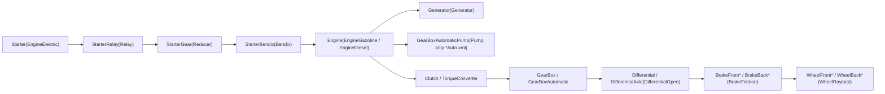

# 03. Drivetrain and Engine Components in City Car Driving 2.0

**Navigation:** [README](./README.md) | [00. Quick Start](./00_Quick_Start.md) | [01. Architecture & Configs](./01_Architecture_and_Config.md) | [02. Named I/O & States](./02_Named_IO_and_States.md) | **03. TorqueTrain** | [04. Electrics](./04_Components_Electrics.md) | [05. Chassis & Subsystems](./05_Components_Chassis_and_Subsystems.md)

## Table of Contents

1. [Building the Drivetrain Chain in XML (`<Links>`) and Common Shaft Parameters in `Vehicle.ini`](#1-building-the-drivetrain-chain-in-xml-links-and-common-shaft-parameters-in-vehicleini)
2. [Engines (`EngineGazoline`, `EngineDiesel`, `EngineElectric`, `ExternalVelocityMotor`)](#2-engines-enginegazoline-enginediesel-engineelectric-externalvelocitymotor)
3. [Clutch, Torque Converter, and Bendix (`ClutchFriction`, `HydraulicTorqueConverter`, `VariableTorqueConverter`, `Bendix`)](#3-clutch-torque-converter-and-bendix-clutchfriction-hydraulictorqueconverter-variabletorqueconverter-bendix)
4. [Gearboxes and Drivetrain Units (`GearBox`, `GearBoxAutomatic`, `DifferentialOpen`, `Reducer`, `Relay`, `Retarder`)](#4-gearboxes-and-drivetrain-units-gearbox-gearboxautomatic-differentialopen-reducer-relay-retarder)
5. [Brake Mechanisms and Wheels (`BrakeFriction`, `BrakeFrictionPneumatic`, `WheelRaycast`)](#5-brake-mechanisms-and-wheels-brakefriction-brakefrictionpneumatic-wheelraycast)
6. [Auxiliary Units (`Generator`, `Pump`, `Compressor`) and Complete `Vehicle.ini` Example](#6-auxiliary-units-generator-pump-compressor-and-complete-vehicleini-example)

---

## 1. Building the Drivetrain Chain in XML (`<Links>`) and Common Shaft Parameters in `Vehicle.ini`

In vehicle XML schemes (`Common/Vehicles/MotorCars/Schemes/*.xml`), all drivetrain units are connected by directed links from the driving shaft to the driven shaft:

```xml
<Link Holder="DrivingComponent" Reference="DrivenComponent" />
```

Torque is transmitted downstream along the `Holder -> Reference` chain, whereas angular velocity (shaft RPM) and reflected moment of inertia are computed in the reverse direction — from the wheels back to the engine.



### Post-Gearbox Chain Differences in Standard City Car Driving 2.0 Schemes

- **Front-wheel drive (`FwdAuto.xml`, `FwdManual.xml`):** The gearbox is connected to a single `<Component Name="Differential" Class="DifferentialOpen" />` component that distributes torque to `BrakeFrontLeft` and `BrakeFrontRight`. The rear brakes `BrakeBackLeft/Right` are connected only to their respective wheels `WheelBackLeft/Right`.
- **Rear-wheel drive (`RwdAuto.xml`, `RwdManual.xml`):** The gearbox is connected to `<Component Name="Differential" Class="DifferentialOpen" />`, which distributes torque to `BrakeBackLeft` and `BrakeBackRight`.
- **All-wheel drive (`AwdAuto.xml`, `AwdManual.xml`):** The gearbox is connected to the center differential **`DifferentialAxle`** (`Class="DifferentialOpen"`), from which two branches run to:
   1. The front axle engagement clutch `FrontAxisRelay` (`Class="Relay"`) $\to$ front differential `DifferentialWheelFront` $\to$ `BrakeFrontLeft` and `BrakeFrontRight`.
   2. The rear differential `DifferentialWheelBack` $\to$ `BrakeBackLeft` and `BrakeBackRight`.

### Summary Registry of the 20 Drivetrain and Engine Components

| # | `Class="..."` in XML | Standard Section in `Vehicle.ini` | Component Purpose |
| --- | --- | --- | --- |
| 1 | `EngineGazoline` | `[Engine]` | Gasoline spark-ignition ICE powered by the electrical system (also used as a universal ICE when combining gearbox and engine options) |
| 2 | `EngineDiesel` | `[Engine]` | Compression-ignition diesel ICE |
| 3 | `EngineElectric` | `[Starter]` | DC electric motor (starter) |
| 4 | `ExternalVelocityMotor` | `[...]` | Mechanism drive servo motor with an external RPM setpoint |
| 5 | `ClutchFriction` | `[Clutch]` | Friction clutch (in `*Manual.xml` schemes) |
| 6 | `HydraulicTorqueConverter` | `[TorqueConverter]` | Automatic transmission hydraulic torque converter with lock-up clutch (in `*Auto.xml`) |
| 7 | `VariableTorqueConverter` | `[...]` | Continuously variable transmission (CVT) with smoothly varying gear ratio |
| 8 | `Bendix` | `[StarterBendix]` | Starter one-way overrunning clutch (Bendix) |
| 9 | `GearBox` | `[GearBox]` | Stepped manual gearbox or transfer case |
| 10 | `GearBoxAutomatic` | `[GearBoxAutomatic]` | Planetary hydromechanical automatic transmission (in `*Auto.xml`) |
| 11 | `DifferentialOpen` | `[Differential]`, `[DifferentialAxle]`, `[DifferentialWheelFront/Back]` | Symmetrical wheel or center differential with lock |
| 12 | `Reducer` | `[StarterGear]` | Mechanical gear reducer with a fixed gear ratio |
| 13 | `Relay` | `[StarterRelay]`, `[FrontAxisRelay]` | Disconnect clutch (1:1 mechanical relay) |
| 14 | `Retarder` | `[Retarder]` | Hydrodynamic driveline retarder brake |
| 15 | `BrakeFriction` | `[BrakeFrontLeft/Right]`, `[BrakeBackLeft/Right]` | Wheel friction brake mechanism |
| 16 | `BrakeFrictionPneumatic` | `[BrakeFrontLeft/Right]`, `[BrakeBackLeft/Right]` | Pneumatic brake with spring brake actuator (trucks/buses) |
| 17 | `WheelRaycast` | `[WheelFrontLeft/Right]`, `[WheelBackLeft/Right]` | Raycast pneumatic wheel with Pacejka curves |
| 18 | `Generator` | `[Generator]` | Automotive alternator with voltage regulator |
| 19 | `Pump` | `[GearBoxAutomaticPump]` | Driven oil/hydraulic pump |
| 20 | `Compressor` | `[Compressor]` | Driven pneumatic system air compressor |

### Common Parameters for All Drivetrain and Engine Components in `Vehicle.ini`

Every one of the 20 components listed above supports the following 5 base rotating-shaft parameters in its `Vehicle.ini` section:

| Key in `Vehicle.ini` | Type | Default | Units | Description |
| --- | --- | --- | --- | --- |
| `Inertia` | `Real` | `1e-4` | $\text{kg}\cdot\text{m}^2$ | Intrinsic moment of inertia of the unit's rotating parts. *(For `WheelRaycast`, calculated automatically from mass and radius.)* |
| `RotationalFrictionConstant` | `Real` | `0.0` | $\text{N}\cdot\text{m}$ | Constant shaft rotational resistance torque ($C_{\text{const}}$). |
| `RotationalFrictionQuadCoeff` | `Real` | `0.0` | $\text{N}\cdot\text{m}\cdot\text{s}^2/\text{rad}^2$ | Quadratic shaft friction coefficient ($C_{\text{quad}}$) multiplied by angular velocity squared $\omega^2$: $M_{\text{rot}} = C_{\text{const}} + C_{\text{quad}}\cdot\omega^2$. *(For `EngineElectric`, calculated automatically.)* |
| `JammingSpeed` | `Real` | `1.0` | $1/\text{s}$ | Ramp-up rate of braking torque when the shaft jams (`Jammed = true`). |
| `JammedFrictionMax` | `Real` | `1.0` | $\text{N}\cdot\text{m}$ | Maximum additional resistance torque when the shaft is completely jammed. |

> [!NOTE]
> Constant shaft load is configured via `RotationalFrictionConstant`, while speed-dependent losses are configured via `RotationalFrictionQuadCoeff`. All numeric arrays in `Vehicle.ini` are written **strictly separated by a semicolon `;` with no space before `;`** (`OilPressureRPM = 0; 750; 6000`).

- **Common output (`<OutputElements>`):** `InternalName="RPM"` (`Real`, RPM) — current rotational speed of the unit's input shaft (except `BrakeFrictionPneumatic`).
- **Common states (`<StateElements>`):** `InternalName="Jammed"` (`Boolean`) — forced shaft jamming (except `[Engine]`); `InternalName="AngularVelocity"` (`Real`, rad/s) — instantaneous override of shaft angular velocity.

---

## 2. Engines (`EngineGazoline`, `EngineDiesel`, `EngineElectric`, `ExternalVelocityMotor`)

### 2.1. Gasoline and Diesel ICE (`[Engine]`)

In City Car Driving 2.0, the engine section in `Vehicle.ini` is named **`[Engine]`**. Two ICE classes are available in XML schemes: **`EngineGazoline`** and **`EngineDiesel`**.

> [!TIP]
> **Using `EngineGazoline` as a universal ("base") ICE class when combining "Gasoline / Diesel" and "AT / MT" options:**
> In `options.xml`, the `SetSchema="true"` attribute is allowed on **only one option** (attempting to bind schema switching to both `TransmissionType` and `EngineType` simultaneously will cause a loading error).
>
> - Therefore, if a vehicle has **two transmission trims** (`Auto` / `Manual`) and **two engine trims** (for example, gasoline `1.8I` and diesel `1.6TD`), XML schema switching (`SetSchema="true"`) is bound to the transmission (`*Auto.xml` and `*Manual.xml`), while the engine component in both standard schemes remains **`Class="EngineGazoline"`**.
> - Because all torque calculation physics from the `PowerCurves` table, engine braking, `RpmLimit` fuel cut, idling, warm-up, cooling, and lubrication are **completely identical** between `EngineGazoline` and `EngineDiesel`, the diesel trim is modeled directly on top of `Class="EngineGazoline"` using its own diesel torque curve (`PowerCurves`) and section overrides `[Engine.EngineType.<Diesel>]`, `[Idler.EngineType.<Diesel>]`, `[Starter.EngineType.<Diesel>]` in `Vehicle.ini` (while keeping `IgnitionResistance = 4` and `IgnitionMinVoltage = 7`):
>    ```ini
>    [Engine.EngineType.1.8I]
>    Volume = 1.8
>    RpmLimit = 7000
>    PowerCurves = ../Plugins/Mods/Content/<ModName>/Engine_1_8I.csv
>    AirPressureRatio = 0.355
>    IgnitionResistance = 4
>    IgnitionMinVoltage = 7
>    
>    [Engine.EngineType.1.6TD]
>    Volume = 1.6
>    RpmLimit = 5000
>    MinCombustionRpm = 150
>    PowerCurves = ../Plugins/Mods/Content/<ModName>/Engine_1_6TD.csv
>    AirPressureRatio = 0.655
>    IgnitionResistance = 4
>    IgnitionMinVoltage = 7
>    ```
> - The dedicated **`Class="EngineDiesel"`** class is only worth using in custom XML schemes for strictly diesel cars or trucks when you need the specific physics of difficult cold compression starts in freezing weather (`FuelIgnitionMinTemperature`, default `-5 °C`, base combustion chance `0.2`, and diesel fuel density `850 kg/m³` instead of `750 kg/m³` in `EngineGazoline`).

**`<Links>` connections for the `Engine` component in XML:**

- Outgoing from `Engine`: mandatory link to the fuel tank `<Link Holder="Engine" Reference="FuelTank" />` and at most 1 link to the driven drivetrain shaft (`Clutch` in `*Manual.xml` or `TorqueConverter` in `*Auto.xml`), plus auxiliary branches to `Generator` and `GearBoxAutomaticPump`.
- Incoming to `Engine`: from `StarterBendix`, `Idler` (`Class="FuelControllerComputer"`), `CarElectrics`, `GearBoxAutomatic` (in `*Auto.xml`), `Turbocharger` (if equipped with a turbocharger).
- **Difference between `EngineGazoline` and `EngineDiesel` in `<Links>`:**
   - For **`EngineGazoline`**, the spark-plug power link `<Link Holder="IgnitionElectricCircuit" Reference="Engine" />` is mandatory (without voltage above `IgnitionMinVoltage` in the ignition circuit, the engine produces no torque).
   - For **`EngineDiesel`**, the `IgnitionElectricCircuit -> Engine` link is **not supported and must be removed from the XML scheme**! A diesel engine ignites fuel by compression (when combustion chamber temperature exceeds `FuelIgnitionMinTemperature`), while guaranteed shutoff when turning the key to `0` is provided by `<Link Holder="IgnitionKey" Reference="Idler" />`, which cuts fuel delivery in the idle ECU.

| Key in `Vehicle.ini` (`[Engine]`) | Type | Default | Units | Description |
| --- | --- | --- | --- | --- |
| `TwoStroked` | `Boolean` | `false` | — | Engine stroke cycle: `false` — 4-stroke, `true` — 2-stroke. |
| `Volume` | `Real` | `1.5` | L | Engine displacement (affects cylinder filling and hourly fuel consumption). |
| `CylinderCount` | `Integer` | `4` | count | Number of cylinders (determines vibration frequency `VibrationFrequency`). |
| `RpmLimit` | `Real` | `6000.0` | RPM | Rev limiter fuel-cut RPM threshold. |
| `RpmLimitTime` | `Real` | `0.1` | s | Duration of fuel cutoff upon reaching `RpmLimit`. |
| `MinStableRpm` | `Real` | `500.0` | RPM | Minimum stable operating RPM (below this, torque begins to drop erratically). |
| `MinCombustionRpm` | `Real` | `50.0` | RPM | Minimum cranking RPM at which cylinder combustion can begin. |
| `AirPressureRatio` | `Real` | `0.2` | ratio | Cylinder air-filling ratio for the reference `PowerCurves` table. |
| `PowerCurves` | `String` | `"engine.csv"` | path | Path to the 2D torque and mechanical losses table relative to the `Content/` folder (for a mod folder: `../Plugins/Mods/Content/<ModName>/Engine.csv`). |
| `OptimalRpmMin` | `Real` | `3000.0` | RPM | Lower bound of the optimal ("green") RPM zone. |
| `OptimalRpmMax` | `Real` | `4000.0` | RPM | Upper bound of the optimal RPM zone. |
| `VibrationCurve` | `String` | `"vibration.csv"` | path | Path to the 1D table of vibration amplitude vs. `RPM / RpmLimit` (`Common/Vehicles/MotorCars/Tables/EngineVibration.csv`). |
| `VibrationAmplitude` | `Real` | `0.01` | m | Base amplitude multiplier for running engine vibration. |
| **`HeatingSpeed`** | `Real` | `0.3` | °C/s | Base coolant warm-up rate at 1000 RPM with no load. |
| `HeatingLoadCoeff` | `Real` | `2.5` | dimensionless | Factor by which engine heating accelerates under full load (100% throttle). |
| `ThermostatBeginTemperature` | `Real` | `80.0` | °C | Coolant temperature at which the thermostat starts opening (transition to the large cooling loop). |
| `ThermostatEndTemperature` | `Real` | `94.0` | °C | Coolant temperature at which the thermostat is fully open. |
| `SmallCircuitCoolingSpeed` | `Real` | `0.1` | °C/s | Cooling rate via the small circuit (at a 100 °C temperature difference with ambient air). |
| `LargeCircuitCoolingSpeed` | `Real` | `0.2` | °C/s | Additional cooling rate from the large-circuit radiator. |
| `InmotionCoolingSpeed` | `Real` | `1.0` | °C/s | Additional cooling rate from oncoming airflow at 100 km/h. |
| `ElectricFan` | `Boolean` | `true` | — | `true` — temperature-switched electric fan; `false` — viscous-clutch fan (blows proportionally to `RPM`). |
| `FanSwitchOnTemperature` | `Real` | `99.0` | °C | Coolant temperature to switch on the primary cooling fan. |
| `FanSwitchOffTemperature` | `Real` | `94.0` | °C | Coolant temperature to switch off the primary cooling fan. |
| `FanCoolingSpeed` | `Real` | `0.5` | °C/s | Cooling rate provided by the active primary fan. |
| `SecondFanSwitchOnTemperature` | `Real` | `115.0` | °C | Coolant temperature to switch on the secondary fan (switches off at `FanSwitchOnTemperature`). |
| `SecondFanCoolingSpeed` | `Real` | `0.0` | °C/s | Cooling rate provided by the secondary fan. |
| `OverheatTemperature` | `Real` | `115.0` | °C | Coolant temperature threshold that triggers the `OverheatIcon` warning indicator. |
| `MaxTemperature` | `Real` | `130.0` | °C | Critical coolant temperature at which the engine permanently seizes. |
| `OilPressureRPM` | `Array<Real>` | — | RPM | RPM breakpoints for oil pressure calculation (array size must match `OilPressureValues`, e.g., `0; 750; 6000`). |
| `OilPressureValues` | `Array<Real>` | — | bar | Oil pressure values at 85 °C corresponding to `OilPressureRPM` breakpoints (e.g., `0; 2; 4.2`). |
| `OilLowPressureThreshold` | `Real` | `1.5` | bar | Minimum operating oil pressure (below this, shaft friction increases and heating accelerates). |
| `OilLowPressureHeatCoeff` | `Real` | `2.0` | dimensionless | Engine heating rate multiplier at zero oil pressure. |
| `OilLowLevelThreshold` | `Real` | `0.5` | `[0..1]` | Oil level below which lubrication system pressure begins to drop. |
| `OilPressureTemperatureCoeff` | `Real` | `0.7` | dimensionless | Temperature correction factor for oil pressure relative to 85 °C. |
| `OilPressureMinTemperature` | `Real` | `30.0` | °C | Lower temperature bound for the oil pressure temperature correction. |
| `OilPressureMaxTemperature` | `Real` | `130.0` | °C | Upper temperature bound for the oil pressure temperature correction. |
| `OilLevelDropRate` | `Real` | `0.01` | $1/\text{s}$ | Rate of oil level decrease when the `OilLevel` leak input is active. |
| `MinOilLevelAtLeak` | `Real` | `0.0` | `[0..1]` | Minimum residual oil level during a leak. |
| `IgnitionResistance` | `Real` | `4.0` | Ω | **`EngineGazoline` only:** electrical resistance of the ignition system at `RpmLimit`. |
| `IgnitionMinVoltage` | `Real` | `11.0` | V | **`EngineGazoline` only:** minimum voltage in `IgnitionElectricCircuit` required to produce a spark. |
| `FuelIgnitionMinTemperature` | `Real` | `-5.0` | °C | **`EngineDiesel` only:** minimum combustion chamber temperature for compression ignition of diesel fuel (recommended `-20..-25`). |

- **Inputs (`InternalName`):** `FuelConsumptionMultiplier` (`Real`), `CoolantLeak` (`Boolean`), `BrokenCoolingSystem` (`Boolean`), `OilLevel` (`Boolean` — oil leak).
- **States (`InternalName`):** `CoolantLevel` (`Real`, `[0..1]`), `CoolantTemperature` (`Real`, °C), `OilTemperature` (`Real`, °C), `OilLevel` (`Real`, `[0..1]`), `FuelChamberTemperature` (`Real`, °C), `BrokenCoolingSystem` (`Boolean`), `AngularVelocity` (`Real`, rad/s).
- **Outputs (`InternalName`):** `RPM`, `RPMLimit`, `StableRPM`, `Combustion` (`Boolean`), `CoolantTemperature`, `CoolantLevel`, `OilTemperature`, `OilPressure`, `OilLowPressure`, `AFRRatio`, `Load` (`EngineLoad`), `MaxTorque` (`EngineMaxTorque`), `FuelConsumedTotal`, `FuelConsumedPerSecond`, `ThermostatBeginTemperature`, `OverheatTemperature`, `VibrationFrequency` (`EngineVibrationFrequency`), `VibrationAmplitude` (`EngineVibrationAmplitude`), `OptimalRpmMin`, `OptimalRpmMax`, `BrokenCoolingSystem` (`Boolean`).

### 2.2. Critical Rule for Calculating `Engine.csv` (`PowerCurves`) and Idling in `D`

The `Engine.csv` file defines a 2D torque table as a function of throttle opening percentage (rows: `0; 5; 10; 20; 40; 60; 80; 100`) and engine speed `RPM` (columns). Cells are delimited by `;`, and decimals use a **dot `.`**:

```csv
thr/rpm;0;50;250;500;750;1000;1500;2000;2500;3000;3500;4000;4500;5500
0;0;0;0;0;0;0;0;0;0;0;0;0;0;0
5;0;15;40;150;32;24;20;18;15;12;10;6;0;0
10;0;18;55;180;75;65;58;52;45;38;30;18;5;0
...
100;0;20;80;208;288;349;490;498;486;464;440;397;325;2.5
0;12;15;20;24;28;35;50;58;68;78;88;98;110;10000
```

> [!CAUTION]
> **Primary rule for calculating the `100%` throttle row in `Engine.csv`:**
> The last row of the table (after row `100`, starting with `0;...`) defines the positive torque of mechanical losses and engine braking $F(\text{RPM}) > 0$. The physics engine **subtracts $F(\text{RPM})$ from every combustion row, including the `100%` full-throttle row**:
>
> If you enter the rated torque of $440\text{ N}\cdot\text{m}$ in row `100` and $60\text{ N}\cdot\text{m}$ in the last friction row, only $380\text{ N}\cdot\text{m}$ will remain at the flywheel (a 20–25% power loss!). To obtain the rated flywheel characteristic $T_{\text{rated}}(\text{RPM})$, row `100` must contain the **sum** $T_{\text{rated}}(\text{RPM}) + F(\text{RPM})$.
>
> *(If a `Turbocharger` component is added to the XML scheme, each combustion cell `(thr, RPM)` after adding $F(\text{RPM})$ is additionally divided by the steady-state boost multiplier $\text{ratio}(\text{RPM}, \text{thr})$ at that pedal position `thr`, while the last friction row $F(\text{RPM})$ is not divided.)*

> [!TIP]
> **Limitation of the `[Idler]` idle controller and the "anti-stall hump" in rows `5%` and `10%`:**
> The idle ECU `[Idler]` (`FuelControllerComputer`) computes base throttle opening in an open loop — it searches for the throttle position where combustion torque at `IdleRpm` equals internal friction $F(\text{IdleRpm})$, without accounting for external torque converter drag in `D` and without opening the throttle wider when RPM drops below `IdleRpm`.
>
> - If you simply raise torque in the `5%` row at the idle RPM column itself (e.g., `750 RPM`), `[Idler]` will close the throttle proportionally, and RPM in `D` will still sag!
> - **Solution:** at the `IdleRpm` column (`750 RPM`), set the `5%` row torque only slightly above friction $F(750)$ (e.g., `32 N·m` when $F(750) = 28\text{ N}\cdot\text{m}$), and shape a steep rise — an **"anti-stall hump"** — at the adjacent lower column **`500 RPM`** (e.g., `150 N·m` in row `5%` and `180 N·m` in row `10%`). Then, when shifting into `D` or smoothly releasing the clutch, a small RPM dip from `750` to `660–680 RPM` causes a sharp surge in torque and holds idle reliably.

### 2.3. Starter Electric Motor (`[Starter]`, `Class="EngineElectric"`)

Connects to the electrical grid (`<Link Holder="BatteryElectricCircuit" Reference="Starter" />`), ignition switch (`<Link Holder="IgnitionKey" Reference="Starter" />`), idle ECU (`<Link Holder="Idler" Reference="Starter" />`), and transmits rotation through the starter relay and starter gear reducer (`<Link Holder="Starter" Reference="StarterRelay" />`).

| Key in `Vehicle.ini` (`[Starter]`) | Type | Default | Units | Description |
| --- | --- | --- | --- | --- |
| `IdleVoltage` | `Real` | `12.0` | V | Starter no-load voltage. |
| `IdleAmperage` | `Real` | `80.0` | A | Current draw at no-load speed `IdleRPM`. |
| `IdleRPM` | `Real` | `3000.0` | RPM | Maximum free-running starter RPM with no load. |
| `StallVoltage` | `Real` | `5.0` | V | Terminal voltage with a completely stalled armature. |
| `StallAmperage` | `Real` | `700.0` | A | Cranking current with a stalled armature. |
| `StallTorque` | `Real` | `13.0` | $\text{N}\cdot\text{m}$ | Maximum starting torque at `StallAmperage`. |

*(Note: the starter automatically computes its quadratic friction coefficient from the no-load regime `IdleRPM` / `IdleAmperage`, so `RotationalFrictionQuadCoeff` does not need to be set in `[Starter]`.)*

### 2.4. External Velocity Setpoint Motor (`Class="ExternalVelocityMotor"`)

Auxiliary drive for special-equipment mechanisms that spins up a driven shaft to target speed `ShaftRpm`.

- **`.ini` parameters:** `TorqueCurve` (`String`, path to 1D torque-vs-RPM table, default `"torque.csv"`), `EnableTorqueFadeByRpmDiff` (`Boolean`, default `true` — smoothly tapers torque as RPM approaches the setpoint), `MinWorkingRpm` (`Real`), `MaxWorkingRpm` (`Real`).
- **Input (`InternalName`):** `ShaftRpm` (`Real`, RPM). **Outputs (`InternalName`):** `RPM` (`Real`), `ShaftRpm` (`Real`), `Position` (`Real`, revolution fraction `(-1..1)`).

---

## 3. Clutch, Torque Converter, and Bendix (`ClutchFriction`, `HydraulicTorqueConverter`, `VariableTorqueConverter`, `Bendix`)

### 3.1. Friction Clutch (`[Clutch]`, `Class="ClutchFriction"`)

Used in manual transmission schemes (`*Manual.xml`). Linked between the engine and gearbox (`Engine -> Clutch -> GearBox`), and receives plate engagement from the pedal component `<Link Holder="ClutchPedal" Reference="Clutch" />`.

| Key in `Vehicle.ini` (`[Clutch]`) | Type | Default | Units | Description |
| --- | --- | --- | --- | --- |
| `MaxTorque` | `Real` | `1000.0` | $\text{N}\cdot\text{m}$ | Maximum friction torque of the fully engaged clutch (recommended `1.4–1.6` times peak engine torque). |
| `VelocityScale` | `Real` | `1.0` | $\text{s}/\text{rad}$ | Slope of friction torque buildup with respect to angular velocity difference between plates. |

### 3.2. Hydraulic Torque Converter (`[TorqueConverter]`, `Class="HydraulicTorqueConverter"`)

Used in automatic transmission schemes (`*Auto.xml`). Linked in the chain `Engine -> TorqueConverter -> GearBoxAutomatic`, while the lock-up clutch engagement command arrives via the feedback link `<Link Holder="GearBoxAutomatic" Reference="TorqueConverter" />`.

| Key in `Vehicle.ini` (`[TorqueConverter]`) | Type | Default | Units | Description |
| --- | --- | --- | --- | --- |
| `MaxRatio` | `Real` | `3.0` | dimensionless | Maximum torque multiplication ratio when launching from a standstill (typically `1.8–2.5`). |
| `MaxRatioVelocity` | `Real` | `100.0` | RPM | Impeller-to-turbine speed difference at which `MaxRatio` is reached (typically `1400–1800`). |
| `Torque` | `Real` | `3000.0` | $\text{N}\cdot\text{m}$ | Reference hydraulic load torque on the impeller at speed difference `TorqueRpm` (`25–65` for passenger cars). |
| `TorqueRpm` | `Real` | `100.0` | RPM | Reference impeller-to-turbine RPM difference for quadratic torque calculation: $M_{\text{pump}} = \text{Torque} \cdot (\Delta\text{RPM} / \text{TorqueRpm})^2$ (typically `700–800`). |
| `LockMaxTorque` | `Real` | `1000.0` | $\text{N}\cdot\text{m}$ | Maximum friction torque of the torque converter lock-up clutch (must comfortably exceed peak engine torque, `750–1100`). |
| `LockVelocityScale` | `Real` | `1000.0` | $\text{s}/\text{rad}$ | Stiffness of the lock-up clutch with respect to shaft speed difference (`10–100` for firm lock-up without slip). |
| `ValveStartOpenVelocity` | `Real` | `-1.0` | RPM | Turbine RPM at which the relief valve starts opening (`-1` — disabled). |
| `ValveFullOpenVelocity` | `Real` | `-1.0` | RPM | Turbine RPM at which the relief valve is fully open (`-1` — disabled). |
| `TransferInertia` | `Boolean` | `true` | — | Whether to transfer reflected engine flywheel inertia to the automatic transmission input shaft. |

### 3.3. Continuously Variable Converter (`Class="VariableTorqueConverter"`) and Bendix (`[StarterBendix]`, `Class="Bendix"`)

- **`VariableTorqueConverter`:** unit with a smoothly adjustable gear ratio. `.ini` parameters: `GearRatio` (`1.0`), `GearRatioMin` (`1.0`), `GearRatioMax` (`100.0`). Input: `GearRatio` (`Real`). Outputs: `RPM`, `OutRPM`.
- **`Bendix` (`[StarterBendix]`):** one-way overrunning clutch between the starter gear reducer and crankshaft (`StarterGear -> StarterBendix -> Engine`). Transmits torque only when starter speed exceeds engine speed; once the engine starts, it freewheels freely. Configured with the 5 common shaft parameters.

---

## 4. Gearboxes and Drivetrain Units (`GearBox`, `GearBoxAutomatic`, `DifferentialOpen`, `Reducer`, `Relay`, `Retarder`)

### 4.1. Manual Gearbox (`[GearBox]`, `Class="GearBox"`)

Used in `*Manual.xml` schemes (`Clutch -> GearBox -> Differential / DifferentialAxle`).

| Key in `Vehicle.ini` (`[GearBox]`) | Type | Default | Units | Description |
| --- | --- | --- | --- | --- |
| `Gears` | `Array<Real>` | — | dimensionless | List of gear ratios (negative — reverse, positive — forward gears). Example: `-4.722; 5.076; 2.610; 1.518; 1.000; 0.791; 0.675`. |
| `GearsSynchronized` | `Array<Bool>` | — | `0`/`1` | Synchronizer presence flags for each gear in `Gears` (list length must match `Gears`, e.g., `1; 1; 1; 1; 1; 1; 1`). |
| `StartingGear` | `Integer` | `-1` | index | Initial gear on spawn (`-1` — neutral, `0..N-1` — index in the `Gears` array). |
| `EnableNeutralInput` | `Boolean` | `true` | — | Whether shifting to neutral (`-1`) is permitted. |
| `MaxTorqueToNeutral` | `Real` | `10.0` | $\text{N}\cdot\text{m}$ | Maximum output shaft torque allowing a gear to be pulled into neutral without pressing the clutch (recommended `50`). |
| `MaxRPMDiffToShift` | `Real` | `50.0` | RPM | Maximum RPM difference between synchronized shafts to engage a gear from neutral. |
| `SynchronizerFrictionCoeff` | `Real` | `0.5` | $\text{N}\cdot\text{m}\cdot\text{s}/\text{rad}$ | Viscous friction coefficient of the synchronizer. |
| `SynchronizerMaxFrictionTorque` | `Real` | `3.0` | $\text{N}\cdot\text{m}$ | Maximum synchronizing friction torque on the input shaft. |

> [!TIP]
> **Manual transmission synchronizer tuning recommendations:**
> For crisp, quick engagement of first gear from neutral while simultaneously applying throttle, it is recommended to set the synchronization tolerance to **`MaxRPMDiffToShift = 200..250`** and synchronizer friction torque to **`SynchronizerMaxFrictionTorque = 10..15`**.

- **Input (`InternalName`):** `Gear` (`Integer`, `-1` — neutral, `0` — reverse, `1..N-1` — forward gears). **State:** `Gear` (`Integer`). **Outputs:** `RPM`, `Gear`, `GearRatio`, `GearCount`, `EnableNeutralInput`.

### 4.2. Hydromechanical Automatic Gearbox (`[GearBoxAutomatic]`, `Class="GearBoxAutomatic"`)

Used in `*Auto.xml` schemes. Has 3 mandatory outgoing links in `<Links>`: `<Link Holder="GearBoxAutomatic" Reference="Engine" />` (reads engine RPM), `<Link Holder="GearBoxAutomatic" Reference="TorqueConverter" />` (controls torque converter lock-up), and `<Link Holder="GearBoxAutomatic" Reference="DifferentialAxle" />` (or `Differential` in `FwdAuto`/`RwdAuto`). Working fluid pressure is supplied by `GearBoxAutomaticPump`, and `P/R/N/D` selector modes come from `GearBoxLogic`.

| Key in `Vehicle.ini` (`[GearBoxAutomatic]`) | Type | Default | Units | Description |
| --- | --- | --- | --- | --- |
| `Gears` | `Array<Real>` | — | dimensionless | List of gear ratios (negative — reverse, positive — forward; `0` is forbidden, values must be unique). |
| `LockTorqueConverter` | `Array<Bool>` | — | `0`/`1` | Whether torque converter lock-up is allowed in each gear from `Gears` (typically `0; 1; 1; ...`). Array size must match `Gears`. |
| `OilWorkPressure` | `Real` | `0.0` | bar | Minimum oil pressure from `GearBoxAutomaticPump` required to engage gears (typically `3.5`). |
| `GearChangeTime` | `Real` | `0.5` | s | Duration of a smooth gear shift (`0.25–0.50`). |
| `ChangeGearWaitTime` | `Real` | `1.0` | s | Minimum pause between two consecutive shifts (`0.30–0.60`). |
| `MaxGearStep` | `Integer` | all gears | count | Maximum number of gears the transmission can skip in a single kickdown shift (recommended `2–3`). |
| `PreferredGearRatioDiffPercent` | `Real` | `0.1` | fraction | Hysteresis threshold of relative gear ratio advantage required to trigger a shift (`0.12–0.35`). |
| `LockTorqueConverterRpm` | `Real` | `3000.0` | RPM | Minimum AT input shaft (torque converter turbine) RPM above which lock-up engagement is allowed. |
| `UnlockTorqueConverterRpm` | `Real` | `1500.0` | RPM | AT input shaft RPM below which the torque converter lock-up is forcibly disengaged. |
| `TorqueConverterLockTime` | `Real` | `1.0` | s | Time for full engagement/disengagement of the torque converter lock-up clutch. |
| `ShiftAccelerator` | `Array<Real>` | — | `[0..1]` | Throttle pedal position breakpoints (e.g., `0; 0.1; 0.2; 0.4; 0.6; 0.8; 1`). |
| `OptimalRpm` | `Array<Real>` | — | RPM | Target engine RPM for selecting the optimal gear at each `ShiftAccelerator` breakpoint. |
| `MaxRpm` | `Array<Real>` | — | RPM | Upper engine RPM limit for forced upshift at each `ShiftAccelerator` breakpoint. |
| `TorqueConverterLockDiff` | `Array<Real>` | — | RPM | Maximum impeller-to-turbine RPM difference at which torque converter lock-up is permitted to engage. |
| `ParkingFriction` | `Real` | `10000.0` | $\text{N}\cdot\text{m}$ | Braking torque of the parking pawl on the output shaft in selector mode `P`. |

- **Input (`InternalName`):** `Accelerator` (`Real`, `[0..1]`). **Output (`InternalName`):** `RPM` (`Real`). *(Channels `AutoShifterState`, `AutoShifterCurrentGear`, `AutoShifterTargetGear`, `AutoShifterMaxGear` belong to the `GearBoxLogic` component; see [05. Chassis & Subsystems](./05_Components_Chassis_and_Subsystems.md).)*

> [!TIP]
> **`[GearBoxAutomatic]` tuning recommendations:**
>
> 1. **Input shaft hydromechanical losses (`RotationalFrictionQuadCoeff`):** because quadratic friction is applied to the AT input shaft before gear ratio multiplication, modern passenger-car automatics work best with `RotationalFrictionQuadCoeff = 2.0e-4 .. 3.0e-4` and `RotationalFrictionConstant = 1.5`.
> 2. **Coordinating shift points (`OptimalRpm`, `MaxRpm`) and lock-up (`TorqueConverterLockDiff`):** during a gear change, the torque converter clutch briefly unlocks and engine RPM rises under load by the converter slip amount. Set `MaxRpm` above the unlocked converter RPM (`3150..4200` for diesel and `4500..6400` for gasoline engines), and tune normal shift points through the `OptimalRpm` array with a sufficiently wide lock-up engagement tolerance `TorqueConverterLockDiff` (`650..2100`).
> 3. **Unlocking the torque converter under hard braking (`UnlockTorqueConverterRpm` and `TorqueConverterLockTime`):** so the lock-up clutch disengages before the wheels lock/stop during emergency braking to a halt, set `UnlockTorqueConverterRpm` with margin above idle RPM (`1200..1250` with `LockTorqueConverterRpm = 1350..1400`) and a clutch actuation time `TorqueConverterLockTime = 0.25..0.30`.

### 4.3. Differentials (`Class="DifferentialOpen"`)

Symmetrical differential with final drive ratio `GearRatio`, distributing torque to exactly **2 mandatory driven shafts**.

- **Section names in `Vehicle.ini`:** in `Fwd*.xml` and `Rwd*.xml` schemes, the single differential is named **`[Differential]`**; in `Awd*.xml` schemes, three sections are used — center **`[DifferentialAxle]`** (carrying the final drive `GearRatio`), front axle **`[DifferentialWheelFront]`** (`GearRatio = 1.0`), and rear axle **`[DifferentialWheelBack]`** (`GearRatio = 1.0`).

| Key in `Vehicle.ini` | Type | Default | Units | Description |
| --- | --- | --- | --- | --- |
| `GearRatio` | `Real` | `4.0` | dimensionless | Final drive gear ratio (must not be `0`). |
| `Locked` | `Boolean` | `false` | — | Whether the differential is locked by default when the vehicle spawns. |
| `DisableInput` | `Boolean` | `false` | — | If `true`, ignores the external `Lock` input. |
| `LockVelocityCoeff` | `Real` | `0.05` | $\text{s}/\text{rad}$ | Rate of torque transfer to the slower-spinning half-shaft when locked. |

- **Input (`InternalName`):** `Lock` (`Boolean`). **Outputs (`InternalName`):** `RPM` (`Real`), `Locked` (`Boolean`).

> [!TIP]
> **Tuning the center `[DifferentialAxle]` for permanent all-wheel drive (AWD):**
> For vehicles with permanent all-wheel drive, keep the center differential `[DifferentialAxle]` unlocked (**`Locked = false`**) so the front and rear axles can rotate freely at different angular velocities while cornering.

### 4.4. Gear Reducer (`Class="Reducer"`), Clutch Relay (`Class="Relay"`), and Retarder (`Class="Retarder"`)

- **`Reducer` (section `[StarterGear]`):** gear reducer with a fixed gear ratio. `.ini` parameter: `GearRatio` (`Real`, default `1.0`, typically `10..12` in `[StarterGear]`). Outputs: `RPM`, `OutRPM`.
- **`Relay` (sections `[StarterRelay]` and `[FrontAxisRelay]`):** controllable 1:1 coupling that engages or interrupts power flow. `.ini` parameter: `Enabled` (`Boolean`, default `true`; set to `false` in `[StarterRelay]`, whereas in `Awd*.xml` the `AWD` input with `DefaultValue="true"` automatically enables `FrontAxisRelay`). Input: `Enable` (`Boolean`). Outputs: `RPM`, `Enabled`.
- **`Retarder`:** driveline retarder brake for trucks and buses. `.ini` parameters: `Rpm` (`Array<Real>`, required RPM list), `Torque` (`Array<Real>`, required braking torque list in N·m of the same length), `TorqueMultiplier` (`Array<Real>`, torque fractions `[0..1]` per stage), `DiscreteInput` (`Boolean`), `TimeLag` (`Real`, s, default `0.1`). Inputs: `Enabled` (`Boolean`), `Brake` (`Real`), `BrakeStage` (`Integer`). Outputs: `RPM`, `Enabled`, `DiscreteInput`, `RelativeTorque`.

---

## 5. Brake Mechanisms and Wheels (`BrakeFriction`, `BrakeFrictionPneumatic`, `WheelRaycast`)

### 5.1. Wheel Friction Brake (`Class="BrakeFriction"`)

Placed directly ahead of each wheel (`Brake* -> Wheel*`). Across all standard CCD 2.0 schemes, rear brake and rear wheel sections use **`Back`**, not `Rear`: **`[BrakeFrontLeft]`**, **`[BrakeFrontRight]`**, **`[BrakeBackLeft]`**, **`[BrakeBackRight]`** and **`[WheelFrontLeft]`**, **`[WheelFrontRight]`**, **`[WheelBackLeft]`**, **`[WheelBackRight]`**.

| Key in `Vehicle.ini` (`[Brake*]`) | Type | Default | Units | Description |
| --- | --- | --- | --- | --- |
| `MaxTorque` | `Real` | `500.0` | $\text{N}\cdot\text{m}$ | Maximum caliper braking torque at 100% pedal depression (typically `2500–3800` front and `1400–2200` rear). |
| `ParkingBrakePower` | `Real` | `0.0` | `[0..1]` | Parking brake (handbrake) effectiveness as a fraction of `MaxTorque` (set `0.7–1.0` on rear brakes `BrakeBackLeft/Right`). |

- **Inputs (`InternalName`):** `Brake` (`Real`, `[0..1]`), `ParkingBrake` (`Real`, `[0..1]`), `BrokenBrake` (`Boolean`). **Output (`InternalName`):** `RPM` (`Real`).

### 5.2. Pneumatic Brake with Spring Brake Actuator (`Class="BrakeFrictionPneumatic"`)

Used on trucks and buses with air brake systems. Contains a direct-acting service brake chamber (`Main*`) and a reverse-acting spring parking brake actuator (`SpringLock*`, which clamps the shoes when air is exhausted by the handbrake or when circuit pressure drops).

- **Receiver link order rule in `<Links>`:** in addition to the wheel link (`WheelRaycast`), the component takes two pneumatic receiver links in a **strictly fixed order**: the **first link** supplies the service brake chamber (`Main`), and the **second link** supplies the spring parking brake actuator (`SpringLock`, mandatory when `SpringLock = true`).
- **`.ini` parameters:** `MaxTorque` (`500.0` N·m), `MainMaxBrakePower` (`1.0`), `SpringLock` (`Boolean`, `false`), `SpringLockMaxBrakePower` (`1.0`), `PressureDelta` (`1.0` bar), `FeedDiameter` (`10.0` mm), `LeakageDiameter` (`5.0` mm); service chamber parameters `MainMinVolume` (`1.0` L), `MainMaxVolume` (`2.0` L), `MainMinVolumePressure` (`4.0` bar), `MainMaxVolumePressure` (`7.0` bar), `MainWorkPressure` (`6.0` bar), `MainMaxPressure` (`8.0` bar), `MainBlowOffDiameter` (`5.0` mm), `MainInitialPressure`; analogous spring actuator parameters with the `SpringLock*` prefix (`SpringLockMinVolume`, `SpringLockMaxVolume`, `SpringLockMinVolumePressure`, `SpringLockMaxVolumePressure`, `SpringLockWorkPressure`, `SpringLockMaxPressure`, `SpringLockBlowOffDiameter`, `SpringLockInitialPressure`).
- **Inputs (`InternalName`):** `Brake` (`Real`), `ParkingBrake` (`Real`), `BrokenBrake` (`Boolean`). **Outputs (`InternalName`):** `MinPressure`, `MinWorkPressure`, `WorkPressure`, `SpringLockMinPressure`, `SpringLockWorkPressure`, `PressureLevel`, `AirFlowIntensityLevel`, `PressureLevelSpringLock`, `AirFlowIntensityLevelSpringLock`.

### 5.3. Raycast Pneumatic Wheel (`[Wheel*]`, `Class="WheelRaycast"`)

Terminal node of a drivetrain branch (cannot have outgoing `<Link Holder="Wheel*" ... />` links). Intrinsic wheel moment of inertia is calculated automatically on load via $J = 0.5 \cdot \text{Mass} \cdot \text{Radius}^2$ (`Inertia` does not need to be specified in `[Wheel*]` sections).

| Key in `Vehicle.ini` (`[Wheel*]`) | Type | Default | Units | Description |
| --- | --- | --- | --- | --- |
| `Radius` | `Real` | `0.4` | m | Static loaded rolling radius at nominal `WorkingPressure` (`8–12 mm` smaller than the unloaded 3D mesh radius). |
| `MinRadius` | `Real` | `0.8 * Radius` | m | Rim radius (minimum radius of a completely deflated wheel). |
| `MaxRadius` | `Real` | `1.05 * Radius` | m | Overinflated wheel radius at `TyreMaxPressure`. |
| `Width` | `Real` | `0.3` | m | Tire section width (e.g., `0.245` for `245/45 R19`). |
| `Mass` | `Real` | `20.0` | kg | Unsprung mass of the wheel assembly (determines rotational inertia $0.5 \cdot \text{Mass} \cdot \text{Radius}^2$). |
| `FrictionCoeff` | `Real` | `1.0` | dimensionless | Overall tire-to-road friction coefficient (typically `0.90–1.00`). |
| **`ForceCurveLoad`** | `Real` | `1000.0` | N | Nominal vertical load $F_{N0}$ at which the grip curves are normalized. |
| `RollingResistanceCoeff` | `Real` | `0.011` | dimensionless | Base rolling resistance coefficient. |
| `RollingResistanceCurves` | `String` | — *(required)* | path | 2D rolling resistance table (`Common/Vehicles/MotorCars/Tables/WheelRollingResistance.csv`). |
| `ForceCurveLongitudinal` | `String` | — *(required)* | path | 1D longitudinal force curve vs. slip in % (`Common/Vehicles/MotorCars/Tables/WheelForceLon.csv`). |
| `ForceCurveLateral` | `String` | — *(required)* | path | 1D lateral force curve vs. slip angle in degrees (`Common/Vehicles/MotorCars/Tables/WheelForceLat.csv`). |
| `AligningTorqueCurve` | `String` | — *(required)* | path | 1D self-aligning torque curve (`Common/Vehicles/MotorCars/Tables/WheelAlignTorque.csv`; must cross `0` at the peak of `ForceCurveLateral`). |
| `CamberToSlipAngleCurve` | `String` | — *(required)* | path | 1D curve of slip angle offset vs. camber (`Common/Vehicles/Tables/Dummy2d.csv` or `WheelCamberToSlipAngle.csv`). |
| `StaticAligningTorqueCoeff` | `Real` | `0.0` | m | Steering centering torque coefficient when turning wheels at a standstill (typically `-0.002` left and `0.002` right on front wheels). |
| `StaticAligningTorqueCurve` | `String` | `""` | path | 1D static aligning torque curve (`Common/Vehicles/MotorCars/Tables/WheelStaticAligningTorque.csv`, required when `StaticAligningTorqueCoeff != 0`). |
| `StaticFrictionTorqueMaxAngVelocity` | `Real` | `1.0` | rad/s | Wheel angular speed up to which static steering resistance applies (typically `2.5`). |
| `LatStaticFrictionMaxLinVelocity` | `Real` | `2.0` | m/s | Linear velocity threshold for lateral static friction hold. |
| `LonStaticFrictionMaxLinVelocity` | `Real` | `0.2` | m/s | Linear velocity threshold for longitudinal static friction hold. |
| `LonStaticFrictionMaxAngVelocity` | `Real` | `0.01` | rad/s | Wheel angular velocity threshold for longitudinal static friction hold. |
| `RelaxationLength` | `Real` | `0.1` | m | Tire lateral force relaxation length. |
| `SlipAngleMinVelocity` | `Real` | `3.0` | m/s | Smoothing velocity for slip angle calculation at low speeds. |
| `SingularSlipRatioVelocity` | `Real` | `0.2` | m/s | Slip threshold velocity when pulling away from a standstill. |
| `WorkingPressure` | `Real` | `2.0` | bar | Nominal gauge tire pressure (applied on vehicle spawn, e.g., `2.2–2.8`). |
| `CriticalPressure` | `Real` | `WorkingPressure - 1` | bar | Pressure threshold triggering the `LowTirePressureIcon` flat-tire warning. |
| `TyreMaxPressure` | `Real` | `8.0` | bar | Maximum pressure of the tire air chamber (`TyreWorkPressure`, `TyreBlowOffDiameter` — valve parameters). |
| `BlowoutHoleSquare` | `Real` | auto | $\text{m}^2$ | Air bleed orifice area on puncture (`Blowout = true`). |
| `PressureToSteeringCoeff` | `Real` | `0.0` | dimensionless | Coefficient of steering pull toward a deflated wheel (`PressureToSteeringCurve` — curve path). |
| `SlipRatioToPacejkaCoeffK` / `B` | `Real` | `-0.4` / `1.4` | dimensionless | Linear coefficients $K$ and $B$ scaling the longitudinal slip X-axis by relative load $F_N / \text{ForceCurveLoad}$. |
| `PacejkaToLonForceCoeffK` / `B` | `Real` | `-0.2` / `1.2` | dimensionless | Coefficients $K$ and $B$ scaling longitudinal force by relative load. |
| `SlipAngleToPacejkaCoeffK` / `B` | `Real` | `-0.1` / `1.1` | dimensionless | Coefficients $K$ and $B$ scaling the lateral slip angle X-axis by relative load. |
| `PacejkaToLatForceCoeffK` / `B` | `Real` | `-0.25` / `1.25` | dimensionless | Coefficients $K$ and $B$ scaling lateral force by relative load ($K = -0.25 < 0$ produces nonlinear tire load sensitivity). |
| **`PacejkaAlignTorqueCoeffK` / `B`** | `Real` | `-0.25` / `1.25` | dimensionless | Coefficients $K$ and $B$ scaling self-aligning torque by load *(spelled **without** `To` in the middle of the name!)*. |

> [!TIP]
> **Fine-tuning handling balance via `ForceCurveLoad`:**
> Because of the negative coefficient `PacejkaToLatForceCoeffK = -0.25`, a tire loaded beyond its `ForceCurveLoad` loses relative lateral grip coefficient. For the front wheels, set `ForceCurveLoad` equal to the static vertical load on one front wheel ($F_{\text{stat,f}} \approx 0.5 \cdot m_{\text{front}} \cdot 9.81$), and for the rear wheels set it **8–15% higher** than the static rear wheel load ($F_{\text{stat,r}}$). This produces natural understeer without front-axle plowing.

- **Inputs (`InternalName`):** `Blowout` (`Boolean` — tire puncture), `NoSlip` (`Boolean` — ideal grip `PerfectWheels` mode). **State:** `Pressure` (`Real`, bar). **Outputs:** `RPM`, `WorkingPressure`, `LowPressure`, `Pressure`.

---

## 6. Auxiliary Units (`Generator`, `Pump`, `Compressor`) and Complete `Vehicle.ini` Example

### 6.1. Electrical Alternator (`[Generator]`, `Class="Generator"`)

Driven by the engine (`<Link Holder="Engine" Reference="Generator" />`), powers the alternator circuit (`<Link Holder="GeneratorElectricCircuit" Reference="Generator" />`), and is monitored by the instrument cluster (`<Link Holder="CarElectrics" Reference="Generator" />`).

| Key in `Vehicle.ini` (`[Generator]`) | Type | Default | Units | Description |
| --- | --- | --- | --- | --- |
| `GearRatio` | `Real` | `1.0` | dimensionless | Alternator belt pulley drive ratio (`2.0–2.5`, rotor spins `GearRatio` times faster than the crankshaft). |
| `MaxAmperage` | `Real` | `80.0` | A | Maximum alternator output current (`80–150`). |
| `MinVoltage` | `Real` | `13.0` | V | Minimum cut-in voltage for the alternator to feed the grid (`13.2`). |
| `MaxVoltage` | `Real` | `14.0` | V | Regulated charging voltage held by the voltage regulator (`14.4–14.7`). |
| `Resistance` | `Real` | `1.0` | Ω | Internal resistance of the alternator windings. |
| `MinAmperageRpm` | `Real` | `0.0` | RPM | Alternator rotor RPM (already multiplied by `GearRatio`) at which current generation starts (`600–1000`). |
| `MaxAmperageRpm` | `Real` | `6000.0` | RPM | Alternator rotor RPM at which full output current `MaxAmperage` is reached. |

- **Input (`InternalName`):** `Broken` (`Boolean` — alternator failure). **Output (`InternalName`):** `RPM` (`Real`).

### 6.2. Hydraulic / Oil Pump (`[GearBoxAutomaticPump]`, `Class="Pump"`) and Compressor (`Class="Compressor"`)

- **`Pump` (`[GearBoxAutomaticPump]` in `*Auto.xml`):** driven by the engine (`Engine -> GearBoxAutomaticPump`), requires a mandatory tank link `<Link Holder="GearBoxAutomaticPump" Reference="OilTank" />`, and supplies pressure to the automatic transmission (`GearBoxAutomaticPump -> GearBoxAutomatic`).
   - **`.ini` parameters:** `MaxPressure` (`1.0` bar; typically `7.0` in `*Auto.xml` — must exceed AT `OilWorkPressure`), `MaxPressureRpm` (`1.0` RPM; typically `650–800` — must not exceed idle RPM!), `MaxPressureVolume` (`1.0` L), `MaxPressureFriction` (`0.0` N·m; typically `1.5–2.0`). **Outputs:** `RPM`, `Pressure`.
- **`Compressor`:** driven air compressor for truck/bus pneumatic systems. Requires a mandatory link `<Link Holder="Compressor" Reference="ReceiverOrProtectionValveName" />`.
   - **`.ini` parameters:** `Volume` (`1.0` L/rev), `ActivatePressure` (`6.0` bar), `DeactivatePressure` (`8.0` bar), `OutputRef` (`1000.0` L/min), `RpmRef` (`1000.0` RPM), `PressureRef` (`8.0` bar), `ResistanceTorqueRef` (`100.0` N·m). **Output:** `RPM`.

### 6.3. Sample Configured Drivetrain and ICE Sections in `Vehicle.ini` (CCD 2.0)

```ini
[Starter]
Inertia = 1e-3
RotationalFrictionConstant = 0.5
StallVoltage = 9.0
StallAmperage = 850
StallTorque = 24
IdleVoltage = 12.0
IdleAmperage = 95
IdleRPM = 7000

[Engine]
Inertia = 0.24
Volume = 2.143
CylinderCount = 4
RpmLimit = 4600
RpmLimitTime = 0.25
MinCombustionRpm = 150
MinStableRpm = 380
PowerCurves = ../Plugins/Mods/Content/CieBensVGruppe/Engine.csv
HeatingSpeed = 0.25
ThermostatBeginTemperature = 82
ThermostatEndTemperature = 95
FanSwitchOffTemperature = 92
FanSwitchOnTemperature = 98
FanCoolingSpeed = 2.0
OverheatTemperature = 112
LargeCircuitCoolingSpeed = 0.3
OilPressureRPM = 0; 750; 2500; 4600
OilPressureValues = 0; 1.8; 3.8; 4.5
AirPressureRatio = 0.355
IgnitionResistance = 4.0
IgnitionMinVoltage = 7.0
VibrationCurve = Common/Vehicles/MotorCars/Tables/EngineVibration.csv
VibrationAmplitude = 0.0075

[TorqueConverter]
MaxRatio = 1.85
MaxRatioVelocity = 1500
Torque = 62
TorqueRpm = 750
LockMaxTorque = 850
LockVelocityScale = 100

[GearBoxAutomatic]
Inertia = 1e-4
RotationalFrictionConstant = 1.5
RotationalFrictionQuadCoeff = 2.6e-4
Gears = -3.416; 4.377; 2.859; 1.921; 1.368; 1.000; 0.820; 0.728
LockTorqueConverter = 0; 1; 1; 1; 1; 1; 1; 1
GearChangeTime = 0.26
ChangeGearWaitTime = 0.45
MaxGearStep = 3
PreferredGearRatioDiffPercent = 0.14
LockTorqueConverterRpm = 1360
UnlockTorqueConverterRpm = 1220
TorqueConverterLockTime = 0.26
ShiftAccelerator = 0; 0.1; 0.2; 0.4; 0.6; 0.8; 1
OptimalRpm = 1420; 1520; 1660; 2040; 2550; 3100; 3400
MaxRpm = 3150; 3250; 3350; 3550; 3780; 4000; 4200
TorqueConverterLockDiff = 650; 800; 950; 1250; 1550; 1850; 2100
OilWorkPressure = 3.5

[DifferentialAxle.TransmissionType.Auto]
Inertia = 1e-4
GearRatio = 3.267
Locked = false
```
