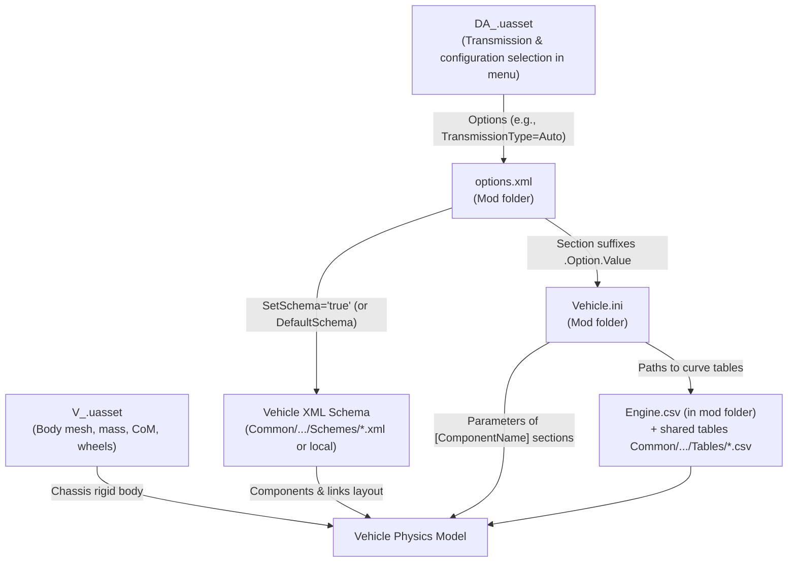

# Vehicle Physics Configuration Guide for City Car Driving 2.0

**Navigation:** **README** | [00. Quick Start](./00_Quick_Start.md) | [01. Architecture & Configs](./01_Architecture_and_Config.md) | [02. Named I/O & States](./02_Named_IO_and_States.md) | [03. TorqueTrain](./03_Components_TorqueTrain.md) | [04. Electrics](./04_Components_Electrics.md) | [05. Chassis & Subsystems](./05_Components_Chassis_and_Subsystems.md)

---

Welcome to the practical modding guide and reference for configuring vehicle physics in **City Car Driving 2.0**, built on Unreal Engine 5.

In **City Car Driving 2.0**, all physics for the powertrain, drivetrain, suspension, tires, brakes, steering, and onboard electrical system are configured declaratively via text configuration files (`Vehicle.ini`, `options.xml`, `.xml` schemas, and `.csv` curve tables) along with asset properties in the Unreal Engine 5 editor.

---

## 1. Documentation Table of Contents

| # | Section | Contents |
| :-: | --- | --- |
| **—** | **[README.md](./README.md)** *(current file)* | Layout of mod physics files, reference of all 46 component classes supported in CCD 2.0 (`Class="..."` in XML) with their standard section names in `Vehicle.ini`, and a table of measurement units. |
| **00** | **[00_Quick_Start.md](./00_Quick_Start.md)** | **Quick Start:** mod file layout and path rules, configuring the `Body` chassis (`Override Mass`, `Center Of Mass Offset`) and wheels in Blueprint, selecting an XML schema and `options.xml`, step-by-step calculation formulas for suspension, tires, `Engine.csv`, and gearbox, plus a 5-test verification checklist. |
| **01** | **[01_Architecture_and_Config.md](./01_Architecture_and_Config.md)** | Path resolution for mod files and base game resources, `Vehicle.ini` and `options.xml` syntax, breakdown of the 6 standard XML schemas in `Common/Vehicles/MotorCars/Schemes/*.xml`, creating a custom schema (using `EngineDiesel` + `Turbocharger` as an example), `.csv` table formats (`Engine.csv`), and trailer coupling (`<VehicleAttachment>`). |
| **02** | **[02_Named_IO_and_States.md](./02_Named_IO_and_States.md)** | Structure of `<InputElements>`, `<InputProcessors>`, `<OutputElements>`, and `<StateElements>`, complete tables of standard inputs/outputs/states in CCD 2.0, and a consolidated reference of all internal names (`InternalName`) across all 46 supported component classes. |
| **03** | **[03_Components_TorqueTrain.md](./03_Components_TorqueTrain.md)** | `.ini` parameter reference for engines and drivetrain: ICE (`EngineGazoline`, `EngineDiesel`), starter (`EngineElectric`, `Bendix`), clutch (`ClutchFriction`), torque converter (`HydraulicTorqueConverter`), gearboxes (`GearBox`, `GearBoxAutomatic`), differentials (`DifferentialOpen`), brakes (`BrakeFriction*`), tires (`WheelRaycast`), and accessories (`Generator`, `Pump`, `Compressor`). |
| **04** | **[04_Components_Electrics.md](./04_Components_Electrics.md)** | Onboard electrical network reference: electric circuits (`ElectricCircuit`), battery (`Battery`), individual consumers (`ElectricElement`), and the integrated body electrics, lighting, wipers, and dashboard unit (`CarElectrics`). |
| **05** | **[05_Components_Chassis_and_Subsystems.md](./05_Components_Chassis_and_Subsystems.md)** | Chassis and subsystems reference: suspension (`Suspension1Spring`), steering (`Steering2Ackermann`), pneumatics and turbocharging (`Turbocharger`), tanks (`Tank`), aerodynamics (`AerodynamicsCarSimple`), controllers (`FuelControllerComputer`, `AbsTcs`, `GearBoxAutomaticLogic`, `IgnitionKeyProcessor`), and telemetry (`Speedometer`, `PowerSteering`, `FuelConsumptionMeter`). |

---

## 2. Which Files Make Up Vehicle Physics in City Car Driving 2.0

Inside the mod plugin folder (`Plugins/Mods/Content/<ModName>/`), alongside the Unreal Engine assets (`V_<ModName>.uasset`, `DA_<ModName>.uasset`, `ST_<ModName>.uasset`), reside the text physics configuration files. These files can reference both shared base-game resources under `Content/Common/Vehicles/MotorCars/` and custom files inside the mod folder itself.

| File | Location | Purpose |
| --- | --- | --- |
| **`Vehicle.ini`** | `Plugins/Mods/Content/<ModName>/Vehicle.ini` | **Required** main configuration file. Contains the `[Vehicle]` section (`DefaultSchema`), `[ComponentName]` sections with parameters for each unit in the XML schema, and configuration override sections `[ComponentName.Option.Value]`. |
| **`options.xml`** | `Plugins/Mods/Content/<ModName>/options.xml` | Defines available trim/configuration options (`<AvailableOptions>`, e.g., `TransmissionType` with values `Auto` and `Manual`), their compatibility rules (`<Compatibilities>`), and switches the XML schema file when `SetSchema="true"`. |
| **Schema `.xml`** | `Content/Common/Vehicles/MotorCars/Schemes/*.xml` *(or mod folder)* | Root tag `<Vehicle>`. Defines the list of components (`<Components>`), links between them (`<Links>`), telemetry channels (`<OutputElements>`), states (`<StateElements>`), and controls (`<InputElements>`, `<InputProcessors>`). |
| **`Engine.csv`** | `Plugins/Mods/Content/<ModName>/Engine.csv` | 2D table of engine combustion torque and mechanical losses indexed by `RPM` and throttle pedal percentage (`0..100%`), referenced via the `PowerCurves` parameter in the `[Engine]` section. |
| **Shared `.csv` tables** | `Content/Common/Vehicles/MotorCars/Tables/*.csv` | Standard 1D and 2D tables for spring progression (`SpringProgression.csv`), ICE vibrations (`EngineVibration.csv`), tire grip (`WheelForceLat.csv`, `WheelForceLon.csv`), camber curves, and rolling resistance. |
| **Coupling schema `.xml`** | Trailer coupling path *(optional)* | Root tag `<VehicleAttachment>`. Describes inter-vehicle connections (`<MasterLinks>` and `<SlaveLinks>`) when coupling a tractor with a trailer. |

---

## 3. Reference of All 46 Component Classes (`Class="..."` in XML)

The `Class` attribute in `<Component Name="..." Class="..." />` specifies the component type, while the `Name` attribute specifies the name of its `[Name]` section in `Vehicle.ini`.

| # | XML Class (`Class`) | Standard `[Name]` Section in `Vehicle.ini` (CCD 2.0) | Component Purpose | Documentation Section |
| :-: | --- | --- | --- | --- |
| **1** | `EngineGazoline` | `[Engine]` | Spark-ignition gasoline ICE (used in all 6 standard schemas, including as a universal ICE when combining transmission and engine options). | [03_Components_TorqueTrain.md](./03_Components_TorqueTrain.md) |
| **2** | `EngineDiesel` | `[Engine]` | Compression-ignition diesel ICE (for local diesel schemas). | [03_Components_TorqueTrain.md](./03_Components_TorqueTrain.md) |
| **3** | `EngineElectric` | `[Starter]` | DC electric motor (starter). | [03_Components_TorqueTrain.md](./03_Components_TorqueTrain.md) |
| **4** | `ExternalVelocityMotor` | *(custom section)* | Drive motor with an external `ShaftRpm` target speed governed by `TorqueCurve`. | [03_Components_TorqueTrain.md](./03_Components_TorqueTrain.md) |
| **5** | `ClutchFriction` | `[Clutch]` *(in `*Manual.xml`)* | Friction clutch for manual transmission. | [03_Components_TorqueTrain.md](./03_Components_TorqueTrain.md) |
| **6** | `HydraulicTorqueConverter` | `[TorqueConverter]` *(in `*Auto.xml`)* | Automatic transmission hydraulic torque converter with lockup clutch. | [03_Components_TorqueTrain.md](./03_Components_TorqueTrain.md) |
| **7** | `VariableTorqueConverter` | *(custom section)* | Continuously variable transmission (CVT) with smoothly varying gear ratio. | [03_Components_TorqueTrain.md](./03_Components_TorqueTrain.md) |
| **8** | `Bendix` | `[StarterBendix]` | Starter overrunning clutch (Bendix drive). | [03_Components_TorqueTrain.md](./03_Components_TorqueTrain.md) |
| **9** | `GearBox` | `[GearBox]` *(in `*Manual.xml`)* | Manual transmission (MT) or transfer case. | [03_Components_TorqueTrain.md](./03_Components_TorqueTrain.md) |
| **10** | `GearBoxAutomatic` | `[GearBoxAutomatic]` *(in `*Auto.xml`)* | Planetary automatic transmission (AT) with automatic shifting and torque converter control. | [03_Components_TorqueTrain.md](./03_Components_TorqueTrain.md) |
| **11** | `DifferentialOpen` | `[DifferentialAxle]`, `[DifferentialWheelFront]`, `[DifferentialWheelBack]` *(in `Awd*`)*; `[Differential]` *(in `Fwd*`, `Rwd*`)* | Symmetrical center or axle differential with final drive `GearRatio` and lock flag `Locked`. | [03_Components_TorqueTrain.md](./03_Components_TorqueTrain.md) |
| **12** | `Reducer` | `[StarterGear]` | Reduction gear with a fixed `GearRatio`. | [03_Components_TorqueTrain.md](./03_Components_TorqueTrain.md) |
| **13** | `Relay` | `[StarterRelay]`, `[FrontAxisRelay]` *(in `Awd*`)* | Disconnecting coupling (starter relay or front-axle engagement coupling). | [03_Components_TorqueTrain.md](./03_Components_TorqueTrain.md) |
| **14** | `Retarder` | *(custom section)* | Transmission retarder brake (for trucks and buses). | [03_Components_TorqueTrain.md](./03_Components_TorqueTrain.md) |
| **15** | `BrakeFriction` | `[BrakeFrontLeft]`, `[BrakeFrontRight]`, `[BrakeBackLeft]`, `[BrakeBackRight]` | Wheel brake mechanism (service + parking brake). | [03_Components_TorqueTrain.md](./03_Components_TorqueTrain.md) |
| **16** | `BrakeFrictionPneumatic` | *(custom section)* | Pneumatic brake mechanism with spring-brake energy accumulator. | [03_Components_TorqueTrain.md](./03_Components_TorqueTrain.md) |
| **17** | `WheelRaycast` | `[WheelFrontLeft]`, `[WheelFrontRight]`, `[WheelBackLeft]`, `[WheelBackRight]` | Raycast wheel and pneumatic tire model. | [03_Components_TorqueTrain.md](./03_Components_TorqueTrain.md) |
| **18** | `Compressor` | *(custom section)* | Air compressor for a pneumatic system. | [03_Components_TorqueTrain.md](./03_Components_TorqueTrain.md) |
| **19** | `Generator` | `[Generator]` | Onboard electrical network alternator. | [03_Components_TorqueTrain.md](./03_Components_TorqueTrain.md), [04_Components_Electrics.md](./04_Components_Electrics.md) |
| **20** | `Pump` | `[GearBoxAutomaticPump]` *(in `*Auto.xml`)* | Automatic transmission oil pump. | [03_Components_TorqueTrain.md](./03_Components_TorqueTrain.md), [05_Components_Chassis_and_Subsystems.md](./05_Components_Chassis_and_Subsystems.md) |
| **21** | `ElectricCircuit` | `[BatteryElectricCircuit]`, `[GeneratorElectricCircuit]`, `[IgnitionElectricCircuit]` | Parallel electrical circuit (onboard network node). | [04_Components_Electrics.md](./04_Components_Electrics.md) |
| **22** | `Battery` | `[Battery]` | Storage battery. | [04_Components_Electrics.md](./04_Components_Electrics.md) |
| **23** | `ElectricElement` | *(custom section)* | Standalone resistive electrical load. | [04_Components_Electrics.md](./04_Components_Electrics.md) |
| **24** | `CarElectrics` | `[CarElectrics]` | Body electrics unit: lights, turn signals, wipers, dashboard, buzzers. | [04_Components_Electrics.md](./04_Components_Electrics.md) |
| **25** | `Suspension1Spring` | `[SuspensionFrontLeft]`, `[SuspensionFrontRight]`, `[SuspensionBackLeft]`, `[SuspensionBackRight]` | Coil-spring and damper wheel suspension with progression and camber curves. | [05_Components_Chassis_and_Subsystems.md](./05_Components_Chassis_and_Subsystems.md) |
| **26** | `Suspension1Constant` | *(custom section)* | Rigid constant-load suspension (for rail vehicles). | [05_Components_Chassis_and_Subsystems.md](./05_Components_Chassis_and_Subsystems.md) |
| **27** | `Steering2Ackermann` | `[Steering]` | Two-wheel steered-axle Ackermann steering linkage. | [05_Components_Chassis_and_Subsystems.md](./05_Components_Chassis_and_Subsystems.md) |
| **28** | `SteeringSimple` | *(custom section)* | Simplified wheel steering mechanism without Ackermann geometry. | [05_Components_Chassis_and_Subsystems.md](./05_Components_Chassis_and_Subsystems.md) |
| **29** | `Receiver` | *(custom section)* | Compressed-air receiver tank. | [05_Components_Chassis_and_Subsystems.md](./05_Components_Chassis_and_Subsystems.md) |
| **30** | `ValveMultiCircuit` | *(custom section)* | Multi-circuit protection valve for pneumatic systems. | [05_Components_Chassis_and_Subsystems.md](./05_Components_Chassis_and_Subsystems.md) |
| **31** | `ActuatorPneumatic1Chamber` | *(custom section)* | Single-chamber spring-return pneumatic actuator. | [05_Components_Chassis_and_Subsystems.md](./05_Components_Chassis_and_Subsystems.md) |
| **32** | `ActuatorPneumatic2Chamber` | *(custom section)* | Dual-chamber pneumatic cylinder (bus door actuator, etc.). | [05_Components_Chassis_and_Subsystems.md](./05_Components_Chassis_and_Subsystems.md) |
| **33** | `Turbocharger` | `[Turbocharger]` *(in local turbo schemas)* | ICE turbocharger with configurable boost and `LagTime`. | [05_Components_Chassis_and_Subsystems.md](./05_Components_Chassis_and_Subsystems.md) |
| **34** | `Tank` | `[FuelTank]`, `[OilTank]` *(in `*Auto.xml`)* | Fuel or oil tank. | [05_Components_Chassis_and_Subsystems.md](./05_Components_Chassis_and_Subsystems.md) |
| **35** | `AerodynamicsCarSimple` | `[Aerodynamics]` | Aerodynamic drag (`DragCoeff`) and lift/downforce (`LiftCoeff`). | [05_Components_Chassis_and_Subsystems.md](./05_Components_Chassis_and_Subsystems.md) |
| **36** | `ExternalThruster` | *(custom section)* | External linear thruster. | [05_Components_Chassis_and_Subsystems.md](./05_Components_Chassis_and_Subsystems.md) |
| **37** | `FuelControllerComputer` | `[Idler]` | ECU for fuel delivery, idle speed (`IdleRpm`, `WarmupRpm`), and speed limiter. | [05_Components_Chassis_and_Subsystems.md](./05_Components_Chassis_and_Subsystems.md) |
| **38** | `FuelControllerMechanical` | *(custom section)* | Carburetor fuel controller with manual choke (`Choke`). | [05_Components_Chassis_and_Subsystems.md](./05_Components_Chassis_and_Subsystems.md) |
| **39** | `AbsTcs` | `[AbsTcs]` | ABS, traction control (TCS), and electronic brakeforce distribution (EBD) unit. | [05_Components_Chassis_and_Subsystems.md](./05_Components_Chassis_and_Subsystems.md) |
| **40** | `ClutchInputProcessor` | `[ClutchPedal]` *(in `*Manual.xml`)* | Clutch pedal travel curve processor (`Power`). | [05_Components_Chassis_and_Subsystems.md](./05_Components_Chassis_and_Subsystems.md) |
| **41** | `GearBoxAutomaticLogic` | `[GearBoxLogic]` *(in `*Auto.xml`)* | Passenger-car automatic transmission selector (`P`, `R`, `N`, `D`). | [05_Components_Chassis_and_Subsystems.md](./05_Components_Chassis_and_Subsystems.md) |
| **42** | `GearBoxAutomaticLogicBus` | *(custom section)* | Bus push-button automatic transmission selector (`D`, `N`, `R`) with auto-neutral. | [05_Components_Chassis_and_Subsystems.md](./05_Components_Chassis_and_Subsystems.md) |
| **43** | `IgnitionKeyProcessor` | `[IgnitionKey]` | Ignition switch (`0 = Off`, `1 = Ignition`, `2 = Starter`). | [05_Components_Chassis_and_Subsystems.md](./05_Components_Chassis_and_Subsystems.md) |
| **44** | `Speedometer` | `[Speedometer]` | Speed sensor and odometer (`MetersPerRotation`). | [05_Components_Chassis_and_Subsystems.md](./05_Components_Chassis_and_Subsystems.md) |
| **45** | `PowerSteering` | `[PowerSteering]` | Hydraulic/electric power steering and Force Feedback calculation. | [05_Components_Chassis_and_Subsystems.md](./05_Components_Chassis_and_Subsystems.md) |
| **46** | `FuelConsumptionMeter` | *(custom section)* | Trip computer for average fuel consumption. | [05_Components_Chassis_and_Subsystems.md](./05_Components_Chassis_and_Subsystems.md) |

---

## 4. Measurement Units in `Vehicle.ini`, `.csv`, and Unreal Engine 5

| Quantity | In `Vehicle.ini` and `.csv` Tables | In Output Channels (`OutputElements`) | In Unreal Engine 5 Editor |
| --- | --- | --- | --- |
| **Coordinates, dimensions, radii, suspension travel** | **meters ($\text{m}$)** *(pneumatic valve diameters `*Diameter` are in $\text{mm}$)* | meters ($\text{m}$) | **centimeters ($\text{cm}$)** ($1\text{ m} = 100\text{ cm}$) |
| **Chassis coordinate system (`Mount`, etc.)** | Right-handed CS: **`X` — forward, `Y` — left, `Z` — up** (m) | — | Left-handed CS: **`X` — forward, `Y` — right, `Z` — up** (cm) |
| **Vehicle speed** | $\text{m/s}$ *(except `SpeedLimit` in `[Idler]` and `SafetyBelt*Speed` in `[CarElectrics]` — those are in $\text{km/h}$)* | **$\text{m/s}$** (`Speed` and `DashboardSpeed`; multiply by $3.6$ to convert to $\text{km/h}$) | — |
| **Shaft rotational speed** | **$\text{RPM}$** *(except `StaticFrictionTorqueMaxAngVelocity` in `[Wheel*]` — in $\text{rad/s}$)* | **$\text{RPM}$** *(in the `AngularVelocity` state — $\text{rad/s}$)* | — |
| **Angles (wheel steer, camber, tire slip)** | **degrees ($^\circ$)** | `WheelSteeringAngle` — deg.; `MaxSteeringAngle` — rad. | degrees ($^\circ$) |
| **Mass and moment of inertia** | kilograms ($\text{kg}$), $\text{kg}\cdot\text{m}^2$ | $\text{kg}\cdot\text{m}^2$ (`ForceFeedbackInertia`) | `Body` mass in **$\text{kg}$** (`Override Mass`), `COMNudge` in **$\text{cm}$** |
| **Force, stiffness, torque** | $\text{N}$, $\text{N/m}$ (`SpringCoeff`), $\text{N}\cdot\text{s/m}$ (`DampCoeff`), $\text{N}\cdot\text{m}$ | $\text{N}\cdot\text{m}$ (`MaxTorque`, `Load`, `ForceFeedbackTorque`) | — |
| **Pressure (tires, oil, pneumatics)** | **bars ($\text{bar}$)** *(gauge pressure in tires and compressor; absolute pressure in receivers)* | **bars ($\text{bar}$)** | — |
| **Volume and fuel consumption** | **liters ($\text{L}$)**; `AveragingDistance` — $\text{km}$, `AveragingStep` — $\text{m}$ | volume — $\text{L}$, instantaneous flow — $\text{L/s}$, average in `FuelConsumptionMeter` — **$\text{L/m}$** (`* 1e5` = L/100 km) | — |
| **Temperature and electrics** | $^\circ\text{C}$; Volts ($\text{V}$), Amperes ($\text{A}$), Ohms ($\Omega$), battery capacity — $\text{A}\cdot\text{h}$ | $^\circ\text{C}$, $\text{V}$, $\text{A}$ | — |
| **Pedal and throttle position** | Fraction **`0.0 .. 1.0`** in `.ini` and inputs; percentage **`0 .. 100`** in column 1 of `Engine.csv` | — | — |
