# Модуль 1. Быстрый старт: минимально рабочий автомобиль

**Навигация:** [README](./README.md) | **01. Минимальный автомобиль** | [02. Экстерьер, свет и мир](./02_Exterior_Lights_and_World.md) | [03. Салон, приборка и камеры](./03_Interior_Dashboard_Cameras_Seats.md) | [04. Зеркала и дворники](./04_Mirrors_and_Wipers.md) | [05. Звуки и FMOD](./05_Sounds_and_FMOD.md) | [06. Комплектации, логика и шпаргалка](./06_Advanced_Specs_Logic_and_Reference.md)

---

В этом модуле вы пройдёте **весь минимально необходимый путь с нуля**: подготовите и импортируете кузов и 4 колеса, назначите базовые материалы, подключите минимальную физику, соберёте Актор автомобиля с базовой камерой, оформите паспорт автомобиля (`DA_*`), соберёте `.pak`, протестируете его локально в **City Car Driving 2.0** и узнаете, как опубликовать мод в Steam Workshop.

> [!NOTE]
> **Что сознательно НЕ входит в Модуль 1:**
> Салон, зеркала, дворники, фары, номера, звуки, `LogicBox` и `FuelTank` **не обязательны** для запуска — игра заспавнит автомобиль и позволит на нём ездить и без них. Всё это вы сможете спокойно добавить позже в Модулях 2–6.

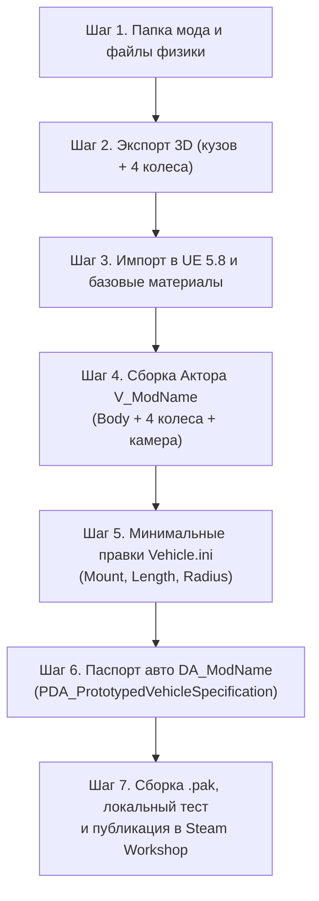

---

## Шаг 1. Создание папки мода и копирование базовой физики

### 1.1. Создаём папку мода в UE
1. Откройте проект `CityCarDriving2.uproject` в Unreal Engine 5.8.
2. Откройте **Content Browser** (`Ctrl + Space`), нажмите **Settings** (шестерёнка справа вверху) и включите **Show Plugin Content** (если ещё не включено).
3. В дереве папок слева перейдите в `All → Plugins → Mods Content`.
4. Нажмите **ПКМ** на пустом месте → **New Folder** и назовите папку латиницей без пробелов, например **`MyFirstCar`**.
5. Внутри `MyFirstCar` для порядка сразу создайте подпапки: `Meshes`, `Materials`, `Textures`.

### 1.2. Копируем файлы физики (`VehicleLib`)
1. В Content Browser нажмите **ПКМ** по вашей папке `MyFirstCar` → **Show in Explorer** — откроется папка `...\Plugins\Mods\Content\MyFirstCar\` в Проводнике Windows.
2. Откройте вторую вкладку Проводника и перейдите в папку готовых примеров физики:
   - `Docs\Samples\VehicleLibConfigs\Vehicle012_HangugEclauto\` *(бензиновый седан, хороший универсальный старт)*
   - или `Docs\Samples\VehicleLibConfigs\Vehicle002_UlgaresGroberolf\`
   - или `Plugins\Mods\Content\CieBensVGruppe\` *(полный привод, дизель)*.
3. Скопируйте в вашу папку `Plugins\Mods\Content\MyFirstCar\` три файла:
   - **`Vehicle.ini`**
   - **`options.xml`**
   - **`Engine.csv`** *(если выбрали пример с другими именами `.csv`, скопируйте и их; если копировали из `CieBensVGruppe`, скопируйте также `AwdAuto.xml` и `AwdManual.xml`)*.

### 1.3. Исправляем пути внутри `Vehicle.ini` и `options.xml`
Откройте скопированные `Vehicle.ini` и `options.xml` в любом текстовом редакторе (Блокнот, Notepad++, VS Code) в кодировке **UTF-8**.

Все пути внутри этих файлов отсчитываются от папки `Content/` основной игры:
- Общие файлы игры (`Common/Vehicles/MotorCars/...`) **менять не нужно** — они работают автоматически.
- Ссылки на файлы **внутри папки вашего мода** должны начинаться с `../Plugins/Mods/Content/<ИмяМода>/`.

Проверьте и замените имя чужой машины на имя вашей папки (`MyFirstCar`) в следующих строках:

**В `Vehicle.ini`:**
```ini
[Vehicle]
; Если используете стандартную схему игры (рекомендуется для старта):
DefaultSchema = Common/Vehicles/MotorCars/Schemes/FwdAuto.xml
; (или если копировали локальную схему в папку мода: ../Plugins/Mods/Content/MyFirstCar/AwdAuto.xml)

[Engine]
PowerCurves = ../Plugins/Mods/Content/MyFirstCar/Engine.csv
```

**В `options.xml`:**
```xml
<?xml version="1.0" encoding="UTF-8" ?>
<Options>
    <AvailableOptions>
        <Option Name="TransmissionType" SetSchema="true">
            <OptionValue Value="Auto" SchemaName="Common/Vehicles/MotorCars/Schemes/FwdAuto.xml" />
            <OptionValue Value="Manual" SchemaName="Common/Vehicles/MotorCars/Schemes/FwdManual.xml" />
        </Option>
    </AvailableOptions>
</Options>
```

> [!CAUTION]
> **Три жёстких правила синтаксиса `Vehicle.ini`:**
> 1. Разделитель чисел в списках и координатах — **точка с запятой `;` БЕЗ пробела перед `;`!**
>    - Правильно: `Mount = 1.63; 0.85; 0.4455`
>    - Ошибка: `Mount = 1.63 ; 0.85 ; 0.4455` (пробел перед `;` воспринимается как комментарий и обрежет всё, что правее!).
> 2. Десятичный разделитель — строго **точка `.`** (не запятая).
> 3. Сохраняйте файлы в кодировке **UTF-8**.

---

## Шаг 2. Подготовка и экспорт 3D-моделей (кузов и 4 колеса)

### 2.1. Критические правила координат и масштаба (особенно для Blender!)

> [!WARNING]
> **Обязательно прочитайте перед экспортом из Blender!**
> В Unreal Engine 1 единица измерения = **1 сантиметр**, перед автомобиля направлен вдоль оси **`+X`**, верх — вдоль оси **`+Z`**.
> **В самом редакторе UE нельзя масштабировать меш или Актор автомобиля (`Scale` всегда должен оставаться `1.0, 1.0, 1.0`) — иначе сломается физика и подвеска!**

Рекомендации по экспорту из **Blender** в формат **FBX**:
1. **Масштаб модели:**
   - В Unreal Engine автомобиль должен иметь реальные размеры в сантиметрах (например, длина ~450 см, ширина ~180 см, высота ~150 см).
   - Если вы моделировали в Blender в метрах (`Unit Scale = 1.0`) и при экспорте с масштабом возникают ошибки — увеличьте модель в Blender в **100 раз** и обязательно примените трансформации (**`Ctrl + A` → `Apply All Transforms`**), либо работайте сразу в сантиметрах (`Scene Properties → Units → Metric`, `Unit Scale = 0.01`, `Length = Centimeters`) с применённым `Scale = 1.0`.
2. **Направление осей при экспорте FBX (`File → Export → FBX`):**
   - В разделе **Transform** окна экспорта выставите:
     - **Forward:** `-X Forward`
     - **Up:** `Z Up`
   - В разделе **Geometry** выставите **Smoothing:** `Face` (чтобы избежать предупреждений о группах сглаживания в UE).

### 2.2. Требования к 3D-модели кузова (`Body`)
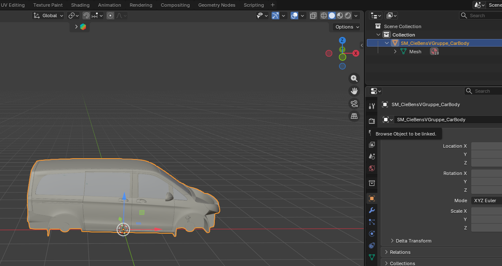

1. Основной объём кузова должен быть **единой моделью** (отдельные декоративные детали вроде бамперов/капота позже можно навесить дочерними мешами, но основной физический объём — один меш `Body`).
2. Модель направлена передом вдоль оси **`+X`** и расположена в центре координатной сетки (`0, 0, 0`).
3. Все элементы имеют UV-развёртку на **0-м UV-канале**.
4. Разные по типу поверхности элементы (окрашенный кузов, чёрный пластик/хром, стёкла, фары) должны иметь отдельные **Material ID** (слоты материалов).

### 2.3. Требования к 3D-моделям колёс (`Wheel`)
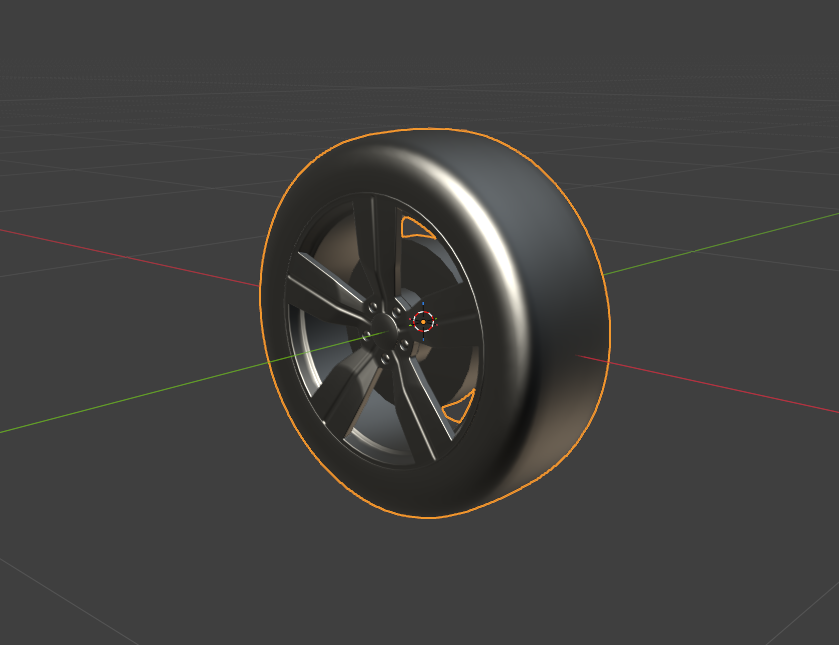

1. **Пивот (Origin)** модели каждого колеса обязан находиться **строго в геометрическом центре колеса** (`0, 0, 0`).
2. Ось вращения колеса — **`Y`** (колесо катится вдоль оси `+X`).
3. Разделите материалы минимум на 2 слота: **покрышка** (шина) и **диск**.
4. Если левые и правые колёса отличаются направленным рисунком протектора или вылетом диска — экспортируйте отдельные модели для левой и правой стороны (или все 4, если задние шире передних).

---

## Шаг 3. Импорт моделей и настройка базовых материалов в UE 5.8

### 3.1. Импорт кузова (`Body`)
1. В Content Browser откройте вашу папку `MyFirstCar/Meshes`.
2. Перетащите `.fbx`-файл кузова из Проводника прямо в окно Content Browser (или нажмите кнопку **Import**).
3. В открывшемся окне импорта обязательно проверьте:
   - **`Generate Missing Collision`** — **ВКЛЮЧИТЬ** (если вы не делали собственную `UCX_`-коллизию в 3D-редакторе; кузову обязательно нужна коллизия для столкновений!).
   - **`Material Import Method`** — выберите **`Do Not Create Material`** (чтобы UE не создавал несовместимые базовые материалы автоматически).
   - **`Build Nanite`** — **ВЫКЛЮЧИТЬ** (Nanite в проекте отключён).
   - **`Import Uniform Scale`** — оставьте **`1.0`**.

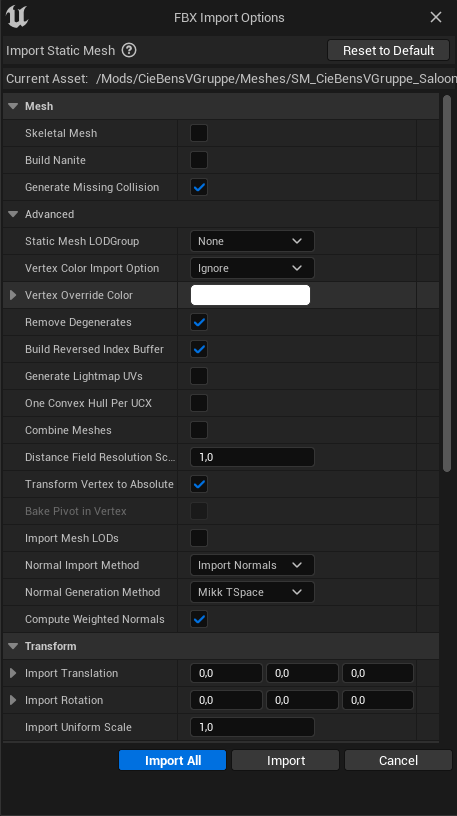

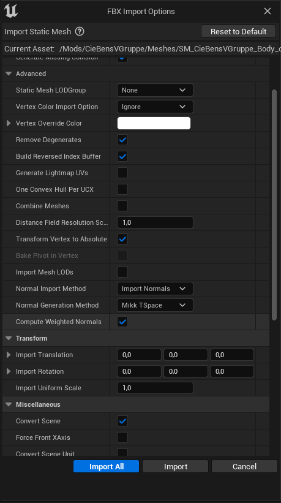

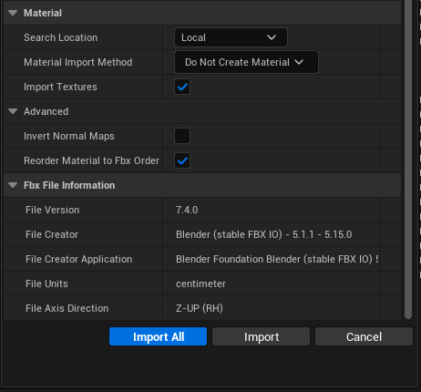

4. Нажмите **Import All**.
5. **Быстрая проверка размера после импорта:** дважды кликните на импортированный меш кузова. В левом верхнем углу 3D-окна посмотрите строку **`Approx Size`**. Для обычного легкового авто цифры должны быть порядка `450 × 180 × 150` (в сантиметрах). Если видите `4 × 2 × 1` — модель экспортировалась в 100 раз меньше, вернитесь к Шагу 2.1!

### 3.2. Импорт колёс (`Wheel`)
Импорт колёс выполняется точно так же в папку `MyFirstCar/Meshes`, **но с одним критическим отличием**:
- **`Generate Missing Collision`** — обязательно **ВЫКЛЮЧИТЬ**! У моделей колёс **не должно быть коллизии** (физический контакт с дорогой считает система `WheelRaycast` из `VehicleLib`).
- **`Material Import Method`** — **`Do Not Create Material`**.

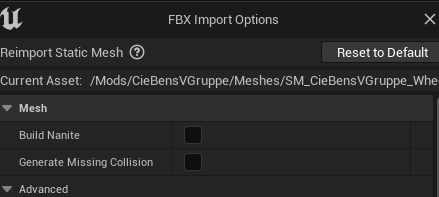

### 3.3. Настройка текстур и базовых материалов

> [!CAUTION]
> **Главное правило материалов в CCD 2.0:**
> Моды **НЕ поддерживают** пользовательские `Master Materials`!
> Вы обязаны использовать только **Material Instance**, созданные на основе подготовленных разработчиками материалов из папки:
> `Content/Common/MasterMaterials/VehicleMaterials/ModMaterials/`

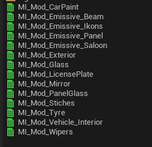

#### Подготовка текстур (если импортируете свои текстуры)
Перетащите текстуры (`.png` / `.tga`) в папку `MyFirstCar/Textures`. Для каждой импортированной текстуры откройте её двойным кликом:
1. **Virtual Texture (обязательно для ВСЕХ текстур мода!):** в панели **Details** справа в поиске введите `Virtual` и поставьте галочку **`Virtual Texture Streaming`**. В углу миниатюры текстуры появится метка `VT`.

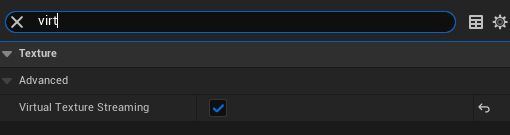

2. **Компрессия для MRA-карты** *(текстура-маска, где канал R = Metallic, G = Roughness, B = Ambient Occlusion)*: в поиске Details введите `Compression` и выберите **`Compression Settings = Masks (no sRGB)`**.

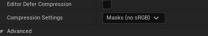

3. Нажмите **Save** (`Ctrl + S`).

#### Минимальный набор материалов для Модуля 1
Чтобы машина уже выглядела аккуратно, создайте 3 базовых **Material Instance**:
1. В Content Browser перейдите в `Content/Common/MasterMaterials/VehicleMaterials/ModMaterials/`.
2. Нажмите **ПКМ** по нужному родительскому материалу → **Create Material Instance** и перетащите созданный файл в вашу папку `MyFirstCar/Materials/`:
   - От **`MI_Mod_CarPaint`** → `MI_MyFirstCar_Paint` (окрашенный кузов — можно просто задать цвет даже без текстур!).
   - От **`MI_Mod_Exterior`** → `MI_MyFirstCar_Exterior` (пластик, металл, диски колёс).
   - От **`MI_Mod_Tyre`** → `MI_MyFirstCar_Tyre` (покрышки колёс).
3. Откройте каждый созданный `MI_*` двойным кликом, поставьте галочки слева от нужных параметров (цвет / текстуры), выберите свои текстуры и нажмите **Save**.
4. Откройте Static Mesh кузова и колёс двойным кликом и в панели **Details → Material Slots** назначьте созданные `MI_*` в соответствующие слоты. Нажмите **Save**.

*(Подробный разбор всех 14 материалов `MI_Mod_*`, ливрей, стёкол и фар — в [Модуле 2](./02_Exterior_Lights_and_World.md) и [Модуле 3](./03_Interior_Dashboard_Cameras_Seats.md).)*

---

## Шаг 4. Сборка минимального Актора автомобиля (`V_MyFirstCar`)

Актор автомобиля — это Blueprint-контейнер, в котором собираются кузов, колёса и камеры.

### 4.1. Общие правила для всех узлов Актора
Запомните 3 базовых правила (они действуют во всех модулях):
1. **Scale всегда `(1.0, 1.0, 1.0)`** у самого Актора и всех его компонентов.
2. **Коллизия по умолчанию выключена:** у всех компонентов (кроме `Body`) выставляйте `Collision Presets = NoCollision` и снимайте галочку `Receives Decals` (по умолчанию выключено).
3. **Немодифицированный Transform:** у важных именованных узлов (например, `Body`) `Location` и `Rotation` остаются `(0, 0, 0)`, если в инструкции явно не указано иное. К любому узлу можно прикрепить свои дополнительные декоративные меши (с `NoCollision` и любым нужным Transform).

### 4.2. Создание Blueprint Актора
1. В Content Browser откройте корень вашей папки мода `Plugins/Mods Content/MyFirstCar/`.
2. Нажмите **ПКМ** на пустом месте → **Blueprint Class**.
3. В окне *Pick Parent Class* выберите **Actor**.
4. Назовите файл **`V_MyFirstCar`** и откройте его двойным кликом.

### 4.3. Добавление кузова (`Body`)
1. В левой панели **Components** нажмите кнопку **`+ Add`** → введите `Static Mesh` → выберите **Static Mesh**.
2. Переименуйте компонент строго в **`Body`** (регистр важен!). Убедитесь, что он прикреплён к `DefaultSceneRoot`, а его `Location` и `Rotation` равны `(0, 0, 0)`.
3. Выделите **`Body`** и в панели **Details** справа настройте:
   - **Static Mesh:** выберите ваш импортированный меш кузова.
   - **Collision → Collision Presets:** выберите **`BlockAllDynamic`**.
   - **Physics → Mass (kg):** поставьте галочку слева от `Mass (kg)` (`Override Mass`) и укажите **подрессоренную массу кузова** в килограммах (масса автомобиля минус масса 4 колёс; для обычного седана это примерно `1200–1500` кг, для минивэна — `2100` кг).
   - **Physics → Advanced → Center Of Mass Offset:** смещение центра масс в сантиметрах `(X, Y, Z)` от геометрического центра коллизии. Для первого теста можно оставить `(0, 0, 0)` или слегка опустить по `Z` (например, `Z = -20`), чтобы машина была устойчивее. *(Точная формула расчёта развесовки приведена в [VehicleLib_HTML/00_Quick_Start.html](../VehicleLib_MD/00_Quick_Start.md).)*

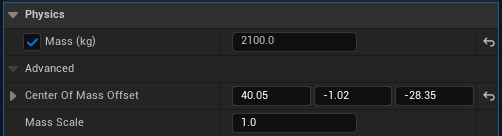

### 4.4. Добавление 4 колёс (`Wheel*`)

> [!CAUTION]
> **Задняя ось в стандартных схемах называется `Back`, а НЕ `Rear`!**
> Используйте строго эти 4 имени:
> - `WheelFrontLeft` — переднее левое
> - `WheelFrontRight` — переднее правое
> - `WheelBackLeft` — заднее левое
> - `WheelBackRight` — заднее правое

В Модуле 1 (без суппортов подвески) колёса крепятся напрямую к `Body`:
1. Выделите в дереве **Components** компонент **`Body`**, нажмите **`+ Add`** → **Static Mesh** и назовите его **`WheelFrontLeft`**.
2. В **Details** выберите меш переднего левого колеса, выставите `Collision Presets = NoCollision` и отключите `Receives Decals`.
3. В поле **Transform → Location** задайте позицию колеса в сантиметрах — **такую, при которой подвеска максимально прожата вверх** (верхняя точка хода стойки, совпадающая с точкой `Mount` в `Vehicle.ini`; подробнее в Шаге 5).
4. Повторите шаги 1–3 для остальных трёх колёс: `WheelFrontRight`, `WheelBackLeft`, `WheelBackRight`.

*(Если позже вы добавите неподвижные суппорты подвески `SuspensionFrontLeft/Right/BackLeft/Right` в [Модуле 2](./02_Exterior_Lights_and_World.md), то координаты `Location` перенесутся на них, а у дочерних `Wheel*` станет `Location = (0, 0, 0)`.)*

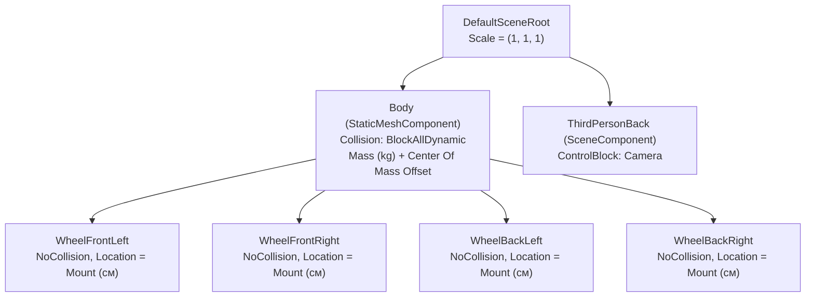

### 4.5. Знакомство с `ControlBlock` и добавление базовой камеры (`ThirdPersonBack`)

Чтобы в игре вы видели свой автомобиль со стороны под удобным ракурсом, добавим одну базовую камеру третьего лица и заодно освоим главный механизм настройки компонентов — **`ControlBlock`**.

> [!NOTE]
> **А что с остальными камерами (`FirstPerson`, `Windshield`, `ThirdPersonFront`, `TopDown`)?**
> Все остальные камеры, которые вы пока не создали вручную, в игре **всё равно будут доступны**, но расположатся в стандартных точках по умолчанию — они могут не совсем подходить под габариты вашего конкретного автомобиля. Точно расставить все 5 камер под свой кузов вы сможете в [Модуле 3](./03_Interior_Dashboard_Cameras_Seats.md#4-игровые-камеры-автомобиля).

1. Выделите `DefaultSceneRoot` → нажмите **`+ Add`** → **Scene** (создастся `SceneComponent`). Назовите его **`Cam_ThirdPersonBack`**.
2. Выставьте ему **Location** примерно в центре автомобиля (ось вращения камеры, например `X = 0, Y = 0, Z = 130` см).
3. Теперь прикрепим к нему **`ControlBlock`** (запомните эту последовательность — она используется по всему руководству):
   - Не снимая выделения с `Cam_ThirdPersonBack`, в панели **Details** справа в строке поиска введите **`Asset User Data`**.
   - Напротив `Asset User Data` нажмите **`+`** → в появившемся слоте `Index [0]` выберите из списка **`Control Asset Data`**.
   - Раскройте `Index [0]` → напротив **`Control Blocks`** нажмите **`+`**.
   - В левое текстовое поле впишите имя блока: **`Camera`**. В правом выпадающем списке убедитесь, что выбрано **`Control Block`**.
   - Раскройте **`Camera`** → напротив **`Properties`** нажмите **`+`** два раза, чтобы добавить 2 свойства:
     1. Имя слева: **`Type`** → тип справа: **`Control Property String`** → раскройте и в `Value` напишите **`ThirdPersonBack`**.
     2. *(Опционально)* Имя слева: **`ArmLength`** → тип справа: **`Control Property Float`** → раскройте и в `Value` напишите дистанцию в сантиметрах, например **`600.0`**. *(На скриншоте ниже указано старое написание с опечаткой, но в актуальной версии используется правильное имя **`ArmLength`**.)*

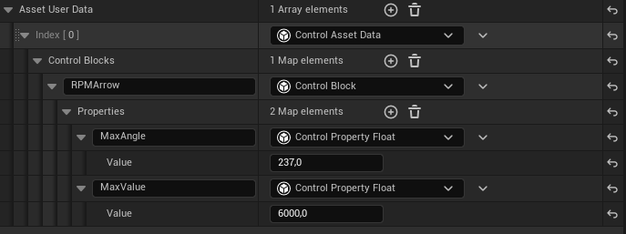

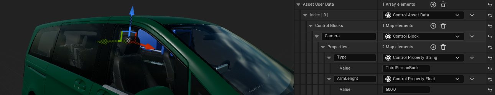

4. **Проверка:** посмотрите на дерево **Components** слева — компонент `Cam_ThirdPersonBack` должен автоматически **подсветиться зелёным**!
5. Нажмите кнопки **Compile** и **Save** в левом верхнем углу Blueprint Editor.

---

## Шаг 5. Минимальная настройка координат и колёс в `Vehicle.ini`

Откройте `Plugins\Mods\Content\MyFirstCar\Vehicle.ini` и синхронизируйте геометрию вашего 3D-автомобиля с физикой (все единицы в `Vehicle.ini` — в **метрах**, тогда как в Unreal Engine — в **сантиметрах**!):

### 5.1. Перевод координат `Location` (UE) → `Mount` (`Vehicle.ini`)

> [!IMPORTANT]
> **Правило перевода координат из UE в `Vehicle.ini`:**
> 1. Поделите все 3 координаты `X, Y, Z` на **100** (перевод из сантиметров в метры).
> 2. **Инвертируйте знак оси `Y`!** В UE левая сторона автомобиля имеет отрицательный `Y` (`Y < 0`), а в `Vehicle.ini` левые колёса имеют **положительный `Y`** (`Y > 0`), правые — **отрицательный `Y`** (`Y < 0`).

Пример для переднего левого колеса:
- В UE (`Location` узла `WheelFrontLeft` / `SuspensionFrontLeft`): `X = 163 см`, `Y = -85 см`, `Z = 44.55 см` (положение при максимально прожатой подвеске).
- В `Vehicle.ini`:
```ini
[SuspensionFrontLeft]
Length = 0.20
Mount = 1.63; 0.85; 0.4455
```

> [!TIP]
> **Как связаны `Mount.Z`, `Length` и положение колеса в покое?**
> В статике автомобиль просаживается под собственным весом примерно на треть хода подвески (`NormalSag = 0.33`).
> Если вы знаете желаемый центр колёсной арки в спокойном состоянии `(X_см, Y_см, Z_см)`, то верхняя точка сжатой стойки `Mount.Z` вычисляется по формуле из `VehicleLib`:
> `Mount.Z = (Z_см / 100) + (1 - 0.33) * Length`
> Например, при центре арки `Z = 31 см` и ходе подвески `Length = 0.20 м`: `Mount.Z = 0.31 + 0.67 * 0.20 = 0.444 м` (`44.4 см` в UE).

Пропишите корректные `Mount` и `Length` для всех четырёх секций:
- `[SuspensionFrontLeft]` (`Y > 0`)
- `[SuspensionFrontRight]` (`Y < 0`)
- `[SuspensionBackLeft]` (`Y > 0`)
- `[SuspensionBackRight]` (`Y < 0`)

### 5.2. Радиус колёс и колёсная база
1. В секциях `[WheelFrontLeft]`, `[WheelFrontRight]`, `[WheelBackLeft]`, `[WheelBackRight]` укажите радиус вашего колеса в **метрах** (измерьте диаметр 3D-меша колеса, поделите пополам и вычтите ~1 см на прогиб шины под весом авто):
```ini
[WheelFrontLeft]
Radius = 0.345
```
2. В секции `[Steering]` укажите расстояние между передней и задней осью в метрах:
```ini
[Steering]
InteraxleDistance = 2.75   ; = (MountFront.X - MountBack.X)
```

*(Когда машина уверенно поедет, для точной настройки жёсткости пружин, двигателя `Engine.csv` и КПП воспользуйтесь руководством **[VehicleLib_HTML/00_Quick_Start.html](../VehicleLib_MD/00_Quick_Start.md)**.)*

---

## Шаг 6. Создание паспорта автомобиля (`PDA_PrototypedVehicleSpecification`)

Чтобы игра увидела ваш автомобиль и показала его в списке выбора машин, нужен специальный **Data Asset**.

1. В Content Browser откройте корень вашей папки `MyFirstCar/`.
2. Нажмите **ПКМ** на пустом месте → **Data** (или **Miscellaneous**) → **Data Asset**.

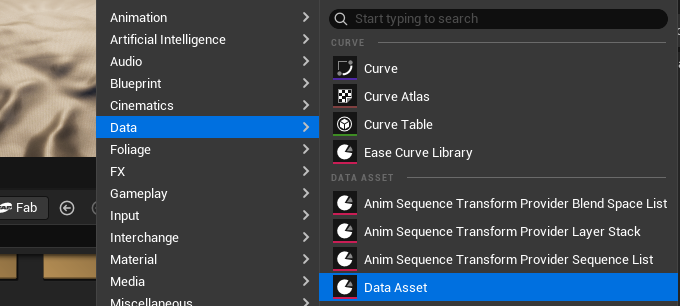

3. В открывшемся окне найдите и выберите класс **`PDA_PrototypedVehicleSpecification`** → нажмите **Select**.

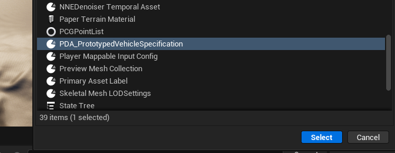

4. Назовите файл **`DA_MyFirstCar`** и откройте его двойным кликом.
5. Заполните секцию **Prototype**:
   - **`Prototype`:** выберите ваш Blueprint Актора **`V_MyFirstCar`**.
   - **`Prototype Version`:** укажите **`1`** (версия загрузчика автомобиля).

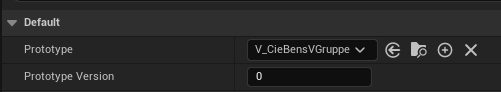

6. Заполните **обязательные спецификации** (секция **Vehicle Specifications**):
   - **`Name`:** отображаемое название автомобиля в игре (можно писать текст напрямую, `String Table` создавать не обязательно).
   - **`Image`:** превью-картинка автомобиля для меню (импортируйте любую `.png` картинку в `Textures/` с включённым Virtual Texture или временно выберите существующую из шаблона).
   - **`Class`:** выберите класс автомобиля из выпадающего списка (например, `Economy`).
   - **`Engine Types`:** нажмите `+`, чтобы добавить **минимум один** тип двигателя — это поле обязательно, так как именно оно определяет тип топлива (`Fuel Type`: `Gasoline`, `Diesel` и т. д.).
   - **`Transmission Types`:** желательно сразу добавить два варианта — `Automatic` и `Manual` — и привязать их к `options.xml`:
     - Для `Index [0]` (`Automatic`): поставьте галочку **`Bound to Option`**, впишите **`Option Name = TransmissionType`**, **`Option Value = Auto`**.
     - Для `Index [1]` (`Manual`): поставьте галочку **`Bound to Option`**, впишите **`Option Name = TransmissionType`**, **`Option Value = Manual`**.
     - Значения `Option Name` и `Option Value` должны **символ в символ совпадать** с полями в вашем `options.xml`!

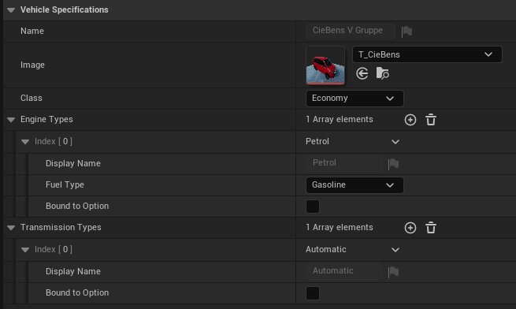

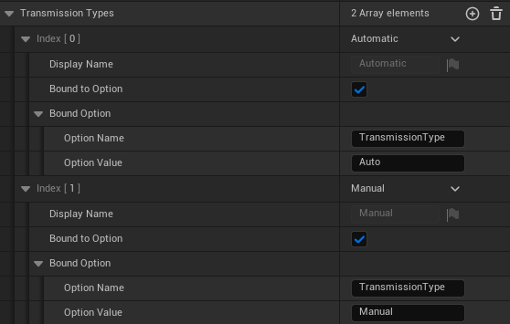

7. Нажмите **Save All** (`Ctrl + Shift + S`) в редакторе UE.

---

## Шаг 7. Сборка `.pak`, локальный тест и публикация в Steam Workshop

### 7.1. Упаковка мода в `.pak`
1. Убедитесь, что все файлы в редакторе UE сохранены (**File → Save All**). Редактор можно закрыть или оставить открытым.
2. В корневой папке проекта `CCD2_VehicleKit` найдите и запустите двойным кликом скрипт **`build_mod_dlc.bat`**.
3. Дождитесь завершения работы консоли. При успешной сборке в конце появится строка:
   ```text
   DLC build successful: ...\Saved\DLC\Windows\Mods.pak
   ```
   *(Эталонный автомобиль `CieBensVGruppe` помечен специальным игнор-лейблом `L_IGNORE` и в ваш `.pak` не попадёт.)*
4. Перейдите в папку `\Saved\DLC\Windows\`, найдите файл **`Mods.pak`** и **переименуйте его** по имени вашего мода, например **`MyFirstCar.pak`**.

### 7.2. Локальное тестирование в игре CCD 2.0 (до публикации)
1. Скопируйте переименованный файл **`MyFirstCar.pak`** в папку с установленной игрой:
   ```text
   <Папка установки игры>\CityCarDriving2\Content\Paks\
   ```
2. Запустите **City Car Driving 2.0** и выберите ваш автомобиль в меню выбора транспорта.

### 7.3. Контрольный чек-лист проверки Модуля 1
Перед тем как переходить к красоте (экстерьеру, салону и звукам), убедитесь, что база работает идеально:

- [ ] Автомобиль отображается в меню выбора машин с правильным именем, превью и выбором АКПП/МКПП.
- [ ] После загрузки на карту машина стоит на колёсах ровно, не проваливается под землю и не улетает в небо.
- [ ] Колёса находятся в арках на правильной высоте и не перепутаны по сторонам (`Y` инвертирован верно).
- [ ] Камера третьего лица (`ThirdPersonBack`) вращается вокруг центра машины на комфортном расстоянии.
- [ ] Двигатель заводится, машина разгоняется, колёса крутятся в правильную сторону, передние колёса поворачивают, тормоз останавливает машину.
- [ ] При лёгком столкновении с бордюром/стеной срабатывает коллизия `Body`.

### 7.4. Публикация в Steam Workshop
Когда мод проверен и готов к публикации для других игроков, воспользуйтесь официальной инструкцией по загрузке в Steam Workshop (**пункт 4**):
- <https://steamcommunity.com/sharedfiles/filedetails/?id=3763865332>

---

**Поздравляем — ваш первый автомобиль уже ездит в CCD 2.0!**
**Следующий шаг:** переходите к **[Модулю 2. Экстерьер, оптика, подвеска и взаимодействие с миром](./02_Exterior_Lights_and_World.md)**, чтобы добавить суппорты, фары, реальные источники света, номера, заправку и взаимодействие с миром.
