# Модуль 2. Экстерьер, оптика, подвеска и взаимодействие с миром

**Навигация:** [README](./README.md) | [01. Минимальный автомобиль](./01_Minimal_Car_QuickStart.md) | **02. Экстерьер, свет и мир** | [03. Салон, приборка и камеры](./03_Interior_Dashboard_Cameras_Seats.md) | [04. Зеркала и дворники](./04_Mirrors_and_Wipers.md) | [05. Звуки и FMOD](./05_Sounds_and_FMOD.md) | [06. Комплектации, логика и шпаргалка](./06_Advanced_Specs_Logic_and_Reference.md)

---

После прохождения [Модуля 1](./01_Minimal_Car_QuickStart.md) ваш автомобиль уже ездит. В этом модуле мы доведём до ума внешний вид и взаимодействие с игровым миром:
- настроим все PBR-материалы экстерьера и стёкол;
- добавим неподвижные элементы подвески (тормозные суппорты `Suspension*`);
- подключим светящиеся фары/фонари и реальные источники света, освещающие дорогу;
- настроим автомобильные номера;
- добавим зону взаимодействия с объектами мира (`LogicBox`), топливный бак (`FuelTank`) и защиту салона от капель дождя (`RainBlocker`).

---

## 1. Текстуры и материалы экстерьера

Все материалы в модах — это **PBR-материалы** (`Material Instance`), унаследованные от подготовленных родительских материалов из папки `Content/Common/MasterMaterials/VehicleMaterials/ModMaterials/` и работающие по **0-му UV-каналу**.

### 1.1. Типы PBR-текстур

| Карта | Назначение | Обязательные настройки в UE |
| --- | --- | --- |
| **Diffuse (Albedo)** | Базовый цвет поверхности (RGB). | `Virtual Texture Streaming = True` |
| **Normal** | Карта нормалей (рельеф поверхности). | `Virtual Texture Streaming = True` |
| **MRA** | Комбинированная маска по каналам: • **R** — Metallic (металличность) • **G** — Roughness (шероховатость) • **B** — Ambient Occlusion (затенение) | `Virtual Texture Streaming = True` **`Compression Settings = Masks (no sRGB)`** |
| **Emissive** | RGB-карта цвета свечения для ламп и фар. | `Virtual Texture Streaming = True` |
| **Livery** | RGB-карта ливреи/наклеек кузова; в **альфа-канале** хранится маска отделения ливреи от базовой краски. | `Virtual Texture Streaming = True` |

> [!TIP]
> Чтобы увидеть все доступные параметры `Material Instance`, откройте его двойным кликом в Content Browser и поставьте галочку слева от нужного параметра в панели **Details** — тогда значение станет активным для редактирования. Рекомендуется также изучать готовые примеры материалов в `Plugins/Mods Content/CieBensVGruppe/Materials/`.

### 1.2. Родительские материалы экстерьера

#### Окрашенная часть кузова — `MI_Mod_CarPaint`
Позволяет настраивать базовую краску автомобиля, её блеск/металлик, а также подключать текстуру ливреи (`Livery`) с маской в альфа-канале.

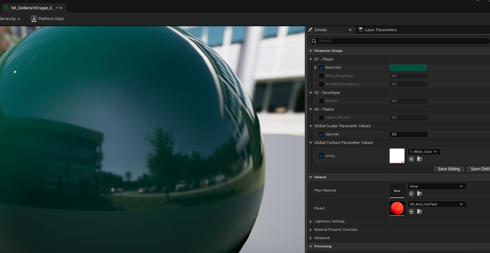

#### Пластик, хром, диски и неокрашенные детали — `MI_Mod_Exterior`
Используется для любых деталей экстерьера, на которые **не** должна наноситься базовая краска автомобиля (молдинги, решётка радиатора, хромированные элементы, днище, диски колёс, суппорты).

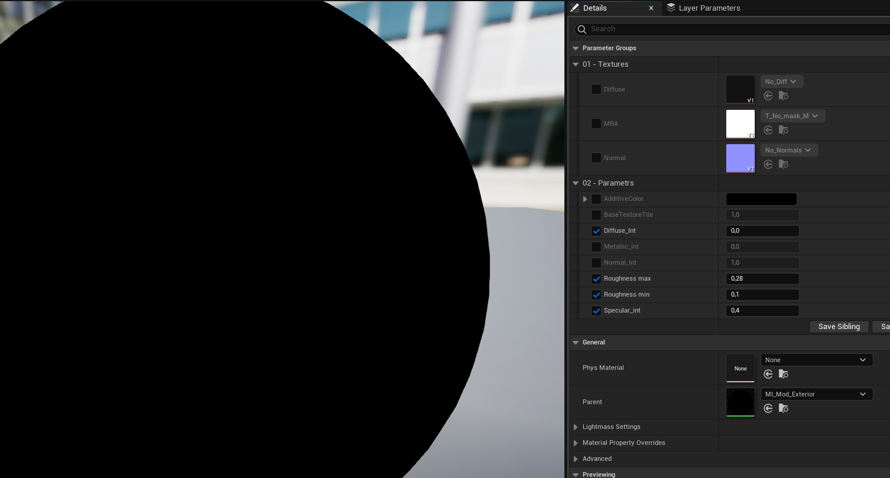

#### Шины — `MI_Mod_Tyre`
Специализированный материал для резиновых покрышек колёс.

#### Стёкла кузова и плафоны фар — `MI_Mod_Glass`
Используется для прозрачных и цветных стёкол фар (плафонов), а также для лобового, боковых и заднего стёкол автомобиля.

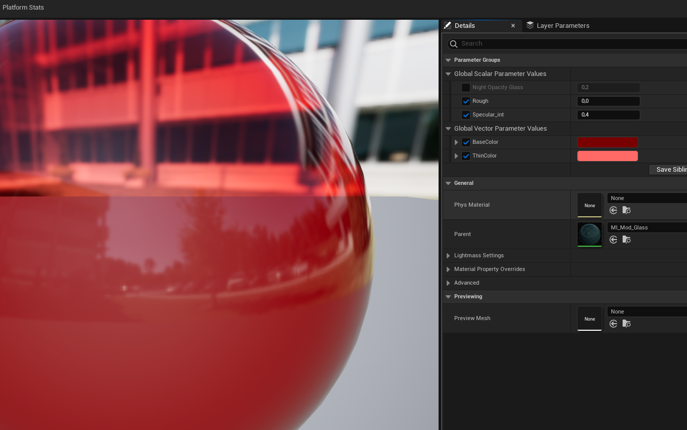

> [!NOTE]
> **Про стёкла (`Inner` / `Outer`) и капли дождя на стекле:**
> На текущий момент функционал капель дождя на стёклах в пользовательских (модерских) автомобилях ещё не реализован, поэтому жёстких требований по разделению стёкол нет — достаточно назначить `MI_Mod_Glass` на ваши меши стёкол.
> Однако **на будущее** (когда поддержка капель и стирания дворниками появится для модов) потребуется разделять стёкла на внешние и внутренние поверхности (`*_Outer` и `*_Inner`), как это уже сделано в эталонной модели `CieBensVGruppe/Meshes/`.

---

## 2. Неподвижные части колеса / суппорты (`Suspension*`)

Если на вашем автомобиле видны тормозные суппорты или поворотные кулаки, которые должны двигаться вверх-вниз на кочках и поворачиваться вместе с передними колёсами, но **не вращаться вокруг оси колеса**, используйте узлы `Suspension*`.

### 2.1. Подготовка и импорт модели суппорта
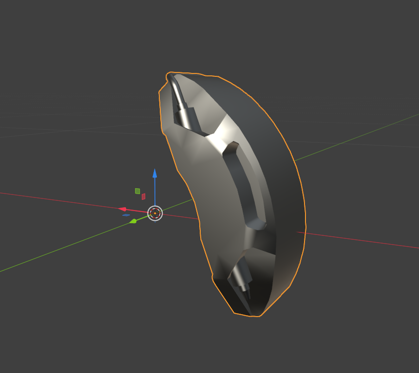

1. В 3D-редакторе поставьте **пивот** модели строго в центре относительно точки крепления колеса (совпадает с центром колеса). Ось вращения колеса — **`Y`**.
2. Импортируйте в UE так же, как колесо: **`Import Collisions` = выключено**, **`Fallback Collision Type` = выключено (`None`)**, **`Import Materials` = выключено**, **`Build Nanite` = выключено**.
3. Назначьте материал от родительского **`MI_Mod_Exterior`**.

### 2.2. Подключение в Акторе `V_<ИмяМода>`
1. Добавьте к **`Body`** *(рекомендуемое крепление для порядка в иерархии)* 4 компонента `StaticMeshComponent` со строгими именами из XML-схемы:
   - `SuspensionFrontLeft`
   - `SuspensionFrontRight`
   - `SuspensionBackLeft`
   - `SuspensionBackRight`
2. Выставьте всем четырём **`Collision Presets = NoCollision`** и снимите **`Receives Decals`**.
3. Перенесите координаты `Location` (в сантиметрах, положение максимально прожатой подвески, совпадающее с `Mount` в `Vehicle.ini` с инверсией `Y`) с узлов колёс на соответствующие узлы `Suspension*`.
4. Перетащите каждый узел колеса (`WheelFrontLeft`, `WheelFrontRight`, `WheelBackLeft`, `WheelBackRight`) мышкой внутрь соответствующего `Suspension*` и обнулите у колёс `Location = (0, 0, 0)`.

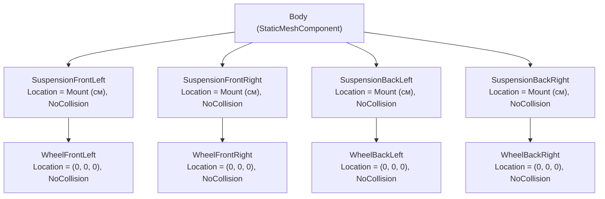

---

## 3. Оптика автомобиля: светящиеся слоты и реальные источники света

В Unreal Engine и CCD 2.0 внешнее освещение состоит из **двух разных частей**:
1. **Светящаяся геометрия фары/фонаря** (визуально загорается сама лампочка на кузове) — управляется через **имена слотов материалов (`Material Slot Name`)** на меше кузова.
2. **Реальный источник света** (светит на асфальт, стены и знаки) — отдельные компоненты **`SpotLight`** на Акторе с **`ControlBlock` `Light`**.

### 3.1. Светящиеся элементы на кузове (`MI_Mod_Emissive_Beam`)

Для каждого типа ламп на 3D-модели кузова должен быть свой **отдельный Material ID (слот материала)**.
1. Создайте `Material Instance` от **`MI_Mod_Emissive_Beam`**. Цвет лампы в выключенном состоянии задаётся через `Albedo_texture`, цвет свечения — через `Emissive`-текстуру.

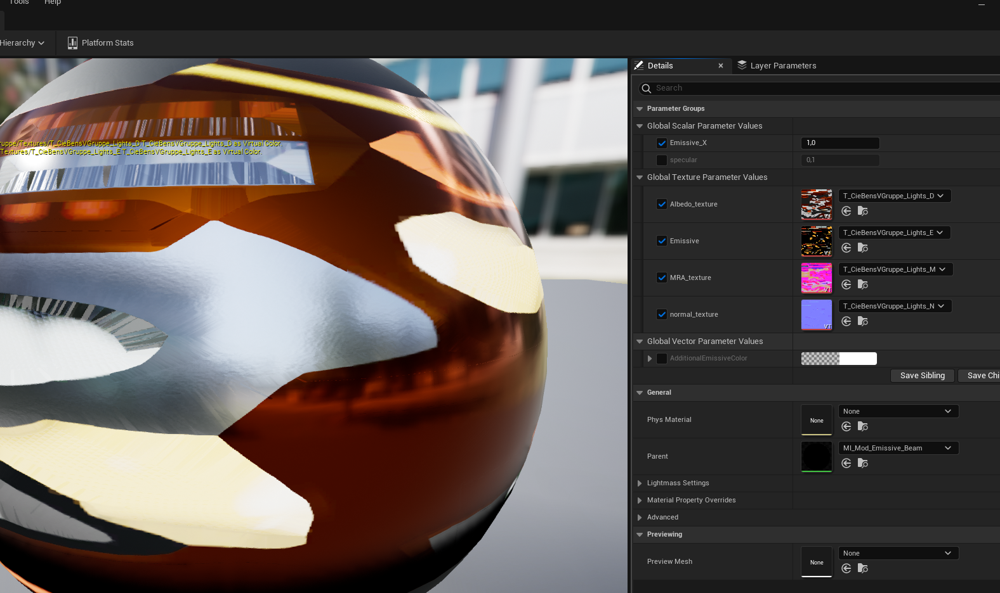

2. Откройте Static Mesh кузова (`Body`) двойным кликом → в панели **Details → Material Slots** назначьте созданные материалы и **переименуйте поле `Slot Name`** строго по таблице ниже:

> [!IMPORTANT]
> Игре важно именно поле **`Slot Name`** внутри Static Mesh, а не имя файла `MI_*` в Content Browser!

| Обязательное имя слота (`Slot Name`) | Назначение |
| --- | --- |
| `LowBeam` | Лампа ближнего света |
| `HighBeam` | Лампа дальнего света |
| `ParkingLights` | Лампа габаритных огней |
| `FrontFogLights` | Лампа переднего противотуманного огня |
| `RearFogLights` | Лампа заднего противотуманного огня |
| `StopLight` | Лампа стоп-сигнала |
| `ReverseLight` | Лампа заднего хода |
| `LeftTurnLight` | Лампа левого указателя поворота |
| `RightTurnLight` | Лампа правого указателя поворота |
| `LicensePlates` | Лампочки подсветки номерного знака |

### 3.2. Реальные источники света (`BP_ExportSpotLight` / `SpotLightComponent`)

#### Шаг 1. Создаём переиспользуемые компоненты света (удобно для левой и правой фары)
В папке `MyFirstCar/Blueprints/` рекомендуется заранее создать Blueprint-компоненты для каждого типа фар:
- Для **передних фар (ближний и дальний свет)** создавайте Blueprint Class с родительским классом **`BP_ExportSpotLight`** (лежит в `Content/Common/Player/BP_ExportSpotLight`).
- Для **остальных огней** (задний ход, стоп-сигналы, поворотники) можно использовать любой Light Component, но рекомендуется обычный **`SpotLightComponent`**.

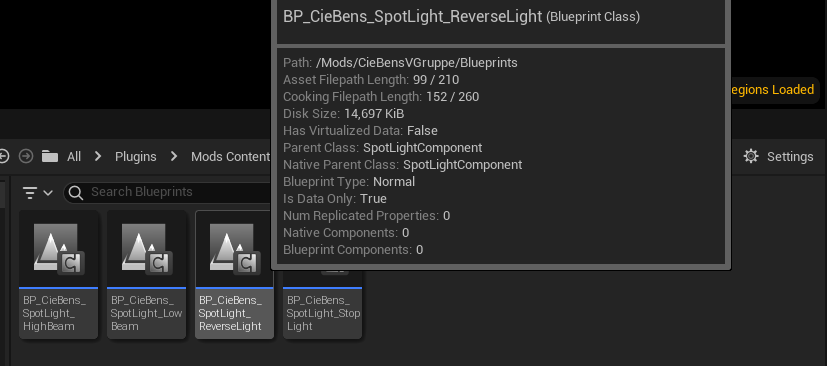

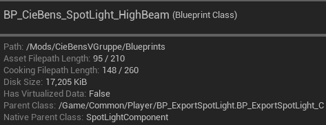

#### Шаг 2. Настройка светового пятна (`LFM_VehicleLightSpot`) и яркости
Если вы хотите, чтобы фара давала реалистичный рисунок светотеневой границы на асфальте:
1. Создайте `Material Instance` от **`LFM_VehicleLightSpot`** (лежит в `Content/Common/MasterMaterials/VehicleMaterials/ModMaterials/Lights/LFM_VehicleLightSpot`).
2. Если подставляете свою текстуру маски светового пятна — откройте её и установите **`Compression Settings = Alpha`**.
3. Назначьте созданный `LFMI_*` в поле **`Light Function Material`** вашего источника света.

Ориентировочные значения параметров из эталонного `CieBensVGruppe`:

| Тип фонаря | Intensity Units | Intensity | Attenuation Radius | Inner / Outer Cone Angle | Shadow Bias |
| --- | --- | --- | --- | --- | --- |
| Ближний свет (`LowBeam`) | `Candelas` | `8000.0 cd` | `2500.0` | `0.0 / 36.0` | `0.1` |
| Дальний свет (`HighBeam`) | `Candelas` | `2500.0 cd` | `10000.0` | `0.0 / 60.0` | `0.1` |
| Задний ход (`ReverseLight`) | `Candelas` | `100.0 cd` | `400.0` | `0.0 / 60.0` | — |
| Стоп-сигнал (`StopLight`) | `Candelas` | `30.0 cd` | `300.0` | `0.0 / 60.0` | — |

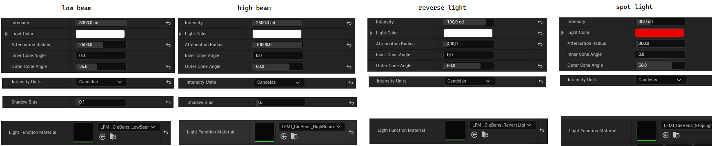

#### Шаг 3. Расстановка на Акторе и ориентация
1. Откройте ваш Актор `V_<ИмяМода>`, добавьте созданные компоненты света к `Body` (или к `DefaultSceneRoot`) и расположите их точно на месте фар/фонарей.
2. **Важно для световых пятен из шаблонного проекта:** соблюдайте ориентацию локальных осей компонента света как на скриншоте ниже — **ось `Y` (зелёная) направлена вниз, ось `Z` (синяя) — в сторону**, ось `X` (красная) — по направлению луча света.

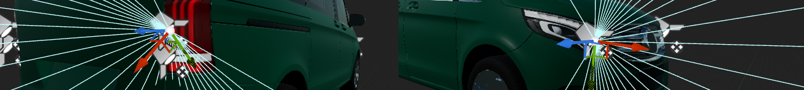

#### Шаг 4. Привязка к физике через `ControlBlock` `Light`
На **каждом** источнике света добавьте `Asset User Data → Control Asset Data`:
- Имя `Control Block`: **`Light`**
- Свойство в `Properties`:
  - Имя: **`PhysicsOutput`**
  - Тип: **`Control Property String Array`**
  - В `Values` добавьте одно или несколько имён выходных каналов физики (типа `float`), управляющих яркостью этого источника:

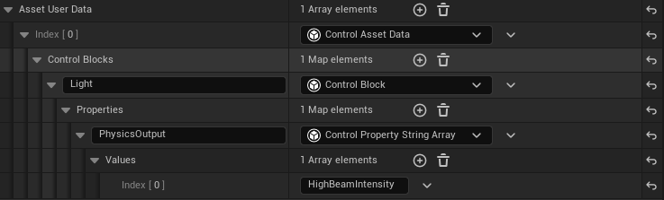

| Значение в `PhysicsOutput` | Чем управляет |
| --- | --- |
| `LowBeamIntensity` | Ближний свет |
| `HighBeamIntensity` | Дальний свет |
| `ParkingLightsIntensity` | Габаритные огни |
| `FrontFogLightsIntensity` | Передние противотуманные фары |
| `RearFogLightsIntensity` | Задние противотуманные фонари |
| `StopLightIntensity` | Стоп-сигналы |
| `ReverseLightIntensity` | Фонари заднего хода |
| `LeftTurnLightIntensity` | Левые указатели поворота |
| `RightTurnLightIntensity` | Правые указатели поворота |
| `LicensePlatesIntensity` | Подсветка номерного знака |

> [!TIP]
> Не забудьте убедиться, что в `Vehicle.ini` в секции `[CarElectrics]` у всех используемых фонарей прописано положительное сопротивление (`*_Resistance > 0`) — подробнее см. [VehicleLib_HTML/04_Components_Electrics.html](../VehicleLib_MD/04_Components_Electrics.md).

---

## 4. Автомобильные номера (`LicensePlates`)

Игровые номера генерируются и подставляются игрой автоматически:
1. На меше номерной таблички задайте **`Slot Name = LicensePlates`**.
2. **Сам материал в слот можно не назначать (оставить пустым)** — игра автоматически заменит его динамическим материалом номерного знака. *(Материал `MI_Mod_LicensePlate` в папке `ModMaterials` для модов не используется.)*
3. UV-развёртка таблички должна заполнять квадрат `0..1` точно так, как показано на примере ниже.
4. **Самый быстрый способ:** просто скопируйте уже готовую плашку номера `SM_CieBensVGruppe_LicensePlate` из `Plugins/Mods Content/CieBensVGruppe/Meshes/` и разместите её на переднем и заднем бамперах вашего Актора (с `NoCollision`).

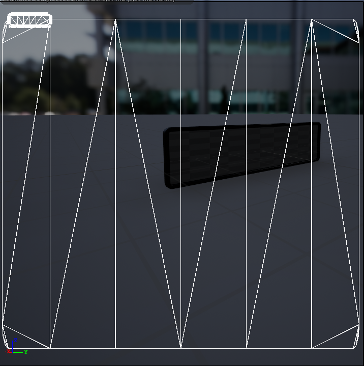

---

## 5. Взаимодействие с игровым миром

Эти 3 компонента не обязательны для базового старта, но необходимы, чтобы автомобиль полноценно работал со всеми механиками симулятора (АЗС, внутриигровые триггеры, дождь).

### 5.1. Зона взаимодействия с внешним миром (`LogicBox`)
Нужна, чтобы интерактивные объекты, шлагбаумы, парковочные зоны и внутриигровые триггеры корректно определяли габариты вашего автомобиля.
1. В Акторе `V_<ИмяМода>` добавьте компонент **`Box Collision`** (`+ Add → Box Collision`).
2. Подогните его **`Location`**, **`Rotation`** и **`Box Extent`** так, чтобы параллелепипед плотно охватывал габариты вашего автомобиля.
3. Добавьте на него `ControlBlock` с именем **`LogicBox`** (свойств добавлять не нужно).

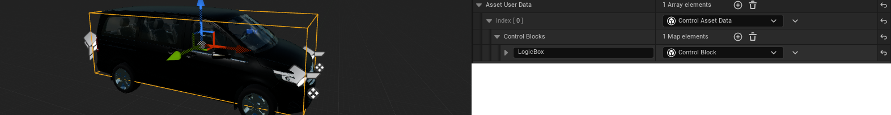

### 5.2. Топливный бак (`FuelTank`)
Отвечает за работу заправки на АЗС.
1. Добавьте **`SceneComponent`** (`+ Add → Scene`) и прикрепите его к компоненту с **нулевыми трансформами относительно корня** (например, напрямую к `DefaultSceneRoot` или `Body`).
2. Выставьте его позицию в районе лючка бензобака (если требуется) и добавьте `ControlBlock` с именем **`FuelTank`** (свойств добавлять не нужно — важен сам факт наличия блока).

### 5.3. Исключение капель дождя из салона (`RainBlocker`)
Чтобы капли падающего дождя не пролетали сквозь крышу внутрь салона:
1. Создайте в 3D-редакторе очень простой замкнутый меш-коробку, **слегка больше самого автомобиля** по объёму (или скопируйте и адаптируйте `SM_CieBensVGruppe_RainBlocker`). Импортируйте без коллизии.
2. Добавьте его как `StaticMeshComponent` на Актор автомобиля (`NoCollision`, `Receives Decals = False`).
3. Для удобства работы в редакторе назначьте ему каркасный материал **`MM_Wireframe`** (`Content/Common/MasterMaterials/System/MM_Wireframe`) — он не будет закрывать машину во вьюпорте, а в игре блокер невидим.
4. Добавьте на компонент `ControlBlock` с именем **`RainBlocker`** (без свойств).

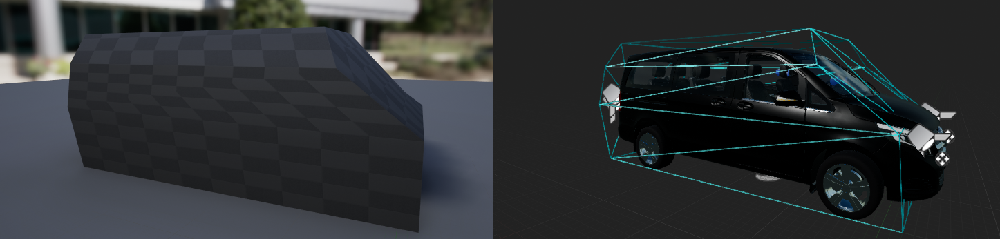

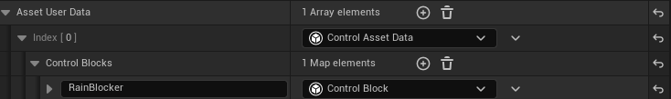

---

**Следующий шаг:** переходите к **[Модулю 3. Салон, приборная панель, камеры и посадка водителя](./03_Interior_Dashboard_Cameras_Seats.md)**, чтобы оживить интерьер автомобиля и вид от первого лица.
