# Модуль 3. Салон, приборная панель, камеры и посадка водителя

**Навигация:** [README](./README.md) | [01. Минимальный автомобиль](./01_Minimal_Car_QuickStart.md) | [02. Экстерьер, свет и мир](./02_Exterior_Lights_and_World.md) | **03. Салон, приборка и камеры** | [04. Зеркала и дворники](./04_Mirrors_and_Wipers.md) | [05. Звуки и FMOD](./05_Sounds_and_FMOD.md) | [06. Комплектации, логика и шпаргалка](./06_Advanced_Specs_Logic_and_Reference.md)

---

В этом модуле мы соберём полноценный вид из кабины:
- импортируем и настроим материалы салона;
- подключим вращающийся руль;
- оживим стрелки и контрольные лампы приборной панели;
- расставим все 5 игровых камер;
- настроим посадку водителя и место под пользовательскую игрушку в салоне.

---

## 1. Модель салона и контейнер `InteriorObjects`

### 1.1. Подготовка 3D-модели салона
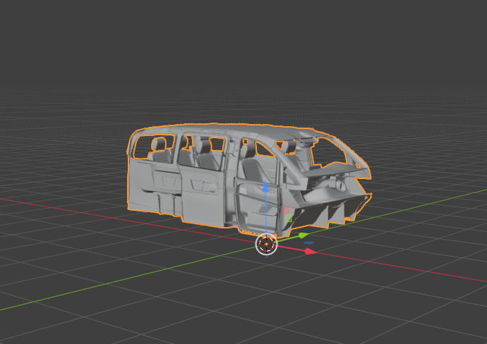

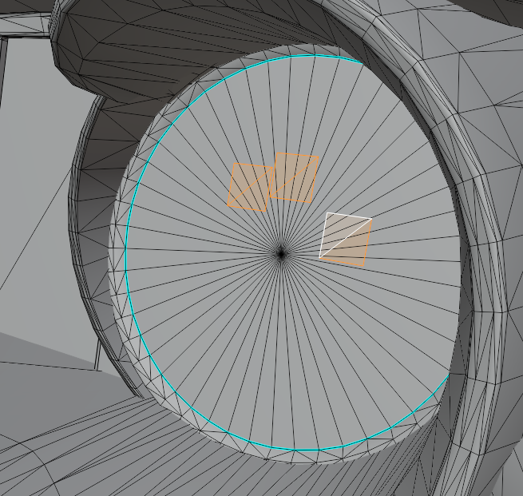

1. Салон должен быть **единой моделью** (руль, стрелки приборной панели и зеркала экспортируются отдельно).
2. Модель направлена вдоль оси **`+X`** и находится в тех же мировых координатах, что и кузов (`Body`), с масштабом `1:1` в сантиметрах.
3. Все элементы имеют UV-развёртку на **0-м канале**.
4. Каждый функциональный элемент (обшивка, стекло приборки, строчка, плафон центрального зеркала, каждый индикатор дашборда и подсвечиваемые кнопки) должен иметь свой **Material ID (слот материала)**.
5. Светящиеся индикаторы приборной панели и обозначения органов управления выполняются в виде отдельных полигонов/элементов меша со своими Material ID и развёрткой на 0-м канале.

### 1.2. Импорт салона в UE 5.8
1. Импортируйте `.fbx` салона в `MyFirstCar/Meshes/`.
2. Отключите **`Import Materials`** (снимите галочку) и **`Build Nanite`** (`False`).
3. В Акторе у меша салона всё равно выставляется **`NoCollision`** (физическая коллизия нужна только на `Body`), поэтому **`Import Collisions`** и **`Fallback Collision Type`** можно выключить (`False` / `None`).

### 1.3. Материалы салона (`MI_Mod_*`)
Все текстуры салона также должны иметь **`Virtual Texture Streaming = True`** (и `Masks (no sRGB)` для `MRA`-карт). Создавайте `Material Instance` от следующих родительских материалов из `Content/Common/MasterMaterials/VehicleMaterials/ModMaterials/`:

| Элемент салона | Родительский материал | Примечание |
| --- | --- | --- |
| Обшивка, торпедо, сиденья, пластик | **`MI_Mod_Vehicle_Interior`** | Основной PBR-материал салона. |
| Защитное стекло приборной панели | **`MI_Mod_PanelGlass`** | Прозрачное стекло над шкалами. |
| Детали с маской прозрачности (оплётка руля, строчка сидений) | **`MI_Mod_Stiches`** *(обратите внимание: без `t`)* | Поддерживает маску прозрачности (Opacity). |
| Плафон / корпус центрального зеркала | **`MI_Mod_Mirror`** | Используется для корпуса/плафона салонного зеркала (не для отражающей поверхности!). |
| Иконки-индикаторы на приборной панели | **`MI_Mod_Emissive_Ikons`** *(через `k`)* | Рекомендуется использовать готовый атлас `T_Dashboard_D` / `T_Dashboard_E` / `T_DashboardMask` из `CieBensVGruppe/Textures/`. |
| Светящиеся шкалы и стрелки приборки | **`MI_Mod_Emissive_Panel`** | Для стрелок (`SpeedometrArrow`, `RPMArrow` и др.) и шкал (`Dashboard`). |
| Подсвечиваемые кнопки и переключатели в салоне | **`MI_Mod_Emissive_Saloon`** | Кнопки стеклоподъёмников, климат-контроля и т. п. |

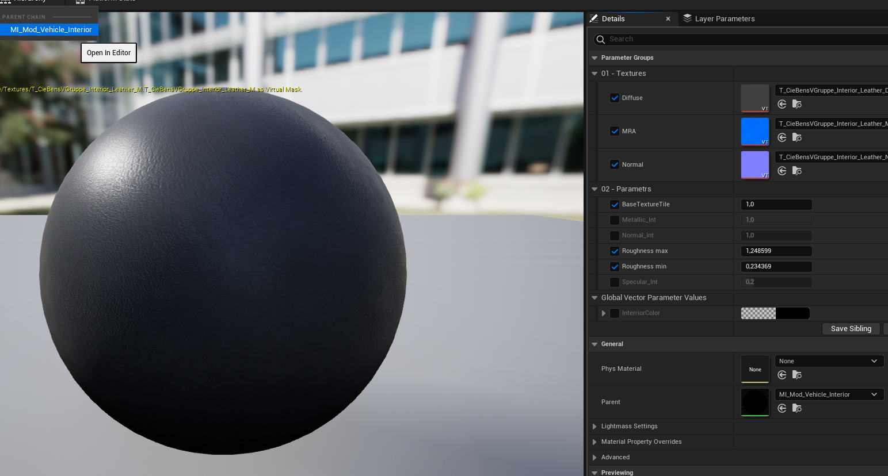

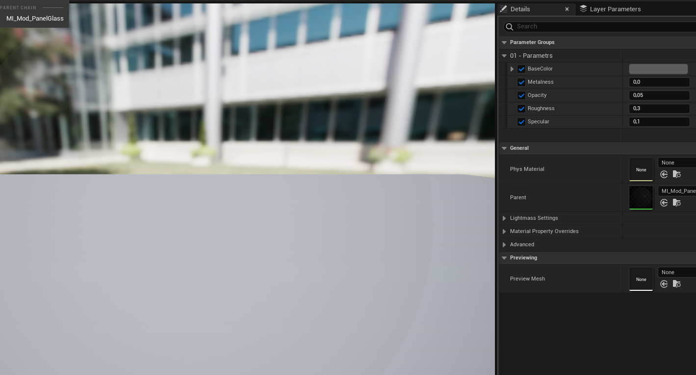

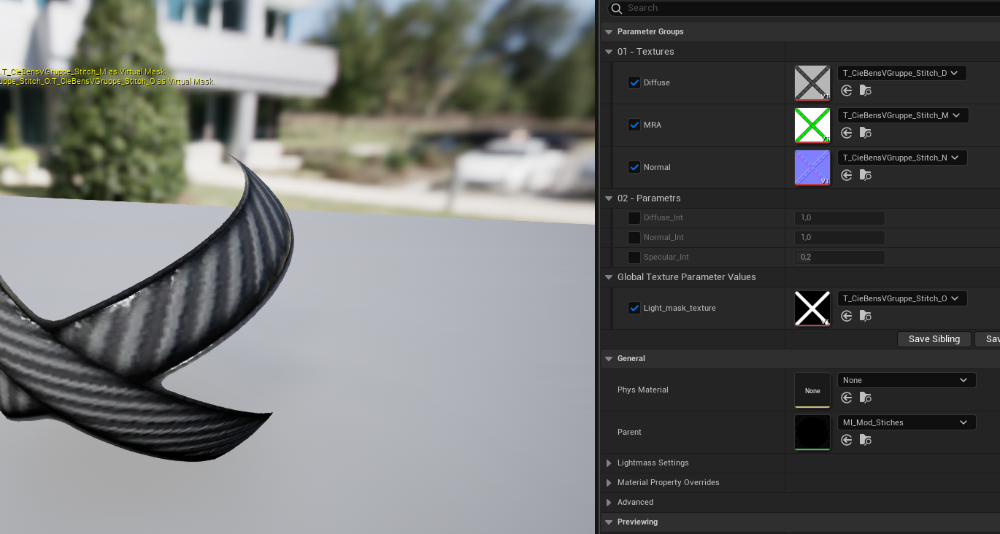

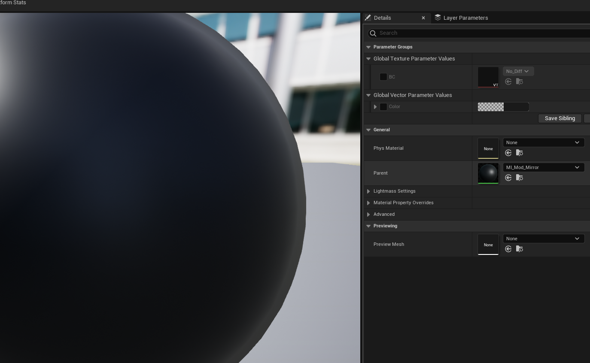

### 1.4. Размещение салона в Акторе (`InteriorObjects`)
1. Откройте Актор `V_<ИмяМода>`.
2. Выделите `DefaultSceneRoot` → нажмите **`+ Add`** → **Scene** и назовите компонент строго **`InteriorObjects`** (`Location = 0, 0, 0`, `Rotation = 0, 0, 0`).
3. Добавьте дочерним к `InteriorObjects` компонент `StaticMeshComponent` с вашим мешем салона (`Collision Presets = NoCollision`, `Receives Decals = False`). Все остальные элементы интерьера (руль, стрелки и т. д.) также удобно крепить внутрь `InteriorObjects`.

---

## 2. Рулевое колесо (`SteeringWheel`)

1. **Подготовка 3D-модели:** пивот руля в центре вращения (`0, 0, 0`), лицевая часть руля смотрит вдоль оси **`Z`** (ось вращения руля — **`Z`**). Импортируйте без коллизии и без создания материалов.

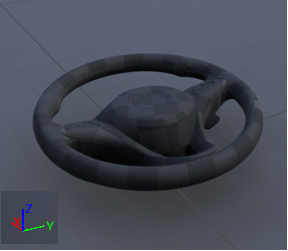

2. **Подключение в Акторе:**
   - Внутри `InteriorObjects` добавьте `StaticMeshComponent` с мешем руля (`NoCollision`).
   - Выставьте ему нужный **`Location`** и **`Rotation`** на рулевой колонке салона.
   - Добавьте **`ControlBlock`** с именем **`SteeringWheel`** (свойств добавлять не нужно).

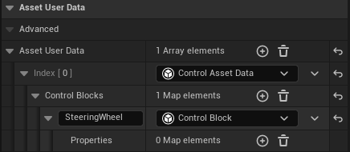

---

## 3. Приборная панель (`Dashboard`): стрелки и индикаторы

### 3.1. Стрелки приборной панели
1. **Подготовка 3D-модели стрелки:**
   - Пивот стрелки в центре её вращения (`0, 0, 0`).
   - Лицевая сторона стрелки смотрит на зрителя по оси **`+Z`**, а сама стрелка (её «остриё») указывает вдоль оси **`+X`**.

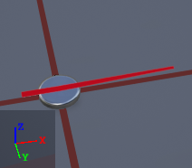

2. **Установка на Акторе:**
   - Добавьте `StaticMeshComponent` для каждой стрелки (внутрь `InteriorObjects`, `NoCollision`).
   - Выставьте `Location` и `Rotation` каждой стрелки так, чтобы она **указывала ровно на нулевое (минимальное) значение шкалы**.

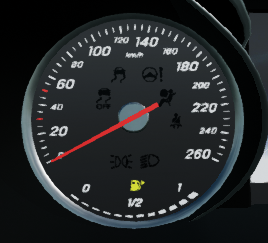

3. **Настройка `ControlBlock` для каждой стрелки:**

| Стрелка | Имя `ControlBlock` | Свойства (`Properties`, тип **`Control Property Float`**) |
| --- | --- | --- |
| **Спидометр** | `SpeedArrow` | • `MaxAngle` — угол поворота (в градусах) от нуля до максимума шкалы • `MaxValue` — максимальная скорость на шкале (например, `260.0`) |
| **Тахометр (RPM)** | `RPMArrow` | • `MaxAngle` — угол до максимума шкалы (например, `237.0`) • `MaxValue` — максимальные обороты на шкале (например, `6000.0`) |
| **Уровень топлива** | `FuelArrow` | • `MaxAngle` — угол от пустого бака до полного |
| **Температура ОЖ** | `CoolantTemperatureArrow` | • `MaxAngle` — угол от минимума до максимума шкалы • `MinValue` — минимальная температура на шкале (например, `50.0`) • `MaxValue` — максимальная температура на шкале (например, `130.0`) |

*(Наглядный пример заполнения `RPMArrow` приведён в [Модуле 1](./01_Minimal_Car_QuickStart.md#45-знакомство-с-controlblock-и-добавление-базовой-камеры-thirdpersonback).)*

### 3.2. Индикаторы и подсветка приборной панели (`SalonLights`)

Для работы контрольных ламп на приборной панели нужно выполнить 2 шага:

#### Шаг 1. Назначить правильные `Slot Name` на меше салона / приборки
Для иконок удобно использовать готовые текстуры `T_Dashboard_D` (цвет) и `T_DashboardMask` / `T_Dashboard_E` из `CieBensVGruppe/Textures/` вместе с родительским материалом **`MI_Mod_Emissive_Ikons`**.

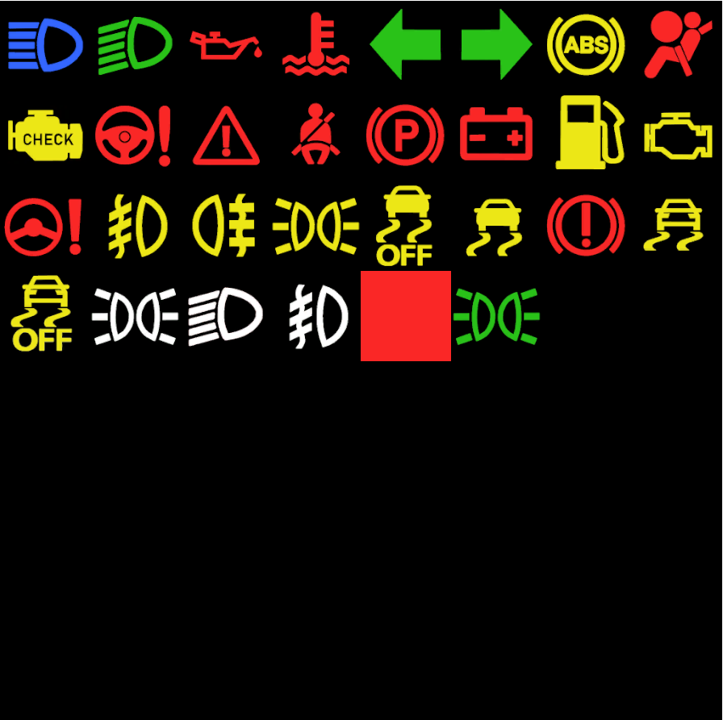

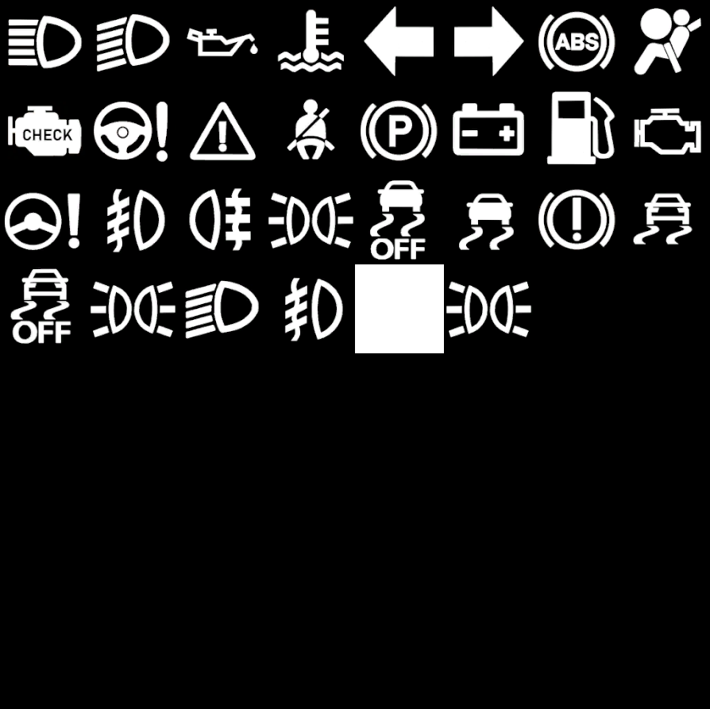

Откройте Static Mesh салона (и меши стрелок) и в **Material Slots** пропишите нужные **`Slot Name`** из сводной таблицы ниже.

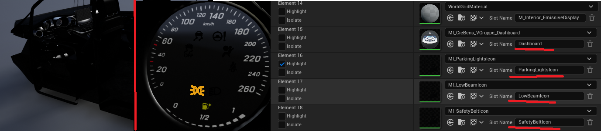

#### Шаг 2. Добавить `ControlBlock` `SalonLights` (или скопировать `DashboardController`)

> [!TIP]
> **Самый быстрый способ для новичков:**
> Если вам не нужна нестандартная схема индикаторов, откройте эталонный `V_CieBensVGruppe`, выберите в дереве `Components` компонент **`DashboardController`**, нажмите **`Ctrl + C`**, откройте ваш Актор `V_<ИмяМода>` и нажмите **`Ctrl + V`**! Все 23 привязки уже настроены внутри — вам останется только задать соответствующие `Slot Name` на меше салона.

Если вы настраиваете привязку вручную:
1. Создайте пустой `SceneComponent` (или выберите меш салона) и добавьте **`ControlBlock`** с именем **`SalonLights`**.
2. В `Properties` добавляйте пары:
   - **Ключ (слева):** имя выходного параметра из физики (`*Intensity`).
   - **Значение (справа):** тип **`Control Property String Array`**, внутри `Values` — один или несколько **`Slot Name`** материалов, свечением которых управляет этот параметр.

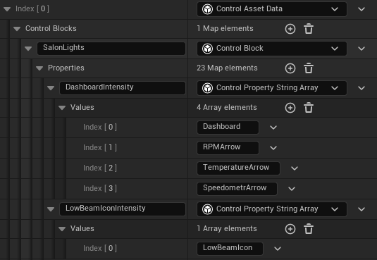

#### Сводная таблица индикаторов и подсветки (`SalonLights`)

> [!WARNING]
> Обратите внимание на точное написание слота **`SpeedometrArrow`** (без буквы `e` после `t`) — писать строго так!

| Параметр из физики (ключ в `SalonLights`) | Рекомендуемый `Slot Name` материала | Назначение |
| --- | --- | --- |
| `LowBeamIconIntensity` | `LowBeamIcon` | Индикатор ближнего света фар |
| `HighBeamIconIntensity` | `HighBeamIcon` | Индикатор дальнего света фар |
| `ParkingLightsIntensity` | `ParkingLightsIcon` | Индикатор габаритных огней |
| `FrontFogLightsIntensity` | `FrontFogLightsIcon` | Индикатор передних противотуманных фар |
| `RearFogLightsIntensity` | `RearFogLightsIcon` | Индикатор задних противотуманных фонарей |
| `LeftTurnLightIconIntensity` | `LeftTurnLightIcon` *(или общий `TurnLightIcon`)* | Индикатор левого поворотника / аварийки |
| `RightTurnLightIconIntensity` | `RightTurnLightIcon` *(или общий `TurnLightIcon`)* | Индикатор правого поворотника / аварийки |
| `HazardLightIconIntensity` | `HazardLightIcon` | Индикатор кнопки аварийной сигнализации |
| `SafetyBeltIconIntensity` | `SafetyBeltIcon` | Индикатор непристёгнутого ремня безопасности |
| `ParkingBrakeIconIntensity` | `ParkingBrakeIcon` | Индикатор стояночного тормоза (ручника) |
| `BatteryIconIntensity` | `BatteryIcon` | Индикатор разряда аккумулятора |
| `FuelIconIntensity` | `FuelIcon` | Индикатор критического (резервного) уровня топлива |
| `OilIconIntensity` | `OilIcon` | Индикатор низкого давления масла ДВС |
| `OverheatIconIntensity` | `OverheatIcon` | Индикатор перегрева охлаждающей жидкости |
| `EmergencyStopIconIntensity` | `EmergencyStopIcon` | Критическая лампа «STOP» (немедленно остановить и заглушить ДВС) |
| `PowerSteeringIconIntensity` | `PowerSteeringIcon` | Индикатор неисправности усилителя руля |
| `AbsActiveIconIntensity` | `AbsIcon` | Индикатор срабатывания / проверки системы ABS |
| `AbsDisableIconIntensity` | `AbsIcon` | Индикатор отключения / неисправности системы ABS |
| `TcsActiveIconIntensity` | `TCSActiveIcon` | Индикатор активного срабатывания системы стабилизации TCS (ESP) |
| `TcsDisableIconIntensity` | `TCSDisableIcon` | Индикатор выключенной системы стабилизации TCS (ESP) |
| `AirbagIconIntensity` | `AirbagIcon` | Индикатор подушки безопасности (самодиагностика при включении зажигания) |
| `ExhaustSystemIconIntensity` | `ExhaustSystemIcon` | Индикатор неисправности выхлопной системы / Check Engine |
| `CheckIconsIntensity` | `CheckIcons` | Вспомогательный канал: загорается только при самодиагностике ламп при включении зажигания (для декоративных иконок без отдельной логики) |
| `DashboardIntensity` | `Dashboard`, `SpeedometrArrow`, `RPMArrow`, `FuelArrow`, `TemperatureArrow`, `InteriorButton`, `MainDisplay`, `SecondDisplay` | Общая подсветка приборной панели, стрелок, кнопок салона и дисплеев |

> [!NOTE]
> **Про бортовые мониторы / мультимедиа-экраны:**
> На текущий момент отдельная инструкция и функционал настройки интерактивных мониторов в модах отсутствуют (можно использовать статическую подсветку через слоты `MainDisplay` / `SecondDisplay`).

---

## 4. Игровые камеры автомобиля

Все камеры настраиваются одинаково: вы добавляете компонент в Актор `V_<ИмяМода>`, выставляете его положение/поворот и вешаете **`ControlBlock`** с именем **`Camera`**.

| Тип камеры (`Type`, `String`) | Какой компонент создать | Дополнительные свойства | Как расположить |
| --- | --- | --- | --- |
| **`ThirdPersonBack`** | `SceneComponent` | Опц. `ArmLength` (`Float`, напр. `600.0`) | Позиция задаёт центр вращения камеры (обычно центр автомобиля). Камера смотрит сзади. |
| **`ThirdPersonFront`** | `SceneComponent` | Опц. `ArmLength` (`Float`) | Позиция задаёт центр вращения камеры. Камера смотрит спереди. |
| **`FirstPerson`** | `CameraComponent` или `SceneComponent` | Нет | Позиция и поворот глаз водителя в салоне (удобно использовать `CameraComponent`, чтобы сразу видеть превью кадра в редакторе!). |
| **`Windshield`** | `CameraComponent` или `SceneComponent` | Нет | Вид от лобового стекла / капота (выставьте позицию и поворот). |
| **`TopDown`** | `SceneComponent` | Опц. `ArmLength` (`Float`) | Позиция — строго в центре автомобиля (камера вида сверху). |

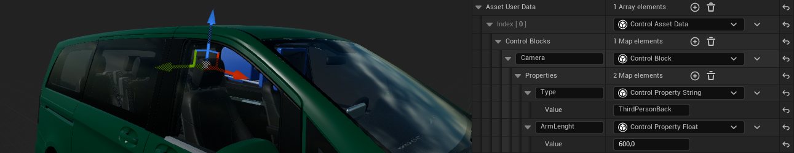

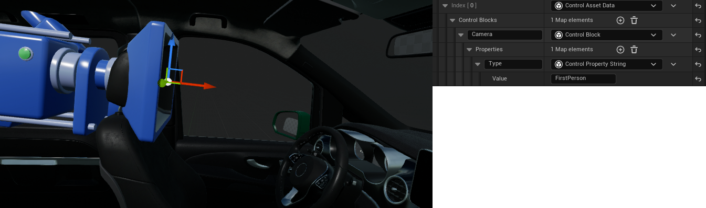

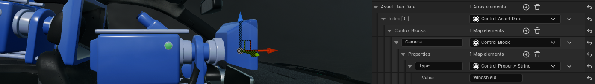

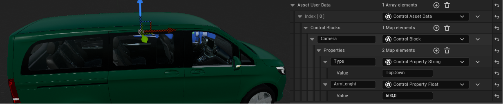

---

## 5. Посадка водителя (настройка сидений `Seats`)

На текущий момент в пользовательских автомобилях можно посадить только водителя. Для этого используется **сокет на Static Mesh сиденья/салона** и **`ControlBlock` `Seats`**.

### Шаг 1. Создание сокета `_Landing` в Static Mesh
1. Откройте Static Mesh, содержащий водительское сиденье (обычно это меш салона), двойным кликом.
2. В верхнем меню откройте **Window → Socket Manager**.
3. Нажмите **`+`** (Create Socket) и назовите сокет по правилу **`<ИмяНабора>_Landing`**, например **`Seat0_Landing`**.
   - `<ИмяНабора>` — любое удобное имя на латинице (в примере `Seat0`).
   - `_Landing` — обязательный программный суффикс (на текущий момент требуется **только** `_Landing`).
4. Переместите сокет в угол стыка подушки и спинки водительского сиденья так, чтобы **красная ось `+X`** смотрела вперёд параллельно подушке сиденья (в сторону руля), а **синяя ось `+Z`** — вверх.
5. Нажмите **Save**.

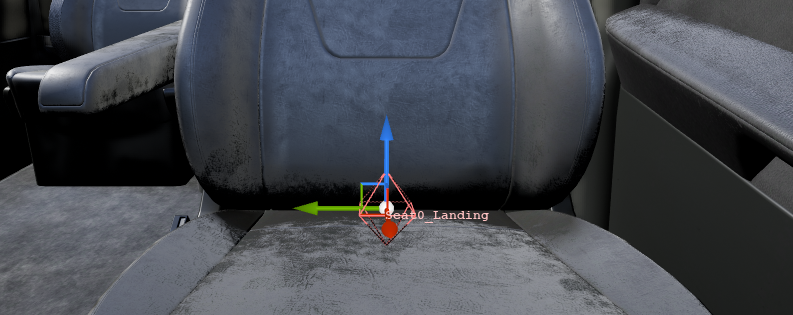

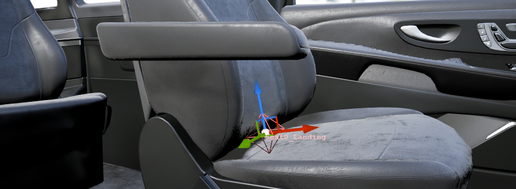

### Шаг 2. Добавление `ControlBlock` `Seats` в Акторе
1. Откройте Актор `V_<ИмяМода>` и выделите тот `StaticMeshComponent`, в меше которого вы только что создали сокет `Seat0_Landing`.
2. Добавьте `Asset User Data → Control Asset Data` → **`ControlBlock`** с именем **`Seats`**:
   - Свойство 1: имя **`Names`**, тип **`Control Property String Array`** → добавьте элемент **`Seat0`** (только префикс, **без** `_Landing`!).
   - Свойство 2 *(если на этом меше находится место водителя)*: имя **`DriverIndex`**, тип **`Control Property Int`** → укажите индекс водительского места из массива `Names` (для `Index [0]` это **`0`**).
3. Нажмите **Compile** и **Save**.

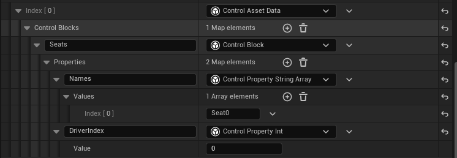

---

## 6. Место для игрушки в салоне (`CarToy`)

Чтобы игроки могли ставить на торпедо пользовательские игрушки из мастерской, нужно указать точку крепления:
1. В Акторе `V_<ИмяМода>` добавьте любой компонент, унаследованный от `SceneComponent` (удобнее всего использовать `SkeletalMeshComponent` или `StaticMeshComponent` с приложенной к шаблону моделью космонавта **`SM_Cosmonaft_Anim`** из `Content/Common/Enviroment/Cosmonaft/` — она поможет точно прикинуть размер и поворот на торпедо, а в самой игре эта тестовая модель автоматически скроется!).
2. Выставьте `NoCollision`, расположите компонент на торпедо и добавьте **`ControlBlock`** с именем **`CarToy`** (без свойств).

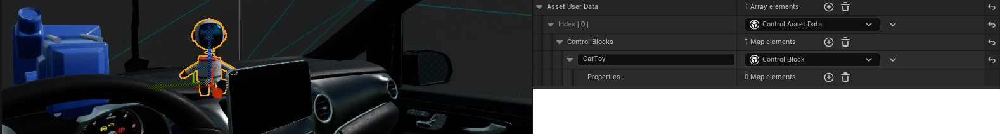

---

**Следующий шаг:** переходите к **[Модулю 4. Зеркала заднего вида и дворники](./04_Mirrors_and_Wipers.md)**, чтобы настроить обзорность и работу стеклоочистителей.
