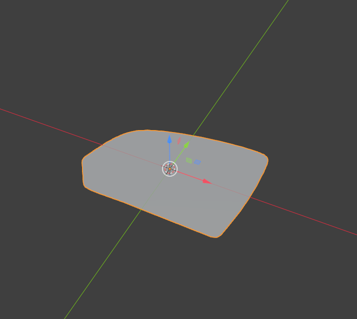
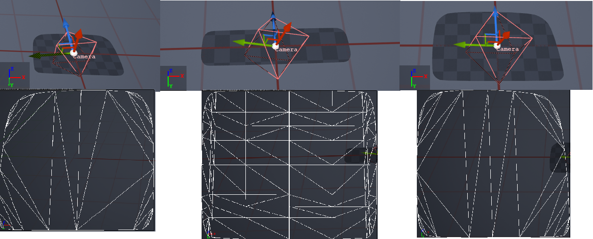
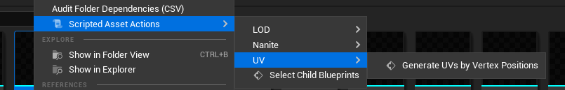
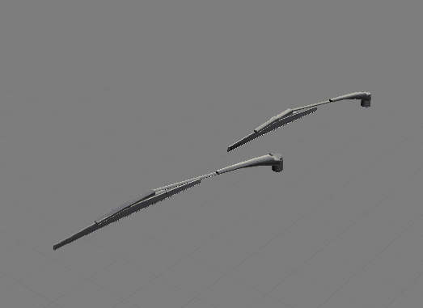
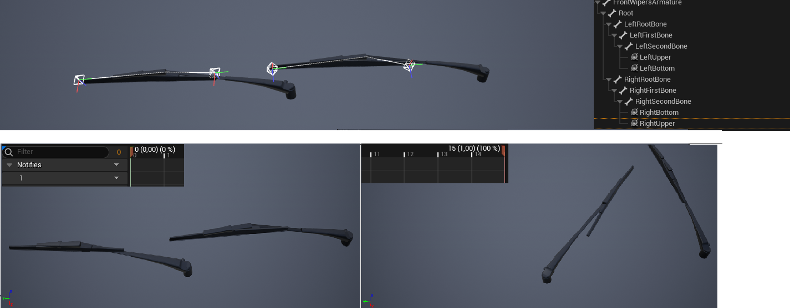

# Модуль 4. Зеркала заднего вида и дворники

**Навигация:** [README](./README.md) | [01. Минимальный автомобиль](./01_Minimal_Car_QuickStart.md) | [02. Экстерьер, свет и мир](./02_Exterior_Lights_and_World.md) | [03. Салон, приборка и камеры](./03_Interior_Dashboard_Cameras_Seats.md) | **04. Зеркала и дворники** | [05. Звуки и FMOD](./05_Sounds_and_FMOD.md) | [06. Комплектации, логика и шпаргалка](./06_Advanced_Specs_Logic_and_Reference.md)

---

В этом модуле вы настроите два важных симуляторных узла автомобиля:
1. **Зеркала заднего вида** (левое, правое и центральное салонное) — с реальным рендером изображения через игровые камеры.
2. **Стеклоочистители (дворники)** — передние и (при наличии) задний, работающие через скелетную анимацию.

---

## 1. Зеркала заднего вида (`Mirror`)

В City Car Driving 2.0 отражение в зеркалах реализовано через рендер-камеры, привязанные к отдельным мешам отражающих стёкол.

### 1.1. Подготовка и импорт 3D-моделей зеркал

1. Для **каждого** зеркала (левое, правое, центральное) экспортируйте **отдельный меш** — только саму плоскую/слегка изогнутую отражающую стекляшку (корпус зеркала остаётся на кузове или салоне).
2. **Строгое требование к осям:**
   - **Ось `+Z`** определяет направление отражающей поверхности (лицевая нормаль зеркала смотрит строго вверх по `+Z`, само стекло лежит в плоскости `XY`!).
   - **Ось `+Y`** определяет направление **вниз** вдоль зеркала.
   *(Это требование необходимо для работы скрипта автоматической генерации UV-координат, который проецирует вершины по осям `X` и `Y`.)*
3. **Импорт в UE:** аналогично колёсам — **`Import Collisions` = выключено**, **`Fallback Collision Type` = выключено (`None`)**, **`Import Materials` = выключено**, **`Build Nanite` = выключено**.
4. **Материал:** материал на отражающую поверхность **можно не назначать** — игра подставит динамический материал отражения автоматически. *(Напоминание: `MI_Mod_Mirror` используется только для корпуса/плафона салонного зеркала, а не для отражающего стекла.)*

### 1.2. Настройка сокета `Camera` и генерация UV в UE

Выполните эти 2 шага для **каждого** импортированного Static Mesh зеркала:

#### Шаг 1. Добавление сокета `Camera`
1. Откройте Static Mesh зеркала двойным кликом.
2. Откройте **Window → Socket Manager** и нажмите **`+`** (Create Socket).
3. Переименуйте сокет строго в **`Camera`**.
4. При необходимости поверните **`Relative Rotation`** этого сокета — именно поворот сокета `Camera` задаёт, куда будет смотреть камера захвата отражения.
5. Нажмите **Save** и закройте окно меша.

#### Шаг 2. Запуск скрипта генерации UV (`Generate UVs by Vertex Positions`)
1. В **Content Browser** нажмите **ПКМ** на ассете Static Mesh зеркала.
2. Выберите в контекстном меню:
   **`Scripted Asset Actions → UV → Generate UVs by Vertex Positions`**
3. Скрипт автоматически сгенерирует UV-координаты по позициям вершин на **1-м UV-канале**, запишет габариты зеркала в метаданные ассета и включит `Allow CPU Access`.
4. **Обязательно сохраните ассет** (`Ctrl + S` или **ПКМ → Save**) — звёздочка `*` на иконке должна исчезнуть!

### 1.3. Подключение зеркал в Акторе `V_<ИмяМода>`
1. Добавьте `StaticMeshComponent` для каждого зеркала (например, внутрь `Body` для боковых и `InteriorObjects` для салонного), выставите **`NoCollision`** и **`Receives Decals = False`**.
2. Расположите и поверните каждое зеркало точно на его место в корпусе зеркала на автомобиле.
3. На каждом компоненте зеркала добавьте `Asset User Data → Control Asset Data` → **`ControlBlock`** с именем **`Mirror`**:
   - *(Опционально)* Добавьте свойство **`FOV`** типа **`Control Property Float`** — угол обзора камеры зеркала в градусах.
   - **Рекомендуемое значение `FOV`: `20–40`** (более высокие значения сильно увеличивают нагрузку на производительность и искажают расстояния в зеркале).
4. Нажмите **Compile** и **Save**.

---

## 2. Стеклоочистители / Дворники (`Wippers`)

Дворники в City Car Driving 2.0 работают с помощью **скелетной анимации**.

### 2.1. Подготовка 3D-модели и анимации

1. В 3D-редакторе создайте скелет (Armature) для дворников, привяжите к костям геометрию поводков и щёток (скиннинг) и сделайте анимацию взмаха.
2. **Важно про цикл анимации:** ваша `Animation Sequence` должна представлять собой только **первую половину цикла** — движение дворника из исходного (нижнего) положения до крайнего (верхнего) положения! Обратный ход игра проигрывает автоматически.

3. Если у автомобиля есть и передние, и задний дворник — экспортируйте их **двумя отдельными Skeletal Mesh** (передние вместе одним мешем, задний — отдельным).

### 2.2. Импорт и материал дворников
1. Импортируйте `.fbx` с дворниками в `MyFirstCar/Meshes/`. В окне импорта:
   - Включите **`Skeletal Mesh`** и **`Import Animations`**.
   - Выключите **`Import Collisions`** / **`Fallback Collision Type`** / создание Physics Asset при необходимости и снимите галочку **`Import Materials`**.
   - В результате в папке появятся `Skeletal Mesh`, `Skeleton` и `Animation Sequence`.
2. Создайте `Material Instance` от родительского материала **`MI_Mod_Wipers`** (`Content/Common/MasterMaterials/VehicleMaterials/ModMaterials/MI_Mod_Wipers`) и назначьте его в слот материала на `Skeletal Mesh`.

> [!NOTE]
> **Про сокеты зоны очистки стекла (которые можно увидеть в `CieBensVGruppe`):**
> Если вы откроете `SM_CieBensVGruppe_Wipers`, то увидите на костях сокеты `LeftUpper`, `LeftBottom`, `RightUpper`, `RightBottom`. **На текущий момент сокеты на дворниках в модах НЕ используются и создавать их не нужно** (функционал стирания капель со стекла в пользовательских автомобилях ещё не активен).

### 2.3. Подключение дворников в Акторе `V_<ИмяМода>`

> [!WARNING]
> **Обратите внимание на точное написание имени `ControlBlock`:**
> В коде игры блок называется **`Wippers`** — **с двумя буквами `p`**! Если написать `Wipers`, дворники не будут работать.

1. Откройте Актор `V_<ИмяМода>` и добавьте компонент **`Skeletal Mesh`** (`+ Add → Skeletal Mesh`), выставите **`NoCollision`** и **`Receives Decals = False`**.
2. Расположите дворники в нужном месте на лобовом (или заднем) стекле.
3. В панели **Details** компонента заполните:
   - **Mesh → Skeletal Mesh Asset:** выберите ваш импортированный `Skeletal Mesh` дворников.
   - **Animation → Animation Mode:** выберите **`Use Animation Asset`**.
   - **Animation → Anim to Play:** выберите вашу `Animation Sequence` (первая половина цикла взмаха).
4. Добавьте `Asset User Data → Control Asset Data` → **`ControlBlock`** с именем **`Wippers`**:
   - Добавьте свойство **`Side`** типа **`Control Property String`**:
     - **`Front`** — для передних дворников;
     - **`Rear`** — для заднего дворника.
5. Убедитесь, что в `Vehicle.ini` в секции `[CarElectrics]` задано сопротивление `FrontWindshieldWiper_Resistance > 0` (и `BackWindshieldWiper_Resistance > 0`, если есть задний дворник).
6. Нажмите **Compile** и **Save**.

---

**Следующий шаг:** переходите к **[Модулю 5. Звуки автомобиля и работа с FMOD Studio](./05_Sounds_and_FMOD.md)**, чтобы настроить звуковое сопровождение вашего автомобиля.
