# Модуль 5. Звуки автомобиля и работа с FMOD Studio

**Навигация:** [README](./README.md) | [01. Минимальный автомобиль](./01_Minimal_Car_QuickStart.md) | [02. Экстерьер, свет и мир](./02_Exterior_Lights_and_World.md) | [03. Салон, приборка и камеры](./03_Interior_Dashboard_Cameras_Seats.md) | [04. Зеркала и дворники](./04_Mirrors_and_Wipers.md) | **05. Звуки и FMOD** | [06. Комплектации, логика и шпаргалка](./06_Advanced_Specs_Logic_and_Reference.md)

---

В City Car Driving 2.0 предусмотрено **3 уровня работы со звуками автомобиля** — вы сами выбираете, на каком остановиться:

| Уровень | Что нужно делать | Результат |
| --- | --- | --- |
| **1. Базовый (по умолчанию)** | Ничего не настраивать. | Автомобиль уже имеет стандартный набор звуков, но их пространственные точки (двигатель, переключатели, колёса) могут не совпадать с габаритами вашей модели. |
| **2. Настройка в UE** | Расставить `SceneComponent` с `ControlBlock` `SoundEvent` в Акторе. | Вы точно задаёте 3D-положение звуков, дистанцию затухания и можете выбрать любой готовый звук из стандартных автомобилей игры (например, другой звук двигателя или селектора КПП). |
| **3. Свои звуки (FMOD Studio)** | Собрать собственный `.bank` и `GUIDs.txt` в **FMOD Studio 2.03.14**. | Полностью уникальное звучание двигателя, клаксона, поворотников и любых других узлов вашего автомобиля. |

---

## 1. Настройка и расстановка звуков в Unreal Engine (Уровень 2)

Настройка звуков в Акторе работает через тот же механизм `ControlBlock`, что и остальные компоненты. **Если звучание и положение каких-то стандартных звуков вас уже устраивают — их можно просто пропустить.**

### 1.1. Как добавить звуковую точку в Актор `V_<ИмяМода>`
1. В дереве **Components** добавьте **`SceneComponent`** (`+ Add → Scene`) и расположите его в нужной точке автомобиля (например, двигатель — под капотом, `RainRoof` — в центре крыши, `Horn` — за решёткой радиатора, `Radio` — в месте магнитолы).

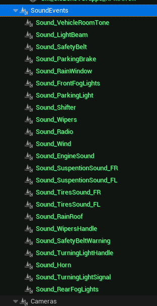

2. Добавьте на этот компонент `Asset User Data → Control Asset Data` → **`ControlBlock`** с именем **`SoundEvent`**.
3. Добавьте нужные свойства в **`Properties`**:

| Имя свойства | Тип | Обязательно? | Описание |
| --- | --- | :-: | --- |
| **`Type`** | `Control Property String` | **Да** | Тип аудиокомпонента (выбирается из таблицы в п. 1.2). Если указать **только** `Type`, вы просто перенесёте стандартный звук в точку этого `SceneComponent`. |
| **`MinimumAttenuationDistance`** | `Control Property Float` | Нет | Минимальная дистанция затухания звука (если не указывать — берутся настройки из FMOD). |
| **`MaximumAttenuationDistance`** | `Control Property Float` | Нет | Максимальная дистанция слышимости звука (если не указывать — берутся настройки из FMOD). |
| **`Bank`** | `Control Property String` | Пара с `EventName` | Имя звукового банка (для стандартных звуков игры — `Master`, для своих — имя вашего `.bank` без расширения). **Указывается строго вместе с `EventName`!** |
| **`EventName`** | `Control Property String` | Пара с `Bank` | Полный путь к FMOD-событию (например, `event:/Vehicles/CarSounds/FME_RainRoof`). **Указывается строго вместе с `Bank`!** |

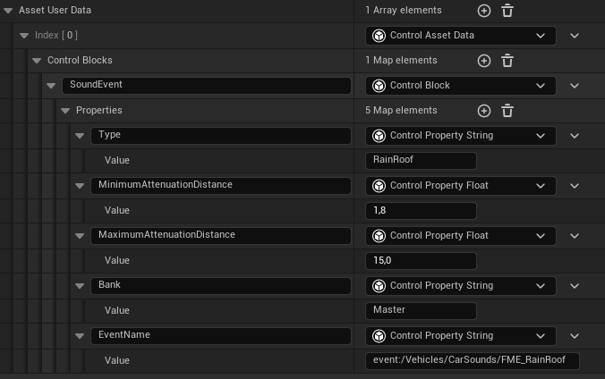

---

### 1.2. Полный справочник стандартных `Type`, `Bank` и `EventName`

> [!WARNING]
> **Обратите внимание на точное написание:**
> `SuspentionSound_FR` и `SuspentionSound_FL` пишутся через **`t`** (`Suspention`), а не `s`! Писать строго в таком виде.

| `Type` | Описание | `Bank` | Доступные стандартные `EventName` |
| --- | --- | --- | --- |
| `EngineSound` | Звук двигателя | `Master` | `event:/Vehicles/UlgaresFolk/FME_UlgaresFolk_WholeEngine` `event:/Vehicles/HangugEclauto/FME_HangugEclauto_WholeEngine` `event:/Vehicles/UlgaresGroberolf/FME_UlgaresGroberolf_WholeEngine` |
| `VehicleRoomTone` | Заполняющий фоновый звук пространства салона | `Master` | `event:/Vehicles/CarSounds/FME_VehicleRoomTone` |
| `Shifter` | Рычаг переключения передач | `Master` | `event:/Vehicles/UlgaresFolk/FME_UlgaresFolk_Shifter` `event:/Vehicles/HangugEclauto/FME_HangugEclauto_Shifter` |
| `LightBeam` | Выключатель ближнего света | `Master` | `event:/Vehicles/CarSounds/FME_Handle` `event:/Vehicles/CarSounds/FME_Click` |
| `ParkingLight` | Выключатель габаритного света | `Master` | `event:/Vehicles/CarSounds/FME_Handle` `event:/Vehicles/CarSounds/FME_Click` |
| `FrontFogLights` | Выключатель передних противотуманных фар | `Master` | `event:/Vehicles/CarSounds/FME_Handle` `event:/Vehicles/CarSounds/FME_Click` |
| `RearFogLights` | Выключатель задних противотуманных фонарей | `Master` | `event:/Vehicles/CarSounds/FME_Handle` `event:/Vehicles/CarSounds/FME_Click` |
| `WipersHandle` | Переключатель дворников | `Master` | `event:/Vehicles/CarSounds/FME_Handle` `event:/Vehicles/CarSounds/FME_Click` |
| `Wipers` | Звук работы щёток дворников | `Master` | `event:/Vehicles/CarSounds/FME_Wipers` |
| `TurningLightHandle` | Переключатель поворотников | `Master` | `event:/Vehicles/CarSounds/FME_TurningLightHandle` |
| `TurningLightSignal` | Щелчки реле поворотников | `Master` | `event:/Vehicles/CarSounds/FME_TurningLightsSignal` |
| `SafetyBelt` | Звук пристёгивания и отстёгивания ремня безопасности | `Master` | `event:/Vehicles/CarSounds/FME_SafetyBelt` |
| `SafetyBeltWarning` | Звук предупреждения о непристёгнутом ремне *(управляется в `Vehicle.ini`)* | `Master` | `event:/Vehicles/CarSounds/FME_SafetyBeltWarning` |
| `ParkingBrake` | Звук ручного тормоза | `Master` | `event:/Vehicles/CarSounds/FME_ParkingBrake` |
| `Horn` | Звуковой сигнал (гудок) | `Master` | `event:/Vehicles/CarSounds/FME_Horn` |
| `RainWindow` | Звуки дождя по лобовому стеклу | `Master` | `event:/Vehicles/CarSounds/FME_RainWindow` |
| `RainRoof` | Звуки дождя по крыше автомобиля | `Master` | `event:/Vehicles/CarSounds/FME_RainRoof` |
| `Wind` | Аэродинамический шум ветра (с учётом скорости и поверхности) | `Master` | `event:/Vehicles/CarSounds/FME_Wind` |
| `SuspentionSound_FR` / `SuspentionSound_FL` | Звуки ударов в переднюю правую / левую подвеску | `Master` | `event:/Vehicles/CarSounds/FME_SuspensionHit` |
| `TiresSound_FR` / `TiresSound_FL` | Звуки шин на различных покрытиях (правое / левое колесо) | `Master` | `event:/Vehicles/CarSounds/FME_Tires` |
| `Radio` | 3D-позиция радиомагнитолы в салоне | *(не указывать)* | Отдельного FMOD-события нет — звук задаётся логикой игры. Укажите только `Type = Radio` (и при желании дистанции затухания). |

---

## 2. Создание собственных звуков в FMOD Studio (Уровень 3)

### 2.1. Что потребуется скачать
1. **FMOD Studio версии `2.03.14`** (версия важна для совместимости банков с игрой!).
2. Репозиторий с двумя FMOD-проектами разработчиков:
   - <https://github.com/Forward-Development/CCD2_VehicleKit_FMOD>
   - **`Template_CCD2`** — чистый шаблонный проект, на базе которого вы будете собирать свой банк.
   - **`Example_CCD2`** — проект-справочник со всеми примерами событий, которые можно заменить.

> [!CAUTION]
> **Никогда не собирайте свой мод напрямую внутри проекта `Example_CCD2`!**
> Используйте `Example_CCD2` только как образец (смотреть используемые параметры, структуру и назначенные шины `Bus`). Всю рабочую сборку ведите исключительно в скопированном **`Template_CCD2`**, иначе возможны конфликты файлов с базовой игрой.

---

### 2.2. Пошаговый пайплайн создания своего звукового банка

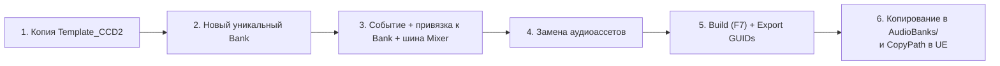

#### Шаг 1. Подготовка проекта
Скопируйте папку **`Template_CCD2`** в отдельную рабочую директорию и переименуйте проект под имя вашего мода (необязательно, но удобно). Откройте проект в FMOD Studio 2.03.14.

#### Шаг 2. Создание уникального `Bank`
Создайте новый **Bank** с максимально уникальным именем (например, по имени вашего мода: `MyFirstCarBank`), чтобы избежать конфликтов с другими модами. К этому банку будут привязаны все ваши события.

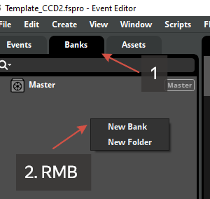

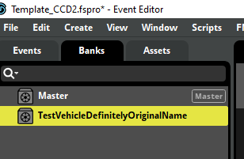

#### Шаг 3. Создание события по образцу из `Example_CCD2`
1. Создайте внутри вкладки **Events** папку с именем вашего Bank и размещайте все свои события в ней.
2. Можно скопировать готовое событие прямо из открытого рядом `Example_CCD2` и вставить в ваш проект — но обязательно дайте событию **новое уникальное имя**, отличное от примера.

#### Шаг 4. Назначение события в ваш `Bank`
Назначьте созданное событие в ваш новый Bank (`ПКМ по событию → Assign to Bank → <ВашBank>`). Также уберите его привязку к банку `Master` (чтобы не перезаписывать базовые ресурсы).

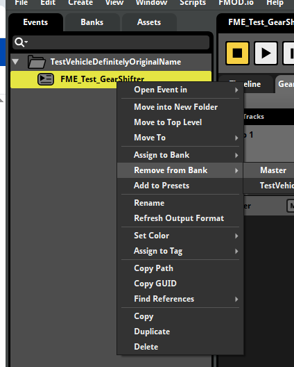

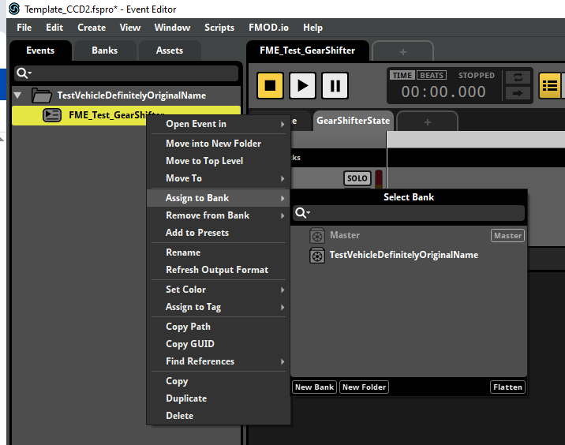

#### Шаг 5. Привязка события к нужной шине (`Mixer / Bus`)
Чтобы в игре корректно работали ползунки громкости в настройках, откройте окно **Mixer** (`Ctrl + 2`) и перетащите ваше событие на ту же шину (`Bus`), на которой оно находилось в `Example_CCD2`. *(При копировании из `Example_CCD2` шина обычно подхватывается автоматически, но обязательно перепроверьте!)*

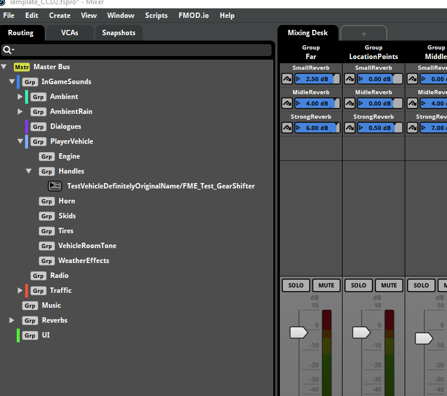

#### Шаг 6. Замена звуковых ассетов
Подготовьте свои `.wav` / `.ogg` аудиофайлы в любом аудиоредакторе.
- **Простой способ:** просто перетащите ваш новый аудиофайл прямо поверх инструмента внутри скопированного FMOD-события.
- **Продвинутый способ:** вы можете переделать логику события под себя, **но нельзя менять имена входных параметров, точки запуска и остановки**, которые ожидает игра!

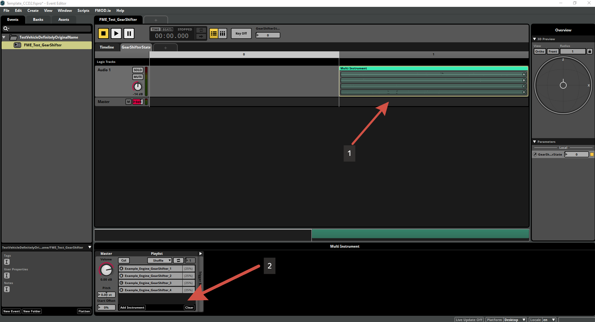

#### Шаг 7. Сборка банка (`Build`)
Нажмите **`F7`** (или **`File → Build`**). Готовый файл `<ВашBank>.bank` появится в папке `\Build\Desktop\` вашего проекта FMOD.

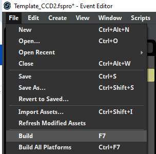

#### Шаг 8. Экспорт `GUIDs.txt`
**Обязательный шаг!** В верхнем меню нажмите **`File → Export GUIDs`**. Файл **`GUIDs.txt`** появится в папке `\Build\` вашего проекта FMOD.

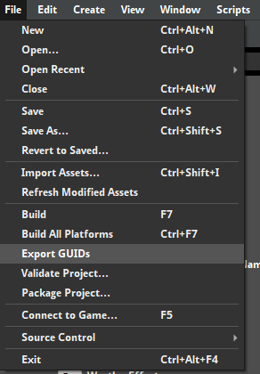

#### Шаг 9. Перенос банка в папку мода
1. В Проводнике Windows откройте папку вашего мода `Plugins\Mods\Content\<ИмяМода>\` и создайте подпапку **`AudioBanks`** (если её ещё нет).
2. Скопируйте туда оба файла:
   - `<ВашBank>.bank` (из `\Build\Desktop\`)
   - `GUIDs.txt` (из `\Build\`)

> [!TIP]
> **Один мод — один `Bank`:**
> Лучше хранить все звуки одного автомобиля в одном общем банке. Если всё же используете несколько банков, объедините их файлы `GUIDs.txt` в один общий `GUIDs.txt` (главное, чтобы в нём присутствовали все строки со всеми вашими банками и событиями).

#### Шаг 10. Прописывание пути события в Unreal Engine
1. В FMOD Studio нажмите **ПКМ** на вашем событии → **`Copy Path`**.

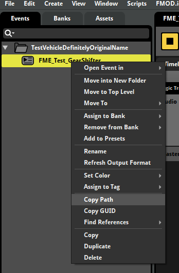

2. В Unreal Engine откройте Актор `V_<ИмяМода>`, выберите нужный `SceneComponent` с `ControlBlock` `SoundEvent` и заполните:
   - **`Bank`** — имя вашего банка (без расширения `.bank`).
   - **`EventName`** — вставьте скопированный путь (например, `event:/MyFirstCar/FME_MyHorn`).

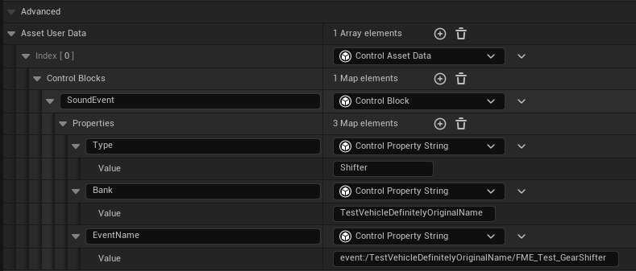

#### Шаг 11. Сборка `.pak`
Сохраните Актор (**Compile → Save All**) и соберите мод через `build_mod_dlc.bat` — скрипт автоматически упакует папку `AudioBanks/` внутрь `.pak`.

---

**Следующий шаг:** переходите к **[Модулю 6. Комплектации, физика, кастомная логика и сводная шпаргалка](./06_Advanced_Specs_Logic_and_Reference.md)**, чтобы оформить карточку автомобиля, добавить выбор комплектаций и получить единый справочник всех настроек.
