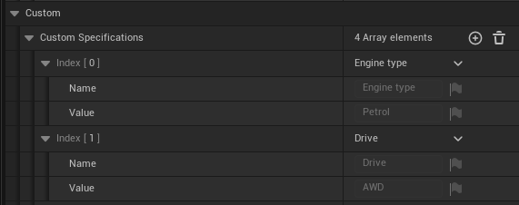
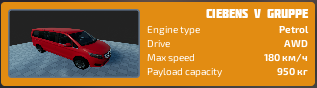
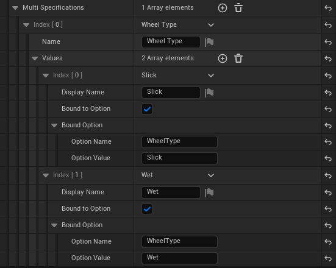
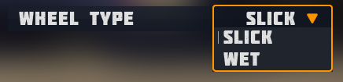

# Модуль 6. Комплектации, глубокая физика, кастомная логика и сводная шпаргалка

**Навигация:** [README](./README.md) | [01. Минимальный автомобиль](./01_Minimal_Car_QuickStart.md) | [02. Экстерьер, свет и мир](./02_Exterior_Lights_and_World.md) | [03. Салон, приборка и камеры](./03_Interior_Dashboard_Cameras_Seats.md) | [04. Зеркала и дворники](./04_Mirrors_and_Wipers.md) | [05. Звуки и FMOD](./05_Sounds_and_FMOD.md) | **06. Комплектации, логика и шпаргалка**

---

В финальном модуле собраны продвинутые возможности оформления и настройки мода, а также **единая шпаргалка** по всем `ControlBlock`, родительским материалам `MI_Mod_*` и особым именам из кода.

---

## 1. Расширенные спецификации в `DA_<ИмяМода>` (`PDA_PrototypedVehicleSpecification`)

Базовые обязательные поля (`Name`, `Image`, `Class`, `EngineTypes`, `TransmissionTypes`) вы уже настроили в [Модуле 1](./01_Minimal_Car_QuickStart.md#шаг-6-создание-паспорта-автомобиля-pda_prototypedvehiclespecification). Помимо них в секции **Custom** доступны два мощных инструмента:

### 1.1. Косметические характеристики на карточке (`CustomSpecifications`)
Позволяют вывести любые справочные параметры автомобиля (привод, максимальная скорость, грузоподъёмность, мощность и т. д.) прямо на карточку выбора транспорта в меню.
- На карточке автомобиля сейчас отображаются **первые 5 параметров** из списка `CustomSpecifications`.
- У каждого элемента заполняются поля `Name` (название характеристики) и `Value` (значение).





### 1.2. Функциональные переключаемые комплектации (`MultiSpecifications`)
Работают точно так же, как выбор типа КПП (`TransmissionTypes`), и позволяют игроку **прямо в меню настроек автомобиля** переключать любые ваши физические опции — например, тип шин (летние/зимние/спорт), разные двигатели, подвески или пакеты настроек!

Как связать `MultiSpecifications` с физикой:
1. В **`DA_<ИмяМода>` → `MultiSpecifications`** добавьте новую спецификацию (например, `Name = "Tire Type"`), внутри её массива `Values` добавьте варианты (например, `Summer`, `Sport`), включите на каждом **`Bound to Option`** и укажите **`Option Name`** и **`Option Value`**.
2. В файле **`options.xml`** в папке мода объявите опцию с точно такими же именами (с `SetSchema="false"`, так как `SetSchema="true"` может быть только у одной опции — обычно у `TransmissionType`):
```xml
<Option Name="TireType" SetSchema="false">
    <OptionValue Value="Summer" />
    <OptionValue Value="Sport" />
</Option>
```
3. В файле **`Vehicle.ini`** добавьте секции переопределения параметров вида `[ИмяКомпонента.ИмяОпции.ЗначениеОпции]`:
```ini
[WheelFrontLeft.TireType.Sport]
FrictionCoeff = 1.15
```
4. Все связанные с опциями `MultiSpecifications` **автоматически появятся** в меню настроек выбранного автомобиля в игре!





---

## 2. Переход к глубокой настройке физики (`VehicleLib`)

Все стандартные XML-схемы и таблицы кривых лежат в основном проекте по путям:
- Схемы: **`Content/Common/Vehicles/MotorCars/Schemes/`** (`AwdAuto.xml`, `AwdManual.xml`, `FwdAuto.xml`, `FwdManual.xml`, `RwdAuto.xml`, `RwdManual.xml`)
- Таблицы кривых: **`Content/Common/Vehicles/MotorCars/Tables/`** (`SpringProgression.csv`, `EngineVibration.csv`, `WheelForceLat.csv`, `WheelForceLon.csv` и др.)

> [!IMPORTANT]
> **Правило редактирования схем и таблиц:**
> Никогда не изменяйте файлы внутри `Content/Common/Vehicles/MotorCars/` — они не попадут в ваш `.pak`!
> Если вы хотите изменить схему или кривую под свой автомобиль — **скопируйте файл в папку вашего мода** `Plugins/Mods/Content/<ИмяМода>/` и пропишите к нему относительный путь `../Plugins/Mods/Content/<ИмяМода>/<Файл>` в `Vehicle.ini` / `options.xml`.

Подробный справочник по всем 46 классам компонентов физики, формулам расчёта и каналам ввода/вывода находится в отдельном руководстве **`VehicleLib_HTML`**:
- **[README (VehicleLib)](../VehicleLib_MD/README.md)** — архитектура файлов и единицы измерения
- **[00. Быстрый старт физики](../VehicleLib_MD/00_Quick_Start.md)** — формулы расчёта массы, ЦТ, подвески, `Engine.csv`, АКПП/МКПП и 5 контрольных тестов
- **[01. Архитектура и конфиги](../VehicleLib_MD/01_Architecture_and_Config.md)** — создание своих XML-схем (например, `EngineDiesel + Turbocharger`), форматы `.csv`
- **[02. Именованный ввод/вывод](../VehicleLib_MD/02_Named_IO_and_States.md)** — все каналы `*Intensity`, входы и состояния
- **[03. Трансмиссия](../VehicleLib_MD/03_Components_TorqueTrain.md)** — ДВС, стартер, сцепление, ГДТ, КПП, дифференциалы, тормоза, шины
- **[04. Электрика](../VehicleLib_MD/04_Components_Electrics.md)** — цепи, АКБ, `CarElectrics`
- **[05. Шасси и подсистемы](../VehicleLib_MD/05_Components_Chassis_and_Subsystems.md)** — подвеска, рулевое, турбонаддув, аэродинамика, ABS/TCS

---

## 3. Пользовательская логика (Custom Blueprint Logic)

Если вы умеете работать с Blueprints в Unreal Engine и хотите добавить автомобилю собственную интерактивную логику (анимацию спойлера, дополнительные эффекты и т. п.):

> [!CAUTION]
> **Не пишите пользовательскую логику прямо в Event Graph самого Актора автомобиля (`V_<ИмяМода>`)!**
> Вместо этого создайте отдельный **`ActorComponent`** (`ПКМ в Content Browser → Blueprint Class → Actor Component`), напишите всю логику внутри него и добавьте этот компонент в ваш Актор.
> На таком пользовательском компоненте **НЕ должно быть `ControlBlock` (`Control Asset Data`)** — тогда игра не будет его перехватывать, и он будет работать штатно.

---

## 4. Сводная шпаргалка (Reference)

### 4.1. Особые написания в коде (НЕ исправлять!)

> [!WARNING]
> Следующие имена зашиты в движок именно в таком виде — пишите их **символ в символ**, не «исправляя» орфографию:
> - `ControlBlock` дворников: **`Wippers`** *(с двумя `p`)*
> - Типы звуков подвески: **`SuspentionSound_FR`**, **`SuspentionSound_FL`** *(через `t`)*
> - Слот подсветки стрелки спидометра: **`SpeedometrArrow`** *(без буквы `e`)*
> - Родительские материалы: **`MI_Mod_Emissive_Ikons`** *(через `k`)*, **`MI_Mod_Stiches`** *(без `t`)*
> - Задняя ось в Акторе и `Vehicle.ini`: **`Back`** (`SuspensionBackLeft/Right`, `WheelBackLeft/Right`), а **НЕ** `Rear`!

---

### 4.2. Полная таблица всех `ControlBlock`

| Имя `ControlBlock` | Куда вешается | Свойства (`Properties`: имя, тип, значения) | Модуль |
| --- | --- | --- | :-: |
| **`Camera`** | `SceneComponent` / `CameraComponent` | `Type` (`String`: `ThirdPersonBack`, `ThirdPersonFront`, `FirstPerson`, `Windshield`, `TopDown`); опц. `ArmLength` (`Float`) | [1](./01_Minimal_Car_QuickStart.md), [3](./03_Interior_Dashboard_Cameras_Seats.md) |
| **`Light`** | `BP_ExportSpotLight` / `SpotLightComponent` | `PhysicsOutput` (`StringArray`: `LowBeamIntensity`, `HighBeamIntensity`, `StopLightIntensity` и др.) | [2](./02_Exterior_Lights_and_World.md) |
| **`LogicBox`** | `BoxCollision` | *(нет свойств)* | [2](./02_Exterior_Lights_and_World.md) |
| **`FuelTank`** | `SceneComponent` *(в нулевых трансформах родителя)* | *(нет свойств)* | [2](./02_Exterior_Lights_and_World.md) |
| **`RainBlocker`** | `StaticMeshComponent` *(с `MM_Wireframe`)* | *(нет свойств)* | [2](./02_Exterior_Lights_and_World.md) |
| **`SteeringWheel`** | `StaticMeshComponent` *(внутри `InteriorObjects`)* | *(нет свойств)* | [3](./03_Interior_Dashboard_Cameras_Seats.md) |
| **`SpeedArrow`** | `StaticMeshComponent` *(стрелка в позиции 0)* | `MaxAngle` (`Float`), `MaxValue` (`Float`) | [3](./03_Interior_Dashboard_Cameras_Seats.md) |
| **`RPMArrow`** | `StaticMeshComponent` *(стрелка в позиции 0)* | `MaxAngle` (`Float`), `MaxValue` (`Float`) | [3](./03_Interior_Dashboard_Cameras_Seats.md) |
| **`FuelArrow`** | `StaticMeshComponent` *(стрелка в позиции 0)* | `MaxAngle` (`Float`) | [3](./03_Interior_Dashboard_Cameras_Seats.md) |
| **`CoolantTemperatureArrow`** | `StaticMeshComponent` *(стрелка в позиции 0)* | `MaxAngle` (`Float`), `MinValue` (`Float`), `MaxValue` (`Float`) | [3](./03_Interior_Dashboard_Cameras_Seats.md) |
| **`SalonLights`** | `SceneComponent` *(или скопированный `DashboardController`)* | Ключ = канал физики (`*Intensity`), значение = `StringArray` имён слотов материалов | [3](./03_Interior_Dashboard_Cameras_Seats.md) |
| **`Seats`** | `StaticMeshComponent` *(с сокетами `<Имя>_Landing`)* | `Names` (`StringArray`, напр. `["Seat0"]`), опц. `DriverIndex` (`Int`, напр. `0`) | [3](./03_Interior_Dashboard_Cameras_Seats.md) |
| **`CarToy`** | `SceneComponent` *(или `SM_Cosmonaft_Anim`)* | *(нет свойств)* | [3](./03_Interior_Dashboard_Cameras_Seats.md) |
| **`Mirror`** | `StaticMeshComponent` *(с сокетом `Camera` и UV1)* | опц. `FOV` (`Float`, реком. `20–40`) | [4](./04_Mirrors_and_Wipers.md) |
| **`Wippers`** *(два `p`!)* | `SkeletalMeshComponent` *(Animation Asset)* | `Side` (`String`: `Front` или `Rear`) | [4](./04_Mirrors_and_Wipers.md) |
| **`SoundEvent`** | `SceneComponent` | `Type` (`String`, обяз.); опц. `MinimumAttenuationDistance` / `MaximumAttenuationDistance` (`Float`); парой `Bank` (`String`) + `EventName` (`String`) | [5](./05_Sounds_and_FMOD.md) |

---

### 4.3. Полный справочник всех 14 родительских материалов (`ModMaterials`)

Папка в проекте: `Content/Common/MasterMaterials/VehicleMaterials/ModMaterials/`

| Материал | Назначение |
| --- | --- |
| `MI_Mod_CarPaint` | Окрашенные части кузова (поддерживает текстуру ливреи `Livery` с альфа-маской). |
| `MI_Mod_Exterior` | Пластик, хром, неокрашенные элементы кузова, диски колёс, суппорты. |
| `MI_Mod_Tyre` | Покрышки (шины) колёс. |
| `MI_Mod_Glass` | Стёкла автомобиля и плафоны фар (прозрачные и цветные). |
| `MI_Mod_Emissive_Beam` | Внешние светящиеся элементы кузова (лампы фар, поворотников, стоп-сигналов). |
| `MI_Mod_Wipers` | Щётки и поводки стеклоочистителей (дворников). |
| `MI_Mod_Vehicle_Interior` | Обшивка, торпедо, сиденья и основные поверхности салона. |
| `MI_Mod_PanelGlass` | Защитное стекло приборной панели. |
| `MI_Mod_Stiches` | Материалы салона с маской прозрачности (строчка сидений, оплётка руля). |
| `MI_Mod_Mirror` | Материал плафона / корпуса центрального салонного зеркала. |
| `MI_Mod_Emissive_Ikons` | Светящиеся иконки-индикаторы на приборной панели (дашборде). |
| `MI_Mod_Emissive_Panel` | Светящиеся элементы приборной панели (стрелки, шкалы). |
| `MI_Mod_Emissive_Saloon` | Подсвечиваемые кнопки в салоне (стеклоподъёмники, переключатели и т. п.). |
| `MI_Mod_LicensePlate` | **Не используется** в модах (слот `LicensePlates` оставляется пустым, игра подставляет материал сама). |

---

## 5. Финальный чек-лист перед публикацией в Steam Workshop

- [ ] Все файлы мода лежат строго внутри `Plugins/Mods/Content/<ИмяМода>/`, в именах нет кириллицы и пробелов.
- [ ] Все текстуры имеют включённый `Virtual Texture Streaming` (метка `VT`), все `MRA`-карты имеют `Compression Settings = Masks (no sRGB)`, текстуры световых пятен `LFM_VehicleLightSpot` — `Alpha`.
- [ ] Не использовано ни одного кастомного `Master Material` — только `Material Instance` от `MI_Mod_*`.
- [ ] У Актора и всех компонентов `Scale = (1.0, 1.0, 1.0)`.
- [ ] Физическая коллизия `BlockAllDynamic` настроена **только** на `Body`; на всех остальных узлах (колёса, суппорты, салон, стёкла, зеркала, дворники) выставлено `NoCollision` и отключено `Receives Decals`.
- [ ] Все пути в `Vehicle.ini` и `options.xml` указывают на вашу папку (`../Plugins/Mods/Content/<ИмяМода>/...`) или общие пути `Common/...`, а перед точкой с запятой `;` нет пробелов.
- [ ] На всех зеркалах добавлен сокет `Camera`, запущен `Generate UVs by Vertex Positions` и ассеты сохранены.
- [ ] Все изменённые файлы в UE сохранены (`Ctrl + Shift + S`), все Blueprints скомпилированы (**Compile** без ошибок).
- [ ] Мод собран через `build_mod_dlc.bat`, файл `\Saved\DLC\Windows\Mods.pak` переименован в `<ИмяМода>.pak` и проверен локально в `CityCarDriving2/Content/Paks/`.
- [ ] Автомобиль протестирован днём, ночью (свет и приборка), в дождь (`RainBlocker` и дворники), на АЗС (`FuelTank`) и во всех камерах.
