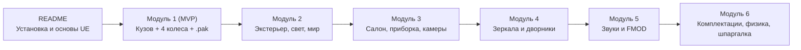

# Руководство по созданию автомобилей (модов) для City Car Driving 2.0

**Навигация:** **README** | [01. Минимальный автомобиль](./01_Minimal_Car_QuickStart.md) | [02. Экстерьер, свет и мир](./02_Exterior_Lights_and_World.md) | [03. Салон, приборка и камеры](./03_Interior_Dashboard_Cameras_Seats.md) | [04. Зеркала и дворники](./04_Mirrors_and_Wipers.md) | [05. Звуки и FMOD](./05_Sounds_and_FMOD.md) | [06. Комплектации, логика и шпаргалка](./06_Advanced_Specs_Logic_and_Reference.md)

---

Добро пожаловать в пошаговое руководство по созданию пользовательских автомобилей для **City Car Driving 2.0** на базе **Unreal Engine 5.8**.

Руководство написано так, чтобы им мог пользоваться **любой мододел — даже если вы никогда раньше не открывали Unreal Engine**. Оно разбито на независимые модули по возрастанию сложности: начав с **Модуля 1**, вы соберёте и запустите в игре минимально рабочий автомобиль (кузов + 4 колеса), а затем шаг за шагом доведёте его до полноценного качественного мода.

---

## 1. Карта модулей



| № | Модуль | Обязательность | Результат после прохождения |
| :-: | --- | --- | --- |
| **—** | **[README.md](./README.md)** *(вы здесь)* | Обязательно | Установлен UE 5.8, открыт проект-шаблон, понятны базовые термины и навигация в редакторе. |
| **01** | **[01. Минимальный автомобиль (Быстрый старт)](./01_Minimal_Car_QuickStart.md)** | **Обязательно (MVP)** | Готовый `.pak` с минимально рабочим автомобилем (кузов, 4 колеса, базовая камера, физика, карточка в меню), проверенный локально в игре и готовый к загрузке в Steam Workshop. |
| **02** | **[02. Экстерьер, оптика, подвеска и взаимодействие с миром](./02_Exterior_Lights_and_World.md)** | Рекомендуется | Полный набор материалов кузова, неподвижные суппорты подвески, горящие фары и реальные источники света, номера, заправка (`FuelTank`), зона взаимодействия (`LogicBox`) и защита от дождя (`RainBlocker`). |
| **03** | **[03. Салон, приборная панель, камеры и посадка водителя](./03_Interior_Dashboard_Cameras_Seats.md)** | Рекомендуется | Интерьер, крутящийся руль, рабочие стрелки и индикаторы приборной панели, все 5 игровых камер, посадка водителя и место для игрушки в салоне. |
| **04** | **[04. Зеркала заднего вида и дворники](./04_Mirrors_and_Wipers.md)** | Рекомендуется | Работающие зеркала заднего вида с настроенными камерами и анимированные стеклоочистители. |
| **05** | **[05. Звуки автомобиля и работа с FMOD Studio](./05_Sounds_and_FMOD.md)** | Опционально | Расстановка и выбор встроенных звуков игры или создание полностью собственных звуковых банков в FMOD Studio. |
| **06** | **[06. Комплектации, физика, кастомная логика и шпаргалка](./06_Advanced_Specs_Logic_and_Reference.md)** | Продвинутый | Характеристики на карточке и переключаемые опции комплектаций (`options.xml`), переход к тонкой настройке физики (`VehicleLib`), пользовательская Blueprint-логика и единая таблица-шпаргалка. |

> [!TIP]
> **Отдельное руководство по тонкой настройке физики:**
> Рядом с этим руководством находится подробный инженерный справочник по физике автомобилей — **[VehicleLib_HTML](../VehicleLib_MD/README.md)**. В Модуле 1 мы настроим только необходимый минимум физики, чтобы машина поехала, а за тонкой настройкой двигателя, КПП, подвески и шин обращайтесь в `VehicleLib_HTML`.

---

## 2. Что нужно скачать и установить

1. **Unreal Engine 5.8** — скачайте и установите через **Epic Games Launcher** (вкладка *Unreal Engine → Library → Engine Versions → `+` → 5.8*).
   - Для создания и упаковки модов (включая запуск `build_mod_dlc.bat`) **достаточно стандартной установки UE 5.8 из Epic Games Store** — Visual Studio или сторонние SDK устанавливать не нужно.
2. **Шаблонный проект `CCD2_VehicleKit`** — скачайте с GitHub:
   - <https://github.com/Forward-Development/CCD2_VehicleKit/tree/main>
   - Распакуйте проект в папку с **коротким путём на латинице и без пробелов**, например `D:\Modding\CCD2_VehicleKit\`.
3. **3D-редактор** (Blender, 3ds Max, Maya или любой другой с экспортом в `.fbx`).
4. *(Только для Модуля 5, если хотите полностью свои звуки)* **FMOD Studio 2.03.14** и шаблоны проектов:
   - <https://github.com/Forward-Development/CCD2_VehicleKit_FMOD>

> [!IMPORTANT]
> **Не используйте кириллицу и пробелы в пути к проекту и именах папок/файлов мода!**
> Вместо `D:\Мои моды\Лада Веста\` используйте `D:\Modding\CCD2_VehicleKit\` и имя папки мода `MyFirstCar`. Это убережёт от ошибок сборки `.pak`.

---

## 3. Первый запуск и мини-гид по Unreal Engine 5.8 для новичков

Если вы впервые открываете Unreal Engine — этот раздел сэкономит вам несколько часов.

### 3.1. Открытие проекта
1. Откройте папку с распакованным `CCD2_VehicleKit` и дважды кликните по файлу **`CityCarDriving2.uproject`**.
2. При **первом запуске** редактор может долго загружаться (5–15 минут) и показывать в правом нижнем углу `Compiling Shaders (...)`. Это нормально — дождитесь окончания компиляции, повторные запуски будут быстрыми.

### 3.2. Главные окна редактора UE
- **Content Browser / Content Drawer** (открывается снизу по `Ctrl + Space`): файловый менеджер вашего проекта. Именно здесь лежат все 3D-модели, текстуры, материалы и схемы.
- **Viewport** (большое центральное окно): 3D-сцена.
  - Зажмите **ПКМ** в 3D-окне и нажимайте **`W` / `A` / `S` / `D`** (вперёд/влево/назад/вправо), **`Q` / `E`** (вниз/вверх), чтобы летать по сцене.
  - Крутите **колёсико мыши** при зажатой ПКМ, чтобы менять скорость полёта.
  - Нажмите **`F`**, чтобы мгновенно подлететь к выделенному объекту.
  - Клавиши **`W` / `E` / `R`** (без зажатой ПКМ) переключают инструменты **Перемещение / Вращение / Масштаб**.
- **Details** (панель справа): все свойства выбранного объекта или компонента. В самом верху панели есть строка **Search** — пользуйтесь ей, чтобы мгновенно находить нужное поле по имени (например, `Asset User Data`, `Collision`, `Virtual`).
- **Сохранение (`Ctrl + Shift + S`):** в UE изменения в файлах не сохраняются на диск автоматически! Файлы с маленькой звёздочкой `*` на иконке не сохранены. Перед сборкой мода всегда нажимайте **File → Save All** (`Ctrl + Shift + S`).

### 3.3. Обязательная настройка: как увидеть папку модов (`Show Plugin Content`)
По умолчанию Unreal Engine скрывает содержимое плагинов. Чтобы увидеть папку модов:
1. Откройте **Content Browser** (`Ctrl + Space`).
2. В правом верхнем углу панели Content Browser нажмите кнопку **Settings** (иконка шестерёнки).
3. Поставьте галочку **Show Plugin Content**.
4. В дереве папок слева раскройте `All → Plugins → Mods Content`. Именно здесь находятся все моды (в том числе готовый пример `CieBensVGruppe`).

> [!TIP]
> **Как открыть папку из UE в Проводнике Windows:**
> Нажмите **ПКМ** на любой папке в Content Browser и выберите **Show in Explorer**. Это понадобится, чтобы положить текстовые конфиги физики (`Vehicle.ini`, `options.xml`, `Engine.csv`) и звуковые банки (`AudioBanks/`), которые не отображаются в Content Browser.

### 3.4. Словарь терминов UE простыми словами

| Термин в UE | Что это такое простыми словами |
| --- | --- |
| **Asset (`.uasset`)** | Любой файл внутри UE: 3D-модель, текстура, материал, автомобиль, таблица данных. |
| **Static Mesh (`SM_*`)** | Неподвижная 3D-модель без костей (кузов, колесо, салон, руль, стрелка спидометра). |
| **Skeletal Mesh (`SK_*`)** | 3D-модель со скелетом и анимацией (в модах CCD 2.0 используется для дворников). |
| **Master Material / Material Instance (`MI_*`)** | Master Material — базовый шейдер игры. В модах **нельзя** создавать свои Master Materials — вы создаёте **Material Instance** (наследник готового `MI_Mod_*`) и просто подставляете в него свои текстуры и цвет. |
| **Virtual Texture (`VT`)** | Специальный формат потоковой загрузки текстур, обязательный для всех текстур вашего мода. |
| **Blueprint Class (`Actor`, `V_*`)** | «Контейнер» автомобиля. Внутри него вы собираете воедино кузов, колёса, камеры, фары, салон и задаёте им параметры. После любых правок в Blueprint нажимайте **Compile** (кнопка вверху слева) и **Save**. |
| **Component** | Отдельный элемент внутри Актора в левой панели **Components**:<br>• `StaticMeshComponent` — отображает 3D-модель;<br>• `SceneComponent` — невидимая точка в пространстве (используется для камер, звуков, топливного бака, группировки узлов);<br>• `BoxCollision` — невидимый прямоугольный объём (используется для `LogicBox`). |
| **Collision (Коллизия)** | Упрощённая физическая форма, которой объект сталкивается с дорогой и препятствиями. У автомобиля физическую коллизию имеет **только `Body`**. |
| **Pivot (Пивот)** | Опорная точка 3D-модели (точка `0, 0, 0`), вокруг которой объект вращается. Например, у колеса пивот обязан быть ровно в его геометрическом центре. |
| **Socket (Сокет)** | Именованная точка привязки, добавляемая прямо внутрь 3D-модели (например, точка посадки водителя `Seat0_Landing` или точка камеры зеркала `Camera`). |
| **ControlBlock (`AssetUserData`)** | Фирменный механизм CCD 2.0: специальные метаданные, которые вы прикрепляете к компоненту Актора, чтобы игра поняла, *за что отвечает этот компонент* (камера, фара, руль, стрелка, зеркало, звук и т. д.). |
| **Primary Data Asset (`PDA_*` / `DA_*`)** | Файл-анкета («паспорт») вашего автомобиля для меню игры: название, превью-картинка, класс, типы двигателей/КПП и ссылка на Актор. |

> [!TIP]
> **Полезная подсказка редактора (зелёная подсветка):**
> В проект встроен помощник `SimulatorMinimal`. Как только вы правильно добавите к любому компоненту Актора `Control Asset Data` (`ControlBlock`), имя этого компонента автоматически **подсветится ярко-зелёным** в дереве **Components**! Это быстрый способ визуально проверить, на какие узлы уже навешана логика игры.

---

## 4. Структура папки мода и пример `CieBensVGruppe`

Все файлы вашего автомобиля должны лежать внутри одной папки:
`Plugins/Mods/Content/<ИмяМода>/` (в Проводнике Windows) или `Plugins/Mods Content/<ИмяМода>/` (в Content Browser UE).

```text
Plugins/Mods/Content/<ИмяМода>/
├── V_<ИмяМода>.uasset         ← Актор автомобиля (Blueprint Class)
├── DA_<ИмяМода>.uasset        ← Паспорт/спецификация авто (PDA_PrototypedVehicleSpecification)
├── Vehicle.ini                ← Главный файл параметров физики (обязательно)
├── options.xml                ← Опции комплектаций и привязка XML-схем (обязательно)
├── Engine.csv                 ← Кривые крутящего момента двигателя (обязательно)
├── AwdAuto.xml / ...          ← (Опционально) Свои XML-схемы физики
├── Meshes/                    ← Импортированные 3D-модели (кузов, колёса, салон...)
├── Materials/                 ← Material Instances, созданные от MI_Mod_*
├── Textures/                  ← Текстуры (с включённым Virtual Texture)
├── Blueprints/                ← (Опционально) Компоненты света (SpotLight) и кастомная логика
└── AudioBanks/                ← (Опционально) Свои звуковые банки FMOD (.bank + GUIDs.txt)
```

### Готовый эталон `CieBensVGruppe`
В папке `Plugins/Mods/Content/CieBensVGruppe/` уже лежит полностью настроенный автомобиль-пример. Вы можете:
- **Изучать его как эталон** (открыть `V_CieBensVGruppe`, посмотреть иерархию узлов, `ControlBlock`, материалы, настройки фар и `Vehicle.ini`).
- **Или создавать свой мод с нуля** в новой папке `Plugins/Mods/Content/<ИмяМода>/` — именно этот путь подробно описан в модулях ниже.

> [!NOTE]
> **Не нужно удалять `CieBensVGruppe` перед сборкой мода!**
> В папке `CieBensVGruppe` лежит специальный игнор-лейбл **`L_IGNORE`** — благодаря ему при упаковке вашего мода через `build_mod_dlc.bat` эталонный автомобиль **не попадёт** в итоговый `.pak`.
> Однако если вы решили делать свой автомобиль *на базе `CieBensVGruppe`* (редактируя или дублируя её), то помимо переименования папки и ключевых ассетов **обязательно удалите файл `L_IGNORE`** из папки автомобиля — иначе ваш мод не попадёт в `.pak`!

---

**Следующий шаг:** переходите к **[Модулю 1. Минимальный автомобиль (Быстрый старт)](./01_Minimal_Car_QuickStart.md)**, чтобы собрать и запустить в игре свою первую машину.
