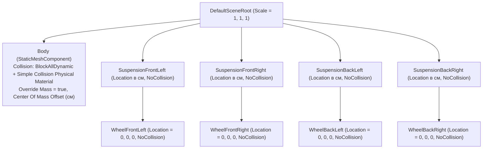

# 00. Быстрый старт: настройка физики автомобиля в City Car Driving 2.0

**Навигация:** [README](./README.md) | **00. Быстрый старт** | [01. Архитектура и конфиги](./01_Architecture_and_Config.md) | [02. Именованный ввод/вывод](./02_Named_IO_and_States.md) | [03. Трансмиссия](./03_Components_TorqueTrain.md) | [04. Электрика](./04_Components_Electrics.md) | [05. Шасси и подсистемы](./05_Components_Chassis_and_Subsystems.md)

---

Этот раздел представляет собой краткое практическое руководство по сборке и инженерному расчёту физики модифицированного автомобиля в **City Car Driving 2.0** с нуля. Подробные справочники по каждому компоненту и каналу телеметрии приведены в разделах [01](./01_Architecture_and_Config.md)–[05](./05_Components_Chassis_and_Subsystems.md).

---

## 1. Состав файлов физики и правила путей (`Vehicle.ini`, `options.xml`, `Engine.csv`, `*.xml`)

В папке плагина мода `Plugins/Mods/Content/<ИмяМода>/` рядом с ассетами Unreal Engine 5 (`V_<ИмяМода>.uasset`, `DA_<ИмяМода>.uasset`, `ST_<ИмяМода>.uasset`) размещаются текстовые файлы физической конфигурации в кодировке **UTF-8**:

- **`Vehicle.ini`** — главный конфигурационный файл с параметрами всех узлов автомобиля;
- **`options.xml`** — описание доступных комплектаций (переключение АКПП/МКПП, выбор двигателя);
- **`Engine.csv`** — двумерная таблица крутящего момента и механических потерь ДВС;
- *(Опционально)* локальные файлы XML-схем (`AwdAuto.xml`, `AwdManual.xml` и др.) и таблиц кривых (`.csv`).

### 1.1. Правила разрешения путей от папки `Content/`

Все пути внутри `Vehicle.ini` и `options.xml` отсчитываются **относительно корневой директории `Content/` основного проекта игры**:

1. **Общие ресурсы базовой игры (`Content/Common/Vehicles/MotorCars/...`):** записываются напрямую без ведущего слэша:
   ```ini
   DefaultSchema = Common/Vehicles/MotorCars/Schemes/AwdAuto.xml
   ProgressionCurve = Common/Vehicles/MotorCars/Tables/SpringProgression.csv
   ```
2. **Собственные файлы внутри папки мода (`Plugins/Mods/Content/<ИмяМода>/...`):** требуют выхода из `Content/` через `../Plugins/Mods/Content/<ИмяМода>/...`:
   ```ini
   PowerCurves = ../Plugins/Mods/Content/CieBensVGruppe/Engine.csv
   ```

### 1.2. Критические правила синтаксиса `Vehicle.ini` и `.csv`

> [!CAUTION]
> **Три правила синтаксиса, нарушение которых ломает чтение параметров:**
>
> 1. **Разделитель списков и 3D-векторов — строго точка с запятой `;` БЕЗ пробела перед `;`!**
>    Запятые `,` не поддерживаются, а комбинация «пробел перед `;`» (`" ;"`) воспринимается парсером `.ini` как начало комментария до конца строки и отбрасывает все последующие числа:
>    ```ini
>    Mount = 1.63; 0.85; 0.4455                                  ; ПРАВИЛЬНО
>    Gears = -3.416; 4.377; 2.859; 1.921; 1.368; 1.000; 0.820    ; ПРАВИЛЬНО
>    Mount = 1.63 ; 0.85 ; 0.4455                                ; ОШИБКА: пробел перед ';' обрежет 0.85 и 0.4455!
>    ```
> 2. **Десятичный разделитель — строго точка `.`** (как в `Vehicle.ini`, так и во всех `.csv`-таблицах).
> 3. **Лимит длины заголовка секции — не более `49` символов** внутри квадратных скобок `[...]` (включая постфиксы опций `.ИмяОпции.ЗначениеОпции`), лимит длины одной строки — не более `400` символов.

Подробное описание синтаксиса `.ini` и форматов таблиц приведено в [разделе 01. Архитектура и конфиги](./01_Architecture_and_Config.md).

---

## 2. Обязательные требования к физическому кузову `Body` и узлам колёс в Blueprint

Масса кузова, его центр тяжести и иерархия колёс задаются непосредственно в Blueprint автомобиля `V_<ИмяМода>.uasset` в редакторе Unreal Engine 5:



1. **Корневой меш кузова `Body` и масштаб `Scale = (1, 1, 1)`:**
   - Единственным физическим мешем кузова обязан быть `StaticMeshComponent` с именем **`Body`**, в ассете которого созданы выпуклые коллизионные оболочки (`Simple Collision`) и назначен **`Simple Collision Physical Material`**.
   - На всех остальных компонентах и мешах в Blueprint (колёсах, суппортах подвески, стёклах, деталях салона и кузова) обязательно должен стоять профиль коллизии **`NoCollision`** (`Receives Decals = False`).
   - У актора и **всех** его компонентов в Blueprint должен быть установлен единичный масштаб **`Scale = (1.0, 1.0, 1.0)`** (оси экспорта FBX: `-X Forward`, `Z Up`).
2. **Обязательные имена узлов подвески и колёс (задняя ось — строго `Back`, а не `Rear`!):**
   - Суппорты подвески: **`SuspensionFrontLeft`**, **`SuspensionFrontRight`**, **`SuspensionBackLeft`**, **`SuspensionBackRight`** (в их свойстве `Location` задаются координаты центров колёс в сантиметрах).
   - Меши колёс (дочерние к соответствующим `Suspension*` с `Location = (0, 0, 0)`): **`WheelFrontLeft`**, **`WheelFrontRight`**, **`WheelBackLeft`**, **`WheelBackRight`**.
3. **Подрессоренная масса кузова (`Override Mass`):**
   - В разделе **Physics** компонента `Body` обязательно включите галочку **`Override Mass`** и укажите в поле **`Mass in Kg`** подрессоренную массу кузова (снаряжённую массу автомобиля с водителем за вычетом массы четырёх колёс):
      $$M_{\text{body}} = M_{\text{curb}} - 4 \cdot M_{\text{wheel}}$$
   - Если оставить `Override Mass` выключенным, физический движок рассчитает массу из объёма коллизии $V$ по нелинейной формуле $M_{\text{auto}} = 1000 \cdot V^{0.75}$, что занижает массу средних и крупных автомобилей почти вдвое.
4. **Смещение центра масс (`Center Of Mass Offset` в сантиметрах):**
   - Вектор **`Center Of Mass Offset`** (`COMNudge`) на компоненте `Body` задаётся в **сантиметрах (`см`)** и представляет собой **относительное смещение** $(\Delta X, \Delta Y, \Delta Z)$ от автоматически вычисленного геометрического центра объёма коллизии $\text{COM}_{\text{auto}}$:
      $$\text{COM}_{\text{final}} = \text{COM}_{\text{auto}} + \text{Center Of Mass Offset}$$
   - Чтобы получить паспортную продольную развесовку (где $w_{\text{front}}$ — доля нагрузки на переднюю ось, например `0.54` для `54% / 46%`), рассчитайте целевую координату $X_{\text{target}}$ между осями $X_{\text{front}}$ и $X_{\text{back}}$ (в `см`) и вычтите из неё $X_{\text{auto}}$:
      $$X_{\text{target}} = X_{\text{back}} + w_{\text{front}} \cdot (X_{\text{front}} - X_{\text{back}}), \qquad \Delta X = X_{\text{target}} - X_{\text{auto}}$$
   - Аналогично задайте $\Delta Y = -Y_{\text{auto}}$ (для устранения поперечного крена) и $\Delta Z = Z_{\text{target}} - Z_{\text{auto}}$ (у высоких кузовов — хэтчбеков, кроссоверов и минивэнов — геометрический центр коллизии $Z_{\text{auto}}$ задран вверх, поэтому смещение $\Delta Z$ должно быть отрицательным).

---

## 3. Выбор XML-схемы и настройка комплектаций (`options.xml`)

### 3.1. Отличия 6 стандартных XML-схем (`Common/Vehicles/MotorCars/Schemes/*.xml`)

| Признак / Узел | Схемы с АКПП (`*Auto.xml`) | Схемы с МКПП (`*Manual.xml`) | Схемы полного привода (`Awd*.xml`) | Схемы монопривода (`Fwd*.xml`, `Rwd*.xml`) |
| --- | --- | --- | --- | --- |
| **Файлы схем** | `AwdAuto.xml`, `FwdAuto.xml`, `RwdAuto.xml` | `AwdManual.xml`, `FwdManual.xml`, `RwdManual.xml` | `AwdAuto.xml`, `AwdManual.xml` | `FwdAuto.xml`, `FwdManual.xml`, `RwdAuto.xml`, `RwdManual.xml` |
| **Секции КПП и сцепления / ГДТ в `Vehicle.ini`** | **`[GearBoxAutomatic]`**, `[TorqueConverter]`, `[GearBoxLogic]`, `[GearBoxAutomaticPump]`, `[OilTank]` | **`[GearBox]`**, `[Clutch]`, `[ClutchPedal]` | Зависит от `Auto` / `Manual` | Зависит от `Auto` / `Manual` |
| **Секции дифференциалов в `Vehicle.ini`** | Зависит от типа привода | Зависит от типа привода | **`[DifferentialAxle]`** *(главная пара)*, `[FrontAxisRelay]`, **`[DifferentialWheelFront]`**, **`[DifferentialWheelBack]`** | **`[Differential]`** *(единственный дифференциал с главной парой)* |
| **Секции задних тормозов, колёс и подвески** | `[BrakeBackLeft/Right]`, `[WheelBackLeft/Right]`, `[SuspensionBackLeft/Right]` | `[BrakeBackLeft/Right]`, `[WheelBackLeft/Right]`, `[SuspensionBackLeft/Right]` | Задняя ось всегда с суффиксом **`Back`** | Задняя ось всегда с суффиксом **`Back`** |
| **Как игра определяет тип КПП (АКПП vs МКПП)** | В `<InputElements>` присутствует вход **`AutoShifterState`** | Вход `AutoShifterState` отсутствует (есть `GearBoxState` и `Clutch`) | — | — |

### 3.2. Комбинация двух опций в `options.xml` (КПП + Двигатель)

В `options.xml` атрибут **`SetSchema="true"` может быть установлен только у одной опции**. Если у автомобиля есть и выбор КПП (`Auto` / `Manual`), и выбор двигателя (например, бензиновый и дизельный), назначьте `SetSchema="true"` опции `TransmissionType`, а `EngineGazoline` из стандартных схем используйте как универсальный базовый ДВС, переключая его характеристики и таблицу `PowerCurves` через секции `[Engine.EngineType.*]` и `[Idler.EngineType.*]` в `Vehicle.ini`:

```xml
<?xml version="1.0" encoding="UTF-8" ?>
<Options>
    <AvailableOptions>
        <Option Name="TransmissionType" SetSchema="true">
            <OptionValue Value="Auto"   SchemaName="Common/Vehicles/MotorCars/Schemes/AwdAuto.xml" />
            <OptionValue Value="Manual" SchemaName="Common/Vehicles/MotorCars/Schemes/AwdManual.xml" />
        </Option>
        <Option Name="EngineType" SetSchema="false">
            <OptionValue Value="2.0I" />
            <OptionValue Value="2.2TD" />
        </Option>
    </AvailableOptions>
</Options>
```

### 3.3. Краткий рецепт локальной схемы с `EngineDiesel` + `Turbocharger`

Если вам нужна собственная схема с классом дизеля `EngineDiesel` и турбокомпрессором `Turbocharger`:

1. Скопируйте базовую схему (`AwdAuto.xml` / `AwdManual.xml`) в папку мода `Plugins/Mods/Content/<ИмяМода>/`.
2. В `<Components>` замените класс `Engine` на `Class="EngineDiesel"` и добавьте `<Component Name="Turbocharger" Class="Turbocharger" />`.
3. В `<Links>` **обязательно удалите** связь `<Link Holder="IgnitionElectricCircuit" Reference="Engine" />`, **сохраните** связь `<Link Holder="IgnitionKey" Reference="Idler" />` (она глушит дизель при повороте ключа в `0`) и добавьте `<Link Holder="Turbocharger" Reference="Engine" />`.
4. В `<InputProcessors>` добавьте `<Processor Input="Accelerator" Component="Turbocharger" InternalName="Throttle" />`, а в `Vehicle.ini` добавьте секцию `[Turbocharger]` с `LagTime = 0.08..0.10` (эффективная постоянная времени сглаживания буста в игре равна $\tau_{\text{eff}} = 4 \cdot \text{LagTime} \approx 0.32..0.40\text{ с}$).

Подробные примеры схем и таблица всех входов/выходов приведены в разделах [01. Архитектура и конфиги](./01_Architecture_and_Config.md) и [02. Именованный ввод/вывод](./02_Named_IO_and_States.md).

---

## 4. Пошаговый расчёт ключевых параметров `Vehicle.ini` и `Engine.csv`

### Шаг 1. Геометрия рулевого `[Steering]` и шины `[Wheel*]`

1. **Колёсная база (`InteraxleDistance` в `[Steering]`):** возьмите продольные координаты $X_{\text{front,cm}}$ и $X_{\text{back,cm}}$ узлов `SuspensionFront*` и `SuspensionBack*` из Blueprint (в `см`) и переведите расстояние между осями в **метры**:
   $$\text{InteraxleDistance} = \frac{X_{\text{front,cm}} - X_{\text{back,cm}}}{100}$$
2. **Статический радиус колеса (`Radius` в `[Wheel*]`):** измерьте свободный радиус 3D-меша колеса и вычтите статический прогиб шины под нагрузкой ($8{-}12\text{ мм}$). Например, при диаметре меша $710\text{ мм}$ ($R_{\text{free}} = 0.355\text{ м}$) задайте `Radius = 0.345` м.
3. **Балансировка поворачиваемости (`ForceCurveLoad` в `[Wheel*]`):**
   - На передних колёсах (`[WheelFrontLeft/Right]`) задайте `ForceCurveLoad` равным статической вертикальной нагрузке переднего колеса: $\text{ForceCurveLoad}_{\text{front}} \approx F_{\text{stat,f}} = m_{\text{f}} \cdot 9.81$.
   - На задних колёсах (`[WheelBackLeft/Right]`) задайте `ForceCurveLoad` на **$5{-}15\%$ выше** статической вертикальной нагрузки заднего колеса $F_{\text{stat,r}} = m_{\text{r}} \cdot 9.81$, чтобы обеспечить автомобилю естественный запас устойчивости задней оси против срыва в занос.

### Шаг 2. Подвеска `[SuspensionFront*]` и `[SuspensionBack*]`

1. **Точка верхнего крепления пружины `Mount` (перевод из левой СК UE5 в `см` в правую СК физики в `м`):**
   Задайте полный ход подвески `Length` (например, `0.20` м спереди и `0.22` м сзади) и целевую относительную просадку в статике `NormalSag = 0.33`. Чтобы колёса в покое встали точно в координаты центров арок $(X_{\text{UE}}, Y_{\text{UE}}, Z_{\text{UE}})$ из Blueprint, рассчитайте `Mount` по формуле:
   $$\text{Mount} = \left(\frac{X_{\text{UE}}}{100};\quad -\frac{Y_{\text{UE}}}{100};\quad \frac{Z_{\text{UE}}}{100} + (1 - \text{NormalSag}) \cdot \text{Length}\right)$$
   *(Обратите внимание на инверсию знака $Y$: в `Vehicle.ini` для левых колёс $Y > 0$, для правых $Y < 0$).*
2. **Жёсткость пружины `SpringCoeff`, преднатяг `PreloadForce` и амортизатор `DampCoeff`:**
   Стандартная таблица прогрессии `Common/Vehicles/MotorCars/Tables/SpringProgression.csv` в точке `NormalSag = 0.33` имеет эффективный множитель жёсткости **`0.654`**. Поэтому для точного попадания в `SpringSag = 0.33` под статической нагрузкой колеса $F_{\text{stat}} = m_{\text{corner}} \cdot 9.81$ параметры связаны соотношениями:
   $$F_{\text{stat}} = \text{PreloadForce} + 0.654 \cdot \text{SpringCoeff} \cdot \text{Length} \cdot \text{NormalSag}, \qquad \text{DampCoeff} \approx (0.65 \dots 0.75) \cdot 2\sqrt{\text{SpringCoeff} \cdot m_{\text{corner}}}$$

### Шаг 3. Двигатель `[Engine]`, регулятор ХХ `[Idler]` и таблица `Engine.csv`

1. **Компенсация вычитания строки механических потерь $F(\text{RPM})$:**
   В таблице `Engine.csv` последняя строка (с меткой `0` после строки `100`) задаёт положительный момент механических потерь $F(\text{RPM}) > 0$. Двигатель **всегда вычитает $F(\text{RPM})$ из интерполированного момента сгорания при любом положении педали газа, включая `100%`**. Поэтому для получения на валу паспортного момента $T_{\text{паспорт}}(\text{RPM})$ в строку `100%` необходимо закладывать сумму:
   $$T_{100}(\text{RPM}) = T_{\text{паспорт}}(\text{RPM}) + F(\text{RPM})$$
   Если в схеме используется компонент **`[Turbocharger]`**, дополнительно разделите каждую ячейку сгорания $(r, c)$ на коэффициент наддува при соответствующем положении дросселя $\text{thr} = \text{row\_pct} / 100$:
   $$\text{ratio}(\text{RPM}, \text{thr}) = 1 + (\text{RefCompressionRatio} - 1)\sqrt{\frac{\max(0,\; \text{RPM}\cdot\text{thr} - \text{MinRpm})}{\text{RefRpm} - \text{MinRpm}}}, \qquad T_{\text{CSV}}(\text{RPM}, \text{thr}) = \frac{T_{\text{target}}(\text{RPM}, \text{thr}) + F(\text{RPM})}{\text{ratio}(\text{RPM}, \text{thr})}$$
   *(Последнюю строку механических потерь $F(\text{RPM})$ на $\text{ratio}$ делить не нужно!)*
2. **Формирование «анти-столл горба» на колонке `500 RPM` в строках `5%–10%`:**
   Регулятор холостого хода `[Idler]` работает по разомкнутой схеме: он вычисляет положение дросселя так, чтобы при `IdleRpm` момент сгорания ровно уравновешивал только внутреннее трение $F(\text{IdleRpm})$, и не увеличивает подачу газа при просадке оборотов под внешней нагрузкой (при включении `D` в АКПП на тормозе или смыкании сцепления). Чтобы мотор уверенно держал холостой ход под нагрузкой, в строках малого газа (`5%` и `10%`) сделайте выраженный подъём крутящего момента на колонке **`500 RPM`** (в `3–5` раз выше момента на колонке `750 RPM`).

### Шаг 4. КПП, дифференциалы и спидометр

1. **МКПП (`[Clutch]`, `[GearBox]`):**
   - В `[Clutch]` задайте `MaxTorque` с запасом $1.4{-}1.6$ от пикового момента двигателя.
   - В `[GearBox]` первый элемент массива `Gears` — задняя передача (отрицательное число), далее — передние передачи по порядку (`StartingGear = -1`). Для чёткого включения первой передачи с места задайте параметры синхронизаторов: `MaxRPMDiffToShift = 200..250`, `SynchronizerMaxFrictionTorque = 10..15`.
2. **АКПП (`[TorqueConverter]`, `[GearBoxAutomatic]`):**
   - В `[GearBoxAutomatic]` задайте квадратичный коэффициент потерь первичного вала **`RotationalFrictionQuadCoeff = 2.0e-4 .. 3.0e-4`** (`RotationalFrictionConstant = 1.5`).
   - В таблицах переключений по педали газа `ShiftAccelerator = 0; 0.1; ...; 1` согласуйте пороги переключения вверх **`MaxRpm`** с оборотами скольжения гидротрансформатора и задайте достаточно широкий допуск блокировки **`TorqueConverterLockDiff`** (`650..2100`), чтобы муфта блокировки ГДТ замыкалась после каждого переключения.
   - Чтобы двигатель не глох при экстренном торможении «в пол» в режиме `D`, настройте своевременное размыкание муфты ГДТ: **`UnlockTorqueConverterRpm = 1200..1250`** (`LockTorqueConverterRpm = 1350..1400`) и **`TorqueConverterLockTime = 0.25..0.30`**.
3. **Дифференциалы и спидометр (`[Speedometer]`):**
   - Для автомобилей с постоянным полным приводом (`Awd*.xml`) во всех трёх дифференциалах (`[DifferentialAxle]`, `[DifferentialWheelFront]`, `[DifferentialWheelBack]`) устанавливайте **`Locked = false`**, а передаточное число главной пары `GearRatio` задавайте в `[DifferentialAxle]`.
   - В `[Speedometer]` рассчитайте путь в метрах за один оборот вала главной передачи по статическому радиусу колеса $R_{\text{wheel}}$ и передаточному числу главной пары $i_{\text{diff}}$:
      $$\text{MetersPerRotation} = \frac{2\pi R_{\text{wheel}}}{i_{\text{diff}}}$$
      *(При необходимости штатного завышения показаний спидометра на $+2\%$ умножьте полученное значение на `1.02`).*

### Шаг 5. Бортовая электрика `[CarElectrics]`

В секции `[CarElectrics]` для всех используемых на автомобиле световых приборов, индикаторов приборной панели, моторов стеклоочистителей и электрических стрелок **обязательно задайте положительное электрическое сопротивление `<Префикс>_Resistance > 0`** (например, `100` Ом для сигнальных ламп и стрелок, `4` Ома для галогенных ламп фар и дворников). Любой элемент с сопротивлением по умолчанию `0.0` Ом считается неподключённым к бортовой сети и не будет работать при включении зажигания.

Подробные таблицы параметров всех компонентов приведены в разделах [03. Трансмиссия](./03_Components_TorqueTrain.md), [04. Электрика](./04_Components_Electrics.md) и [05. Шасси и подсистемы](./05_Components_Chassis_and_Subsystems.md).

---

## 5. Контрольный чек-лист проверки автомобиля (5 базовых тестов)

Перед завершением настройки проверьте автомобиль по 5 контрольным сценариям на ровной горизонтальной площадке:

- [ ] **1. Статическая посадка (`SpringSag` и углы кузова):** после спавна автомобиль стоит ровно и неподвижно (`Pitch` и `Roll` около `0°`), колёса находятся строго по центрам колёсных арок, а выход относительного сжатия подвески `SpringSag` на всех четырёх стойках составляет около **`0.33`** (`0.32..0.34`).
- [ ] **2. Пуск и глушение ключом (`0 -> 1 -> 2 -> 1 -> 0`):** при включении зажигания (`1`) загораются контрольные лампы приборной панели, но двигатель сам не запускается; в положении стартера (`2`) на `P` или `N` двигатель запускается за `0.4–0.7 с` и выходит на обороты холостого хода (`WarmupRpm` / `IdleRpm`), а в режимах `D` и `R` стартер заблокирован. При повороте ключа обратно в `0` подача топлива прекращается и двигатель полностью останавливается (`RPM = 0`).
- [ ] **3. Холостой ход в `D` на тормозе и разгон `0–100 км/ч`:** при переводе селектора АКПП из `N` в `D` с удерживаемой педалью тормоза обороты плавно снижаются на `60–100 об/мин` и стабильно держатся без провала ниже `MinStableRpm`. При отпускании тормоза автомобиль плавно начинает катиться (`Creep`), а при разгоне с места в полный газ время достижения `100 км/ч` соответствует паспортным характеристикам.
- [ ] **4. Накат, кикдаун и экстренное торможение со `100` до `0 км/ч` в `D`:** при плавном движении коробка своевременно доходит до высшей передачи и блокирует ГДТ; при отпускании педали газа на скорости наблюдается плавное торможение двигателем; при резком нажатии газа в пол (`Kick-Down`) АКПП сбрасывает 2–3 передачи вниз; при экстренном торможении «в пол» со `100 км/ч` до полной остановки `0 км/ч` в режиме `D` муфта ГДТ вовремя размыкается и **двигатель не глохнет**.
- [ ] **5. Работа комплектации с МКПП и точность приборов:** при выборе механической коробки передач в меню настроек автомобиль плавно трогается на одном сцеплении, все передачи от первой до высшей и задней чётко включаются синхронизаторами, а показания спидометра и тахометра соответствуют фактической скорости и оборотам отсечки `RpmLimit`.
