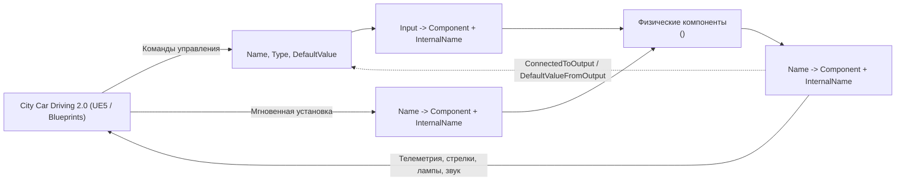

# 02. Именованные входы, выходы и состояния в XML-схемах City Car Driving 2.0

**Навигация:** [README](./README.md) | [00. Быстрый старт](./00_Quick_Start.md) | [01. Архитектура и конфиги](./01_Architecture_and_Config.md) | **02. Именованный ввод/вывод** | [03. Трансмиссия](./03_Components_TorqueTrain.md) | [04. Электрика](./04_Components_Electrics.md) | [05. Шасси и подсистемы](./05_Components_Chassis_and_Subsystems.md)

---

## 1. Устройство секций `<InputElements>`, `<InputProcessors>`, `<OutputElements>` и `<StateElements>`

Связь между игровой логикой City Car Driving 2.0 (управлением игрока, ИИ-трафиком, приборной панелью, внешней светотехникой, звуками FMOD, контролем ПДД и Force Feedback) и физическими компонентами автомобиля задаётся в XML-схеме (`<Vehicle>`) через 4 секции:



### 1.1. Атрибуты тегов: `Name`, `Component` и `InternalName`

В каждом элементе ввода/вывода участвуют три атрибута:

- **`Component`** — **имя экземпляра компонента** из раздела `<Components><Component Name="..." Class="..." /></Components>` вашей XML-схемы. Имя `Component` в системе ввода/вывода **не ограничено** (кроме обязательных имён стоек подвески `SuspensionFrontLeft/Right`, `SuspensionBackLeft/Right` и колёс `WheelFrontLeft/Right`, `WheelBackLeft/Right`, которые привязываются к 3D-мешам в Blueprint). Остальные узлы в собственной XML-схеме можно называть произвольно, главное — чтобы атрибут `Component="..."` и заголовок секции `[ИмяКомпонента]` в `Vehicle.ini` ссылались на это имя.
- **`InternalName`** — **внутреннее имя канала класса (`Class`)**. Оно жёстко задано реализацией соответствующего `Class` и **обязано точно совпадать** со списком поддерживаемых классом входов/выходов/состояний (см. [Раздел 3](#3-справочник-внутренних-имён-internalname-по-классам-компонентов)). Если атрибут `InternalName` в XML опущен, он автоматически принимается равным внешнему имени `Name` (или `Input`).
- **`Name`** (или **`Input`** в `<InputProcessors>`) — **внешнее имя канала автомобиля**, по которому к физике обращается игра City Car Driving 2.0 и Blueprints. Обязательные внешние имена каналов приведены в таблицах Раздела 2.

| Секция и тег в XML | Атрибуты | Назначение |
| --- | --- | --- |
| **`<OutputElements>`**<br>`<Element ... />` | `Name`, `Type` (`Real`/`Integer`/`Boolean`), `Component`, `InternalName` *(опц.)* | Выводит физическую величину, положение стрелки или яркость индикатора из компонента `Component` наружу под именем `Name`. |
| **`<StateElements>`**<br>`<Element ... />` | `Name`, `Type` (`Real`/`Integer`/`Boolean`), `Component`, `InternalName` *(опц.)* | Позволяет игре мгновенно задать внутреннее состояние компонента (объём топлива, температуру ДВС, пробег, передачу) при спавне, заправке или перезапуске. |
| **`<InputElements>`**<br>`<Element ... />` | `Name`, `Type` (`Real`/`Integer`/`Boolean`), `DefaultValue` *(опц.)*, `DefaultValueFromOutput` *(опц.)*, `ConnectedToOutput` *(опц.)* | Объявляет внешний канал управления и способ его начальной инициализации. |
| **`<InputProcessors>`**<br>`<Processor ... />` | `Input`, `Component`, `InternalName` *(опц.)* | Подписывает компонент `Component` на изменения канала ввода `Input`. |

### 1.2. Начальные значения входов и автосвязка `ConnectedToOutput`

В теге `<Element>` секции `<InputElements>` поддерживаются три атрибута инициализации (в порядке возрастания приоритета):

1. **`DefaultValue="..."`** — однократно подаёт указанное константное значение при создании автомобиля (например, `DefaultValue="true"` для `Battery`, `EnableABS`, `EnableTCS`).
2. **`DefaultValueFromOutput="ИмяВыхода"`** — при создании автомобиля однократно копирует начальное значение из указанного `<OutputElements>` того же типа (например, в `*Manual.xml` вход `Gear` берёт стартовую передачу `DefaultValueFromOutput="Gear"`). Вход остаётся доступным для управления из игры.
3. **`ConnectedToOutput="ИмяВыхода"`** — автоматически копирует значение указанного выхода в этот вход **на каждом кадре симуляции** и скрывает вход из списка внешних входов. Используется для прямой передачи сигнала от одного компонента к другому без участия игры:

```xml
<OutputElements>
    <Element Name="RetarderActive" Type="Boolean" Component="Retarder" InternalName="Enabled" />
</OutputElements>
<InputElements>
    <Element Name="RetarderIndicatorInput" Type="Boolean" ConnectedToOutput="RetarderActive" />
</InputElements>
<InputProcessors>
    <Processor Input="RetarderIndicatorInput" Component="CarElectrics" InternalName="Retarder" />
</InputProcessors>
```

---

## 2. Стандартные и обязательные входы, состояния и выходы в City Car Driving 2.0

> [!IMPORTANT]
> **Шесть ключевых правил работы с каналами ввода/вывода в City Car Driving 2.0:**
>
> 1. **Определение типа КПП по наличию входа `AutoShifterState`:** контроллеры салона, селектора и звука (`BP_VehicleInteriorController_Transmission`, `BP_CarSound`) проверяют наличие входа `HasInput("AutoShifterState")`. Если вход `AutoShifterState` объявлен в схеме — машина считается оснащённой **АКПП**, если отсутствует — **МКПП**.
> 2. **Педаль газа называется `Accelerator` (а не `Throttle`):** во всех схемах CCD 2.0 внешний вход газа имеет имя **`Accelerator`** (`0.0 .. 1.0`). Имя `Throttle` используется только как `InternalName` внутри компонента `Turbocharger`.
> 3. **Инверсия педали сцепления `Clutch` (`*Manual.xml`):** значение **`0.0`** означает **полностью выжатую педаль** (сцепление разомкнуто), а **`1.0`** — **полностью отпущенную педаль** (сцепление замкнуто).
> 4. **Ключ зажигания `Ignition` и блокировка стартера:** принимает значения **`0`** (`Off` — выключено), **`1`** (`Ignition` — зажигание включено), **`2`** (`Starter` — пуск стартера). В схемах с АКПП (`*Auto.xml`) замок зажигания связан с `GearBoxLogic` и **разрешает работу стартера (`2`) только в положениях `P (0)` или `N (2)`**.
> 5. **Управление КПП (`AutoShifterState` в `*Auto.xml` против `Gear` в `*Manual.xml`):**
>    - В `*Auto.xml` селектор управляется входом **`AutoShifterState`**: **`0 = P`**, **`1 = R`**, **`2 = N`**, **`3 = D`**. Для вывода из `P (0)` должен быть нажат тормоз (`Brake >= ShiftMinBrake`, по умолчанию `0.1`).
>    - В `*Manual.xml` используется вход **`Gear`**: внутри `GearBox` индекс **`-1`** — нейтраль (`N`), **`0`** — задний ход (`R`), **`1..N-1`** — передачи вперёд *(игровой контроллер CCD 2.0 автоматически переводит `-1 = R`, `0 = N`, `1..N = вперёд` в индексы `GearBox` при наличии выхода `EnableNeutralInput = true`)*.
> 6. **Единицы скорости `Speed` и `DashboardSpeed`:** оба выхода возвращают скорость строго в **метрах в секунду ($\text{м/с}$)** (`1 м/с = 3.6 км/ч`).

### 2.1. Входные каналы (`<InputElements>` и `<InputProcessors>`) — один вход на строку

В столбце **«Статус в CCD 2.0»** отмечены **обязательные** каналы, имена которых жёстко зашиты в коде управления, ИИ-трафика и Blueprint-компонентах игры.

| Внешнее имя `Name` | `Type` | По умолч. | Куда направляется (`Component` $\rightarrow$ `InternalName`) | Схемы | Статус в CCD 2.0 (где используется) |
| --- | :-: | :-: | --- | :-: | --- |
| **`Accelerator`** | `Real` | — | `AbsTcs`; в `*Auto`: + `GearBoxAutomatic`, `GearBoxLogic`; с турбиной: + `Turbocharger` (`Throttle`) | Все 6 | **Обязательный** (управление игрока/ИИ, звук нагрузки ДВС `BP_CarSound`, `BP_TrafficSound`) |
| **`Brake`** | `Real` | — | `AbsTcs`, `CarElectrics`; в `*Auto`: + `GearBoxLogic` | Все 6 | **Обязательный** (управление игрока/ИИ, стоп-сигналы, разблокировка селектора АКПП из `P`) |
| **`ParkingBrake`** | `Real` | — | `BrakeBackLeft`, `BrakeBackRight`, `CarElectrics` | Все 6 | **Обязательный** (стояночный тормоз игрока/ИИ, звук ручника в `BP_CarSound`) |
| **`Clutch`** | `Real` | — | `ClutchPedal` (`Clutch`, `0.0` = выжато, `1.0` = отпущено) | `*Manual` | **Обязательный для МКПП** (педаль сцепления игрока и ИИ) |
| **`Steering`** | `Real` | — | `Steering` (`Steering`, `-1.0..+1.0`) | Все 6 | **Обязательный** (рулевое управление игрока/ИИ, вращение 3D-руля и рук в `BP_SteeringWheel`) |
| **`Ignition`** | `Integer` | — | `IgnitionKey` (`Ignition`, `0=Off, 1=On, 2=Start`) | Все 6 | **Обязательный** (замок зажигания, экран БК в `BP_VehicleDashboard`, звук ДВС в `BP_CarSound`) |
| **`AutoShifterState`** | `Integer` | — | `GearBoxLogic` (`AutoShifterState`, `0=P, 1=R, 2=N, 3=D`) | `*Auto` | **Обязательный для АКПП** (селектор АКПП; по `HasInput("AutoShifterState")` игра отличает АКПП от МКПП!) |
| **`AutoShifterMaxGear`** | `Integer` | — | `GearBoxLogic` (`AutoShifterMaxGear`, `0..N`) | `*Auto` | **Обязательный для АКПП** (ручное ограничение диапазона ступеней АКПП) |
| **`Gear`** | `Integer` | `FromOutput="Gear"` | `GearBox` (`Gear`) | `*Manual` | **Обязательный для МКПП** (переключение передач МКПП, звук рычага КПП в `BP_CarSound`) |
| **`SafetyBelt`** | `Boolean` | — | `CarElectrics` (`SafetyBelt`) | Все 6 | **Обязательный** (ремень безопасности, анимация в `BP_SteeringWheel`, звук в `BP_CarSound`, контроль ПДД) |
| **`Horn`** | `Boolean` | — | `CarElectrics` (`Horn`) | Все 6 | **Обязательный** (звуковой сигнал / клаксон игрока и ИИ) |
| **`LowBeam`** | `Boolean` | — | `CarElectrics` (`LowBeam`) | Все 6 | **Обязательный** (ближний свет фар игрока/ИИ, звук тумблера в `BP_CarSound`) |
| **`HighBeam`** | `Boolean` | — | `CarElectrics` (`HighBeam`) | Все 6 | **Обязательный** (фиксированный дальний свет фар, звук подрулевого рычажка в `BP_CarSound`) |
| **`HighBeamUnfixed`** | `Boolean` | — | `CarElectrics` (`HighBeamUnfixed`) | Все 6 | Стандартный (моргание дальним светом фар) |
| **`ParkingLights`** | `Boolean` | — | `CarElectrics` (`ParkingLights`) | Все 6 | **Обязательный** (габаритные огни, звук выключателя света в `BP_CarSound`) |
| **`FrontFogLights`** | `Boolean` | — | `CarElectrics` (`FrontFogLights`) | Все 6 | **Обязательный** (передние ПТФ, звук кнопки в `BP_CarSound`) |
| **`RearFogLights`** | `Boolean` | — | `CarElectrics` (`RearFogLights`) | Все 6 | **Обязательный** (задние ПТФ, звук кнопки в `BP_CarSound`) |
| **`LeftTurnLight`** | `Boolean` | — | `CarElectrics` (`LeftTurnLight`) | Все 6 | **Обязательный** (левый поворотник игрока/ИИ, звук рычажка в `BP_CarSound`, проверка ПДД `EG_TurningLights`) |
| **`RightTurnLight`** | `Boolean` | — | `CarElectrics` (`RightTurnLight`) | Все 6 | **Обязательный** (правый поворотник игрока/ИИ, звук рычажка в `BP_CarSound`, проверка ПДД `EG_TurningLights`) |
| **`HazardLight`** | `Boolean` | — | `CarElectrics` (`HazardLight`) | Все 6 | **Обязательный** (аварийная сигнализация игрока и ИИ) |
| **`FrontWindshieldWiper`** | `Integer` | — | `CarElectrics` (`FrontWindshieldWiper`, `0..3`) | Все 6 | **Обязательный** (режим передних дворников `0..3`, звук переключателя в `BP_CarSound`) |
| **`BackWindshieldWiper`** | `Integer` | — | `CarElectrics` (`BackWindshieldWiper`, `0..3`) | Все 6 | **Обязательный** (режим заднего дворника `0..3`) |
| **`EnableABS`** | `Boolean` | `true` | `AbsTcs` (`EnableABS`) | Все 6 | **Обязательный** (включение/отключение ABS в настройках и читах) |
| **`EnableTCS`** | `Boolean` | `true` | `AbsTcs` (`EnableTCS`) | Все 6 | **Обязательный** (включение/отключение TCS в настройках) |
| **`AWD`** | `Boolean` | `true` | `FrontAxisRelay` (`Enable`) | `Awd*` | **Обязательный для подключаемого AWD** (тумблер полного привода) |
| **`DifferentialAxleLock`** | `Boolean` | `false` | `DifferentialAxle` (`Lock`) | `Awd*` | Стандартный в `Awd*.xml` *(в игровом контроллере зашито имя `AxleDiffLock`)* |
| **`DifferentialWheelLock`** | `Boolean` | `false` | `DifferentialWheelFront` (`Lock`), `DifferentialWheelBack` (`Lock`) | `Awd*` | Стандартный в `Awd*.xml` *(в игровом контроллере зашиты `FrontDiffLock` / `BackDiffLock`)* |
| **`Battery`** | `Boolean` | `true` | `Battery` (`Battery`) | Все 6 | **Обязательный** (`DefaultValue="true"` включает массу АКБ при спавне) |
| **`MileageMultiplier`** | `Real` | `1.0` | `Speedometer` (`MileageMultiplier`), `Engine` (`FuelConsumptionMultiplier`) | Все 6 | **Обязательный** (множитель пробега/расхода, читается в `BP_VehicleDashboard`) |
| **`UnlimitedFuelTank`** | `Boolean` | — | `FuelTank` (`EnableUnlimited`) | Все 6 | **Обязательный** (режим бесконечного топлива в игре) |
| **`UnlimitedBattery`** | `Boolean` | — | `Battery` (`EnableUnlimited`) | Все 6 | Стандартный (бесконечный заряд АКБ) |
| **`PerfectWheels`** | `Boolean` | `false` | `WheelFrontLeft..BackRight` (`NoSlip`) | Все 6 | **Обязательный** (режим идеального сцепления шин без скольжения) |
| **`FuelLeak`** | `Real` | — | `FuelTank` (`DrainSpeed`, л/с) | Все 6 | **Обязательный** (неисправность: утечка топлива) |
| **`CoolantLeak`** | `Boolean` | — | `Engine` (`CoolantLeak`) | Все 6 | **Обязательный** (неисправность: утечка ОЖ) |
| **`BrokenSteering`** | `Boolean` | — | `Steering` (`BrokenSteering`) | Все 6 | **Обязательный** (неисправность: отказ рулевого управления) |
| **`BrokenPowerSteering`** | `Boolean` | — | `CarElectrics` (`BrokenPowerSteering`), `PowerSteering` (`Broken`) | Все 6 | **Обязательный** (неисправность: отказ усилителя руля ГУР/ЭУР) |
| **`BrokenLighting`** | `Boolean` | — | `CarElectrics` (`BrokenLighting`) | Все 6 | Стандартный (неисправность: отказ внешнего освещения) |
| **`BrokenBrake`** | `Boolean` | — | `BrakeFrontLeft..BackRight` (`BrokenBrake`), `CarElectrics` (`BrokenBrake`) | Все 6 | Стандартный в `*.xml` *(система повреждений также ищет `BrokenFrontLeftBrake..BackRightBrake`)* |
| **`BlowoutTyreFrontLeft`** | `Boolean` | — | `WheelFrontLeft` (`Blowout`) | Все 6 | Стандартный в `*.xml` *(система повреждений также ищет `BlowoutFrontLeftWheel`)* |
| **`BlowoutTyreFrontRight`** | `Boolean` | — | `WheelFrontRight` (`Blowout`) | Все 6 | Стандартный в `*.xml` *(система повреждений также ищет `BlowoutFrontRightWheel`)* |

---

### 2.2. Канал состояний (`<StateElements>`) — одно состояние на строку

| Внешнее имя `Name` | `Type` | `Component` в XML | `InternalName` | Ед. изм. | Статус в CCD 2.0 (где используется) |
| --- | :-: | --- | --- | :-: | --- |
| **`FuelVolume`** | `Real` | `FuelTank` | `LiquidVolume` | л (`0..Volume`) | **Обязательный** (заправка на АЗС в `BP_CarFuelTank` / `BP_Vehicle_FuelTank`, сохранение топлива, читы) |
| **`Mileage`** | `Real` | `Speedometer` | `Mileage` | м | **Обязательный** (установка сохранённого общего пробега автомобиля при спавне) |
| **`SessionMileage`** | `Real` | `Speedometer` | `SessionMileage` | м | **Обязательный** (сброс и инициализация суточного пробега) |
| **`AutoShifterState`** | `Integer` | `GearBoxLogic` | `State` | `0=P..3=D` | **Обязательный для АКПП** (мгновенная установка режима АКПП при спавне с работающим/заглушенным ДВС) |
| **`Gear`** | `Integer` | `GearBox` | `Gear` | `-1..N-1` | **Обязательный для МКПП** (мгновенная установка передачи МКПП при спавне) |
| **`CoolantTemperature`** | `Real` | `Engine` | `CoolantTemperature` | $^\circ\text{C}$ | **Обязательный** (установка начальной температуры прогретого/холодного ДВС при старте) |
| **`FuelChamberTemperature`** | `Real` | `Engine` | `FuelChamberTemperature` | $^\circ\text{C}$ | **Обязательный** (прогрев камеры сгорания при спавне заведённого автомобиля) |
| **`CoolantLevel`** | `Real` | `Engine` | `CoolantLevel` | `0.0..1.0` | Стандартный (начальный уровень охлаждающей жидкости) |
| **`BrokenCoolingSystem`** | `Boolean` | `Engine` | `BrokenCoolingSystem` | флаг | **Обязательный** (неисправность системы охлаждения / термостата) |
| **`WheelPressureFrontLeft`** | `Real` | `WheelFrontLeft` | `Pressure` | бар (изб.) | Стандартный (начальное давление в передней левой шине) |
| **`WheelPressureFrontRight`** | `Real` | `WheelFrontRight` | `Pressure` | бар (изб.) | Стандартный (начальное давление в передней правой шине) |
| **`DriveShaftVelocity`** | `Real` | `DifferentialAxle` (`Awd*`) / `Differential` (`Fwd*`, `Rwd*`) | `AngularVelocity` | рад/с | Стандартный (начальная угловая скорость карданного вала) |

---

### 2.3. Выходные каналы (`<OutputElements>`) — один выход на строку

#### A. Движение, двигатель, КПП, топливо и электросеть

| Внешнее имя `Name` | `Type` | `Component` | `InternalName` | Ед. изм. | Статус в CCD 2.0 (где используется) |
| --- | :-: | --- | --- | :-: | --- |
| **`Speed`** | `Real` | `Speedometer` | `Speed` | **м/с** | **Обязательный** (скорость машины для ИИ, HUD, звуков ветра/шин, `BP_VehicleDashboard`, `BP_VehicleListener`) |
| **`Mileage`** | `Real` | `Speedometer` | `Mileage` | м | **Обязательный** (общий пробег на экране одометра в `BP_VehicleDashboard` и проверка ПДД `EG_TurningLights`) |
| **`SessionMileage`** | `Real` | `Speedometer` | `SessionMileage` | м | **Обязательный** (суточный пробег и расчёт среднего расхода топлива в `BP_VehicleDashboard`) |
| **`RPM`** | `Real` | `Engine` | `RPM` | об/мин | **Обязательный** (обороты ДВС для ИИ, HUD, FMOD-звука двигателя в `BP_CarSound` / `BP_TrafficSound`, `BP_VehicleListener`) |
| **`RPMLimit`** | `Real` | `Engine` | `RPMLimit` | об/мин | **Обязательный** (отсечка оборотов для логики переключения передач и тахометра HUD) |
| **`StableRPM`** | `Real` | `Engine` | `StableRPM` | об/мин | **Обязательный** (минимальные устойчивые обороты ХХ для логики трогания и анти-столла) |
| **`Combustion`** | `Boolean` | `Engine` | `Combustion` | флаг | **Обязательный** (флаг работы двигателя `IsEngineRunning` для звука `BP_CarSound`, ГУР и игровой логики) |
| **`EngineLoad`** | `Real` | `Engine` | `Load` | $\text{Н}\cdot\text{м}$ | **Обязательный** (текущий момент нагрузки ДВС для телеметрии и звука) |
| **`EngineMaxTorque`** | `Real` | `Engine` | `MaxTorque` | $\text{Н}\cdot\text{м}$ | **Обязательный** (максимальный момент ДВС для расчёта относительной нагрузки) |
| **`EngineVibrationFrequency`** | `Real` | `Engine` | `VibrationFrequency` | Гц | **Обязательный** (частота вибрации ДВС для геймпада и руля Force Feedback) |
| **`EngineVibrationAmplitude`** | `Real` | `Engine` | `VibrationAmplitude` | м | **Обязательный** (амплитуда вибрации ДВС для геймпада и руля Force Feedback) |
| **`CoolantTemperature`** | `Real` | `Engine` | `CoolantTemperature` | $^\circ\text{C}$ | **Обязательный** (температура ОЖ для игровой логики и HUD) |
| **`CoolantLevel`** | `Real` | `Engine` | `CoolantLevel` | `0.0..1.0` | Стандартный (уровень охлаждающей жидкости) |
| **`ThermostatBeginTemperature`** | `Real` | `Engine` | `ThermostatBeginTemperature` | $^\circ\text{C}$ | **Обязательный** (порог рабочей температуры ОЖ) |
| **`OverheatTemperature`** | `Real` | `Engine` | `OverheatTemperature` | $^\circ\text{C}$ | **Обязательный** (порог перегрева двигателя) |
| **`OilTemperature`** | `Real` | `Engine` | `OilTemperature` | $^\circ\text{C}$ | **Обязательный** (температура моторного масла) |
| **`OilPressure`** | `Real` | `Engine` | `OilPressure` | бар | **Обязательный** (текущее давление масла ДВС) |
| **`OilLowPressure`** | `Real` | `Engine` | `OilLowPressure` | бар | **Обязательный** (аварийный порог давления масла) |
| **`AFRRatio`** | `Real` | `Engine` | `AFRRatio` | $\lambda$ | Стандартный (коэффициент избытка воздуха топливовоздушной смеси) |
| **`FuelConsumedTotal`** | `Real` | `Engine` | `FuelConsumedTotal` | л | **Обязательный** (суммарно израсходованное топливо для расчёта `AvgEconomy` в `BP_VehicleDashboard`) |
| **`FuelConsumedPerSecond`** | `Real` | `Engine` | `FuelConsumedPerSecond` | л/с | **Обязательный** (мгновенный расход топлива для бортового компьютера `BP_VehicleDashboard`) |
| **`BrokenCoolingSystem`** | `Boolean` | `Engine` | `BrokenCoolingSystem` | флаг | Стандартный (флаг поломки системы охлаждения) |
| **`StarterRPM`** | `Real` | `Starter` | `RPM` | об/мин | Стандартный (обороты вала электростартера) |
| **`StarterBendixRPM`** | `Real` | `StarterBendix` | `RPM` | об/мин | Стандартный (обороты выходной шестерни бендикса) |
| **`StarterRelayEnabled`** | `Boolean` | `StarterRelay` | `Enabled` | флаг | Стандартный (состояние втягивающего реле стартера) |
| **`AutoShifterState`** | `Integer` | `GearBoxLogic` | `AutoShifterState` | `0=P..3=D` | **Обязательный для АКПП** (положение селектора АКПП для HUD, `BP_VehicleDashboard`, звука заднего хода в `BP_CarSound` и анимации рычага) |
| **`AutoShifterCurrentGear`** | `Integer` | `GearBoxLogic` | `AutoShifterCurrentGear` | `-1..N-1` | **Обязательный для АКПП** (текущая ступень АКПП для HUD и `BP_VehicleDashboard`) |
| **`AutoShifterTargetGear`** | `Integer` | `GearBoxLogic` | `AutoShifterTargetGear` | `-1..N-1` | **Обязательный для АКПП** (целевая ступень АКПП при переключении) |
| **`AutoShifterMaxGear`** | `Integer` | `GearBoxLogic` | `AutoShifterMaxGear` | `0..N` | **Обязательный для АКПП** (ограничение верхней передачи АКПП для HUD) |
| **`Gear`** | `Integer` | `GearBox` | `Gear` | `-1..N-1` | **Обязательный для МКПП** (включённая передача МКПП для HUD, `BP_VehicleDashboard` и анимации кулисы) |
| **`GearRatio`** | `Real` | `GearBox` | `GearRatio` | число | **Обязательный для МКПП** (текущее передаточное число КПП) |
| **`GearCount`** | `Integer` | `GearBox` | `GearCount` | шт. | **Обязательный для МКПП** (общее число ступеней в массиве `Gears`) |
| **`BatteryActive`** | `Boolean` | `Battery` | `BatteryActive` | флаг | Стандартный (состояние подключения АКБ) |
| **`Amperage`** | `Real` | `Battery` | `Amperage` | А | Стандартный (ток разряда `>0` / заряда `<0` аккумулятора) |
| **`Voltage`** | `Real` | `IgnitionElectricCircuit` | `Voltage` | В | **Обязательный** (напряжение в цепи зажигания) |
| **`FuelVolume`** | `Real` | `FuelTank` | `LiquidVolume` | л | **Обязательный** (остаток топлива в баке для `BP_CarFuelTank`, `BP_Vehicle_FuelTank`, `BP_VehicleDashboard`) |
| **`FuelVolumeMax`** | `Real` | `FuelTank` | `Volume` | л | **Обязательный** (полная ёмкость бака для АЗС `BP_CarFuelTank`, `BP_VehicleDashboard` и читов) |
| **`FuelRelative`** | `Real` | `FuelTank` | `LiquidRelativeVolume` | `0.0..1.0` | Стандартный (относительный уровень топлива в баке) |

#### B. Шасси, шины, тормоза (ABS/TCS) и обратная связь на руле (Force Feedback)

| Внешнее имя `Name` | `Type` | `Component` | `InternalName` | Ед. изм. | Статус в CCD 2.0 (где используется) |
| --- | :-: | --- | --- | :-: | --- |
| **`ForceFeedbackTorque`** | `Real` | `PowerSteering` | `Torque` | $\text{Н}\cdot\text{м}$ | **Обязательный** (возвращающий момент на руле для модуля Force Feedback) |
| **`ForceFeedbackFriction`** | `Real` | `PowerSteering` | `Friction` | $\text{Н}\cdot\text{м}$ | **Обязательный** (сухое трение на рулевом валу для Force Feedback) |
| **`ForceFeedbackDamping`** | `Real` | `PowerSteering` | `Damping` | $\text{Н}\cdot\text{м}\cdot\text{с/рад}$ | **Обязательный** (вязкое демпфирование руля для Force Feedback) |
| **`ForceFeedbackSlipAngle`** | `Real` | `PowerSteering` | `SlipAngle` | `-1.0..1.0` | **Обязательный** (нормированный угол увода передних шин для Force Feedback) |
| **`ForceFeedbackInertia`** | `Real` | `PowerSteering` | `Inertia` | $\text{кг}\cdot\text{м}^2$ | **Обязательный** (приведённая инерция рулевого управления для Force Feedback) |
| **`AbsActive`** | `Boolean` | `AbsTcs` | `AbsActive` | флаг | Стандартный (флаг активного срабатывания ABS в данный момент) |
| **`TcsActive`** | `Boolean` | `AbsTcs` | `TcsActive` | флаг | Стандартный (флаг активного срабатывания TCS в данный момент) |
| **`AbsEnabled`** | `Boolean` | `AbsTcs` | `AbsEnabled` | флаг | Стандартный (система ABS исправна и включена) |
| **`TcsEnabled`** | `Boolean` | `AbsTcs` | `TcsEnabled` | флаг | Стандартный (система TCS исправна и включена) |
| **`FrontWheelsWorkingPressure`** | `Real` | `WheelFrontLeft` | `WorkingPressure` | бар | Стандартный (номинальное рабочее давление передних шин) |
| **`WheelPressureFrontLeft`** | `Real` | `WheelFrontLeft` | `Pressure` | бар | Стандартный (текущее давление в передней левой шине) |
| **`WheelPressureFrontRight`** | `Real` | `WheelFrontRight` | `Pressure` | бар | Стандартный (текущее давление в передней правой шине) |
| **`WheelRpmFrontLeft`** | `Real` | `WheelFrontLeft` | `RPM` | об/мин | Стандартный (обороты переднего левого колеса) |
| **`WheelRpmFrontRight`** | `Real` | `WheelFrontRight` | `RPM` | об/мин | Стандартный (обороты переднего правого колеса) |
| **`WheelRpmBackLeft`** | `Real` | `WheelBackLeft` | `RPM` | об/мин | Стандартный (обороты заднего левого колеса) |
| **`WheelRpmBackRight`** | `Real` | `WheelBackRight` | `RPM` | об/мин | Стандартный (обороты заднего правого колеса) |

#### C. Стрелки приборки, внешний свет, индикаторы, дворники и звук (`Component="CarElectrics"`)

| Внешнее имя `Name` | `Type` | `InternalName` в `CarElectrics` | Ед. изм. | Статус в CCD 2.0 (где используется) |
| --- | :-: | --- | :-: | --- |
| **`DashboardSpeed`** | `Real` | `Speed` | **м/с** | **Обязательный** (стрелка спидометра `SpeedArrow` / `ArrowSpeedometr` и цифровой спидометр в `BP_VehicleDashboard`) |
| **`DashboardRPM`** | `Real` | `RPM` | об/мин | **Обязательный** (стрелка тахометра `RPMArrow` / `ArrowRPM` в `BP_VehicleDashboard`) |
| **`DashboardFuel`** | `Real` | `Fuel` | л | **Обязательный** (стрелка уровня топлива `FuelArrow` / `ArrowFuelLevel` в `BP_VehicleDashboard`) |
| **`DashboardCoolantTemperature`** | `Real` | `CoolantTemperature` | $^\circ\text{C}$ | **Обязательный** (стрелка температуры ОЖ `CoolantTemperatureArrow` / `ArrowCoolantTemperature` в `BP_VehicleDashboard`) |
| **`DashboardOilPressure`** | `Real` | `OilPressure` | бар | Стандартный (стрелка манометра масла ДВС) |
| **`DashboardVoltage`** | `Real` | `Voltage` | В | Стандартный (стрелка вольтметра бортсети) |
| **`DashboardAmperage`** | `Real` | `Amperage` | А | **Обязательный** (стрелка амперметра в `BP_VehicleDashboard`) |
| **`DashboardIntensity`** | `Real` | `DashboardIntensity` | `0.0..1.0` | **Обязательный** (подсветка шкал приборки, стрелок и кнопок салона в `BP_VehicleDashboard`) |
| **`LowBeamIntensity`** | `Real` | `LowBeamIntensity` | `0.0..1.0` | **Обязательный** (фары и слот материала `LowBeam` в `BP_VehicleExternalLight`) |
| **`HighBeamIntensity`** | `Real` | `HighBeamIntensity` | `0.0..1.0` | **Обязательный** (фары и слот материала `HighBeam` в `BP_VehicleExternalLight`) |
| **`ParkingLightsIntensity`** | `Real` | `ParkingLightsIntensity` | `0.0..1.0` | **Обязательный** (слоты материалов `ParkingLights` и `LicensePlates` в `BP_VehicleExternalLight`) |
| **`FrontFogLightsIntensity`** | `Real` | `FrontFogLightsIntensity` | `0.0..1.0` | **Обязательный** (фары и слот `FrontFogLights` в `BP_VehicleExternalLight`, иконка `FrontFogLightsIcon`) |
| **`RearFogLightsIntensity`** | `Real` | `RearFogLightsIntensity` | `0.0..1.0` | **Обязательный** (фонарь и слот `RearFogLights` в `BP_VehicleExternalLight`, иконка `RearFogLightsIcon`) |
| **`StopLightIntensity`** | `Real` | `StopLightIntensity` | `0.0..1.0` | **Обязательный** (фонари и слот материала `StopLight` в `BP_VehicleExternalLight`) |
| **`ReverseLightIntensity`** | `Real` | `ReverseLightIntensity` | `0.0..1.0` | **Обязательный** (фонари и слот материала `ReverseLight` в `BP_VehicleExternalLight`) |
| **`LeftTurnLightIntensity`** | `Real` | `LeftTurnLightIntensity` | `0.0..1.0` | **Обязательный** (мигание левых поворотников и слота `LeftTurnLight` в `BP_VehicleExternalLight`) |
| **`RightTurnLightIntensity`** | `Real` | `RightTurnLightIntensity` | `0.0..1.0` | **Обязательный** (мигание правых поворотников и слота `RightTurnLight` в `BP_VehicleExternalLight`) |
| **`LowBeamIconIntensity`** | `Real` | `LowBeamIconIntensity` | `0.0..1.0` | **Обязательный** (слот индикатора `LowBeamIcon` в `BP_VehicleDashboard`) |
| **`HighBeamIconIntensity`** | `Real` | `HighBeamIconIntensity` | `0.0..1.0` | **Обязательный** (слот индикатора `HighBeamIcon` в `BP_VehicleDashboard`) |
| **`ParkingLightsIconIntensity`** | `Real` | `ParkingLightsIconIntensity` | `0.0..1.0` | **Обязательный** (слот индикатора `ParkingLightsIcon` в `BP_VehicleDashboard`) |
| **`LeftTurnLightIconIntensity`** | `Real` | `LeftTurnLightIconIntensity` | `0.0..1.0` | **Обязательный** (слот `LeftTurnLightIcon` в `BP_VehicleDashboard` + звук щелчков реле в `BP_CarSound`) |
| **`RightTurnLightIconIntensity`** | `Real` | `RightTurnLightIconIntensity` | `0.0..1.0` | **Обязательный** (слот `RightTurnLightIcon` в `BP_VehicleDashboard` + звук щелчков реле в `BP_CarSound`) |
| **`HazardLightIconIntensity`** | `Real` | `HazardLightIconIntensity` | `0.0..1.0` | **Обязательный** (подсветка кнопки аварийки `HazardLightIcon` в `BP_VehicleDashboard`) |
| **`SafetyBeltIconIntensity`** | `Real` | `SafetyBeltIconIntensity` | `0.0..1.0` | **Обязательный** (слот индикатора ремня `SafetyBeltIcon` в `BP_VehicleDashboard`) |
| **`ParkingBrakeIconIntensity`** | `Real` | `ParkingBrakeIconIntensity` | `0.0..1.0` | **Обязательный** (слот индикатора ручника `ParkingBrakeIcon` в `BP_VehicleDashboard`) |
| **`BatteryIconIntensity`** | `Real` | `BatteryIconIntensity` | `0.0..1.0` | **Обязательный** (слот индикатора АКБ `BatteryIcon` в `BP_VehicleDashboard`) |
| **`FuelIconIntensity`** | `Real` | `FuelIconIntensity` | `0.0..1.0` | **Обязательный** (слот резерва топлива `FuelIcon` в `BP_VehicleDashboard`) |
| **`OilIconIntensity`** | `Real` | `OilIconIntensity` | `0.0..1.0` | **Обязательный** (слот аварийного давления масла `OilIcon` в `BP_VehicleDashboard`) |
| **`OverheatIconIntensity`** | `Real` | `OverheatIconIntensity` | `0.0..1.0` | **Обязательный** (слот перегрева ОЖ `OverheatIcon` в `BP_VehicleDashboard`) |
| **`CheckIconsIntensity`** | `Real` | `CheckIconsIntensity` | `0.0..1.0` | **Обязательный** (слот самодиагностики `CheckIcons` при включении зажигания в `BP_VehicleDashboard`) |
| **`AbsDisableIconIntensity`** | `Real` | `AbsDisableIconIntensity` | `0.0..1.0` | **Обязательный** (слот индикатора `AbsIcon` в `BP_VehicleDashboard`) |
| **`AbsActiveIconIntensity`** | `Real` | `AbsActiveIconIntensity` | `0.0..1.0` | **Обязательный** (слот индикатора `AbsIcon` в `BP_VehicleDashboard`) |
| **`TcsDisableIconIntensity`** | `Real` | `TcsDisableIconIntensity` | `0.0..1.0` | **Обязательный** (слот индикатора `TCSDisableIcon` в `BP_VehicleDashboard`) |
| **`TcsActiveIconIntensity`** | `Real` | `TcsActiveIconIntensity` | `0.0..1.0` | **Обязательный** (слот индикатора `TCSActiveIcon` в `BP_VehicleDashboard`) |
| **`AirbagIconIntensity`** | `Real` | `AirbagIconIntensity` | `0.0..1.0` | **Обязательный** (слот индикатора `AirbagIcon` в `BP_VehicleDashboard`) |
| **`ExhaustSystemIconIntensity`** | `Real` | `ExhaustSystemIconIntensity` | `0.0..1.0` | **Обязательный** (слот индикатора `ExhaustSystemIcon` / Check Engine в `BP_VehicleDashboard`) |
| **`PowerSteeringIconIntensity`** | `Real` | `PowerSteeringIconIntensity` | `0.0..1.0` | **Обязательный** (слот индикатора `PowerSteeringIcon` в `BP_VehicleDashboard`) |
| **`EmergencyStopIconIntensity`** | `Real` | `EmergencyStopIconIntensity` | `0.0..1.0` | **Обязательный** (слот индикатора `EmergencyStopIcon` в `BP_VehicleDashboard`) |
| **`FrontWindshieldWiperPhase`** | `Real` | `FrontWindshieldWiperPhase` | `0.0..1.0` | **Обязательный** (анимация передних дворников в `BP_VehicleWipersController`, очистка капель `BP_VehicleWindshieldController`, звук в `BP_CarSound`) |
| **`BackWindshieldWiperPhase`** | `Real` | `BackWindshieldWiperPhase` | `0.0..1.0` | **Обязательный** (анимация заднего дворника в `BP_VehicleWipersController`) |
| **`FrontWindshieldWiperSpeed`** | `Real` | `FrontWindshieldWiperSpeed` | цикл/с | Стандартный (скорость взмаха передних дворников) |
| **`BackWindshieldWiperSpeed`** | `Real` | `BackWindshieldWiperSpeed` | цикл/с | Стандартный (скорость взмаха заднего дворника) |
| **`FrontWindshieldWiperForward`** | `Boolean` | `FrontWindshieldWiperForward` | флаг | Стандартный (направление хода щёток передних дворников) |
| **`TurnSignal`** | `Boolean` | `TurnSignal` | флаг | Стандартный (состояние реле-прерывателя поворотников) |
| **`HornVolume`** | `Real` | `HornVolume` | `0.0..1.0` | **Обязательный** (громкость клаксона: при `> 0.1` включает FMOD-событие гудка в `BP_CarSound`) |
| **`SafetyBeltBeeperVolume`** | `Real` | `SafetyBeltBeeperVolume` | `0.0..1.0` | **Обязательный** (громкость зуммера непристёгнутого ремня: при `> 0.1` включает звук в `BP_CarSound`) |
| **`BeeperVolume`** | `Real` | `BeeperVolume` | `0.0..1.0` | Стандартный (громкость аварийного зуммера приборной панели) |

---

## 3. Справочник внутренних имён (`InternalName`) по классам компонентов

### 3.1. Доступные входы (`<InputProcessors>`) по классам `Class`

| Класс компонента (`Class`) | `InternalName` входа | Тип | Назначение и диапазон |
| --- | --- | :-: | --- |
| **`EngineGazoline`**, **`EngineDiesel`** | `FuelConsumptionMultiplier` | `Real` | Множитель расхода топлива (`1.0` по умолчанию) |
| **`EngineGazoline`**, **`EngineDiesel`** | `CoolantLeak` | `Boolean` | Пробоина радиатора / утечка ОЖ |
| **`EngineGazoline`**, **`EngineDiesel`** | `BrokenCoolingSystem` | `Boolean` | Заклинивание термостата (отказ охлаждения) |
| **`EngineGazoline`**, **`EngineDiesel`** | `OilLevel` | `Boolean` | Утечка моторного масла |
| **`ExternalVelocityMotor`** | `ShaftRpm` | `Real` | Целевые обороты вала (об/мин) |
| **`VariableTorqueConverter`** | `GearRatio` | `Real` | Текущее передаточное число вариатора |
| **`GearBox`** | `Gear` | `Integer` | Индекс включаемой передачи (`-1` = нейтраль, `0..N-1` = ступени `Gears`) |
| **`GearBoxAutomatic`** | `Accelerator` | `Real` | Педаль газа `0.0..1.0` (для расчёта переключений по `OptimalRpm` и блокировки ГДТ) |
| **`DifferentialOpen`** | `Lock` | `Boolean` | Принудительная блокировка дифференциала (при `DisableInput = false`) |
| **`Relay`** | `Enable` | `Boolean` | Смыкание (`true`) / размыкание (`false`) муфты |
| **`Retarder`** | `Enabled` | `Boolean` | Разрешение работы гидравлического ретардера |
| **`Retarder`** | `Brake` | `Real` | Плавное тормозное усилие `0.0..1.0` (при `DiscreteInput = false`) |
| **`Retarder`** | `BrakeStage` | `Integer` | Ступень торможения `0..N` (при `DiscreteInput = true`) |
| **`BrakeFriction`**, **`BrakeFrictionPneumatic`** | `Brake` | `Real` | Рабочий тормоз `0.0..1.0` |
| **`BrakeFriction`**, **`BrakeFrictionPneumatic`** | `ParkingBrake` | `Real` | Стояночный тормоз `0.0..1.0` |
| **`BrakeFriction`**, **`BrakeFrictionPneumatic`** | `BrokenBrake` | `Boolean` | Отказ тормозного механизма |
| **`WheelRaycast`** | `Blowout` | `Boolean` | Прокол / разрыв шины |
| **`WheelRaycast`** | `NoSlip` | `Boolean` | Режим идеального сцепления без скольжения |
| **`Generator`**, **`PowerSteering`** | `Broken` | `Boolean` | Отказ генератора / отказ усилителя руля |
| **`ElectricCircuit`** | `Master` | `Boolean` | Подключение цепи к её родительской мастер-цепи |
| **`Battery`** | `Battery` | `Boolean` | Выключатель массы АКБ (`true` = подключена) |
| **`Battery`** | `EnableUnlimited` | `Boolean` | Бесконечный заряд аккумулятора |
| **`ElectricElement`** | `Enabled` | `Boolean` | Включение одиночного электропотребителя |
| **`CarElectrics`** | `Brake`, `ParkingBrake` | `Real` | Сигналы педали тормоза и ручника `0.0..1.0` |
| **`CarElectrics`** | `FrontWindshieldWipersTimeDelay`, `BackWindshieldWipersTimeDelay` | `Real` | Пауза прерывистого режима дворников (с) |
| **`CarElectrics`** | `FrontWindshieldWiper`, `BackWindshieldWiper` | `Integer` | Режим работы дворников (`0` = выкл., `1` = прерыв., `2` = норм., `3` = быстр.) |
| **`CarElectrics`** | `LowBeam`, `HighBeam`, `HighBeamUnfixed`, `ParkingLights`, `FrontFogLights`, `RearFogLights`, `LeftTurnLight`, `RightTurnLight`, `HazardLight`, `Horn`, `SafetyBelt`, `BrokenLighting`, `BrokenBrake`, `BrokenPowerSteering`, `ShutdownEngine`, `Retarder` | `Boolean` | Включение соответствующих световых приборов, клаксона, ремня, индикаторов и отказов |
| **`FuelControllerComputer`** | `Accelerator` | `Real` | Педаль газа `0.0..1.0` |
| **`FuelControllerComputer`** | `FuelFeed` | `Boolean` | Разрешение подачи топлива от замка зажигания |
| **`FuelControllerMechanical`** | `Accelerator`, `Choke` | `Real` | Педаль газа `0.0..1.0` и воздушная заслонка (подсос) `0.0..1.0` |
| **`FuelControllerMechanical`** | `FuelFeed` | `Boolean` | Разрешение подачи топлива |
| **`AbsTcs`** | `Brake`, `Accelerator` | `Real` | Входы педалей тормоза и газа `0.0..1.0` |
| **`AbsTcs`** | `EnableABS`, `EnableTCS`, `Enabled` | `Boolean` | Включение ABS, TCS и электропитания блока |
| **`ClutchInputProcessor`** | `Clutch` | `Real` | Педаль сцепления (`0.0` = выжата, `1.0` = отпущена) |
| **`GearBoxAutomaticLogic`** | `Accelerator`, `Brake` | `Real` | Сигналы педалей газа и тормоза `0.0..1.0` |
| **`GearBoxAutomaticLogic`** | `AutoShifterState`, `AutoShifterMaxGear` | `Integer` | Режим селектора (`0=P, 1=R, 2=N, 3=D`) и ограничение ступени (`0..N`) |
| **`GearBoxAutomaticLogicBus`** | `ReverseLock` *(+ все входы `GearBoxAutomaticLogic`)* | `Boolean` | Блокировка включения заднего хода автобуса |
| **`IgnitionKeyProcessor`** | `Ignition` | `Integer` | Положение ключа (`0 = Off`, `1 = Ignition`, `2 = Starter`) |
| **`Speedometer`** | `MileageMultiplier` | `Real` | Множитель намотки пробега |
| **`Steering2Ackermann`**, **`SteeringSimple`** | `Steering` | `Real` | Положение руля (`-1.0` = влево, `+1.0` = вправо) |
| **`Steering2Ackermann`**, **`SteeringSimple`** | `BrokenSteering` | `Boolean` | Поломка рулевого механизма |
| **`ActuatorPneumatic1Chamber/2Chamber`** | `Position` | `Real` | Целевое положение штока/поршня `0.0..1.0` |
| **`Turbocharger`** | `Throttle` | `Real` | Открытие дросселя `0.0..1.0` для расчёта наддува |
| **`Tank`** | `DrainSpeed` | `Real` | Скорость утечки (`> 0`) или заправки (`< 0`), л/с |
| **`Tank`** | `EnableUnlimited` | `Boolean` | Бесконечный запас жидкости в баке |
| **`ExternalThruster`** | `Power` | `Real` / `Boolean` | Относительная тяга внешнего толкателя `[-1.0..1.0]` |

---

### 3.2. Доступные выходы (`<OutputElements>`) по классам `Class`

| Класс компонента (`Class`) | `InternalName` выхода | Тип | Описание и единицы измерения |
| --- | --- | :-: | --- |
| **Узлы силовой передачи** *(кроме `BrakeFrictionPneumatic`)* | `RPM` | `Real` | Частота вращения вала компонента (об/мин) |
| **`EngineGazoline`**, **`EngineDiesel`** | `RPM`, `RPMLimit`, `StableRPM`, `OptimalRpmMin`, `OptimalRpmMax` | `Real` | Текущие, предельные, минимальные устойчивые и оптимальные обороты (об/мин) |
| **`EngineGazoline`**, **`EngineDiesel`** | `CoolantTemperature`, `ThermostatBeginTemperature`, `OverheatTemperature`, `OilTemperature` | `Real` | Температуры ОЖ, начала открытия термостата, перегрева и масла ($^\circ\text{C}$) |
| **`EngineGazoline`**, **`EngineDiesel`** | `CoolantLevel`, `OilPressure`, `OilLowPressure`, `AFRRatio` | `Real` | Уровень ОЖ (`0..1`), давление масла и его аварийный порог (бар), коэффициент $\lambda$ |
| **`EngineGazoline`**, **`EngineDiesel`** | `Load`, `MaxTorque` | `Real` | Текущий и максимальный крутящий момент ДВС ($\text{Н}\cdot\text{м}$) |
| **`EngineGazoline`**, **`EngineDiesel`** | `FuelConsumedTotal`, `FuelConsumedPerSecond` | `Real` | Суммарный (л) и мгновенный (л/с) расход топлива |
| **`EngineGazoline`**, **`EngineDiesel`** | `VibrationFrequency`, `VibrationAmplitude` | `Real` | Частота (Гц) и амплитуда (м) вибрации двигателя |
| **`EngineGazoline`**, **`EngineDiesel`** | `Combustion`, `BrokenCoolingSystem` | `Boolean` | Флаг работы ДВС (наличия вспышек) и флаг поломки охлаждения |
| **`ExternalVelocityMotor`** | `RPM`, `ShaftRpm`, `Position` | `Real` | Обороты вала, целевые обороты (об/мин) и угловое положение (`-1..1`) |
| **`VariableTorqueConverter`**, **`Reducer`** | `RPM`, `OutRPM` | `Real` | Обороты входного и выходного валов (об/мин) |
| **`GearBox`** | `RPM`, `GearRatio` | `Real` | Обороты вала (об/мин) и текущее передаточное число |
| **`GearBox`** | `Gear`, `GearCount` | `Integer` | Индекс включённой передачи (`-1..N-1`) и общее число передач |
| **`GearBox`** | `EnableNeutralInput` | `Boolean` | Разрешён ли индекс `-1` для нейтрали |
| **`DifferentialOpen`** | `RPM` (`Real`), `Locked` (`Boolean`) | смеш. | Обороты корпуса дифференциала и статус его блокировки |
| **`Relay`** | `RPM` (`Real`), `Enabled` (`Boolean`) | смеш. | Обороты муфты и статус её включения |
| **`Retarder`** | `RPM`, `RelativeTorque` (`Real`), `Enabled`, `DiscreteInput` (`Boolean`) | смеш. | Обороты, относительный тормозной момент и флаги режима ретардера |
| **`BrakeFrictionPneumatic`** | `MinPressure`, `MinWorkPressure`, `WorkPressure`, `SpringLockMinPressure`, `SpringLockWorkPressure`, `PressureLevel`, `AirFlowIntensityLevel`, `PressureLevelSpringLock`, `AirFlowIntensityLevelSpringLock` | `Real` | Давления (бар) и уровни перепуска воздуха рабочей тормозной камеры и пружинного энергоаккумулятора |
| **`WheelRaycast`** | `RPM`, `WorkingPressure`, `LowPressure`, `Pressure` | `Real` | Обороты колеса (об/мин), номинальное, аварийное и текущее давление в шине (бар) |
| **`Pump`**, **`Receiver`** | `RPM` *(только `Pump`)*, `Pressure` | `Real` | Обороты насоса (об/мин) и абсолютное давление в контуре (бар) |
| **`ElectricCircuit`** | `Voltage` | `Real` | Напряжение электрической цепи (В) |
| **`Battery`** | `Amperage`, `VoltageMin`, `CapacityRelative` (`Real`), `BatteryActive` (`Boolean`) | смеш. | Ток АКБ (А), минимальное напряжение (В), уровень заряда (`0..1`) и флаг активности |
| **`ElectricElement`** | `Intensity` (`Real`), `Enabled` (`Boolean`) | смеш. | Относительная мощность работы (`0..1`) и статус включения |
| **`AbsTcs`** | `Intensity` (`Real`), `Enabled`, `AbsActive`, `TcsActive`, `AbsEnabled`, `TcsEnabled` (`Boolean`) | смеш. | Статусы готовности и активного вмешательства систем ABS и TCS |
| **`GearBoxAutomaticLogic`**, **`GearBoxAutomaticLogicBus`** | `AutoShifterState`, `CurrentState`, `AutoShifterMaxGear`, `AutoShifterCurrentGear`, `AutoShifterTargetGear` | `Integer` | Выбранный и фактический режим (`0=P..3=D`), лимит ступени, текущая и целевая передачи |
| **`FuelConsumptionMeter`** | `AverageFuelConsumption`, `SessionAverageFuelConsumption` | `Real` | Скользящий и сессионный средний расход в **л/м** *(для л/100 км умножить на `100000`)* |
| **`PowerSteering`** | `Torque`, `Friction`, `Damping`, `SlipAngle`, `Inertia` | `Real` | Параметры силовой обратной связи (Force Feedback) на рулевом валу |
| **`Speedometer`** | `Speed`, `Mileage`, `SessionMileage` | `Real` | Скорость автомобиля (**м/с**), общий и суточный пробег (м) |
| **`Steering2Ackermann`** | `MaxSteeringAngle` | `Real` | Средний максимальный угол поворота управляемых колёс (рад) |
| **`Suspension1Spring`** | `SpringSag`, `WheelSteeringAngle` | `Real` | Относительное сжатие пружины (`0..1`) и угол поворота колеса (град.) |
| **`ActuatorPneumatic1/2Chamber`** | `WorkPressure`, `MaxVolumePressure`, `Position`, `PressureLeft`, `PressureRight` | `Real` | Давления в камерах (бар) и положение поршня (`0..1`, для `2Chamber`) |
| **`Tank`** | `LiquidVolume`, `Volume`, `LiquidRelativeVolume` | `Real` | Текущий объём (л), полная ёмкость (л) и доля заполнения (`0..1`) |
| **`CarElectrics`** *(стрелки)* | `Fuel`, `Speed` (м/с), `RPM`, `CoolantTemperature`, `OilPressure`, `GearBoxOilPressure`, `Voltage`, `Amperage`, `PneumoPressure0`, `PneumoPressure1` | `Real` | Показания стрелочных указателей приборной панели (в `.ini` настраиваются с префиксами `<Имя>Needle_`, `RpmNeedle_`, `OilNeedle_`, `GearBoxOilNeedle_`) |
| **`CarElectrics`** *(внешний свет и подсветка)* | `LowBeamIntensity`, `HighBeamIntensity`, `ParkingLightsIntensity`, `FrontFogLightsIntensity`, `RearFogLightsIntensity`, `StopLightIntensity`, `ReverseLightIntensity`, `ParkingBrakeLightIntensity`, `RetarderLightIntensity`, `LeftTurnLightIntensity`, `RightTurnLightIntensity`, `DashboardIntensity` | `Real` | Яркость внешних световых приборов и подсветки приборной панели (`0.0..1.0`) |
| **`CarElectrics`** *(основные иконки приборки)* | `LowBeamIconIntensity`, `HighBeamIconIntensity`, `ParkingLightsIconIntensity`, `LeftTurnLightIconIntensity`, `RightTurnLightIconIntensity`, `HazardLightIconIntensity`, `SafetyBeltIconIntensity`, `ParkingBrakeIconIntensity`, `BatteryIconIntensity`, `FuelIconIntensity`, `OilIconIntensity`, `OverheatIconIntensity`, `CheckIconsIntensity`, `AbsDisableIconIntensity`, `AbsActiveIconIntensity`, `TcsDisableIconIntensity`, `TcsActiveIconIntensity`, `AirbagIconIntensity`, `ExhaustSystemIconIntensity`, `PowerSteeringIconIntensity`, `EmergencyStopIconIntensity` | `Real` | Яркость 21 стандартной контрольной лампы приборной панели легкового автомобиля (`0.0..1.0`) |
| **`CarElectrics`** *(доп. иконки грузовиков/автобусов/AWD)* | `HighOilPressureIconIntensity`, `GearBoxOilIconIntensity`, `GearBoxOilHighPressureIconIntensity`, `StartControlIconIntensity`, `HeaterControlIconIntensity`, `DoorIcon0Intensity..DoorIcon3Intensity`, `RetarderIconIntensity`, `GearBoxIconNIntensity`, `GearBoxIconRIntensity`, `GearBoxIconDIntensity`, `GearBoxIcon1Intensity`, `GearBoxIcon2Intensity`, `BrakeOilLowLevelIconIntensity`, `LowTirePressureIconIntensity`, `OverdriveAWDIconIntensity`, `DownshiftAWDIconIntensity`, `LowPressureIcon0Intensity..3Intensity`, `LowPressureIconIntensity`, `ShutdownEngineIconIntensity`, `DiffLockIcon0Intensity..2Intensity`, `DriveAxisIcon0Intensity..2Intensity` | `Real` | Яркость специализированных контрольных ламп (`0.0..1.0`; для работы любого элемента в `[CarElectrics]` должно быть задано `<Префикс>_Resistance > 0`) |
| **`CarElectrics`** *(дворники, звук и флаги)* | `FrontWindshieldWiperPhase`, `BackWindshieldWiperPhase`, `FrontWindshieldWiperSpeed`, `BackWindshieldWiperSpeed`, `HornVolume`, `BeeperVolume`, `SafetyBeltBeeperVolume`, `EnvironmentTemperature` (`Real`); `TurnSignal`, `ParkingBrakeLight`, `HighBeam`, `FrontWindshieldWiperForward` (`Boolean`) | смеш. | Фазы (`0..1`) и скорости дворников, громкости звуковых сигналов (`0..1`), внешняя температура ($^\circ\text{C}$) и логические флаги |

---

### 3.3. Доступные состояния (`<StateElements>`) по классам `Class`

| Класс компонента (`Class`) | `InternalName` состояния | Тип | Назначение и диапазон |
| --- | --- | :-: | --- |
| **Все узлы силовой передачи** | `AngularVelocity` | `Real` | Мгновенная установка угловой скорости вала (рад/с) |
| **Узлы силовой передачи** *(кроме ДВС)* | `Jammed` | `Boolean` | Механическое заклинивание вала |
| **`EngineGazoline`**, **`EngineDiesel`** | `CoolantLevel`, `OilLevel` | `Real` | Уровень охлаждающей жидкости и моторного масла (`0.0..1.0`) |
| **`EngineGazoline`**, **`EngineDiesel`** | `CoolantTemperature`, `OilTemperature`, `FuelChamberTemperature` | `Real` | Температура ОЖ, масла и камеры сгорания ($^\circ\text{C}$) |
| **`EngineGazoline`**, **`EngineDiesel`** | `BrokenCoolingSystem` | `Boolean` | Поломка системы охлаждения / термостата |
| **`GearBox`** | `Gear` | `Integer` | Мгновенное включение передачи (`-1..N-1`) в обход синхронизаторов |
| **`GearBoxAutomaticLogic`**, **`GearBoxAutomaticLogicBus`** | `State` | `Integer` | Мгновенный перевод селектора и АКПП в режим `0=P, 1=R, 2=N, 3=D` |
| **`WheelRaycast`** | `Pressure` | `Real` | Избыточное давление воздуха в шине (бар) |
| **`Speedometer`** | `Mileage`, `SessionMileage` | `Real` | Общий и суточный пробег по одометру (м) |
| **`Tank`** | `LiquidVolume` | `Real` | Текущий объём жидкости в баке (`0..Volume`, л) |
| **`FuelConsumptionMeter`** | `AverageFuelConsumption`, `SessionMileage`, `SessionFuelConsumed` (`Real`), `IsEnabled` (`Boolean`) | смеш. | Средний расход (л/м; `< 0` сбрасывает буфер), пробег сессии (м), расход сессии (л) и флаг активности |
