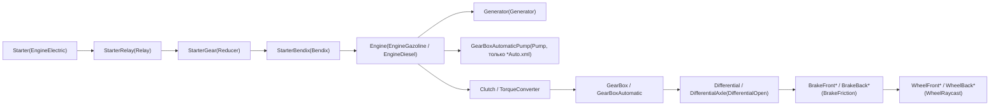

# 03. Компоненты силовой передачи и двигателей в City Car Driving 2.0

**Навигация:** [README](./README.md) | [00. Быстрый старт](./00_Quick_Start.md) | [01. Архитектура и конфиги](./01_Architecture_and_Config.md) | [02. Именованный ввод/вывод](./02_Named_IO_and_States.md) | **03. Трансмиссия** | [04. Электрика](./04_Components_Electrics.md) | [05. Шасси и подсистемы](./05_Components_Chassis_and_Subsystems.md)

## Содержание

1. [Сборка цепочки трансмиссии в XML (`<Links>`) и общие параметры валов в `Vehicle.ini`](#1-сборка-цепочки-трансмиссии-в-xml-links-и-общие-параметры-валов-в-vehicleini)
2. [Двигатели (`EngineGazoline`, `EngineDiesel`, `EngineElectric`, `ExternalVelocityMotor`)](#2-двигатели-enginegazoline-enginediesel-engineelectric-externalvelocitymotor)
3. [Сцепление, гидротрансформатор и бендикс (`ClutchFriction`, `HydraulicTorqueConverter`, `VariableTorqueConverter`, `Bendix`)](#3-сцепление-гидротрансформатор-и-бендикс-clutchfriction-hydraulictorqueconverter-variabletorqueconverter-bendix)
4. [Коробки передач и узлы трансмиссии (`GearBox`, `GearBoxAutomatic`, `DifferentialOpen`, `Reducer`, `Relay`, `Retarder`)](#4-коробки-передач-и-узлы-трансмиссии-gearbox-gearboxautomatic-differentialopen-reducer-relay-retarder)
5. [Тормозные механизмы и колёса (`BrakeFriction`, `BrakeFrictionPneumatic`, `WheelRaycast`)](#5-тормозные-механизмы-и-колёса-brakefriction-brakefrictionpneumatic-wheelraycast)
6. [Навесные агрегаты (`Generator`, `Pump`, `Compressor`) и готовый пример `Vehicle.ini`](#6-навесные-агрегаты-generator-pump-compressor-и-готовый-пример-vehicleini)

---

## 1. Сборка цепочки трансмиссии в XML (`<Links>`) и общие параметры валов в `Vehicle.ini`

В XML-схемах автомобиля (`Common/Vehicles/MotorCars/Schemes/*.xml`) все узлы силовой передачи соединяются направленными связями от ведущего вала к ведомому:

```xml
<Link Holder="ВедущийКомпонент" Reference="ВедомыйКомпонент" />
```

Крутящий момент передаётся сверху вниз по цепочке `Holder -> Reference`, а угловая скорость вращения (обороты валов) и приведённый момент инерции рассчитываются в обратном направлении — от колёс к двигателю.



### Различия цепочки после КПП в стандартных схемах City Car Driving 2.0

- **Передний привод (`FwdAuto.xml`, `FwdManual.xml`):** КПП соединена с одним компонентом `<Component Name="Differential" Class="DifferentialOpen" />`, который раздаёт момент на `BrakeFrontLeft` и `BrakeFrontRight`. Задние тормоза `BrakeBackLeft/Right` соединены только со своими колёсами `WheelBackLeft/Right`.
- **Задний привод (`RwdAuto.xml`, `RwdManual.xml`):** КПП соединена с `<Component Name="Differential" Class="DifferentialOpen" />`, который раздаёт момент на `BrakeBackLeft` и `BrakeBackRight`.
- **Полный привод (`AwdAuto.xml`, `AwdManual.xml`):** КПП соединена с межосевым дифференциалом **`DifferentialAxle`** (`Class="DifferentialOpen"`), от которого две ветви идут на:
   1. Муфту подключения переднего моста `FrontAxisRelay` (`Class="Relay"`) $\to$ передний дифференциал `DifferentialWheelFront` $\to$ `BrakeFrontLeft` и `BrakeFrontRight`.
   2. Задний дифференциал `DifferentialWheelBack` $\to$ `BrakeBackLeft` и `BrakeBackRight`.

### Сводный реестр 20 компонентов силовой передачи и двигателей

| № | `Class="..."` в XML | Стандартная секция в `Vehicle.ini` | Назначение компонента |
| --- | --- | --- | --- |
| 1 | `EngineGazoline` | `[Engine]` | Бензиновый ДВС с искровым зажиганием от электросети (также используется как универсальный ДВС при комбинации опций КПП и двигателя) |
| 2 | `EngineDiesel` | `[Engine]` | Дизельный ДВС с воспламенением от сжатия |
| 3 | `EngineElectric` | `[Starter]` | Электродвигатель постоянного тока (стартер) |
| 4 | `ExternalVelocityMotor` | `[...]` | Сервомотор привода механизмов с внешней уставкой оборотов |
| 5 | `ClutchFriction` | `[Clutch]` | Фрикционное сцепление (в схемах `*Manual.xml`) |
| 6 | `HydraulicTorqueConverter` | `[TorqueConverter]` | Гидротрансформатор АКПП с муфтой блокировки (в `*Auto.xml`) |
| 7 | `VariableTorqueConverter` | `[...]` | Вариатор с плавно изменяемым передаточным числом |
| 8 | `Bendix` | `[StarterBendix]` | Обгонная муфта (бендикс) стартера |
| 9 | `GearBox` | `[GearBox]` | Механическая ступенчатая КПП или раздаточная коробка |
| 10 | `GearBoxAutomatic` | `[GearBoxAutomatic]` | Планетарная гидромеханическая АКПП (в `*Auto.xml`) |
| 11 | `DifferentialOpen` | `[Differential]`, `[DifferentialAxle]`, `[DifferentialWheelFront/Back]` | Симметричный межколёсный или межосевой дифференциал с блокировкой |
| 12 | `Reducer` | `[StarterGear]` | Механический редуктор с постоянным передаточным числом |
| 13 | `Relay` | `[StarterRelay]`, `[FrontAxisRelay]` | Разобщительная муфта (механическое реле 1:1) |
| 14 | `Retarder` | `[Retarder]` | Трансмиссионный гидродинамический тормоз-замедлитель |
| 15 | `BrakeFriction` | `[BrakeFrontLeft/Right]`, `[BrakeBackLeft/Right]` | Колёсный фрикционный тормозной механизм |
| 16 | `BrakeFrictionPneumatic` | `[BrakeFrontLeft/Right]`, `[BrakeBackLeft/Right]` | Пневматический тормоз с пружинным энергоаккумулятором (грузовики/автобусы) |
| 17 | `WheelRaycast` | `[WheelFrontLeft/Right]`, `[WheelBackLeft/Right]` | Рейкастовое пневматическое колесо с кривыми Пацейки |
| 18 | `Generator` | `[Generator]` | Автомобильный генератор с регулятором напряжения |
| 19 | `Pump` | `[GearBoxAutomaticPump]` | Приводной масляный/гидравлический насос |
| 20 | `Compressor` | `[Compressor]` | Приводной воздушный компрессор пневмосистемы |

### Общие параметры всех компонентов трансмиссии и двигателей в `Vehicle.ini`

Любой из 20 перечисленных выше компонентов поддерживает в своей секции `Vehicle.ini` следующие 5 базовых параметров вращающегося вала:

| Ключ в `Vehicle.ini` | Тип | По умолч. | Ед. изм. | Описание |
| --- | --- | --- | --- | --- |
| `Inertia` | `Real` | `1e-4` | $\text{кг}\cdot\text{м}^2$ | Собственный момент инерции вращающихся частей узла. *(У `WheelRaycast` вычисляется автоматически из массы и радиуса).* |
| `RotationalFrictionConstant` | `Real` | `0.0` | $\text{Н}\cdot\text{м}$ | Постоянный момент сопротивления вращению вала ($C_{\text{const}}$). |
| `RotationalFrictionQuadCoeff` | `Real` | `0.0` | $\text{Н}\cdot\text{м}\cdot\text{с}^2/\text{рад}^2$ | Квадратичный коэффициент трения вала ($C_{\text{quad}}$), умножаемый на квадрат угловой скорости $\omega^2$: $M_{\text{rot}} = C_{\text{const}} + C_{\text{quad}}\cdot\omega^2$. *(У `EngineElectric` вычисляется автоматически).* |
| `JammingSpeed` | `Real` | `1.0` | $1/\text{с}$ | Скорость нарастания тормозного момента при заклинивании вала (`Jammed = true`). |
| `JammedFrictionMax` | `Real` | `1.0` | $\text{Н}\cdot\text{м}$ | Максимальный дополнительный момент сопротивления при полном заклинивании вала. |

> [!NOTE]
> Постоянная нагрузка на вал задаётся через `RotationalFrictionConstant`, а скоростные потери — через `RotationalFrictionQuadCoeff`. Все массивы чисел в `Vehicle.ini` записываются **строго через точку с запятой `;` без пробела перед `;`** (`OilPressureRPM = 0; 750; 6000`).

- **Общий выход (`<OutputElements>`):** `InternalName="RPM"` (`Real`, об/мин) — текущая частота вращения входного вала узла (кроме `BrakeFrictionPneumatic`).
- **Общие состояния (`<StateElements>`):** `InternalName="Jammed"` (`Boolean`) — принудительное заклинивание вала (кроме `[Engine]`); `InternalName="AngularVelocity"` (`Real`, рад/с) — мгновенная установка угловой скорости вала.

---

## 2. Двигатели (`EngineGazoline`, `EngineDiesel`, `EngineElectric`, `ExternalVelocityMotor`)

### 2.1. Бензиновый и дизельный ДВС (`[Engine]`)

В City Car Driving 2.0 секция двигателя в `Vehicle.ini` называется **`[Engine]`**. В XML-схемах доступны два класса ДВС: **`EngineGazoline`** и **`EngineDiesel`**.

> [!TIP]
> **Использование `EngineGazoline` как универсального («базового») класса ДВС при сочетании опций «Бензин / Дизель» и «АКПП / МКПП»:**
>  В файле `options.xml` атрибут `SetSchema="true"` разрешено указывать **только у одной опции** (попытка привязать к смене схемы одновременно и `TransmissionType`, и `EngineType` вызовет ошибку загрузки).
>
> - Поэтому, если у автомобиля есть **две комплектации по коробке передач** (`Auto` / `Manual`) и **две комплектации по типу двигателя** (например, бензиновый `1.8I` и дизельный `1.6TD`), переключение XML-схемы (`SetSchema="true"`) привязывается к коробке передач (`*Auto.xml` и `*Manual.xml`), а сам компонент двигателя в обеих стандартных схемах остаётся **`Class="EngineGazoline"`**.
> - Поскольку вся физика расчёта крутящего момента по таблице `PowerCurves`, торможения двигателем, отсечки `RpmLimit`, холостого хода, прогрева, охлаждения и смазки у `EngineGazoline` и `EngineDiesel` **полностью идентична**, дизельная комплектация моделируется прямо на базе `Class="EngineGazoline"` за счёт своей дизельной кривой крутящего момента (`PowerCurves`) и переопределения секций `[Engine.EngineType.<Дизель>]`, `[Idler.EngineType.<Дизель>]`, `[Starter.EngineType.<Дизель>]` в `Vehicle.ini` (с сохранением `IgnitionResistance = 4` и `IgnitionMinVoltage = 7`):
>    ```ini
>    [Engine.EngineType.1.8I]
>    Volume = 1.8
>    RpmLimit = 7000
>    PowerCurves = ../Plugins/Mods/Content/<ИмяМода>/Engine_1_8I.csv
>    AirPressureRatio = 0.355
>    IgnitionResistance = 4
>    IgnitionMinVoltage = 7
>    
>    [Engine.EngineType.1.6TD]
>    Volume = 1.6
>    RpmLimit = 5000
>    MinCombustionRpm = 150
>    PowerCurves = ../Plugins/Mods/Content/<ИмяМода>/Engine_1_6TD.csv
>    AirPressureRatio = 0.655
>    IgnitionResistance = 4
>    IgnitionMinVoltage = 7
>    ```
> - Выделенный класс **`Class="EngineDiesel"`** целесообразно использовать только в собственных кастомных XML-схемах чисто дизельных автомобилей или грузовиков, когда требуется специфическая физика затруднённого холодного пуска от сжатия на морозе (`FuelIgnitionMinTemperature`, по умолчанию `-5 °C`, базовый шанс вспышки `0.2` и плотность дизтоплива `850 кг/м³` вместо `750 кг/м³` у `EngineGazoline`).

**Связи `<Links>` компонента `Engine` в XML:**

- Исходящие от `Engine`: обязательная связь с топливным баком `<Link Holder="Engine" Reference="FuelTank" />` и не более 1 связи с ведомым валом трансмиссии (`Clutch` в `*Manual.xml` или `TorqueConverter` в `*Auto.xml`), плюс отводы на `Generator` и `GearBoxAutomaticPump`.
- Входящие на `Engine`: от `StarterBendix`, `Idler` (`Class="FuelControllerComputer"`), `CarElectrics`, `GearBoxAutomatic` (в `*Auto.xml`), `Turbocharger` (при наличии турбины).
- **Отличие `EngineGazoline` и `EngineDiesel` в `<Links>`:**
   - Для **`EngineGazoline`** обязательна связь питания свечей зажигания `<Link Holder="IgnitionElectricCircuit" Reference="Engine" />` (без напряжения в цепи зажигания выше `IgnitionMinVoltage` мотор не развивает момент).
   - Для **`EngineDiesel`** связь `IgnitionElectricCircuit -> Engine` **не поддерживается и должна быть удалена из XML-схемы**! Дизель воспламеняет топливо от сжатия (при температуре камеры сгорания выше `FuelIgnitionMinTemperature`), а его гарантированное глушение при повороте ключа в `0` обеспечивается связью `<Link Holder="IgnitionKey" Reference="Idler" />`, перекрывающей подачу топлива в ЭБУ холостого хода.

| Ключ в `Vehicle.ini` (`[Engine]`) | Тип | По умолч. | Ед. изм. | Описание |
| --- | --- | --- | --- | --- |
| `TwoStroked` | `Boolean` | `false` | — | Тактность ДВС: `false` — 4-тактный, `true` — 2-тактный. |
| `Volume` | `Real` | `1.5` | л | Рабочий объём двигателя (влияет на наполнение цилиндров и часовой расход топлива). |
| `CylinderCount` | `Integer` | `4` | шт. | Число цилиндров (определяет частоту вибрации `VibrationFrequency`). |
| `RpmLimit` | `Real` | `6000.0` | об/мин | Обороты срабатывания отсечки подачи топлива. |
| `RpmLimitTime` | `Real` | `0.1` | с | Длительность перекрытия топлива при достижении `RpmLimit`. |
| `MinStableRpm` | `Real` | `500.0` | об/мин | Минимальные обороты устойчивой работы (ниже них момент начинает случайно проседать). |
| `MinCombustionRpm` | `Real` | `50.0` | об/мин | Минимальные пусковые обороты коленвала, начиная с которых возможны вспышки в цилиндрах. |
| `AirPressureRatio` | `Real` | `0.2` | доля | Коэффициент наполнения цилиндров воздухом при эталонной кривой `PowerCurves`. |
| `PowerCurves` | `String` | `"engine.csv"` | путь | Путь к 2D-таблице крутящего момента и механических потерь относительно папки `Content/` (для папки мода: `../Plugins/Mods/Content/<ИмяМода>/Engine.csv`). |
| `OptimalRpmMin` | `Real` | `3000.0` | об/мин | Нижняя граница оптимальной («зелёной») зоны оборотов. |
| `OptimalRpmMax` | `Real` | `4000.0` | об/мин | Верхняя граница оптимальной зоны оборотов. |
| `VibrationCurve` | `String` | `"vibration.csv"` | путь | Путь к 1D-таблице амплитуды вибраций от `RPM / RpmLimit` (`Common/Vehicles/MotorCars/Tables/EngineVibration.csv`). |
| `VibrationAmplitude` | `Real` | `0.01` | м | Базовый множитель амплитуды вибрации работающего двигателя. |
| **`HeatingSpeed`** | `Real` | `0.3` | °C/с | Базовая скорость прогрева ОЖ на 1000 об/мин без нагрузки. |
| `HeatingLoadCoeff` | `Real` | `2.5` | безразм. | Во сколько раз ускоряется нагрев двигателя под полной нагрузкой (100% газа). |
| `ThermostatBeginTemperature` | `Real` | `80.0` | °C | Температура ОЖ начала открытия термостата (перехода на большой круг). |
| `ThermostatEndTemperature` | `Real` | `94.0` | °C | Температура ОЖ полного открытия термостата. |
| `SmallCircuitCoolingSpeed` | `Real` | `0.1` | °C/с | Скорость охлаждения по малому кругу (при разнице температур с воздухом 100 °C). |
| `LargeCircuitCoolingSpeed` | `Real` | `0.2` | °C/с | Дополнительная скорость охлаждения радиатором большого круга. |
| `InmotionCoolingSpeed` | `Real` | `1.0` | °C/с | Дополнительная скорость охлаждения набегающим потоком воздуха на 100 км/ч. |
| `ElectricFan` | `Boolean` | `true` | — | `true` — электровентилятор по датчику температуры; `false` — крыльчатка на вискомуфте (дует пропорционально `RPM`). |
| `FanSwitchOnTemperature` | `Real` | `99.0` | °C | Температура ОЖ включения основного вентилятора охлаждения. |
| `FanSwitchOffTemperature` | `Real` | `94.0` | °C | Температура ОЖ выключения основного вентилятора охлаждения. |
| `FanCoolingSpeed` | `Real` | `0.5` | °C/с | Скорость охлаждения от работающего основного вентилятора. |
| `SecondFanSwitchOnTemperature` | `Real` | `115.0` | °C | Температура ОЖ включения второго вентилятора (выключается при `FanSwitchOnTemperature`). |
| `SecondFanCoolingSpeed` | `Real` | `0.0` | °C/с | Скорость охлаждения от второго вентилятора. |
| `OverheatTemperature` | `Real` | `115.0` | °C | Порог температуры ОЖ, при котором срабатывает индикатор перегрева `OverheatIcon`. |
| `MaxTemperature` | `Real` | `130.0` | °C | Критическая температура ОЖ, при достижении которой двигатель необратимо заклинивает. |
| `OilPressureRPM` | `Array<Real>` | — | об/мин | Точки оборотов для расчёта давления масла (размер обязан совпадать с `OilPressureValues`, например `0; 750; 6000`). |
| `OilPressureValues` | `Array<Real>` | — | бар | Значения давления масла при 85 °C для точек `OilPressureRPM` (например, `0; 2; 4.2`). |
| `OilLowPressureThreshold` | `Real` | `1.5` | бар | Минимальное рабочее давление масла (ниже него растёт трение вала и ускоряется нагрев). |
| `OilLowPressureHeatCoeff` | `Real` | `2.0` | безразм. | Множитель скорости нагрева ДВС при нулевом давлении масла. |
| `OilLowLevelThreshold` | `Real` | `0.5` | `[0..1]` | Уровень масла, ниже которого начинает падать давление в системе смазки. |
| `OilPressureTemperatureCoeff` | `Real` | `0.7` | безразм. | Коэффициент изменения давления масла от температуры относительно 85 °C. |
| `OilPressureMinTemperature` | `Real` | `30.0` | °C | Нижняя граница температуры для расчёта температурной поправки давления масла. |
| `OilPressureMaxTemperature` | `Real` | `130.0` | °C | Верхняя граница температуры для расчёта температурной поправки давления масла. |
| `OilLevelDropRate` | `Real` | `0.01` | $1/\text{с}$ | Скорость падения уровня масла при включённом входе утечки `OilLevel`. |
| `MinOilLevelAtLeak` | `Real` | `0.0` | `[0..1]` | Минимальный остаточный уровень масла при утечке. |
| `IgnitionResistance` | `Real` | `4.0` | Ом | **Только `EngineGazoline`:** электрическое сопротивление системы зажигания на оборотах `RpmLimit`. |
| `IgnitionMinVoltage` | `Real` | `11.0` | В | **Только `EngineGazoline`:** минимальное напряжение в `IgnitionElectricCircuit`, необходимое для искры. |
| `FuelIgnitionMinTemperature` | `Real` | `-5.0` | °C | **Только `EngineDiesel`:** минимальная температура камеры сгорания для воспламенения дизтоплива от сжатия (рекомендуется `-20..-25`). |

- **Входы (`InternalName`):** `FuelConsumptionMultiplier` (`Real`), `CoolantLeak` (`Boolean`), `BrokenCoolingSystem` (`Boolean`), `OilLevel` (`Boolean` — утечка масла).
- **Состояния (`InternalName`):** `CoolantLevel` (`Real`, `[0..1]`), `CoolantTemperature` (`Real`, °C), `OilTemperature` (`Real`, °C), `OilLevel` (`Real`, `[0..1]`), `FuelChamberTemperature` (`Real`, °C), `BrokenCoolingSystem` (`Boolean`), `AngularVelocity` (`Real`, рад/с).
- **Выходы (`InternalName`):** `RPM`, `RPMLimit`, `StableRPM`, `Combustion` (`Boolean`), `CoolantTemperature`, `CoolantLevel`, `OilTemperature`, `OilPressure`, `OilLowPressure`, `AFRRatio`, `Load` (`EngineLoad`), `MaxTorque` (`EngineMaxTorque`), `FuelConsumedTotal`, `FuelConsumedPerSecond`, `ThermostatBeginTemperature`, `OverheatTemperature`, `VibrationFrequency` (`EngineVibrationFrequency`), `VibrationAmplitude` (`EngineVibrationAmplitude`), `OptimalRpmMin`, `OptimalRpmMax`, `BrokenCoolingSystem` (`Boolean`).

### 2.2. Критическое правило расчёта `Engine.csv` (`PowerCurves`) и холостого хода в `D`

Файл `Engine.csv` задаёт двумерную таблицу крутящего момента от процента открытия дроссельной заслонки (по строкам: `0; 5; 10; 20; 40; 60; 80; 100`) и оборотов `RPM` (по столбцам). Разделитель ячеек — `;`, дробная часть отделяется **точкой `.`**:

```csv
thr/rpm;0;50;250;500;750;1000;1500;2000;2500;3000;3500;4000;4500;5500
0;0;0;0;0;0;0;0;0;0;0;0;0;0;0
5;0;15;40;150;32;24;20;18;15;12;10;6;0;0
10;0;18;55;180;75;65;58;52;45;38;30;18;5;0
...
100;0;20;80;208;288;349;490;498;486;464;440;397;325;2.5
0;12;15;20;24;28;35;50;58;68;78;88;98;110;10000
```

> [!CAUTION]
> **Главное правило расчёта строки `100%` газа в `Engine.csv`:**
>  Последняя строка таблицы (после строки `100`, начинающаяся с `0;...`) задаёт положительный момент механических потерь и торможения двигателем $F(\text{RPM}) > 0$. Физический движок **вычитает $F(\text{RPM})$ из всех строк сгорания, включая строку `100%` полного газа**:
>
> Если записать в строку `100` паспортный крутящий момент $440\text{ Н}\cdot\text{м}$, а в последнюю строку трения — $60\text{ Н}\cdot\text{м}$, то на маховике останется лишь $380\text{ Н}\cdot\text{м}$ (потеря до 20–25% мощности!). Чтобы получить на маховике паспортную характеристику $T_{\text{паспорт}}(\text{RPM})$, в строку `100` необходимо записывать **сумму**:
>
> *(Если в XML-схему добавлен компонент `Turbocharger`, то каждая ячейка сгорания `(thr, RPM)` после прибавления $F(\text{RPM})$ дополнительно делится на стационарный коэффициент наддува $\text{ratio}(\text{RPM}, \text{thr})$ при данном положении педали `thr`, а последняя строка трения $F(\text{RPM})$ остаётся без деления).*

> [!TIP]
> **Ограничение регулятора холостого хода `[Idler]` и «анти-столл горб» в строках `5%` и `10%`:**
>  ЭБУ холостого хода `[Idler]` (`FuelControllerComputer`) рассчитывает базовое открытие дросселя в разомкнутом цикле — он ищет такое положение заслонки, при котором момент сгорания на `IdleRpm` равен внутреннему трению $F(\text{IdleRpm})$, не учитывая внешнюю нагрузку от гидротрансформатора в `D` и не открывая заслонку шире при падении оборотов ниже `IdleRpm`.
>
> - Если просто поднять момент в строке `5%` на колонке самих оборотов ХХ (например, `750 RPM`), `[Idler]` пропорционально прикроет заслонку, и обороты в `D` всё равно провалятся!
> - **Решение:** на колонке `IdleRpm` (`750 RPM`) задайте в строке `5%` момент лишь чуть выше трения $F(750)$ (например, `32 Н·м` при $F(750) = 28\text{ Н}\cdot\text{м}$), а на соседней нижней колонке **`500 RPM`** сформируйте крутой подъём — **«анти-столл горб»** (например, `150 Н·м` в строке `5%` и `180 Н·м` в строке `10%`). Тогда при переводе селектора в `D` или плавном отпускании сцепления небольшое снижение оборотов с `750` до `660–680 об/мин` вызовет резкий рост крутящего момента и надёжно удержит холостой ход.

### 2.3. Электродвигатель стартера (`[Starter]`, `Class="EngineElectric"`)

Подключается к электросети (`<Link Holder="BatteryElectricCircuit" Reference="Starter" />`), замку зажигания (`<Link Holder="IgnitionKey" Reference="Starter" />`), ЭБУ ХХ (`<Link Holder="Idler" Reference="Starter" />`) и передаёт вращение через реле и редуктор стартера (`<Link Holder="Starter" Reference="StarterRelay" />`).

| Ключ в `Vehicle.ini` (`[Starter]`) | Тип | По умолч. | Ед. изм. | Описание |
| --- | --- | --- | --- | --- |
| `IdleVoltage` | `Real` | `12.0` | В | Напряжение холостого хода стартера. |
| `IdleAmperage` | `Real` | `80.0` | А | Потребляемый ток на оборотах холостого хода `IdleRPM`. |
| `IdleRPM` | `Real` | `3000.0` | об/мин | Максимальные обороты холостого хода стартера без нагрузки. |
| `StallVoltage` | `Real` | `5.0` | В | Напряжение на клеммах при полностью заторможенном якоре. |
| `StallAmperage` | `Real` | `700.0` | А | Пусковой ток при заторможенном якоре. |
| `StallTorque` | `Real` | `13.0` | $\text{Н}\cdot\text{м}$ | Максимальный пусковой крутящий момент при токе `StallAmperage`. |

*(Примечание: стартер сам вычисляет квадратичный коэффициент трения из режима холостого хода `IdleRPM` / `IdleAmperage`, поэтому задавать `RotationalFrictionQuadCoeff` в секции `[Starter]` не нужно).*

### 2.4. Мотор внешней уставки скорости (`Class="ExternalVelocityMotor"`)

Вспомогательный привод механизмов спецтехники, раскручивающий ведомый вал до целевых оборотов `ShaftRpm`.

- **Параметры `.ini`:** `TorqueCurve` (`String`, путь к 1D-таблице момента от оборотов, по умолчанию `"torque.csv"`), `EnableTorqueFadeByRpmDiff` (`Boolean`, по умолчанию `true` — плавно снижает момент при приближении оборотов к уставке), `MinWorkingRpm` (`Real`), `MaxWorkingRpm` (`Real`).
- **Вход (`InternalName`):** `ShaftRpm` (`Real`, об/мин). **Выходы (`InternalName`):** `RPM` (`Real`), `ShaftRpm` (`Real`), `Position` (`Real`, доля оборота `(-1..1)`).

---

## 3. Сцепление, гидротрансформатор и бендикс (`ClutchFriction`, `HydraulicTorqueConverter`, `VariableTorqueConverter`, `Bendix`)

### 3.1. Фрикционное сцепление (`[Clutch]`, `Class="ClutchFriction"`)

Используется в схемах с МКПП (`*Manual.xml`). Связывается между двигателем и КПП (`Engine -> Clutch -> GearBox`), а степень смыкания дисков принимает от компонента педали `<Link Holder="ClutchPedal" Reference="Clutch" />`.

| Ключ в `Vehicle.ini` (`[Clutch]`) | Тип | По умолч. | Ед. изм. | Описание |
| --- | --- | --- | --- | --- |
| `MaxTorque` | `Real` | `1000.0` | $\text{Н}\cdot\text{м}$ | Максимальный момент трения полностью замкнутого сцепления (рекомендуется в `1.4–1.6` раза выше пикового момента ДВС). |
| `VelocityScale` | `Real` | `1.0` | $\text{с}/\text{рад}$ | Крутизна нарастания момента трения от разности угловых скоростей дисков. |

### 3.2. Гидротрансформатор (`[TorqueConverter]`, `Class="HydraulicTorqueConverter"`)

Используется в схемах с АКПП (`*Auto.xml`). Связывается в цепочку `Engine -> TorqueConverter -> GearBoxAutomatic`, а команда на смыкание фрикциона блокировки приходит по обратной связи `<Link Holder="GearBoxAutomatic" Reference="TorqueConverter" />`.

| Ключ в `Vehicle.ini` (`[TorqueConverter]`) | Тип | По умолч. | Ед. изм. | Описание |
| --- | --- | --- | --- | --- |
| `MaxRatio` | `Real` | `3.0` | безразм. | Максимальный коэффициент трансформации (умножения) момента при старте с места (обычно `1.8–2.5`). |
| `MaxRatioVelocity` | `Real` | `100.0` | об/мин | Разность оборотов насосного и турбинного колёс, при которой достигается `MaxRatio` (обычно `1400–1800`). |
| `Torque` | `Real` | `3000.0` | $\text{Н}\cdot\text{м}$ | Опорный гидравлический момент нагружения насосного колеса при разности оборотов `TorqueRpm` (для легковых авто `25–65`). |
| `TorqueRpm` | `Real` | `100.0` | об/мин | Опорная разность оборотов насоса и турбины для расчёта квадратичного момента: $M_{\text{pump}} = \text{Torque} \cdot (\Delta\text{RPM} / \text{TorqueRpm})^2$ (обычно `700–800`). |
| `LockMaxTorque` | `Real` | `1000.0` | $\text{Н}\cdot\text{м}$ | Максимальный момент трения муфты блокировки ГДТ (должен с запасом перекрывать пиковый момент ДВС, `750–1100`). |
| `LockVelocityScale` | `Real` | `1000.0` | $\text{с}/\text{рад}$ | Жёсткость муфты блокировки ГДТ по разности скоростей валов (`10–100` для плотной фиксации без пробуксовки). |
| `ValveStartOpenVelocity` | `Real` | `-1.0` | об/мин | Обороты турбины начала открытия разгрузочного клапана (`-1` — отключено). |
| `ValveFullOpenVelocity` | `Real` | `-1.0` | об/мин | Обороты турбины полного открытия разгрузочного клапана (`-1` — отключено). |
| `TransferInertia` | `Boolean` | `true` | — | Передавать ли приведённую инерцию маховика ДВС на первичный вал АКПП. |

### 3.3. Вариатор (`Class="VariableTorqueConverter"`) и бендикс (`[StarterBendix]`, `Class="Bendix"`)

- **`VariableTorqueConverter`:** узел с плавно меняющимся передаточным числом. Параметры `.ini`: `GearRatio` (`1.0`), `GearRatioMin` (`1.0`), `GearRatioMax` (`100.0`). Вход: `GearRatio` (`Real`). Выходы: `RPM`, `OutRPM`.
- **`Bendix` (`[StarterBendix]`):** односторонняя обгонная муфта между редуктором стартера и коленвалом (`StarterGear -> StarterBendix -> Engine`). Передаёт крутящий момент только тогда, когда обороты стартера выше оборотов ДВС; после запуска мотора свободно проскальзывает. Настраивается 5 общими параметрами вала.

---

## 4. Коробки передач и узлы трансмиссии (`GearBox`, `GearBoxAutomatic`, `DifferentialOpen`, `Reducer`, `Relay`, `Retarder`)

### 4.1. Механическая КПП (`[GearBox]`, `Class="GearBox"`)

Используется в схемах `*Manual.xml` (`Clutch -> GearBox -> Differential / DifferentialAxle`).

| Ключ в `Vehicle.ini` (`[GearBox]`) | Тип | По умолч. | Ед. изм. | Описание |
| --- | --- | --- | --- | --- |
| `Gears` | `Array<Real>` | — | безразм. | Список передаточных чисел (отрицательные — задний ход, положительные — передние передачи). Пример: `-4.722; 5.076; 2.610; 1.518; 1.000; 0.791; 0.675`. |
| `GearsSynchronized` | `Array<Bool>` | — | `0`/`1` | Флаги наличия синхронизатора для каждой передачи из `Gears` (длина списка обязана совпадать с `Gears`, например `1; 1; 1; 1; 1; 1; 1`). |
| `StartingGear` | `Integer` | `-1` | индекс | Начальная передача при спавне (`-1` — нейтраль, `0..N-1` — индекс в массиве `Gears`). |
| `EnableNeutralInput` | `Boolean` | `true` | — | Разрешено ли переключение в нейтраль (`-1`). |
| `MaxTorqueToNeutral` | `Real` | `10.0` | $\text{Н}\cdot\text{м}$ | Максимальный момент на вторичном валу, позволяющий выдернуть передачу в нейтраль без выжима сцепления (рекомендуется `50`). |
| `MaxRPMDiffToShift` | `Real` | `50.0` | об/мин | Максимальная разница оборотов синхронизируемых валов для включения передачи из нейтрали. |
| `SynchronizerFrictionCoeff` | `Real` | `0.5` | $\text{Н}\cdot\text{м}\cdot\text{с}/\text{рад}$ | Коэффициент вязкого трения синхронизатора. |
| `SynchronizerMaxFrictionTorque` | `Real` | `3.0` | $\text{Н}\cdot\text{м}$ | Максимальный синхронизирующий момент трения на первичном валу. |

> [!TIP]
> **Рекомендации по настройке синхронизаторов МКПП:**
>  Для быстрого и чёткого включения первой передачи из нейтрали при одновременной подаче газа рекомендуется задавать допуск синхронизации **`MaxRPMDiffToShift = 200..250`** и момент трения синхронизатора **`SynchronizerMaxFrictionTorque = 10..15`**.

- **Вход (`InternalName`):** `Gear` (`Integer`, `-1` — нейтраль, `0` — задняя, `1..N-1` — передние передачи). **Состояние:** `Gear` (`Integer`). **Выходы:** `RPM`, `Gear`, `GearRatio`, `GearCount`, `EnableNeutralInput`.

### 4.2. Гидромеханическая АКПП (`[GearBoxAutomatic]`, `Class="GearBoxAutomatic"`)

Используется в схемах `*Auto.xml`. Имеет 3 обязательные исходящие связи в `<Links>`: `<Link Holder="GearBoxAutomatic" Reference="Engine" />` (чтение оборотов ДВС), `<Link Holder="GearBoxAutomatic" Reference="TorqueConverter" />` (управление блокировкой ГДТ) и `<Link Holder="GearBoxAutomatic" Reference="DifferentialAxle" />` (или `Differential` в `FwdAuto`/`RwdAuto`). Давление рабочей жидкости подаётся от `GearBoxAutomaticPump`, а режимы селектора `P/R/N/D` — от `GearBoxLogic`.

| Ключ в `Vehicle.ini` (`[GearBoxAutomatic]`) | Тип | По умолч. | Ед. изм. | Описание |
| --- | --- | --- | --- | --- |
| `Gears` | `Array<Real>` | — | безразм. | Список передаточных чисел (отрицательное — задняя, положительные — передние; `0` запрещён, значения уникальны). |
| `LockTorqueConverter` | `Array<Bool>` | — | `0`/`1` | Разрешена ли блокировка ГДТ на каждой передаче из `Gears` (обычно `0; 1; 1; ...`). Размер обязан совпадать с `Gears`. |
| `OilWorkPressure` | `Real` | `0.0` | бар | Минимальное давление масла от `GearBoxAutomaticPump`, необходимое для включения передач (обычно `3.5`). |
| `GearChangeTime` | `Real` | `0.5` | с | Длительность плавного переключения ступени (`0.25–0.50`). |
| `ChangeGearWaitTime` | `Real` | `1.0` | с | Минимальная пауза между двумя соседними переключениями (`0.30–0.60`). |
| `MaxGearStep` | `Integer` | все ступени | шт. | На сколько максимум ступеней коробка может перескочить за одно переключение при кикдауне (рекомендуется `2–3`). |
| `PreferredGearRatioDiffPercent` | `Real` | `0.1` | доля | Порог гистерезиса относительной выгоды передаточного числа для старта переключения (`0.12–0.35`). |
| `LockTorqueConverterRpm` | `Real` | `3000.0` | об/мин | Минимальные обороты входного вала АКПП (турбины ГДТ), выше которых разрешено замыкание блокировки ГДТ. |
| `UnlockTorqueConverterRpm` | `Real` | `1500.0` | об/мин | Обороты входного вала АКПП, ниже которых блокировка ГДТ принудительно размыкается. |
| `TorqueConverterLockTime` | `Real` | `1.0` | с | Время полного смыкания/размыкания муфты блокировки ГДТ. |
| `ShiftAccelerator` | `Array<Real>` | — | `[0..1]` | Опорные точки положения педали газа (например, `0; 0.1; 0.2; 0.4; 0.6; 0.8; 1`). |
| `OptimalRpm` | `Array<Real>` | — | об/мин | Целевые обороты ДВС для выбора оптимальной передачи в каждой точке `ShiftAccelerator`. |
| `MaxRpm` | `Array<Real>` | — | об/мин | Предельные обороты ДВС принудительного переключения вверх в каждой точке `ShiftAccelerator`. |
| `TorqueConverterLockDiff` | `Array<Real>` | — | об/мин | Максимальная разность оборотов насоса и турбины ГДТ, при которой разрешается включить блокировку ГДТ. |
| `ParkingFriction` | `Real` | `10000.0` | $\text{Н}\cdot\text{м}$ | Тормозной момент парковочного стопора на выходном валу в режиме селектора `P`. |

- **Вход (`InternalName`):** `Accelerator` (`Real`, `[0..1]`). **Выход (`InternalName`):** `RPM` (`Real`). *(Каналы `AutoShifterState`, `AutoShifterCurrentGear`, `AutoShifterTargetGear`, `AutoShifterMaxGear` принадлежат компоненту `GearBoxLogic`, см. [05. Шасси и подсистемы](./05_Components_Chassis_and_Subsystems.md)).*

> [!TIP]
> **Рекомендации по настройке `[GearBoxAutomatic]`:**
>
> 1. **Гидромеханические потери первичного вала (`RotationalFrictionQuadCoeff`):** поскольку квадратичное трение прикладывается к первичному валу АКПП до умножения передаточным числом, для современных легковых АКПП рекомендуется задавать `RotationalFrictionQuadCoeff = 2.0e-4 .. 3.0e-4` и `RotationalFrictionConstant = 1.5`.
> 2. **Согласование точек переключения (`OptimalRpm`, `MaxRpm`) и блокировки ГДТ (`TorqueConverterLockDiff`):** при переключении ступени муфта ГДТ кратковременно размыкается, и обороты двигателя под тягой возрастают на величину скольжения ГДТ. Рекомендуется задавать `MaxRpm` выше оборотов разомкнутого ГДТ (`3150..4200` для дизельных и `4500..6400` для бензиновых ДВС), а рабочие моменты переключений настраивать через массив `OptimalRpm` при достаточно широком допуске смыкания `TorqueConverterLockDiff` (`650..2100`).
> 3. **Размыкание ГДТ при резком торможении (`UnlockTorqueConverterRpm` и `TorqueConverterLockTime`):** чтобы при экстренном торможении до полной остановки муфта блокировки ГДТ успевала разомкнуться раньше остановки колёс, рекомендуется задавать `UnlockTorqueConverterRpm` с запасом над оборотами холостого хода (`1200..1250` при `LockTorqueConverterRpm = 1350..1400`) и время срабатывания муфты `TorqueConverterLockTime = 0.25..0.30`.

### 4.3. Дифференциалы (`Class="DifferentialOpen"`)

Симметричный дифференциал с главной передачей `GearRatio`, раздающий момент ровно на **2 обязательных ведомых вала**.

- **Имена секций в `Vehicle.ini`:** в схемах `Fwd*.xml` и `Rwd*.xml` единственный дифференциал называется **`[Differential]`**; в схемах `Awd*.xml` используются три секции — межосевой **`[DifferentialAxle]`** (с передаточным числом главной пары `GearRatio`), передний межколёсный **`[DifferentialWheelFront]`** (`GearRatio = 1.0`) и задний межколёсный **`[DifferentialWheelBack]`** (`GearRatio = 1.0`).

| Ключ в `Vehicle.ini` | Тип | По умолч. | Ед. изм. | Описание |
| --- | --- | --- | --- | --- |
| `GearRatio` | `Real` | `4.0` | безразм. | Передаточное число главной пары (не должно быть равно `0`). |
| `Locked` | `Boolean` | `false` | — | Заблокирован ли дифференциал по умолчанию при спавне автомобиля. |
| `DisableInput` | `Boolean` | `false` | — | Если `true`, игнорирует внешний вход включения блокировки `Lock`. |
| `LockVelocityCoeff` | `Real` | `0.05` | $\text{с}/\text{рад}$ | Скорость переброски крутящего момента на отстающую полуось при включённой блокировке. |

- **Вход (`InternalName`):** `Lock` (`Boolean`). **Выходы (`InternalName`):** `RPM` (`Real`), `Locked` (`Boolean`).

> [!TIP]
> **Настройка межосевого `[DifferentialAxle]` для постоянного полного привода (AWD):**
>  Для автомобилей с постоянным полным приводом межосевой дифференциал `[DifferentialAxle]` рекомендуется держать разблокированным (**`Locked = false`**), чтобы передняя и задняя оси могли свободно вращаться с разной угловой скоростью в поворотах.

### 4.4. Редуктор (`Class="Reducer"`), муфта (`Class="Relay"`) и ретардер (`Class="Retarder"`)

- **`Reducer` (секция `[StarterGear]`):** редуктор с постоянным передаточным отношением. Параметр `.ini`: `GearRatio` (`Real`, по умолчанию `1.0`, в `[StarterGear]` обычно `10..12`). Выходы: `RPM`, `OutRPM`.
- **`Relay` (секции `[StarterRelay]` и `[FrontAxisRelay]`):** управляемая муфта с передаточным числом `1:1`, замыкающая или разрывающая поток мощности. Параметр `.ini`: `Enabled` (`Boolean`, по умолчанию `true`; в `[StarterRelay]` ставится `false`, а в `Awd*.xml` вход `AWD` с `DefaultValue="true"` автоматически включает `FrontAxisRelay`). Вход: `Enable` (`Boolean`). Выходы: `RPM`, `Enabled`.
- **`Retarder`:** трансмиссионный тормоз-замедлитель грузовиков и автобусов. Параметры `.ini`: `Rpm` (`Array<Real>`, обязательный список оборотов), `Torque` (`Array<Real>`, обязательный список тормозных моментов в Н·м того же размера), `TorqueMultiplier` (`Array<Real>`, доли момента `[0..1]` по ступеням), `DiscreteInput` (`Boolean`), `TimeLag` (`Real`, с, по умолчанию `0.1`). Входы: `Enabled` (`Boolean`), `Brake` (`Real`), `BrakeStage` (`Integer`). Выходы: `RPM`, `Enabled`, `DiscreteInput`, `RelativeTorque`.

---

## 5. Тормозные механизмы и колёса (`BrakeFriction`, `BrakeFrictionPneumatic`, `WheelRaycast`)

### 5.1. Колёсный фрикционный тормоз (`Class="BrakeFriction"`)

Ставится непосредственно перед каждым колесом (`Brake* -> Wheel*`). Во всех стандартных схемах CCD 2.0 секции задних тормозов и задних колёс называются через **`Back`**, а не `Rear`: **`[BrakeFrontLeft]`**, **`[BrakeFrontRight]`**, **`[BrakeBackLeft]`**, **`[BrakeBackRight]`** и **`[WheelFrontLeft]`**, **`[WheelFrontRight]`**, **`[WheelBackLeft]`**, **`[WheelBackRight]`**.

| Ключ в `Vehicle.ini` (`[Brake*]`) | Тип | По умолч. | Ед. изм. | Описание |
| --- | --- | --- | --- | --- |
| `MaxTorque` | `Real` | `500.0` | $\text{Н}\cdot\text{м}$ | Максимальный тормозной момент суппорта при 100% нажатии педали (обычно `2500–3800` спереди и `1400–2200` сзади). |
| `ParkingBrakePower` | `Real` | `0.0` | `[0..1]` | Эффективность стояночного тормоза (ручника) в долях от `MaxTorque` (задаётся `0.7–1.0` для задних тормозов `BrakeBackLeft/Right`). |

- **Входы (`InternalName`):** `Brake` (`Real`, `[0..1]`), `ParkingBrake` (`Real`, `[0..1]`), `BrokenBrake` (`Boolean`). **Выход (`InternalName`):** `RPM` (`Real`).

### 5.2. Пневматический тормоз с энергоаккумулятором (`Class="BrakeFrictionPneumatic"`)

Используется на грузовиках и автобусах с пневматической тормозной системой. Содержит рабочую тормозную камеру прямого действия (`Main*`) и пружинный энергоаккумулятор стояночного тормоза обратного действия (`SpringLock*`, зажимает колодки при сбросе воздуха ручником или падении давления в контуре).

- **Правило порядка связей с ресиверами в `<Links>`:** помимо связи с колесом (`WheelRaycast`), компонент принимает две связи с пневморесиверами в **строго фиксированном порядке**: **первая связь** питает рабочую тормозную камеру (`Main`), **вторая связь** питает пружинный энергоаккумулятор ручника (`SpringLock`, обязательна при `SpringLock = true`).
- **Параметры `.ini`:** `MaxTorque` (`500.0` Н·м), `MainMaxBrakePower` (`1.0`), `SpringLock` (`Boolean`, `false`), `SpringLockMaxBrakePower` (`1.0`), `PressureDelta` (`1.0` бар), `FeedDiameter` (`10.0` мм), `LeakageDiameter` (`5.0` мм); параметры рабочей камеры `MainMinVolume` (`1.0` л), `MainMaxVolume` (`2.0` л), `MainMinVolumePressure` (`4.0` бар), `MainMaxVolumePressure` (`7.0` бар), `MainWorkPressure` (`6.0` бар), `MainMaxPressure` (`8.0` бар), `MainBlowOffDiameter` (`5.0` мм), `MainInitialPressure`; аналогичные параметры энергоаккумулятора с префиксом `SpringLock*` (`SpringLockMinVolume`, `SpringLockMaxVolume`, `SpringLockMinVolumePressure`, `SpringLockMaxVolumePressure`, `SpringLockWorkPressure`, `SpringLockMaxPressure`, `SpringLockBlowOffDiameter`, `SpringLockInitialPressure`).
- **Входы (`InternalName`):** `Brake` (`Real`), `ParkingBrake` (`Real`), `BrokenBrake` (`Boolean`). **Выходы (`InternalName`):** `MinPressure`, `MinWorkPressure`, `WorkPressure`, `SpringLockMinPressure`, `SpringLockWorkPressure`, `PressureLevel`, `AirFlowIntensityLevel`, `PressureLevelSpringLock`, `AirFlowIntensityLevelSpringLock`.

### 5.3. Рейкастовое пневматическое колесо (`[Wheel*]`, `Class="WheelRaycast"`)

Конечный узел ветви трансмиссии (не может иметь исходящих связей `<Link Holder="Wheel*" ... />`). Собственный момент инерции колеса вычисляется автоматически при загрузке по формуле $J = 0.5 \cdot \text{Mass} \cdot \text{Radius}^2$ (ключ `Inertia` в секциях `[Wheel*]` указывать не нужно).

| Ключ в `Vehicle.ini` (`[Wheel*]`) | Тип | По умолч. | Ед. изм. | Описание |
| --- | --- | --- | --- | --- |
| `Radius` | `Real` | `0.4` | м | Статический рабочий радиус колеса под нагрузкой при нормальном давлении `WorkingPressure` (на `8–12 мм` меньше свободного радиуса 3D-меша). |
| `MinRadius` | `Real` | `0.8 * Radius` | м | Радиус колёсного диска (минимальный радиус полностью спущенного колеса). |
| `MaxRadius` | `Real` | `1.05 * Radius` | м | Радиус перекачанного колеса при давлении `TyreMaxPressure`. |
| `Width` | `Real` | `0.3` | м | Ширина профиля шины (например, `0.245` для `245/45 R19`). |
| `Mass` | `Real` | `20.0` | кг | Неподрессоренная масса колеса в сборе (определяет инерцию вращения $0.5 \cdot \text{Mass} \cdot \text{Radius}^2$). |
| `FrictionCoeff` | `Real` | `1.0` | безразм. | Общий коэффициент сцепления шины с дорогой (обычно `0.90–1.00`). |
| **`ForceCurveLoad`** | `Real` | `1000.0` | Н | Номинальная вертикальная нагрузка $F_{N0}$, на которой нормированы кривые сцепления. |
| `RollingResistanceCoeff` | `Real` | `0.011` | безразм. | Базовый коэффициент сопротивления качению. |
| `RollingResistanceCurves` | `String` | — *(обяз.)* | путь | 2D-таблица сопротивления качению (`Common/Vehicles/MotorCars/Tables/WheelRollingResistance.csv`). |
| `ForceCurveLongitudinal` | `String` | — *(обяз.)* | путь | 1D-кривая продольной силы от скольжения в % (`Common/Vehicles/MotorCars/Tables/WheelForceLon.csv`). |
| `ForceCurveLateral` | `String` | — *(обяз.)* | путь | 1D-кривая боковой силы от угла увода в градусах (`Common/Vehicles/MotorCars/Tables/WheelForceLat.csv`). |
| `AligningTorqueCurve` | `String` | — *(обяз.)* | путь | 1D-кривая стабилизирующего момента (`Common/Vehicles/MotorCars/Tables/WheelAlignTorque.csv`; обязана иметь `0` в точке пика `ForceCurveLateral`). |
| `CamberToSlipAngleCurve` | `String` | — *(обяз.)* | путь | 1D-кривая смещения угла увода от развала (`Common/Vehicles/Tables/Dummy2d.csv` или `WheelCamberToSlipAngle.csv`). |
| `StaticAligningTorqueCoeff` | `Real` | `0.0` | м | Коэффициент возвращающего момента на руле при повороте колёс на месте (на передних колёсах обычно `-0.002` слева и `0.002` справа). |
| `StaticAligningTorqueCurve` | `String` | `""` | путь | 1D-кривая статического момента (`Common/Vehicles/MotorCars/Tables/WheelStaticAligningTorque.csv`, обязательна при `StaticAligningTorqueCoeff != 0`). |
| `StaticFrictionTorqueMaxAngVelocity` | `Real` | `1.0` | рад/с | Скорость вращения колеса, до которой действует статическое сопротивление повороту руля (обычно `2.5`). |
| `LatStaticFrictionMaxLinVelocity` | `Real` | `2.0` | м/с | Линейная скорость удержания боковым статическим трением покоя. |
| `LonStaticFrictionMaxLinVelocity` | `Real` | `0.2` | м/с | Линейная скорость удержания продольным статическим трением покоя. |
| `LonStaticFrictionMaxAngVelocity` | `Real` | `0.01` | рад/с | Угловая скорость колеса для удержания продольным трением покоя. |
| `RelaxationLength` | `Real` | `0.1` | м | Длина релаксации боковой силы шины. |
| `SlipAngleMinVelocity` | `Real` | `3.0` | м/с | Сглаживающая скорость вычисления угла увода на малом ходу. |
| `SingularSlipRatioVelocity` | `Real` | `0.2` | м/с | Пороговая скорость скольжения при старте с места. |
| `WorkingPressure` | `Real` | `2.0` | бар | Рабочее избыточное давление в шине (устанавливается при спавне авто, например `2.2–2.8`). |
| `CriticalPressure` | `Real` | `WorkingPressure - 1` | бар | Порог давления срабатывания индикатора спущенной шины `LowTirePressureIcon`. |
| `TyreMaxPressure` | `Real` | `8.0` | бар | Предельное давление воздушного баллона шины (`TyreWorkPressure`, `TyreBlowOffDiameter` — параметры клапана). |
| `BlowoutHoleSquare` | `Real` | авто | $\text{м}^2$ | Площадь отверстия стравливания воздуха при проколе (`Blowout = true`). |
| `PressureToSteeringCoeff` | `Real` | `0.0` | безразм. | Коэффициент увода автомобиля в сторону спущенного колеса (`PressureToSteeringCurve` — путь к кривой). |
| `SlipRatioToPacejkaCoeffK` / `B` | `Real` | `-0.4` / `1.4` | безразм. | Линейные коэффициенты $K$ и $B$ масштабирования оси X продольного скольжения от относительной нагрузки $F_N / \text{ForceCurveLoad}$. |
| `PacejkaToLonForceCoeffK` / `B` | `Real` | `-0.2` / `1.2` | безразм. | Коэффициенты $K$ и $B$ масштабирования продольной силы от относительной нагрузки. |
| `SlipAngleToPacejkaCoeffK` / `B` | `Real` | `-0.1` / `1.1` | безразм. | Коэффициенты $K$ и $B$ масштабирования оси X угла бокового увода от относительной нагрузки. |
| `PacejkaToLatForceCoeffK` / `B` | `Real` | `-0.25` / `1.25` | безразм. | Коэффициенты $K$ и $B$ масштабирования боковой силы от относительной нагрузки ($K = -0.25 < 0$ задаёт нелинейное насыщение шины под нагрузкой). |
| **`PacejkaAlignTorqueCoeffK` / `B`** | `Real` | `-0.25` / `1.25` | безразм. | Коэффициенты $K$ и $B$ масштабирования стабилизирующего момента от нагрузки *(пишутся **без** `To` в середине имени!)*. |

> [!TIP]
> **Тонкая настройка поворачиваемости через `ForceCurveLoad`:**
>  Из-за отрицательного коэффициента `PacejkaToLatForceCoeffK = -0.25` шина, нагруженная сильнее своего `ForceCurveLoad`, теряет относительный коэффициент бокового зацепа. Для передних колёс задавайте `ForceCurveLoad` равным статической вертикальной нагрузке одного переднего колеса ($F_{\text{stat,f}} \approx 0.5 \cdot m_{\text{перед}} \cdot 9.81$), а для задних колёс — на **8–15% выше** статической нагрузки заднего колеса ($F_{\text{stat,r}}$). Это обеспечит естественную недостаточную поворачиваемость без «плужения» передней оси.

- **Входы (`InternalName`):** `Blowout` (`Boolean` — прокол шины), `NoSlip` (`Boolean` — режим идеального зацепа `PerfectWheels`). **Состояние:** `Pressure` (`Real`, бар). **Выходы:** `RPM`, `WorkingPressure`, `LowPressure`, `Pressure`.

---

## 6. Навесные агрегаты (`Generator`, `Pump`, `Compressor`) и готовый пример `Vehicle.ini`

### 6.1. Электрический генератор (`[Generator]`, `Class="Generator"`)

Приводится во вращение от двигателя (`<Link Holder="Engine" Reference="Generator" />`), питает цепь генератора (`<Link Holder="GeneratorElectricCircuit" Reference="Generator" />`) и отслеживается приборной панелью (`<Link Holder="CarElectrics" Reference="Generator" />`).

| Ключ в `Vehicle.ini` (`[Generator]`) | Тип | По умолч. | Ед. изм. | Описание |
| --- | --- | --- | --- | --- |
| `GearRatio` | `Real` | `1.0` | безразм. | Передаточное отношение ременного привода шкива генератора (`2.0–2.5`, ротор вращается в `GearRatio` раз быстрее коленвала). |
| `MaxAmperage` | `Real` | `80.0` | А | Максимальный ток отдачи генератора (`80–150`). |
| `MinVoltage` | `Real` | `13.0` | В | Минимальное напряжение включения генератора в сеть (`13.2`). |
| `MaxVoltage` | `Real` | `14.0` | В | Поддерживаемое реле-регулятором напряжение зарядки (`14.4–14.7`). |
| `Resistance` | `Real` | `1.0` | Ом | Внутреннее сопротивление обмоток генератора. |
| `MinAmperageRpm` | `Real` | `0.0` | об/мин | Обороты ротора генератора (уже умноженные на `GearRatio`), с которых начинается выработка тока (`600–1000`). |
| `MaxAmperageRpm` | `Real` | `6000.0` | об/мин | Обороты ротора генератора, на которых достигается полная токоотдача `MaxAmperage`. |

- **Вход (`InternalName`):** `Broken` (`Boolean` — поломка генератора). **Выход (`InternalName`):** `RPM` (`Real`).

### 6.2. Гидравлический / масляный насос (`[GearBoxAutomaticPump]`, `Class="Pump"`) и компрессор (`Class="Compressor"`)

- **`Pump` (`[GearBoxAutomaticPump]` в `*Auto.xml`):** приводится от двигателя (`Engine -> GearBoxAutomaticPump`), требует обязательной связи с баком `<Link Holder="GearBoxAutomaticPump" Reference="OilTank" />` и подаёт давление в АКПП (`GearBoxAutomaticPump -> GearBoxAutomatic`).
   - **Параметры `.ini`:** `MaxPressure` (`1.0` бар, в `*Auto.xml` обычно `7.0` — должно быть выше `OilWorkPressure` АКПП), `MaxPressureRpm` (`1.0` об/мин, обычно `650–800` — не выше оборотов ХХ!), `MaxPressureVolume` (`1.0` л), `MaxPressureFriction` (`0.0` Н·м, обычно `1.5–2.0`). **Выходы:** `RPM`, `Pressure`.
- **`Compressor`:** приводной компрессор пневмосистемы грузовиков/автобусов. Требует обязательной связи `<Link Holder="Compressor" Reference="ИмяРесивераИлиЗащитногоКлапана" />`.
   - **Параметры `.ini`:** `Volume` (`1.0` л/об), `ActivatePressure` (`6.0` бар), `DeactivatePressure` (`8.0` бар), `OutputRef` (`1000.0` л/мин), `RpmRef` (`1000.0` об/мин), `PressureRef` (`8.0` бар), `ResistanceTorqueRef` (`100.0` Н·м). **Выход:** `RPM`.

### 6.3. Образец настроенных секций трансмиссии и ДВС в `Vehicle.ini` (CCD 2.0)

```ini
[Starter]
Inertia = 1e-3
RotationalFrictionConstant = 0.5
StallVoltage = 9.0
StallAmperage = 850
StallTorque = 24
IdleVoltage = 12.0
IdleAmperage = 95
IdleRPM = 7000

[Engine]
Inertia = 0.24
Volume = 2.143
CylinderCount = 4
RpmLimit = 4600
RpmLimitTime = 0.25
MinCombustionRpm = 150
MinStableRpm = 380
PowerCurves = ../Plugins/Mods/Content/CieBensVGruppe/Engine.csv
HeatingSpeed = 0.25
ThermostatBeginTemperature = 82
ThermostatEndTemperature = 95
FanSwitchOffTemperature = 92
FanSwitchOnTemperature = 98
FanCoolingSpeed = 2.0
OverheatTemperature = 112
LargeCircuitCoolingSpeed = 0.3
OilPressureRPM = 0; 750; 2500; 4600
OilPressureValues = 0; 1.8; 3.8; 4.5
AirPressureRatio = 0.355
IgnitionResistance = 4.0
IgnitionMinVoltage = 7.0
VibrationCurve = Common/Vehicles/MotorCars/Tables/EngineVibration.csv
VibrationAmplitude = 0.0075

[TorqueConverter]
MaxRatio = 1.85
MaxRatioVelocity = 1500
Torque = 62
TorqueRpm = 750
LockMaxTorque = 850
LockVelocityScale = 100

[GearBoxAutomatic]
Inertia = 1e-4
RotationalFrictionConstant = 1.5
RotationalFrictionQuadCoeff = 2.6e-4
Gears = -3.416; 4.377; 2.859; 1.921; 1.368; 1.000; 0.820; 0.728
LockTorqueConverter = 0; 1; 1; 1; 1; 1; 1; 1
GearChangeTime = 0.26
ChangeGearWaitTime = 0.45
MaxGearStep = 3
PreferredGearRatioDiffPercent = 0.14
LockTorqueConverterRpm = 1360
UnlockTorqueConverterRpm = 1220
TorqueConverterLockTime = 0.26
ShiftAccelerator = 0; 0.1; 0.2; 0.4; 0.6; 0.8; 1
OptimalRpm = 1420; 1520; 1660; 2040; 2550; 3100; 3400
MaxRpm = 3150; 3250; 3350; 3550; 3780; 4000; 4200
TorqueConverterLockDiff = 650; 800; 950; 1250; 1550; 1850; 2100
OilWorkPressure = 3.5

[DifferentialAxle.TransmissionType.Auto]
Inertia = 1e-4
GearRatio = 3.267
Locked = false
```
