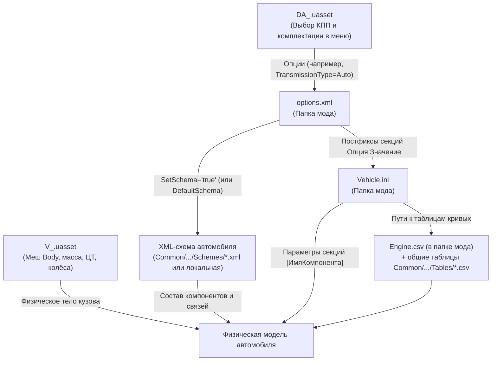

# Руководство по настройке физики автомобилей в City Car Driving 2.0

**Навигация:** **README** | [00. Быстрый старт](./00_Quick_Start.md) | [01. Архитектура и конфиги](./01_Architecture_and_Config.md) | [02. Именованный ввод/вывод](./02_Named_IO_and_States.md) | [03. Трансмиссия](./03_Components_TorqueTrain.md) | [04. Электрика](./04_Components_Electrics.md) | [05. Шасси и подсистемы](./05_Components_Chassis_and_Subsystems.md)

---

Добро пожаловать в практическое руководство и справочник для мододелов по настройке физики автомобилей в проекте **City Car Driving 2.0** на базе Unreal Engine 5.

В **City Car Driving 2.0** вся физика силового агрегата, трансмиссии, подвески, шин, тормозов, рулевого управления и бортовой электрики настраивается декларативно через текстовые файлы конфигурации (`Vehicle.ini`, `options.xml`, `.xml`-схемы и `.csv`-таблицы кривых) и свойства ассетов в редакторе Unreal Engine 5.

---

## 1. Оглавление документации

| № | Раздел | Содержание |
| :-: | --- | --- |
| **—** | **[README.md](./README.md)** *(текущий файл)* | Устройство файлов физики мода, справочник всех 46 поддерживаемых в CCD 2.0 классов компонентов (`Class="..."` в XML) со стандартными именами секций в `Vehicle.ini` и таблица единиц измерения. |
| **00** | **[00_Quick_Start.md](./00_Quick_Start.md)** | **Быстрый старт:** состав файлов мода и правила путей, настройка кузова `Body` (`Override Mass`, `Center Of Mass Offset`) и колёс в Blueprint, выбор XML-схемы и `options.xml`, пошаговые формулы расчёта подвески, шин, `Engine.csv`, КПП и контрольный чек-лист из 5 тестов. |
| **01** | **[01_Architecture_and_Config.md](./01_Architecture_and_Config.md)** | Разрешение путей к файлам мода и ресурсам игры, синтаксис `Vehicle.ini` и `options.xml`, разбор 6 стандартных XML-схем `Common/Vehicles/MotorCars/Schemes/*.xml`, создание своей схемы (на примере `EngineDiesel` + `Turbocharger`), форматы таблиц `.csv` (`Engine.csv`) и сцепка с прицепом (`<VehicleAttachment>`). |
| **02** | **[02_Named_IO_and_States.md](./02_Named_IO_and_States.md)** | Устройство секций `<InputElements>`, `<InputProcessors>`, `<OutputElements>` и `<StateElements>`, полные таблицы стандартных входов/выходов/состояний в CCD 2.0 и сводный справочник всех внутренних имён (`InternalName`) по всем 46 поддерживаемым классам компонентов. |
| **03** | **[03_Components_TorqueTrain.md](./03_Components_TorqueTrain.md)** | Справочник параметров `.ini` для двигателей и силовой передачи: ДВС (`EngineGazoline`, `EngineDiesel`), стартер (`EngineElectric`, `Bendix`), сцепление (`ClutchFriction`), ГДТ (`HydraulicTorqueConverter`), КПП (`GearBox`, `GearBoxAutomatic`), дифференциалы (`DifferentialOpen`), тормоза (`BrakeFriction*`), шины (`WheelRaycast`) и агрегаты (`Generator`, `Pump`, `Compressor`). |
| **04** | **[04_Components_Electrics.md](./04_Components_Electrics.md)** | Справочник бортовой электросети: электрические цепи (`ElectricCircuit`), аккумулятор (`Battery`), одиночные потребители (`ElectricElement`) и комплексный блок кузовной электрики, фар, дворников и приборной панели (`CarElectrics`). |
| **05** | **[05_Components_Chassis_and_Subsystems.md](./05_Components_Chassis_and_Subsystems.md)** | Справочник шасси и подсистем: подвеска (`Suspension1Spring`), рулевое управление (`Steering2Ackermann`), пневматика и турбонаддув (`Turbocharger`), баки (`Tank`), аэродинамика (`AerodynamicsCarSimple`), контроллеры (`FuelControllerComputer`, `AbsTcs`, `GearBoxAutomaticLogic`, `IgnitionKeyProcessor`) и телеметрия (`Speedometer`, `PowerSteering`, `FuelConsumptionMeter`). |

---

## 2. Из каких файлов состоит физика автомобиля в City Car Driving 2.0

В папке плагина мода (`Plugins/Mods/Content/<ИмяМода>/`) рядом с ассетами Unreal Engine (`V_<ИмяМода>.uasset`, `DA_<ИмяМода>.uasset`, `ST_<ИмяМода>.uasset`) располагаются конфигурационные файлы физики, которые могут ссылаться как на общие ресурсы игры в `Content/Common/Vehicles/MotorCars/`, так и на собственные файлы внутри папки мода.

| Файл | Где лежит | Назначение |
| --- | --- | --- |
| **`Vehicle.ini`** | `Plugins/Mods/Content/<ИмяМода>/Vehicle.ini` | **Обязательный** главный файл настроек. Содержит секцию `[Vehicle]` (`DefaultSchema`) и секции `[ИмяКомпонента]` с параметрами каждого узла из XML-схемы, а также секции переопределения под комплектации `[ИмяКомпонента.Опция.Значение]`. |
| **`options.xml`** | `Plugins/Mods/Content/<ИмяМода>/options.xml` | Определяет доступные опции комплектации (`<AvailableOptions>`, например `TransmissionType` со значениями `Auto` и `Manual`), их совместимость (`<Compatibilities>`) и переключает файл XML-схемы при `SetSchema="true"`. |
| **Схема `.xml`** | `Content/Common/Vehicles/MotorCars/Schemes/*.xml` *(или папка мода)* | Корневой тег `<Vehicle>`. Определяет список компонентов (`<Components>`), связи между ними (`<Links>`), каналы телеметрии (`<OutputElements>`), состояния (`<StateElements>`) и управление (`<InputElements>`, `<InputProcessors>`). |
| **`Engine.csv`** | `Plugins/Mods/Content/<ИмяМода>/Engine.csv` | Двумерная таблица крутящего момента и механических потерь двигателя по оборотам (`RPM`) и проценту нажатия педали газа (`0..100%`), подключаемая через параметр `PowerCurves` в секции `[Engine]`. |
| **Общие таблицы `.csv`** | `Content/Common/Vehicles/MotorCars/Tables/*.csv` | Стандартные 1D- и 2D-таблицы прогрессии пружин (`SpringProgression.csv`), вибраций ДВС (`EngineVibration.csv`), сцепления шин (`WheelForceLat.csv`, `WheelForceLon.csv`), углов развала и сопротивления качению. |
| **Схема сцепки `.xml`** | По пути сцепки автопоезда *(опционально)* | Корневой тег `<VehicleAttachment>`. Описывает межмашинные связи `<MasterLinks>` и `<SlaveLinks>` при сцепке тягача с прицепом. |

---

## 3. Справочник всех 46 классов компонентов (`Class="..."` в XML)

Атрибут `Class` в теге `<Component Name="..." Class="..." />` задаёт тип узла, а атрибут `Name` — имя его секции `[Name]` в `Vehicle.ini`.

| № | Класс в XML (`Class`) | Стандартная секция `[Name]` в `Vehicle.ini` (CCD 2.0) | Назначение компонента | Раздел документации |
| :-: | --- | --- | --- | --- |
| **1** | `EngineGazoline` | `[Engine]` | Бензиновый ДВС с искровым зажиганием (используется во всех 6 базовых схемах, в т.ч. как универсальный ДВС при комбинации опций КПП и двигателя). | [03_Components_TorqueTrain.md](./03_Components_TorqueTrain.md) |
| **2** | `EngineDiesel` | `[Engine]` | Дизельный ДВС с воспламенением от сжатия (для локальных дизельных схем). | [03_Components_TorqueTrain.md](./03_Components_TorqueTrain.md) |
| **3** | `EngineElectric` | `[Starter]` | Электродвигатель постоянного тока (стартер). | [03_Components_TorqueTrain.md](./03_Components_TorqueTrain.md) |
| **4** | `ExternalVelocityMotor` | *(кастомная секция)* | Приводной мотор с внешней уставкой оборотов `ShaftRpm` по кривой `TorqueCurve`. | [03_Components_TorqueTrain.md](./03_Components_TorqueTrain.md) |
| **5** | `ClutchFriction` | `[Clutch]` *(в `*Manual.xml`)* | Фрикционное сцепление МКПП. | [03_Components_TorqueTrain.md](./03_Components_TorqueTrain.md) |
| **6** | `HydraulicTorqueConverter` | `[TorqueConverter]` *(в `*Auto.xml`)* | Гидротрансформатор (ГДТ) АКПП с муфтой блокировки. | [03_Components_TorqueTrain.md](./03_Components_TorqueTrain.md) |
| **7** | `VariableTorqueConverter` | *(кастомная секция)* | Вариатор с плавно изменяемым передаточным числом. | [03_Components_TorqueTrain.md](./03_Components_TorqueTrain.md) |
| **8** | `Bendix` | `[StarterBendix]` | Обгонная муфта (бендикс) стартера. | [03_Components_TorqueTrain.md](./03_Components_TorqueTrain.md) |
| **9** | `GearBox` | `[GearBox]` *(в `*Manual.xml`)* | Механическая коробка передач (МКПП) или раздаточная коробка. | [03_Components_TorqueTrain.md](./03_Components_TorqueTrain.md) |
| **10** | `GearBoxAutomatic` | `[GearBoxAutomatic]` *(в `*Auto.xml`)* | Планетарная АКПП с автоматическим переключением ступеней и управлением ГДТ. | [03_Components_TorqueTrain.md](./03_Components_TorqueTrain.md) |
| **11** | `DifferentialOpen` | `[DifferentialAxle]`, `[DifferentialWheelFront]`, `[DifferentialWheelBack]` *(в `Awd*`)*; `[Differential]` *(в `Fwd*`, `Rwd*`)* | Симметричный межосевой или межколёсный дифференциал с главной парой `GearRatio` и блокировкой `Locked`. | [03_Components_TorqueTrain.md](./03_Components_TorqueTrain.md) |
| **12** | `Reducer` | `[StarterGear]` | Понижающий редуктор с постоянным передаточным числом `GearRatio`. | [03_Components_TorqueTrain.md](./03_Components_TorqueTrain.md) |
| **13** | `Relay` | `[StarterRelay]`, `[FrontAxisRelay]` *(в `Awd*`)* | Разобщительная муфта (реле стартера или муфта подключения передней оси). | [03_Components_TorqueTrain.md](./03_Components_TorqueTrain.md) |
| **14** | `Retarder` | *(кастомная секция)* | Трансмиссионный тормоз-замедлитель (ретардер грузовиков и автобусов). | [03_Components_TorqueTrain.md](./03_Components_TorqueTrain.md) |
| **15** | `BrakeFriction` | `[BrakeFrontLeft]`, `[BrakeFrontRight]`, `[BrakeBackLeft]`, `[BrakeBackRight]` | Колёсный тормозной механизм (рабочий + стояночный тормоз). | [03_Components_TorqueTrain.md](./03_Components_TorqueTrain.md) |
| **16** | `BrakeFrictionPneumatic` | *(кастомная секция)* | Пневматический тормозной механизм с энергоаккумулятором. | [03_Components_TorqueTrain.md](./03_Components_TorqueTrain.md) |
| **17** | `WheelRaycast` | `[WheelFrontLeft]`, `[WheelFrontRight]`, `[WheelBackLeft]`, `[WheelBackRight]` | Рейкастовая модель колеса и пневматической шины. | [03_Components_TorqueTrain.md](./03_Components_TorqueTrain.md) |
| **18** | `Compressor` | *(кастомная секция)* | Воздушный компрессор пневмосистемы. | [03_Components_TorqueTrain.md](./03_Components_TorqueTrain.md) |
| **19** | `Generator` | `[Generator]` | Генератор переменного тока бортовой сети. | [03_Components_TorqueTrain.md](./03_Components_TorqueTrain.md), [04_Components_Electrics.md](./04_Components_Electrics.md) |
| **20** | `Pump` | `[GearBoxAutomaticPump]` *(в `*Auto.xml`)* | Масляный насос АКПП. | [03_Components_TorqueTrain.md](./03_Components_TorqueTrain.md), [05_Components_Chassis_and_Subsystems.md](./05_Components_Chassis_and_Subsystems.md) |
| **21** | `ElectricCircuit` | `[BatteryElectricCircuit]`, `[GeneratorElectricCircuit]`, `[IgnitionElectricCircuit]` | Параллельная электрическая цепь (узел бортовой сети). | [04_Components_Electrics.md](./04_Components_Electrics.md) |
| **22** | `Battery` | `[Battery]` | Аккумуляторная батарея (АКБ). | [04_Components_Electrics.md](./04_Components_Electrics.md) |
| **23** | `ElectricElement` | *(кастомная секция)* | Одиночный резистивный электропотребитель. | [04_Components_Electrics.md](./04_Components_Electrics.md) |
| **24** | `CarElectrics` | `[CarElectrics]` | Блок кузовной электрики: фары, поворотники, дворники, приборка, зуммеры. | [04_Components_Electrics.md](./04_Components_Electrics.md) |
| **25** | `Suspension1Spring` | `[SuspensionFrontLeft]`, `[SuspensionFrontRight]`, `[SuspensionBackLeft]`, `[SuspensionBackRight]` | Пружинно-амортизаторная подвеска колеса с прогрессией и углами развала. | [05_Components_Chassis_and_Subsystems.md](./05_Components_Chassis_and_Subsystems.md) |
| **26** | `Suspension1Constant` | *(кастомная секция)* | Жёсткая подвеска с постоянной нагрузкой (для рельсового транспорта). | [05_Components_Chassis_and_Subsystems.md](./05_Components_Chassis_and_Subsystems.md) |
| **27** | `Steering2Ackermann` | `[Steering]` | Рулевая трапеция Аккермана двухколёсной управляемой оси. | [05_Components_Chassis_and_Subsystems.md](./05_Components_Chassis_and_Subsystems.md) |
| **28** | `SteeringSimple` | *(кастомная секция)* | Упрощённый механизм поворота колеса без трапеции Аккермана. | [05_Components_Chassis_and_Subsystems.md](./05_Components_Chassis_and_Subsystems.md) |
| **29** | `Receiver` | *(кастомная секция)* | Воздушный ресивер (баллон сжатого воздуха). | [05_Components_Chassis_and_Subsystems.md](./05_Components_Chassis_and_Subsystems.md) |
| **30** | `ValveMultiCircuit` | *(кастомная секция)* | Многоконтурный защитный клапан пневмосистемы. | [05_Components_Chassis_and_Subsystems.md](./05_Components_Chassis_and_Subsystems.md) |
| **31** | `ActuatorPneumatic1Chamber` | *(кастомная секция)* | Однокамерный пневмопривод с пружинным возвратом. | [05_Components_Chassis_and_Subsystems.md](./05_Components_Chassis_and_Subsystems.md) |
| **32** | `ActuatorPneumatic2Chamber` | *(кастомная секция)* | Двухкамерный пневмоцилиндр (привод дверей автобуса и др.). | [05_Components_Chassis_and_Subsystems.md](./05_Components_Chassis_and_Subsystems.md) |
| **33** | `Turbocharger` | `[Turbocharger]` *(в локальных турбо-схемах)* | Турбокомпрессор ДВС с настройкой буста и турболага `LagTime`. | [05_Components_Chassis_and_Subsystems.md](./05_Components_Chassis_and_Subsystems.md) |
| **34** | `Tank` | `[FuelTank]`, `[OilTank]` *(в `*Auto.xml`)* | Топливный или масляный бак. | [05_Components_Chassis_and_Subsystems.md](./05_Components_Chassis_and_Subsystems.md) |
| **35** | `AerodynamicsCarSimple` | `[Aerodynamics]` | Аэродинамическое сопротивление (`DragCoeff`) и прижимная сила (`LiftCoeff`). | [05_Components_Chassis_and_Subsystems.md](./05_Components_Chassis_and_Subsystems.md) |
| **36** | `ExternalThruster` | *(кастомная секция)* | Внешний линейный толкатель (трастер). | [05_Components_Chassis_and_Subsystems.md](./05_Components_Chassis_and_Subsystems.md) |
| **37** | `FuelControllerComputer` | `[Idler]` | ЭБУ подачи топлива, холостого хода (`IdleRpm`, `WarmupRpm`) и отсечки скорости. | [05_Components_Chassis_and_Subsystems.md](./05_Components_Chassis_and_Subsystems.md) |
| **38** | `FuelControllerMechanical` | *(кастомная секция)* | Карбюраторный контроллер подачи топлива с ручным «подсосом» (`Choke`). | [05_Components_Chassis_and_Subsystems.md](./05_Components_Chassis_and_Subsystems.md) |
| **39** | `AbsTcs` | `[AbsTcs]` | Блок ABS, антипробуксовочной системы (TCS) и распределителя тормозов (EBD). | [05_Components_Chassis_and_Subsystems.md](./05_Components_Chassis_and_Subsystems.md) |
| **40** | `ClutchInputProcessor` | `[ClutchPedal]` *(в `*Manual.xml`)* | Преобразователь хода педали сцепления (`Power`). | [05_Components_Chassis_and_Subsystems.md](./05_Components_Chassis_and_Subsystems.md) |
| **41** | `GearBoxAutomaticLogic` | `[GearBoxLogic]` *(в `*Auto.xml`)* | Селектор режимов АКПП легкового автомобиля (`P`, `R`, `N`, `D`). | [05_Components_Chassis_and_Subsystems.md](./05_Components_Chassis_and_Subsystems.md) |
| **42** | `GearBoxAutomaticLogicBus` | *(кастомная секция)* | Кнопочный селектор АКПП автобуса (`D`, `N`, `R`) с автонейтралью. | [05_Components_Chassis_and_Subsystems.md](./05_Components_Chassis_and_Subsystems.md) |
| **43** | `IgnitionKeyProcessor` | `[IgnitionKey]` | Замок зажигания (`0 = Off`, `1 = Ignition`, `2 = Starter`). | [05_Components_Chassis_and_Subsystems.md](./05_Components_Chassis_and_Subsystems.md) |
| **44** | `Speedometer` | `[Speedometer]` | Датчик скорости и одометр (`MetersPerRotation`). | [05_Components_Chassis_and_Subsystems.md](./05_Components_Chassis_and_Subsystems.md) |
| **45** | `PowerSteering` | `[PowerSteering]` | Гидро-/электроусилитель руля и расчёт обратной связи Force Feedback. | [05_Components_Chassis_and_Subsystems.md](./05_Components_Chassis_and_Subsystems.md) |
| **46** | `FuelConsumptionMeter` | *(кастомная секция)* | Маршрутный компьютер среднего расхода топлива. | [05_Components_Chassis_and_Subsystems.md](./05_Components_Chassis_and_Subsystems.md) |

---

## 4. Единицы измерения в `Vehicle.ini`, `.csv` и Unreal Engine 5

| Величина | В `Vehicle.ini` и таблицах `.csv` | В каналах вывода (`OutputElements`) | В редакторе Unreal Engine 5 |
| --- | --- | --- | --- |
| **Координаты, размеры, радиусы, ход подвески** | **метры ($\text{м}$)** *(диаметры клапанов пневматики `*Diameter` — в $\text{мм}$)* | метры ($\text{м}$) | **сантиметры ($\text{см}$)** ($1\text{ м} = 100\text{ см}$) |
| **Система координат кузова (`Mount` и др.)** | Правая СК: **`X` — вперёд, `Y` — влево, `Z` — вверх** (м) | — | Левая СК: **`X` — вперёд, `Y` — вправо, `Z` — вверх** (см) |
| **Скорость движения** | $\text{м/с}$ *(кроме `SpeedLimit` в `[Idler]` и `SafetyBelt*Speed` в `[CarElectrics]` — там $\text{км/ч}$)* | **$\text{м/с}$** (`Speed` и `DashboardSpeed`; для перевода в $\text{км/ч}$ умножьте на $3.6$) | — |
| **Частота вращения валов** | **$\text{об/мин}$ (`RPM`)** *(кроме `StaticFrictionTorqueMaxAngVelocity` в `[Wheel*]` — там $\text{рад/с}$)* | **$\text{об/мин}$ (`RPM`)** *(в состоянии `AngularVelocity` — $\text{рад/с}$)* | — |
| **Углы (поворот колёс, развал, увод шин)** | **градусы ($^\circ$)** | `WheelSteeringAngle` — град.; `MaxSteeringAngle` — рад. | градусы ($^\circ$) |
| **Масса и момент инерции** | килограммы ($\text{кг}$), $\text{кг}\cdot\text{м}^2$ | $\text{кг}\cdot\text{м}^2$ (`ForceFeedbackInertia`) | масса `Body` в **$\text{кг}$** (`Override Mass`), `COMNudge` в **$\text{см}$** |
| **Сила, жёсткость, крутящий момент** | $\text{Н}$, $\text{Н/м}$ (`SpringCoeff`), $\text{Н}\cdot\text{с/м}$ (`DampCoeff`), $\text{Н}\cdot\text{м}$ | $\text{Н}\cdot\text{м}$ (`MaxTorque`, `Load`, `ForceFeedbackTorque`) | — |
| **Давление (шины, масло, пневматика)** | **бары ($\text{бар}$)** *(в шинах и компрессоре — избыточное; в ресиверах — абсолютное)* | **бары ($\text{бар}$)** | — |
| **Объём и расход топлива** | **литры ($\text{л}$)**; `AveragingDistance` — $\text{км}$, `AveragingStep` — $\text{м}$ | объём — $\text{л}$, секундный расход — $\text{л/с}$, средний в `FuelConsumptionMeter` — **$\text{л/м}$** (`* 1e5` = л/100 км) | — |
| **Температура и электрика** | $^\circ\text{C}$; Вольты ($\text{В}$), Амперы ($\text{А}$), Омы ($\text{Ом}$), ёмкость АКБ — $\text{А}\cdot\text{ч}$ | $^\circ\text{C}$, $\text{В}$, $\text{А}$ | — |
| **Положение педалей и дросселя** | Доля **`0.0 .. 1.0`** в `.ini` и входах; проценты **`0 .. 100`** в 1-м столбце `Engine.csv` | — | — |
